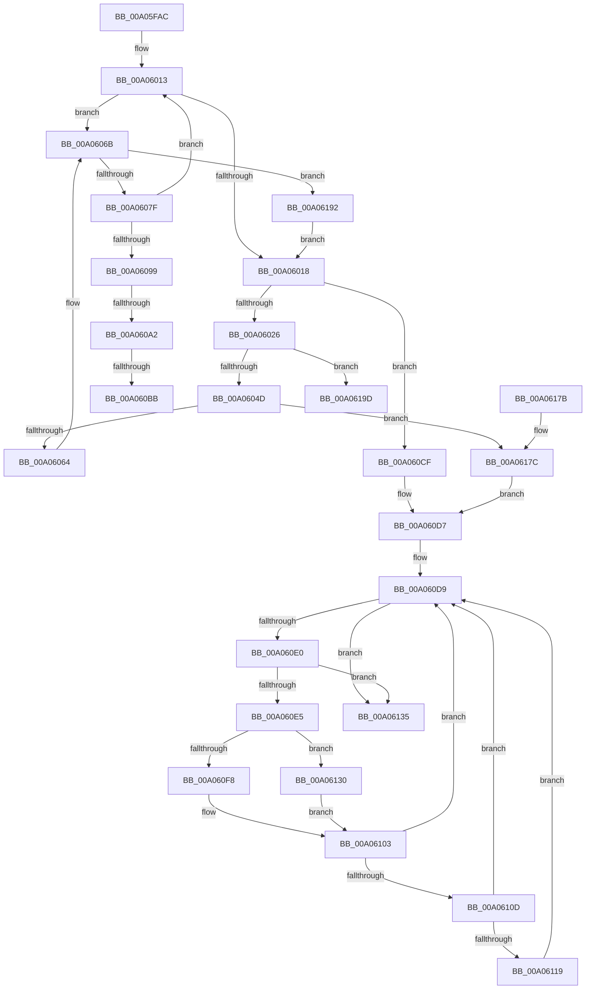

# PnpQueuePendingSurpriseRemoval

- RVA: `0x00A05FAC`–`0x00A061AB` (길이 `511` bytes)
- VA: `0x0000000140A05FAC`
- 실행 섹션: `PAGE`
- PDB 이름 있음: `예`; PDB Function 태그: `예`
- unwind 정보 RVA: `0x000A8494`
- 디코드: `131`개 명령, `511/511` bytes 표시
- 미해석 바이트: `0` (있으면 어셈블리에 `.byte`로 보존)

> 이 문서는 커널 이미지의 기계어와 PDB 기호를 분석해 생성했습니다. 4번과 5번은 함수 원형과 자료형을 바이너리 사용 방식에서 추정한 C 해석이며 원본 소스 복구 결과는 아닙니다.

## 1. Dependencies

- 직접 호출 지점: **11**; 고유 호출 대상: **11**
- 직접 호출자로 확인된 함수: **1**
- RIP 상대 이미지 참조: **4**

### Outgoing calls
- `0x00A05FF9` → [ExAcquireResourceExclusiveLite](../../text/21/ExAcquireResourceExclusiveLite_function_00214E20.md) (function, `0x00214E20`)
- `0x00A06000` → [PnpAcquireDependencyRelationsLock](PnpAcquireDependencyRelationsLock_function_00A06788.md) (function, `0x00A06788`)
- `0x00A06018` → [PnpReleaseDependencyRelationsLock](PnpReleaseDependencyRelationsLock_function_00A06E14.md) (function, `0x00A06E14`)
- `0x00A0603C` → [ExAllocatePool2](../../poolcode/B8/ExAllocatePool2_function_00B820F0.md) (function, `0x00B820F0`)
- `0x00A06085` → [IopCheckIfMergeRequired](IopCheckIfMergeRequired_function_00A061B4.md) (function, `0x00A061B4`)
- `0x00A060AA` → [IopAllocateRelationList](IopAllocateRelationList_function_00A0784C.md) (function, `0x00A0784C`)
- `0x00A060C4` → [IopMergeRelationLists](../73/IopMergeRelationLists_function_0073DA50.md) (function, `0x0073DA50`)
- `0x00A060D2` → [IopFreeRelationList](IopFreeRelationList_function_00A08310.md) (function, `0x00A08310`)
- `0x00A06110` → [IopIsDescendantNode](IopIsDescendantNode_function_00A0665C.md) (function, `0x00A0665C`)
- `0x00A06154` → [ExReleaseResourceLite](../../text/25/ExReleaseResourceLite_function_0025FA10.md) (function, `0x0025FA10`)
- `0x00A06159` → [KeLeaveCriticalRegion](../../text/25/KeLeaveCriticalRegion_function_0025D8B0.md) (function, `0x0025D8B0`)

### Direct callers
- [PiEventRemovalPostSurpriseRemove](PiEventRemovalPostSurpriseRemove_function_00A0596C.md) at `0x00A059D1`

### Static image references
- `0x00A05FF1` → RVA `0x00F8C460` (`.data`; read)
- `0x00A06005` → RVA `0x00F8C550` (`.data`; read)
- `0x00A0604D` → RVA `0x00F8C558` (`.data`; read)
- `0x00A06186` → RVA `0x00F8C558` (`.data`; write)

## 2. Other-region calls and transfers

- 다른 실행 섹션으로 향하는 call: **4**
  - `0x00A05FF9` → [ExAcquireResourceExclusiveLite](../../text/21/ExAcquireResourceExclusiveLite_function_00214E20.md) (`PAGE` → `.text`)
  - `0x00A0603C` → [ExAllocatePool2](../../poolcode/B8/ExAllocatePool2_function_00B820F0.md) (`PAGE` → `POOLCODE`)
  - `0x00A06154` → [ExReleaseResourceLite](../../text/25/ExReleaseResourceLite_function_0025FA10.md) (`PAGE` → `.text`)
  - `0x00A06159` → [KeLeaveCriticalRegion](../../text/25/KeLeaveCriticalRegion_function_0025D8B0.md) (`PAGE` → `.text`)
- call이 아닌 외부 분기/꼬리 이동: **4**
  - `0x00A0609C` → [sub_00B344A6](../B3/Unknown_function_00B344A6.md) (`tail-transfer`)
  - `0x00A060B5` → [sub_00B344A6 + 0x58](../B3/Unknown_function_00B344A6.md) (`tail-transfer`)
  - `0x00A060CA` → [sub_00B344A6](../B3/Unknown_function_00B344A6.md) (`tail-transfer`)
  - `0x00A061A6` → [sub_00B344A6 + 0x66](../B3/Unknown_function_00B344A6.md) (`tail-transfer`)

## 3. Assembly (complete function range)

```asm
00A05FAC  48 89 5C 24 08                  mov qword ptr [rsp + 8], rbx
00A05FB1  48 89 6C 24 18                  mov qword ptr [rsp + 0x18], rbp
00A05FB6  48 89 74 24 20                  mov qword ptr [rsp + 0x20], rsi
00A05FBB  57                              push rdi
00A05FBC  41 54                           push r12
00A05FBE  41 55                           push r13
00A05FC0  41 56                           push r14
00A05FC2  41 57                           push r15
00A05FC4  48 83 EC 20                     sub rsp, 0x20
00A05FC8  48 8B 2A                        mov rbp, qword ptr [rdx]
00A05FCB  4C 8B F9                        mov r15, rcx
00A05FCE  65 48 8B 04 25 88 01 00 00      mov rax, qword ptr gs:[0x188]
00A05FD7  83 C9 FF                        or ecx, 0xffffffff
00A05FDA  33 DB                           xor ebx, ebx
00A05FDC  45 8B E1                        mov r12d, r9d
00A05FDF  48 21 1A                        and qword ptr [rdx], rbx
00A05FE2  45 8B E8                        mov r13d, r8d
00A05FE5  B2 01                           mov dl, 1
00A05FE7  48 8B FD                        mov rdi, rbp
00A05FEA  66 01 88 E4 01 00 00            add word ptr [rax + 0x1e4], cx
00A05FF1  48 8D 0D 68 64 58 00            lea rcx, [rip + 0x586468]
00A05FF8  90                              nop
00A05FF9  E8 22 EE 80 FF                  call 0x140214e20
00A05FFE  B1 01                           mov cl, 1
00A06000  E8 83 07 00 00                  call 0x140a06788
00A06005  4C 8B 35 44 65 58 00            mov r14, qword ptr [rip + 0x586544]
00A0600C  48 8D 05 3D 65 58 00            lea rax, [rip + 0x58653d]
00A06013  4C 3B F0                        cmp r14, rax
00A06016  75 53                           jne 0x140a0606b
00A06018  E8 F7 0D 00 00                  call 0x140a06e14
00A0601D  48 3B EF                        cmp rbp, rdi
00A06020  0F 85 A9 00 00 00               jne 0x140a060cf
00A06026  BD 70 00 00 00                  mov ebp, 0x70
00A0602B  BE 50 6E 70 54                  mov esi, 0x54706e50
00A06030  44 8B C6                        mov r8d, esi
00A06033  8B D5                           mov edx, ebp
00A06035  44 8D 75 D0                     lea r14d, [rbp - 0x30]
00A06039  41 8B CE                        mov ecx, r14d
00A0603C  E8 AF C0 17 00                  call 0x140b820f0
00A06041  48 8B D8                        mov rbx, rax
00A06044  48 85 C0                        test rax, rax
00A06047  0F 84 50 01 00 00               je 0x140a0619d
00A0604D  48 8B 05 04 65 58 00            mov rax, qword ptr [rip + 0x586504]
00A06054  48 8D 15 F5 64 58 00            lea rdx, [rip + 0x5864f5]
00A0605B  48 39 10                        cmp qword ptr [rax], rdx
00A0605E  0F 84 18 01 00 00               je 0x140a0617c
00A06064  B9 03 00 00 00                  mov ecx, 3
00A06069  CD 29                           int 0x29
00A0606B  49 8B F6                        mov rsi, r14
00A0606E  4D 8B 36                        mov r14, qword ptr [r14]
00A06071  48 8B 46 40                     mov rax, qword ptr [rsi + 0x40]
00A06075  4C 39 7E 38                     cmp qword ptr [rsi + 0x38], r15
00A06079  0F 84 13 01 00 00               je 0x140a06192
00A0607F  48 8B D7                        mov rdx, rdi
00A06082  48 8B C8                        mov rcx, rax
00A06085  E8 2A 01 00 00                  call 0x140a061b4
00A0608A  84 C0                           test al, al
00A0608C  48 8D 05 BD 64 58 00            lea rax, [rip + 0x5864bd]
00A06093  0F 84 7A FF FF FF               je 0x140a06013
00A06099  48 3B FD                        cmp rdi, rbp
00A0609C  0F 85 04 E4 12 00               jne 0x140b344a6
00A060A2  B9 03 00 00 00                  mov ecx, 3
00A060A7  48 8B DE                        mov rbx, rsi
00A060AA  E8 9D 17 00 00                  call 0x140a0784c
00A060AF  48 8B F8                        mov rdi, rax
00A060B2  48 85 C0                        test rax, rax
00A060B5  0F 84 43 E4 12 00               je 0x140b344fe
00A060BB  45 33 C0                        xor r8d, r8d
00A060BE  48 8B D5                        mov rdx, rbp
00A060C1  48 8B C8                        mov rcx, rax
00A060C4  E8 87 79 D3 FF                  call 0x14073da50
00A060C9  90                              nop
00A060CA  E9 D7 E3 12 00                  jmp 0x140b344a6
00A060CF  48 8B CD                        mov rcx, rbp
00A060D2  E8 39 22 00 00                  call 0x140a08310
00A060D7  33 F6                           xor esi, esi
00A060D9  48 8B 17                        mov rdx, qword ptr [rdi]
00A060DC  3B 32                           cmp esi, dword ptr [rdx]
00A060DE  73 55                           jae 0x140a06135
00A060E0  48 85 D2                        test rdx, rdx
00A060E3  74 50                           je 0x140a06135
00A060E5  0F AE E8                        lfence
00A060E8  48 8D 0C 76                     lea rcx, [rsi + rsi*2]
00A060EC  FF C6                           inc esi
00A060EE  48 8B 54 CA 10                  mov rdx, qword ptr [rdx + rcx*8 + 0x10]
00A060F3  48 85 D2                        test rdx, rdx
00A060F6  74 38                           je 0x140a06130
00A060F8  48 8B 82 38 01 00 00            mov rax, qword ptr [rdx + 0x138]
00A060FF  4C 8B 58 28                     mov r11, qword ptr [rax + 0x28]
00A06103  41 F6 83 88 02 00 00 01         test byte ptr [r11 + 0x288], 1
00A0610B  74 CC                           je 0x140a060d9
00A0610D  48 8B CF                        mov rcx, rdi
00A06110  E8 47 05 00 00                  call 0x140a0665c
00A06115  84 C0                           test al, al
00A06117  74 C0                           je 0x140a060d9
00A06119  49 83 A3 88 02 00 00 FE         and qword ptr [r11 + 0x288], 0xfffffffffffffffe
00A06121  49 8B 83 88 02 00 00            mov rax, qword ptr [r11 + 0x288]
00A06128  FF 88 90 02 00 00               dec dword ptr [rax + 0x290]
00A0612E  EB A9                           jmp 0x140a060d9
00A06130  45 33 DB                        xor r11d, r11d
00A06133  EB CE                           jmp 0x140a06103
00A06135  48 8D 0D 24 63 58 00            lea rcx, [rip + 0x586324]
00A0613C  4C 89 7B 38                     mov qword ptr [rbx + 0x38], r15
00A06140  44 89 6B 54                     mov dword ptr [rbx + 0x54], r13d
00A06144  C6 43 58 00                     mov byte ptr [rbx + 0x58], 0
00A06148  48 89 7B 40                     mov qword ptr [rbx + 0x40], rdi
00A0614C  44 89 63 6C                     mov dword ptr [rbx + 0x6c], r12d
00A06150  C6 43 68 00                     mov byte ptr [rbx + 0x68], 0
00A06154  E8 B7 98 85 FF                  call 0x14025fa10
00A06159  E8 52 77 85 FF                  call 0x14025d8b0
00A0615E  48 8B 5C 24 50                  mov rbx, qword ptr [rsp + 0x50]
00A06163  48 8B 6C 24 60                  mov rbp, qword ptr [rsp + 0x60]
00A06168  48 8B 74 24 68                  mov rsi, qword ptr [rsp + 0x68]
00A0616D  48 83 C4 20                     add rsp, 0x20
00A06171  41 5F                           pop r15
00A06173  41 5E                           pop r14
00A06175  41 5D                           pop r13
00A06177  41 5C                           pop r12
00A06179  5F                              pop rdi
00A0617A  C3                              ret
00A0617B  CC                              int3
00A0617C  48 89 13                        mov qword ptr [rbx], rdx
00A0617F  48 89 43 08                     mov qword ptr [rbx + 8], rax
00A06183  48 89 18                        mov qword ptr [rax], rbx
00A06186  48 89 1D CB 63 58 00            mov qword ptr [rip + 0x5863cb], rbx
00A0618D  E9 45 FF FF FF                  jmp 0x140a060d7
00A06192  48 8B DE                        mov rbx, rsi
00A06195  48 8B F8                        mov rdi, rax
00A06198  E9 7B FE FF FF                  jmp 0x140a06018
00A0619D  48 C7 44 24 58 F0 D8 FF FF      mov qword ptr [rsp + 0x58], 0xffffffffffffd8f0
00A061A6  E9 61 E3 12 00                  jmp 0x140b3450c
```

## 4. C-style interpretation (structured pseudocode)

```c
__int64 __fastcall PnpQueuePendingSurpriseRemoval(__int64 a1, __int64 a2, int a3, int a4)
{
    __int64 result;
    __int64 v_r11;
    __int64 v_rbx;
    __int64 v_rsi;
    __int64 v_rsp;
    unsigned __int64 v_stack_p18;
    unsigned __int64 v_stack_p20;
    unsigned __int64 v_stack_p58;
    unsigned __int64 v_stack_p8;

    v_stack_p8 = v_rbx;
    v_stack_p18 = v_rbp;
    v_stack_p20 = v_rsi;
    v_rsp = (v_rsp) - (32);
    a1 = (unsigned int)((a1) | (0xFFFFFFFFULL));
    v_rbx = 0;
    result = ExAcquireResourceExclusiveLite(v_rip + 5792872, 1, a3, a4);
    result = PnpAcquireDependencyRelationsLock(1, 1, a3, a4);
loc_00A06013:
    if ((*(unsigned __int64 *)(v_rip + 5793092)) != (v_rip + 5793085)) goto loc_00A0606B;
loc_00A06018:
    result = PnpReleaseDependencyRelationsLock(1, 1, a3, a4);
    if ((*(unsigned __int64 *)(a2)) != (*(unsigned __int64 *)(a2))) goto loc_00A060CF;
    result = ExAllocatePool2((unsigned int)((unsigned int)(112 - 48)), 112, (unsigned int)((unsigned int)((unsigned int)(0x54706E50ULL))), a4);
    if (result == 0) goto loc_00A0619D;
    if ((*(unsigned __int64 *)(*(unsigned __int64 *)(v_rip + 5793028))) == (v_rip + 5793013)) goto loc_00A0617C;
loc_00A0606B:
    if ((*(unsigned __int64 *)(112 - 48 + 56)) == a1) goto loc_00A06192;
    result = IopCheckIfMergeRequired(*(unsigned __int64 *)(112 - 48 + 64), *(unsigned __int64 *)(a2), (unsigned int)((unsigned int)((unsigned int)(0x54706E50ULL))), a4);
    if ((unsigned __int8)(result) == 0) goto loc_00A06013;
    result = IopAllocateRelationList(3, *(unsigned __int64 *)(a2), (unsigned int)((unsigned int)((unsigned int)(0x54706E50ULL))), a4);
    a3 = 0;
    result = IopMergeRelationLists(result, 112, a3, a4);
loc_00A060CF:
    result = IopFreeRelationList(112, 112, a3, a4);
loc_00A060D7:
    v_rsi = 0;
loc_00A060D9:
    if (0 >= (*(unsigned int *)(*(unsigned __int64 *)(result)))) goto loc_00A06135;
    if (*(unsigned __int64 *)(result) == 0) goto loc_00A06135;
    v_rsi = (unsigned int)((v_rsi) + 1);
    if (*(unsigned __int64 *)(*(unsigned __int64 *)(result) + v_rsi + v_rsi * 2 * 8 + 16) == 0) goto loc_00A06130;
loc_00A06103:
    if (((*(unsigned __int8 *)(*(unsigned __int64 *)(*(unsigned __int64 *)(*(unsigned __int64 *)(*(unsigned __int64 *)(result) + v_rsi + v_rsi * 2 * 8 + 16) + 312) + 40) + 648)) & (1)) == 0) goto loc_00A060D9;
    result = IopIsDescendantNode(result, *(unsigned __int64 *)(*(unsigned __int64 *)(result) + v_rsi + v_rsi * 2 * 8 + 16), a3, a4);
    if ((unsigned __int8)(result) == 0) goto loc_00A060D9;
    goto loc_00A060D9;
loc_00A06130:
    v_r11 = 0;
    goto loc_00A06103;
loc_00A06135:
    *(unsigned __int64 *)(112 - 48 + 56) = a1;
    *(unsigned int *)(112 - 48 + 84) = (unsigned int)((unsigned int)(a3));
    *(unsigned __int8 *)(112 - 48 + 88) = 0;
    *(unsigned __int64 *)(112 - 48 + 64) = result;
    *(unsigned int *)(112 - 48 + 108) = (unsigned int)((unsigned int)(a4));
    *(unsigned __int8 *)(112 - 48 + 104) = 0;
    result = ExReleaseResourceLite(v_rip + 5792548, *(unsigned __int64 *)(*(unsigned __int64 *)(result) + v_rsi + v_rsi * 2 * 8 + 16), a3, a4);
    result = KeLeaveCriticalRegion(v_rip + 5792548, *(unsigned __int64 *)(*(unsigned __int64 *)(result) + v_rsi + v_rsi * 2 * 8 + 16), a3, a4);
    v_rsp = (v_rsp) + (32);
    return result;
loc_00A0617C:
    *(unsigned __int64 *)(v_stack_p8) = *(unsigned __int64 *)(*(unsigned __int64 *)(result) + v_rsi + v_rsi * 2 * 8 + 16);
    *(unsigned __int64 *)(v_stack_p8 + 8) = result;
    *(unsigned __int64 *)(result) = v_stack_p8;
    *(unsigned __int64 *)(v_rip + 5792715) = v_stack_p8;
    goto loc_00A060D7;
loc_00A06192:
    goto loc_00A06018;
loc_00A0619D:
    v_stack_p58 = 0xFFFFFFFFFFFFD8F0ULL;
}
```

## 5. (Beta) C Style

```c
int64_t PnpQueuePendingSurpriseRemoval(int64_t Arg1, void *Arg2, int32_t Arg3, int32_t Arg4)
{
    uint8_t *arg2 = (uint8_t *)Arg2;

    int64_t result;
    int64_t local_r11;
    int64_t local_rbx;
    int64_t local_rsi;
    int64_t local_rsp;
    uint64_t v_stack_p18;
    uint64_t v_stack_p20;
    uint64_t v_stack_p58;
    uint64_t v_stack_p8;

    v_stack_p8 = local_rbx;
    v_stack_p18 = local_rbp;
    v_stack_p20 = local_rsi;
    local_rsp = (local_rsp) - (32);
    Arg1 = (uint32_t)((Arg1) | (0xFFFFFFFFULL));
    local_rbx = 0;
    result = ExAcquireResourceExclusiveLite(v_rip + 5792872, 1, Arg3, Arg4);
    result = PnpAcquireDependencyRelationsLock(1, 1, Arg3, Arg4);
loc_00A06013:
    if ((*(uint64_t *)(v_rip + 0x586544)) != (v_rip + 5793085)) goto loc_00A0606B;
loc_00A06018:
    result = PnpReleaseDependencyRelationsLock(1, 1, Arg3, Arg4);
    if ((*(uint64_t *)(arg2)) != (*(uint64_t *)(arg2))) goto loc_00A060CF;
    result = ExAllocatePool2((uint32_t)((uint32_t)(112 - 48)), 112, (uint32_t)((uint32_t)((uint32_t)(0x54706E50ULL))), Arg4);
    if (result == 0) goto loc_00A0619D;
    if ((*(uint64_t *)(*(uint64_t *)(v_rip + 0x586504))) == (v_rip + 5793013)) goto loc_00A0617C;
loc_00A0606B:
    if ((*(uint64_t *)(112 - 0x30 + 0x38)) == Arg1) goto loc_00A06192;
    result = IopCheckIfMergeRequired(*(uint64_t *)(112 - 0x30 + 0x40), *(uint64_t *)(arg2), (uint32_t)((uint32_t)((uint32_t)(0x54706E50ULL))), Arg4);
    if ((uint8_t)(result) == 0) goto loc_00A06013;
    result = IopAllocateRelationList(3, *(uint64_t *)(arg2), (uint32_t)((uint32_t)((uint32_t)(0x54706E50ULL))), Arg4);
    Arg3 = 0;
    result = IopMergeRelationLists(result, 112, Arg3, Arg4);
loc_00A060CF:
    result = IopFreeRelationList(112, 112, Arg3, Arg4);
loc_00A060D7:
    local_rsi = 0;
loc_00A060D9:
    if (0 >= (*(uint32_t *)(*(uint64_t *)(result)))) goto loc_00A06135;
    if (*(uint64_t *)(result) == 0) goto loc_00A06135;
    local_rsi = (uint32_t)((local_rsi) + 1);
    if (*(uint64_t *)(*(uint64_t *)(result) + local_rsi + local_rsi * 2 * 8 + 0x10) == 0) goto loc_00A06130;
loc_00A06103:
    if (((*(uint8_t *)(*(uint64_t *)(*(uint64_t *)(*(uint64_t *)(*(uint64_t *)(result) + local_rsi + local_rsi * 2 * 8 + 0x10) + 0x138) + 0x28) + 0x288)) & (1)) == 0) goto loc_00A060D9;
    result = IopIsDescendantNode(result, *(uint64_t *)(*(uint64_t *)(result) + local_rsi + local_rsi * 2 * 8 + 0x10), Arg3, Arg4);
    if ((uint8_t)(result) == 0) goto loc_00A060D9;
    goto loc_00A060D9;
loc_00A06130:
    local_r11 = 0;
    goto loc_00A06103;
loc_00A06135:
    *(uint64_t *)(112 - 0x30 + 0x38) = Arg1;
    *(uint32_t *)(112 - 0x30 + 0x54) = (uint32_t)((uint32_t)(Arg3));
    *(uint8_t *)(112 - 0x30 + 0x58) = 0;
    *(uint64_t *)(112 - 0x30 + 0x40) = result;
    *(uint32_t *)(112 - 0x30 + 0x6C) = (uint32_t)((uint32_t)(Arg4));
    *(uint8_t *)(112 - 0x30 + 0x68) = 0;
    result = ExReleaseResourceLite(v_rip + 5792548, *(uint64_t *)(*(uint64_t *)(result) + local_rsi + local_rsi * 2 * 8 + 0x10), Arg3, Arg4);
    result = KeLeaveCriticalRegion(v_rip + 5792548, *(uint64_t *)(*(uint64_t *)(result) + local_rsi + local_rsi * 2 * 8 + 0x10), Arg3, Arg4);
    local_rsp = (local_rsp) + (32);
    return result;
loc_00A0617C:
    *(uint64_t *)(v_stack_p8) = *(uint64_t *)(*(uint64_t *)(result) + local_rsi + local_rsi * 2 * 8 + 0x10);
    *(uint64_t *)(v_stack_p8 + 0x8) = result;
    *(uint64_t *)(result) = v_stack_p8;
    *(uint64_t *)(v_rip + 0x5863CB) = v_stack_p8;
    goto loc_00A060D7;
loc_00A06192:
    goto loc_00A06018;
loc_00A0619D:
    v_stack_p58 = 0xFFFFFFFFFFFFD8F0ULL;
}
```

### 관측된 메모리 오프셋

구조체 형식이 확인되지 않은 접근은 인자 기준의 오프셋으로만 기록했습니다.

| 기준 인자 | 오프셋 표현 | 폭 (bit) | 접근 |
|---|---:|---:|---|
| `Arg2` | `+ 0x0` | `64` | `R` |
| `Arg2` | `+ 0x0` | `64` | `R/W` |

## 6. Execution-region graph

[열기: 2D/3D 그래프와 함수 탐색 컨트롤 패널](../../../control-panel.html?section=page&rva=0x00A05FAC&view=graph)

- 2D 그래프는 위에서 아래로 흐르고, 3D 그래프는 빈 공간을 드래그해 회전합니다. Shift+드래그는 이동, 휠은 확대·축소, 함수 노드 선택은 대상 보고서 이동입니다.

### Static fallback


