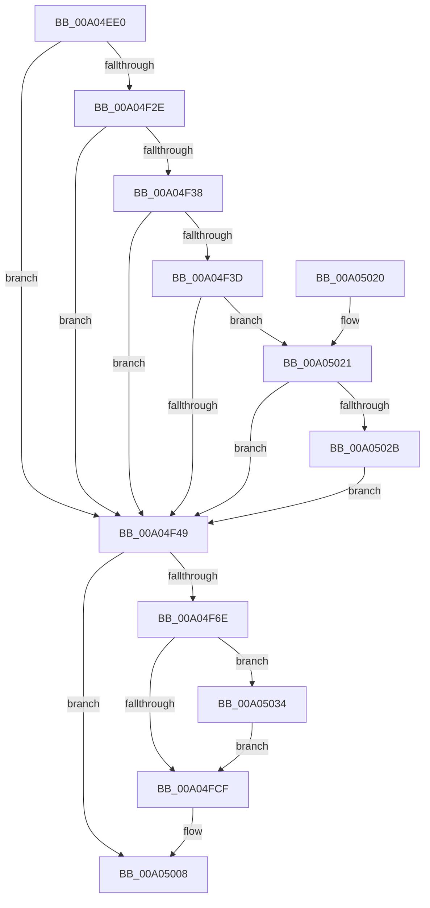

# PnpRecordBlackboxPnpEventInformation

- RVA: `0x00A04EE0`–`0x00A05063` (길이 `387` bytes)
- VA: `0x0000000140A04EE0`
- 실행 섹션: `PAGE`
- PDB 이름 있음: `예`; PDB Function 태그: `아니요`
- unwind 정보 RVA: `0x000A8384`
- 디코드: `104`개 명령, `387/387` bytes 표시
- 미해석 바이트: `0` (있으면 어셈블리에 `.byte`로 보존)

> 이 문서는 커널 이미지의 기계어와 PDB 기호를 분석해 생성했습니다. 4번과 5번은 함수 원형과 자료형을 바이너리 사용 방식에서 추정한 C 해석이며 원본 소스 복구 결과는 아닙니다.

## 1. Dependencies

- 직접 호출 지점: **6**; 고유 호출 대상: **5**
- 직접 호출자로 확인된 함수: **1**
- RIP 상대 이미지 참조: **0**

### Outgoing calls
- `0x00A04F1A` → [PiGetTargetDeviceNode](PiGetTargetDeviceNode_function_00A0506C.md) (function, `0x00A0506C`)
- `0x00A04F5D` → [ExAllocatePool2](../../poolcode/B8/ExAllocatePool2_function_00B820F0.md) (function, `0x00B820F0`)
- `0x00A04FB4` → [memcpy](../../text/6C/memcpy_function_006C6840.md) (function, `0x006C6840`)
- `0x00A04FF6` → [NtPowerInformation](../95/NtPowerInformation_function_00955D80.md) (function, `0x00955D80`)
- `0x00A05003` → [ExFreePoolWithTag](../../poolcode/B8/ExFreePoolWithTag_function_00B82870.md) (function, `0x00B82870`)
- `0x00A0504E` → [memcpy](../../text/6C/memcpy_function_006C6840.md) (function, `0x006C6840`)

### Direct callers
- [PnpProcessQueryRemoveAndEject](PnpProcessQueryRemoveAndEject_function_00A05170.md) at `0x00A053BF`
- [PnpProcessQueryRemoveAndEject](PnpProcessQueryRemoveAndEject_function_00A05170.md) at `0x00A0557F`
- [PnpProcessQueryRemoveAndEject](PnpProcessQueryRemoveAndEject_function_00A05170.md) at `0x00A056E7`

### Static image references
- 디코드된 RIP-relative 메모리 참조가 없습니다.

## 2. Other-region calls and transfers

- 다른 실행 섹션으로 향하는 call: **4**
  - `0x00A04F5D` → [ExAllocatePool2](../../poolcode/B8/ExAllocatePool2_function_00B820F0.md) (`PAGE` → `POOLCODE`)
  - `0x00A04FB4` → [memcpy](../../text/6C/memcpy_function_006C6840.md) (`PAGE` → `.text`)
  - `0x00A05003` → [ExFreePoolWithTag](../../poolcode/B8/ExFreePoolWithTag_function_00B82870.md) (`PAGE` → `POOLCODE`)
  - `0x00A0504E` → [memcpy](../../text/6C/memcpy_function_006C6840.md) (`PAGE` → `.text`)
- 별도 외부 분기/꼬리 이동을 확인하지 못했습니다.

## 3. Assembly (complete function range)

```asm
00A04EE0  48 8B C4                        mov rax, rsp
00A04EE3  48 89 58 18                     mov qword ptr [rax + 0x18], rbx
00A04EE7  44 88 48 20                     mov byte ptr [rax + 0x20], r9b
00A04EEB  89 50 10                        mov dword ptr [rax + 0x10], edx
00A04EEE  48 89 48 08                     mov qword ptr [rax + 8], rcx
00A04EF2  55                              push rbp
00A04EF3  56                              push rsi
00A04EF4  57                              push rdi
00A04EF5  41 54                           push r12
00A04EF7  41 55                           push r13
00A04EF9  41 56                           push r14
00A04EFB  41 57                           push r15
00A04EFD  48 83 EC 50                     sub rsp, 0x50
00A04F01  48 BB 14 00 00 00 80 F7 FF FF   movabs rbx, 0xfffff78000000014
00A04F0B  4D 8B E0                        mov r12, r8
00A04F0E  45 33 C0                        xor r8d, r8d
00A04F11  45 8B F0                        mov r14d, r8d
00A04F14  41 8B F0                        mov esi, r8d
00A04F17  48 8B 1B                        mov rbx, qword ptr [rbx]
00A04F1A  E8 4D 01 00 00                  call 0x140a0506c
00A04F1F  4C 8B F8                        mov r15, rax
00A04F22  0F B7 68 28                     movzx ebp, word ptr [rax + 0x28]
00A04F26  83 C5 32                        add ebp, 0x32
00A04F29  4D 85 E4                        test r12, r12
00A04F2C  74 1B                           je 0x140a04f49
00A04F2E  49 8D 74 24 08                  lea rsi, [r12 + 8]
00A04F33  45 84 C9                        test r9b, r9b
00A04F36  75 11                           jne 0x140a04f49
00A04F38  48 85 F6                        test rsi, rsi
00A04F3B  74 0C                           je 0x140a04f49
00A04F3D  0F B7 06                        movzx eax, word ptr [rsi]
00A04F40  66 85 C0                        test ax, ax
00A04F43  0F 85 D8 00 00 00               jne 0x140a05021
00A04F49  41 8D 04 2E                     lea eax, [r14 + rbp]
00A04F4D  41 B8 50 6E 70 4B               mov r8d, 0x4b706e50
00A04F53  8B D0                           mov edx, eax
00A04F55  B9 40 00 00 00                  mov ecx, 0x40
00A04F5A  44 8B E8                        mov r13d, eax
00A04F5D  E8 8E D1 17 00                  call 0x140b820f0
00A04F62  48 8B F8                        mov rdi, rax
00A04F65  48 85 C0                        test rax, rax
00A04F68  0F 84 9A 00 00 00               je 0x140a05008
00A04F6E  48 83 64 24 40 00               and qword ptr [rsp + 0x40], 0
00A04F74  83 64 24 4C 00                  and dword ptr [rsp + 0x4c], 0
00A04F79  48 8B 8C 24 90 00 00 00         mov rcx, qword ptr [rsp + 0x90]
00A04F81  0F 10 41 58                     movups xmm0, xmmword ptr [rcx + 0x58]
00A04F85  48 89 58 10                     mov qword ptr [rax + 0x10], rbx
00A04F89  F3 0F 7F 00                     movdqu xmmword ptr [rax], xmm0
00A04F8D  8B 49 10                        mov ecx, dword ptr [rcx + 0x10]
00A04F90  89 48 20                        mov dword ptr [rax + 0x20], ecx
00A04F93  48 8D 4F 2C                     lea rcx, [rdi + 0x2c]
00A04F97  8B 84 24 98 00 00 00            mov eax, dword ptr [rsp + 0x98]
00A04F9E  89 47 18                        mov dword ptr [rdi + 0x18], eax
00A04FA1  8A 84 24 A8 00 00 00            mov al, byte ptr [rsp + 0xa8]
00A04FA8  88 47 1C                        mov byte ptr [rdi + 0x1c], al
00A04FAB  45 0F B7 47 28                  movzx r8d, word ptr [r15 + 0x28]
00A04FB0  49 8B 57 30                     mov rdx, qword ptr [r15 + 0x30]
00A04FB4  E8 87 18 CC FF                  call 0x1406c6840
00A04FB9  41 0F B7 47 28                  movzx eax, word ptr [r15 + 0x28]
00A04FBE  45 33 FF                        xor r15d, r15d
00A04FC1  48 D1 E8                        shr rax, 1
00A04FC4  66 44 89 7C 47 2C               mov word ptr [rdi + rax*2 + 0x2c], r15w
00A04FCA  45 85 F6                        test r14d, r14d
00A04FCD  75 65                           jne 0x140a05034
00A04FCF  45 33 C9                        xor r9d, r9d
00A04FD2  C7 44 24 48 02 00 00 00         mov dword ptr [rsp + 0x48], 2
00A04FDA  48 8D 54 24 30                  lea rdx, [rsp + 0x30]
00A04FDF  48 89 7C 24 30                  mov qword ptr [rsp + 0x30], rdi
00A04FE4  4C 89 6C 24 38                  mov qword ptr [rsp + 0x38], r13
00A04FE9  44 89 7C 24 20                  mov dword ptr [rsp + 0x20], r15d
00A04FEE  45 8D 41 20                     lea r8d, [r9 + 0x20]
00A04FF2  41 8D 49 5E                     lea ecx, [r9 + 0x5e]
00A04FF6  E8 85 0D F5 FF                  call 0x140955d80
00A04FFB  BA 50 6E 70 4B                  mov edx, 0x4b706e50
00A05000  48 8B CF                        mov rcx, rdi
00A05003  E8 68 D8 17 00                  call 0x140b82870
00A05008  48 8B 9C 24 A0 00 00 00         mov rbx, qword ptr [rsp + 0xa0]
00A05010  48 83 C4 50                     add rsp, 0x50
00A05014  41 5F                           pop r15
00A05016  41 5E                           pop r14
00A05018  41 5D                           pop r13
00A0501A  41 5C                           pop r12
00A0501C  5F                              pop rdi
00A0501D  5E                              pop rsi
00A0501E  5D                              pop rbp
00A0501F  C3                              ret
00A05020  CC                              int3
00A05021  4C 39 46 08                     cmp qword ptr [rsi + 8], r8
00A05025  0F 84 1E FF FF FF               je 0x140a04f49
00A0502B  44 8D 70 02                     lea r14d, [rax + 2]
00A0502F  E9 15 FF FF FF                  jmp 0x140a04f49
00A05034  41 8B 04 24                     mov eax, dword ptr [r12]
00A05038  89 47 24                        mov dword ptr [rdi + 0x24], eax
00A0503B  89 6F 28                        mov dword ptr [rdi + 0x28], ebp
00A0503E  44 0F B7 06                     movzx r8d, word ptr [rsi]
00A05042  48 8B 56 08                     mov rdx, qword ptr [rsi + 8]
00A05046  8B DD                           mov ebx, ebp
00A05048  48 03 DF                        add rbx, rdi
00A0504B  48 8B CB                        mov rcx, rbx
00A0504E  E8 ED 17 CC FF                  call 0x1406c6840
00A05053  0F B7 06                        movzx eax, word ptr [rsi]
00A05056  48 D1 E8                        shr rax, 1
00A05059  66 44 89 3C 43                  mov word ptr [rbx + rax*2], r15w
00A0505E  E9 6C FF FF FF                  jmp 0x140a04fcf
```

## 4. C-style interpretation (structured pseudocode)

```c
__int64 __fastcall PnpRecordBlackboxPnpEventInformation(__int64 a1, int a2, __int64 a3, int a4)
{
    __int64 result;
    __int64 v_r15;
    __int64 v_rbp;
    __int64 v_rbx;
    __int64 v_rsp;
    unsigned int v_stack_m3C;
    unsigned int v_stack_m40;
    unsigned __int64 v_stack_m48;
    unsigned __int64 v_stack_m50;
    unsigned __int64 v_stack_m58;
    unsigned int v_stack_m68;
    unsigned int v_stack_p10;
    unsigned __int64 v_stack_p18;
    unsigned __int8 v_stack_p20;
    unsigned __int64 v_stack_p8;

    *(unsigned __int64 *)(v_rsp + 24) = v_rbx;
    *(unsigned __int8 *)(v_rsp + 32) = (unsigned __int8)(a4);
    *(unsigned int *)(v_rsp + 16) = a2;
    *(unsigned __int64 *)(v_rsp + 8) = a1;
    v_rsp = (v_rsp) - (80);
    a3 = 0;
    result = PiGetTargetDeviceNode(a1, a2, a3, a4);
    v_rbp = (unsigned int)((*(unsigned __int16 *)(result + 40)) + (50));
    if (0 == 0) goto loc_00A04F49;
    if ((unsigned __int8)(a4) != 0) goto loc_00A04F49;
    if (a3 + 8 == 0) goto loc_00A04F49;
    if ((unsigned __int16)(*(unsigned __int16 *)(a3 + 8)) != 0) goto loc_00A05021;
loc_00A04F49:
    result = ExAllocatePool2(64, (unsigned int)((unsigned int)(0 + v_rbp * 1)), (unsigned int)(0x4B706E50ULL), a4);
    if (result == 0) goto loc_00A05008;
    *(unsigned __int64 *)(result + 16) = *(unsigned __int64 *)(v_rbx);
    *(unsigned __int64 *)(result) = v_xmm0;
    *(unsigned int *)(result + 32) = (unsigned int)((unsigned int)(*(unsigned int *)(v_stack_p8 + 16)));
    *(unsigned int *)(result + 24) = (unsigned int)((unsigned int)(v_stack_p10));
    *(unsigned __int8 *)(result + 28) = (unsigned __int8)(v_stack_p20);
    result = memcpy(result + 44, *(unsigned __int64 *)(result + 48), *(unsigned __int16 *)(result + 40), a4);
    v_r15 = 0;
    result = (*(unsigned __int16 *)(result + 40)) >> (1);
    *(unsigned __int16 *)(result + result * 2 + 44) = 0;
    if (0 != 0) goto loc_00A05034;
loc_00A04FCF:
    a4 = 0;
    v_stack_m40 = 2;
    v_stack_m58 = result;
    v_stack_m50 = (unsigned int)((unsigned int)(0 + v_rbp * 1));
    v_stack_m68 = 0;
    result = NtPowerInformation(a4 + 94, v_stack_m58, a4 + 32, a4);
    result = ExFreePoolWithTag(result, (unsigned int)(0x4B706E50ULL), a4 + 32, a4);
loc_00A05008:
    v_rsp = (v_rsp) + (80);
    return result;
loc_00A05021:
    if ((*(unsigned __int64 *)(a3 + 8 + 8)) == (a4 + 32)) goto loc_00A04F49;
    goto loc_00A04F49;
loc_00A05034:
    *(unsigned int *)(result + 36) = (unsigned int)((unsigned int)(*(unsigned int *)(a3)));
    *(unsigned int *)(result + 40) = (unsigned int)(v_rbp);
    v_rbx = ((unsigned int)((unsigned int)(v_rbp))) + (result);
    result = memcpy(v_rbx, *(unsigned __int64 *)(a3 + 8 + 8), *(unsigned __int16 *)(a3 + 8), a4);
    result = (*(unsigned __int16 *)(a3 + 8)) >> (1);
    *(unsigned __int16 *)(v_rbx + result * 2) = 0;
    goto loc_00A04FCF;
}
```

## 5. (Beta) C Style

```c
int64_t PnpRecordBlackboxPnpEventInformation(int64_t Arg1, int32_t Arg2, int64_t Arg3, int32_t Arg4)
{
    int64_t result;
    int64_t local_r15;
    int64_t local_rbp;
    int64_t local_rbx;
    int64_t local_rsp;
    uint32_t v_stack_m3C;
    uint32_t v_stack_m40;
    uint64_t v_stack_m48;
    uint64_t v_stack_m50;
    uint64_t v_stack_m58;
    uint32_t v_stack_m68;
    uint32_t v_stack_p10;
    uint64_t v_stack_p18;
    uint8_t v_stack_p20;
    uint64_t v_stack_p8;

    *(uint64_t *)(local_rsp + 0x18) = local_rbx;
    *(uint8_t *)(local_rsp + 0x20) = (uint8_t)(Arg4);
    *(uint32_t *)(local_rsp + 0x10) = Arg2;
    *(uint64_t *)(local_rsp + 0x8) = Arg1;
    local_rsp = (local_rsp) - (80);
    Arg3 = 0;
    result = PiGetTargetDeviceNode(Arg1, Arg2, Arg3, Arg4);
    local_rbp = (uint32_t)((*(uint16_t *)(result + 0x28)) + (50));
    if (0 == 0) goto loc_00A04F49;
    if ((uint8_t)(Arg4) != 0) goto loc_00A04F49;
    if (Arg3 + 8 == 0) goto loc_00A04F49;
    if ((uint16_t)(*(uint16_t *)(Arg3 + 0x8)) != 0) goto loc_00A05021;
loc_00A04F49:
    result = ExAllocatePool2(64, (uint32_t)((uint32_t)(0 + local_rbp * 1)), (uint32_t)(0x4B706E50ULL), Arg4);
    if (result == 0) goto loc_00A05008;
    *(uint64_t *)(result + 0x10) = *(uint64_t *)(local_rbx);
    *(uint64_t *)(result) = v_xmm0;
    *(uint32_t *)(result + 0x20) = (uint32_t)((uint32_t)(*(uint32_t *)(v_stack_p8 + 0x10)));
    *(uint32_t *)(result + 0x18) = (uint32_t)((uint32_t)(v_stack_p10));
    *(uint8_t *)(result + 0x1C) = (uint8_t)(v_stack_p20);
    result = memcpy(result + 44, *(uint64_t *)(result + 0x30), *(uint16_t *)(result + 0x28), Arg4);
    local_r15 = 0;
    result = (*(uint16_t *)(result + 0x28)) >> (1);
    *(uint16_t *)(result + result * 2 + 0x2C) = 0;
    if (0 != 0) goto loc_00A05034;
loc_00A04FCF:
    Arg4 = 0;
    v_stack_m40 = 2;
    v_stack_m58 = result;
    v_stack_m50 = (uint32_t)((uint32_t)(0 + local_rbp * 1));
    v_stack_m68 = 0;
    result = NtPowerInformation(Arg4 + 94, v_stack_m58, Arg4 + 32, Arg4);
    result = ExFreePoolWithTag(result, (uint32_t)(0x4B706E50ULL), Arg4 + 32, Arg4);
loc_00A05008:
    local_rsp = (local_rsp) + (80);
    return result;
loc_00A05021:
    if ((*(uint64_t *)(Arg3 + 0x8 + 0x8)) == (Arg4 + 32)) goto loc_00A04F49;
    goto loc_00A04F49;
loc_00A05034:
    *(uint32_t *)(result + 0x24) = (uint32_t)((uint32_t)(*(uint32_t *)(Arg3)));
    *(uint32_t *)(result + 0x28) = (uint32_t)(local_rbp);
    local_rbx = ((uint32_t)((uint32_t)(local_rbp))) + (result);
    result = memcpy(local_rbx, *(uint64_t *)(Arg3 + 0x8 + 0x8), *(uint16_t *)(Arg3 + 0x8), Arg4);
    result = (*(uint16_t *)(Arg3 + 0x8)) >> (1);
    *(uint16_t *)(local_rbx + result * 2) = 0;
    goto loc_00A04FCF;
}
```

## 6. Execution-region graph

[열기: 2D/3D 그래프와 함수 탐색 컨트롤 패널](../../../control-panel.html?section=page&rva=0x00A04EE0&view=graph)

- 2D 그래프는 위에서 아래로 흐르고, 3D 그래프는 빈 공간을 드래그해 회전합니다. Shift+드래그는 이동, 휠은 확대·축소, 함수 노드 선택은 대상 보고서 이동입니다.

### Static fallback


