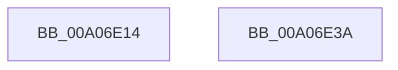

# PnpReleaseDependencyRelationsLock

- RVA: `0x00A06E14`–`0x00A06E3B` (길이 `39` bytes)
- VA: `0x0000000140A06E14`
- 실행 섹션: `PAGE`
- PDB 이름 있음: `예`; PDB Function 태그: `아니요`
- unwind 정보 RVA: `0x0005C788`
- 디코드: `9`개 명령, `39/39` bytes 표시
- 미해석 바이트: `0` (있으면 어셈블리에 `.byte`로 보존)

> 이 문서는 커널 이미지의 기계어와 PDB 기호를 분석해 생성했습니다. 4번과 5번은 함수 원형과 자료형을 바이너리 사용 방식에서 추정한 C 해석이며 원본 소스 복구 결과는 아닙니다.

## 1. Dependencies

- 직접 호출 지점: **3**; 고유 호출 대상: **2**
- 직접 호출자로 확인된 함수: **19**
- RIP 상대 이미지 참조: **2**

### Outgoing calls
- `0x00A06E1F` → [ExReleaseResourceLite](../../text/25/ExReleaseResourceLite_function_0025FA10.md) (function, `0x0025FA10`)
- `0x00A06E2B` → [ExReleaseResourceLite](../../text/25/ExReleaseResourceLite_function_0025FA10.md) (function, `0x0025FA10`)
- `0x00A06E30` → [KeLeaveCriticalRegion](../../text/25/KeLeaveCriticalRegion_function_0025D8B0.md) (function, `0x0025D8B0`)

### Direct callers
- [IoResolveDependency](../../text/4C/IoResolveDependency_function_004C4380.md) at `0x004C448A`
- [IoResolveDependency](../../text/4C/IoResolveDependency_function_004C4380.md) at `0x004C44DF`
- [IoDuplicateDependency](../72/IoDuplicateDependency_function_00727580.md) at `0x007275CD`
- [IoDuplicateDependency](../72/IoDuplicateDependency_function_00727580.md) at `0x0072766D`
- [IoReserveDependency](../72/IoReserveDependency_function_007276B0.md) at `0x0072771B`
- [IoSetDependency](../72/IoSetDependency_function_00727740.md) at `0x007277BB`
- [IoSetDependency](../72/IoSetDependency_function_00727740.md) at `0x007277C2`
- [PnpRequestDeviceRemoval](../8F/PnpRequestDeviceRemoval_function_008FC294.md) at `0x008FC2DE`
- [PnpStartedDeviceNodeDependencyCheck](../8F/PnpStartedDeviceNodeDependencyCheck_function_008FCF58.md) at `0x008FCF96`
- [PnpGetDeviceDependencyList](PnpGetDeviceDependencyList_function_00A05090.md) at `0x00A05112`
- [PnpGetDeviceDependencyList](PnpGetDeviceDependencyList_function_00A05090.md) at `0x00A0512B`
- [PnpQueuePendingSurpriseRemoval](PnpQueuePendingSurpriseRemoval_function_00A05FAC.md) at `0x00A06018`
- [PnpNewDeviceNodeDependencyCheck](PnpNewDeviceNodeDependencyCheck_function_00A062A0.md) at `0x00A062C8`
- [PnpNewDeviceNodeDependencyCheck](PnpNewDeviceNodeDependencyCheck_function_00A062A0.md) at `0x00A06320`
- [PnpNewDeviceNodeDependencyCheck](PnpNewDeviceNodeDependencyCheck_function_00A062A0.md) at `0x00A06369`
- [PnpDeleteAllDependencyRelations](PnpDeleteAllDependencyRelations_function_00A06724.md) at `0x00A0675C`
- [PnpDeleteAllDependencyRelations](PnpDeleteAllDependencyRelations_function_00A06724.md) at `0x00A0677B`
- [PipProcessRebuildPowerRelationsQueue](PipProcessRebuildPowerRelationsQueue_function_00A06844.md) at `0x00A0687F`
- [PipProcessRebuildPowerRelationsQueue](PipProcessRebuildPowerRelationsQueue_function_00A06844.md) at `0x00A068F6`
- [IopSortRelationListForRemove](IopSortRelationListForRemove_function_00A06C30.md) at `0x00A06CAF`
- [PnpCheckForActiveDependencies](PnpCheckForActiveDependencies_function_00A06DA4.md) at `0x00A06E03`
- [PnpProcessDependencyRelations](PnpProcessDependencyRelations_function_00A07548.md) at `0x00A075BB`
- [PnpSurpriseRemovedDeviceNodeDependencyCheck](PnpSurpriseRemovedDeviceNodeDependencyCheck_function_00A0861C.md) at `0x00A08655`
- [PiQueryPowerDependencyRelations](../AA/PiQueryPowerDependencyRelations_function_00AA4524.md) at `0x00AA4741`
- [sub_00B33DD8](../B3/Unknown_function_00B33DD8.md) at `0x00B33FB3`
- [sub_00B33DD8](../B3/Unknown_function_00B33DD8.md) at `0x00B33FDD`
- [sub_00B344A6](../B3/Unknown_function_00B344A6.md) at `0x00B34501`
- [IopInitializePlugPlayServices](../../init/C2/IopInitializePlugPlayServices_function_00C2F298.md) at `0x00C2FB43`

### Static image references
- `0x00A06E18` → RVA `0x00F8CEA0` (`.data`; read)
- `0x00A06E24` → RVA `0x00F8C560` (`.data`; read)

## 2. Other-region calls and transfers

- 다른 실행 섹션으로 향하는 call: **3**
  - `0x00A06E1F` → [ExReleaseResourceLite](../../text/25/ExReleaseResourceLite_function_0025FA10.md) (`PAGE` → `.text`)
  - `0x00A06E2B` → [ExReleaseResourceLite](../../text/25/ExReleaseResourceLite_function_0025FA10.md) (`PAGE` → `.text`)
  - `0x00A06E30` → [KeLeaveCriticalRegion](../../text/25/KeLeaveCriticalRegion_function_0025D8B0.md) (`PAGE` → `.text`)
- 별도 외부 분기/꼬리 이동을 확인하지 못했습니다.

## 3. Assembly (complete function range)

```asm
00A06E14  48 83 EC 28                     sub rsp, 0x28
00A06E18  48 8D 0D 81 60 58 00            lea rcx, [rip + 0x586081]
00A06E1F  E8 EC 8B 85 FF                  call 0x14025fa10
00A06E24  48 8D 0D 35 57 58 00            lea rcx, [rip + 0x585735]
00A06E2B  E8 E0 8B 85 FF                  call 0x14025fa10
00A06E30  E8 7B 6A 85 FF                  call 0x14025d8b0
00A06E35  48 83 C4 28                     add rsp, 0x28
00A06E39  C3                              ret
00A06E3A  CC                              int3
```

## 4. C-style interpretation (structured pseudocode)

```c
__int64 __fastcall PnpReleaseDependencyRelationsLock(void)
{
    __int64 result;
    __int64 v_rsp;

    v_rsp = (v_rsp) - (40);
    result = ExReleaseResourceLite(v_rip + 5791873, a2, a3, a4);
    result = ExReleaseResourceLite(v_rip + 5789493, a2, a3, a4);
    result = KeLeaveCriticalRegion(v_rip + 5789493, a2, a3, a4);
    v_rsp = (v_rsp) + (40);
    return result;
}
```

## 5. (Beta) C Style

```c
void PnpReleaseDependencyRelationsLock(void)
{
    int64_t result;
    int64_t local_rsp;

    local_rsp = (local_rsp) - (40);
    result = ExReleaseResourceLite(v_rip + 5791873, a2, a3, a4);
    result = ExReleaseResourceLite(v_rip + 5789493, a2, a3, a4);
    result = KeLeaveCriticalRegion(v_rip + 5789493, a2, a3, a4);
    local_rsp = (local_rsp) + (40);
    return result;
}
```

## 6. Execution-region graph

[열기: 2D/3D 그래프와 함수 탐색 컨트롤 패널](../../../control-panel.html?section=page&rva=0x00A06E14&view=graph)

- 2D 그래프는 위에서 아래로 흐르고, 3D 그래프는 빈 공간을 드래그해 회전합니다. Shift+드래그는 이동, 휠은 확대·축소, 함수 노드 선택은 대상 보고서 이동입니다.

### Static fallback


