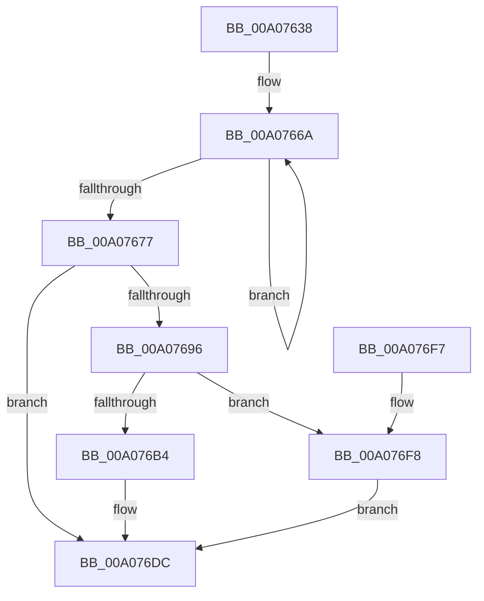

# PnpResizeTargetDeviceBlock

- RVA: `0x00A07638`–`0x00A076FF` (길이 `199` bytes)
- VA: `0x0000000140A07638`
- 실행 섹션: `PAGE`
- PDB 이름 있음: `예`; PDB Function 태그: `아니요`
- unwind 정보 RVA: `0x00075210`
- 디코드: `56`개 명령, `199/199` bytes 표시
- 미해석 바이트: `0` (있으면 어셈블리에 `.byte`로 보존)

> 이 문서는 커널 이미지의 기계어와 PDB 기호를 분석해 생성했습니다. 4번과 5번은 함수 원형과 자료형을 바이너리 사용 방식에서 추정한 C 해석이며 원본 소스 복구 결과는 아닙니다.

## 1. Dependencies

- 직접 호출 지점: **2**; 고유 호출 대상: **2**
- 직접 호출자로 확인된 함수: **1**
- RIP 상대 이미지 참조: **0**

### Outgoing calls
- `0x00A076A7` → [PnpAllocateCriticalMemory](PnpAllocateCriticalMemory_function_00A07924.md) (function, `0x00A07924`)
- `0x00A076C0` → [memcpy](../../text/6C/memcpy_function_006C6840.md) (function, `0x006C6840`)

### Direct callers
- [PnpProcessQueryRemoveAndEject](PnpProcessQueryRemoveAndEject_function_00A05170.md) at `0x00A05517`

### Static image references
- 디코드된 RIP-relative 메모리 참조가 없습니다.

## 2. Other-region calls and transfers

- 다른 실행 섹션으로 향하는 call: **1**
  - `0x00A076C0` → [memcpy](../../text/6C/memcpy_function_006C6840.md) (`PAGE` → `.text`)
- 별도 외부 분기/꼬리 이동을 확인하지 못했습니다.

## 3. Assembly (complete function range)

```asm
00A07638  48 89 5C 24 08                  mov qword ptr [rsp + 8], rbx
00A0763D  48 89 6C 24 10                  mov qword ptr [rsp + 0x10], rbp
00A07642  48 89 74 24 18                  mov qword ptr [rsp + 0x18], rsi
00A07647  57                              push rdi
00A07648  41 56                           push r14
00A0764A  41 57                           push r15
00A0764C  48 83 EC 20                     sub rsp, 0x20
00A07650  4C 8B F9                        mov r15, rcx
00A07653  33 FF                           xor edi, edi
00A07655  48 8B 09                        mov rcx, qword ptr [rcx]
00A07658  44 8B D2                        mov r10d, edx
00A0765B  44 8B B1 9C 00 00 00            mov r14d, dword ptr [rcx + 0x9c]
00A07662  41 83 C6 78                     add r14d, 0x78
00A07666  48 83 C8 FF                     or rax, 0xffffffffffffffff
00A0766A  48 FF C0                        inc rax
00A0766D  66 39 BC 41 A8 00 00 00         cmp word ptr [rcx + rax*2 + 0xa8], di
00A07675  75 F3                           jne 0x140a0766a
00A07677  8D 04 45 02 00 00 00            lea eax, [rax*2 + 2]
00A0767E  8B CF                           mov ecx, edi
00A07680  83 F8 02                        cmp eax, 2
00A07683  41 8B EE                        mov ebp, r14d
00A07686  0F 45 C8                        cmovne ecx, eax
00A07689  2B E9                           sub ebp, ecx
00A0768B  81 C5 90 01 00 00               add ebp, 0x190
00A07691  41 3B EE                        cmp ebp, r14d
00A07694  76 46                           jbe 0x140a076dc
00A07696  44 8B C5                        mov r8d, ebp
00A07699  BA 00 01 00 00                  mov edx, 0x100
00A0769E  41 B9 50 6E 70 4B               mov r9d, 0x4b706e50
00A076A4  41 8B CA                        mov ecx, r10d
00A076A7  E8 78 02 00 00                  call 0x140a07924
00A076AC  48 8B F0                        mov rsi, rax
00A076AF  48 85 C0                        test rax, rax
00A076B2  74 44                           je 0x140a076f8
00A076B4  49 8B 1F                        mov rbx, qword ptr [r15]
00A076B7  48 8B C8                        mov rcx, rax
00A076BA  48 8B D3                        mov rdx, rbx
00A076BD  45 8B C6                        mov r8d, r14d
00A076C0  E8 7B F1 CB FF                  call 0x1406c6840
00A076C5  8D 4D 88                        lea ecx, [rbp - 0x78]
00A076C8  C7 46 40 01 00 00 00            mov dword ptr [rsi + 0x40], 1
00A076CF  89 8E 9C 00 00 00               mov dword ptr [rsi + 0x9c], ecx
00A076D5  48 89 5E 50                     mov qword ptr [rsi + 0x50], rbx
00A076D9  49 89 37                        mov qword ptr [r15], rsi
00A076DC  48 8B 5C 24 40                  mov rbx, qword ptr [rsp + 0x40]
00A076E1  8B C7                           mov eax, edi
00A076E3  48 8B 6C 24 48                  mov rbp, qword ptr [rsp + 0x48]
00A076E8  48 8B 74 24 50                  mov rsi, qword ptr [rsp + 0x50]
00A076ED  48 83 C4 20                     add rsp, 0x20
00A076F1  41 5F                           pop r15
00A076F3  41 5E                           pop r14
00A076F5  5F                              pop rdi
00A076F6  C3                              ret
00A076F7  CC                              int3
00A076F8  BF 9A 00 00 C0                  mov edi, 0xc000009a
00A076FD  EB DD                           jmp 0x140a076dc
```

## 4. C-style interpretation (structured pseudocode)

```c
__int64 __fastcall PnpResizeTargetDeviceBlock(__int64 a1, int a2)
{
    __int64 result;
    __int64 v_r14;
    __int64 v_rbp;
    __int64 v_rdi;
    __int64 v_rsp;
    unsigned __int64 v_stack_p10;
    unsigned __int64 v_stack_p18;
    unsigned __int64 v_stack_p8;

    v_stack_p8 = v_rbx;
    v_stack_p10 = v_rbp;
    v_stack_p18 = v_rsi;
    v_rsp = (v_rsp) - (32);
    v_rdi = 0;
    v_r14 = (unsigned int)(((unsigned int)(*(unsigned int *)(*(unsigned __int64 *)(a1) + 156))) + (120));
    result = (result) | (-1);
loc_00A0766A:
    result = (result) + 1;
    if ((*(unsigned __int16 *)(*(unsigned __int64 *)(a1) + result * 2 + 168)) != 0) goto loc_00A0766A;
    a1 = 0;
    if (((unsigned int)(result * 2 + 2)) != 2) { a1 = (unsigned int)(result * 2 + 2); }
    v_rbp = (unsigned int)(((unsigned int)((unsigned int)(v_r14))) - ((unsigned int)(a1)));
    v_rbp = (unsigned int)((v_rbp) + (400));
    if (((unsigned int)(v_rbp)) <= ((unsigned int)(v_r14))) goto loc_00A076DC;
    result = PnpAllocateCriticalMemory((unsigned int)((unsigned int)((unsigned int)(a2))), 256, (unsigned int)((unsigned int)(v_rbp)), (unsigned int)(0x4B706E50ULL));
    if (result == 0) goto loc_00A076F8;
    result = memcpy(result, *(unsigned __int64 *)(a1), (unsigned int)((unsigned int)(v_r14)), (unsigned int)(0x4B706E50ULL));
    *(unsigned int *)(result + 64) = 1;
    *(unsigned int *)(result + 156) = (unsigned int)(v_rbp - 120);
    *(unsigned __int64 *)(result + 80) = *(unsigned __int64 *)(a1);
    *(unsigned __int64 *)(a1) = result;
loc_00A076DC:
    v_rsp = (v_rsp) + (32);
    return 0;
loc_00A076F8:
    goto loc_00A076DC;
}
```

## 5. (Beta) C Style

```c
int64_t PnpResizeTargetDeviceBlock(void *Arg1, int32_t Arg2)
{
    uint8_t *arg1 = (uint8_t *)Arg1;

    int64_t result;
    int64_t local_r14;
    int64_t local_rbp;
    int64_t local_rdi;
    int64_t local_rsp;
    uint64_t v_stack_p10;
    uint64_t v_stack_p18;
    uint64_t v_stack_p8;

    v_stack_p8 = local_rbx;
    v_stack_p10 = local_rbp;
    v_stack_p18 = local_rsi;
    local_rsp = (local_rsp) - (32);
    local_rdi = 0;
    local_r14 = (uint32_t)(((uint32_t)(*(uint32_t *)(*(uint64_t *)(arg1) + 0x9C))) + (120));
    result = (result) | (-1);
loc_00A0766A:
    result = (result) + 1;
    if ((*(uint16_t *)(*(uint64_t *)(arg1) + result * 2 + 0xA8)) != 0) goto loc_00A0766A;
    Arg1 = 0;
    if (((uint32_t)(result * 2 + 2)) != 2) { Arg1 = (uint32_t)(result * 2 + 2); }
    local_rbp = (uint32_t)(((uint32_t)((uint32_t)(local_r14))) - ((uint32_t)(Arg1)));
    local_rbp = (uint32_t)((local_rbp) + (400));
    if (((uint32_t)(local_rbp)) <= ((uint32_t)(local_r14))) goto loc_00A076DC;
    result = PnpAllocateCriticalMemory((uint32_t)((uint32_t)((uint32_t)(Arg2))), 256, (uint32_t)((uint32_t)(local_rbp)), (uint32_t)(0x4B706E50ULL));
    if (result == 0) goto loc_00A076F8;
    result = memcpy(result, *(uint64_t *)(arg1), (uint32_t)((uint32_t)(local_r14)), (uint32_t)(0x4B706E50ULL));
    *(uint32_t *)(result + 0x40) = 1;
    *(uint32_t *)(result + 0x9C) = (uint32_t)(local_rbp - 120);
    *(uint64_t *)(result + 0x50) = *(uint64_t *)(arg1);
    *(uint64_t *)(arg1) = result;
loc_00A076DC:
    local_rsp = (local_rsp) + (32);
    return 0;
loc_00A076F8:
    goto loc_00A076DC;
}
```

### 관측된 메모리 오프셋

구조체 형식이 확인되지 않은 접근은 인자 기준의 오프셋으로만 기록했습니다.

| 기준 인자 | 오프셋 표현 | 폭 (bit) | 접근 |
|---|---:|---:|---|
| `Arg1` | `+ 0x0` | `64` | `R` |
| `Arg1` | `+ 0x0` | `64` | `W` |

## 6. Execution-region graph

[열기: 2D/3D 그래프와 함수 탐색 컨트롤 패널](../../../control-panel.html?section=page&rva=0x00A07638&view=graph)

- 2D 그래프는 위에서 아래로 흐르고, 3D 그래프는 빈 공간을 드래그해 회전합니다. Shift+드래그는 이동, 휠은 확대·축소, 함수 노드 선택은 대상 보고서 이동입니다.

### Static fallback


