# PnpSurpriseRemoveLockedDeviceNode

- RVA: `0x00A08370`–`0x00A08613` (길이 `675` bytes)
- VA: `0x0000000140A08370`
- 실행 섹션: `PAGE`
- PDB 이름 있음: `예`; PDB Function 태그: `예`
- unwind 정보 RVA: `0x000A86F0`
- 디코드: `169`개 명령, `675/675` bytes 표시
- 미해석 바이트: `0` (있으면 어셈블리에 `.byte`로 보존)

> 이 문서는 커널 이미지의 기계어와 PDB 기호를 분석해 생성했습니다. 4번과 5번은 함수 원형과 자료형을 바이너리 사용 방식에서 추정한 C 해석이며 원본 소스 복구 결과는 아닙니다.

## 1. Dependencies

- 직접 호출 지점: **17**; 고유 호출 대상: **12**
- 직접 호출자로 확인된 함수: **1**
- RIP 상대 이미지 참조: **1**

### Outgoing calls
- `0x00A08404` → [IopReleaseDeviceResources](IopReleaseDeviceResources_function_00A0867C.md) (function, `0x00A0867C`)
- `0x00A08411` → [PipSetDevNodeState](../../text/47/PipSetDevNodeState_function_00470708.md) (function, `0x00470708`)
- `0x00A08446` → [IopRemoveDevice](../8F/IopRemoveDevice_function_008FC7FC.md) (function, `0x008FC7FC`)
- `0x00A08451` → [PnpDisableDeviceInterfaces](PnpDisableDeviceInterfaces_function_00A0885C.md) (function, `0x00A0885C`)
- `0x00A08474` → [PipSetDevNodeState](../../text/47/PipSetDevNodeState_function_00470708.md) (function, `0x00470708`)
- `0x00A08485` → [PipSetDevNodeState](../../text/47/PipSetDevNodeState_function_00470708.md) (function, `0x00470708`)
- `0x00A084A2` → [PnpSurpriseRemovedDeviceNodeDependencyCheck](PnpSurpriseRemovedDeviceNodeDependencyCheck_function_00A0861C.md) (function, `0x00A0861C`)
- `0x00A084EF` → [PipClearDevNodeFlags](../8F/PipClearDevNodeFlags_function_008F9F54.md) (function, `0x008F9F54`)
- `0x00A084FA` → [PipSetDevNodeState](../../text/47/PipSetDevNodeState_function_00470708.md) (function, `0x00470708`)
- `0x00A08531` → [PipRestoreDevNodeState](../../text/5A/PipRestoreDevNodeState_function_005A7100.md) (function, `0x005A7100`)
- `0x00A08582` → [PnpMarkDeviceForRemove](../../text/4C/PnpMarkDeviceForRemove_function_004C9DA8.md) (function, `0x004C9DA8`)
- `0x00A0858A` → [PnpUnlockMountableDevice](../../text/4C/PnpUnlockMountableDevice_function_004CDD2C.md) (function, `0x004CDD2C`)
- `0x00A08594` → [PipClearDevNodeFlags](../8F/PipClearDevNodeFlags_function_008F9F54.md) (function, `0x008F9F54`)
- `0x00A085A3` → [IopReleaseDeviceResources](IopReleaseDeviceResources_function_00A0867C.md) (function, `0x00A0867C`)
- `0x00A085BE` → [IopDecrementDeviceObjectHandleCount](../../text/59/IopDecrementDeviceObjectHandleCount_function_00596FE4.md) (function, `0x00596FE4`)
- `0x00A085C6` → [ObfDereferenceObject](../../text/2F/ObfDereferenceObject_function_002F9350.md) (function, `0x002F9350`)
- `0x00A085E9` → [PipSetDevNodeProblem](../8F/PipSetDevNodeProblem_function_008FDE0C.md) (function, `0x008FDE0C`)

### Direct callers
- [PnpDeleteLockedDeviceNode](PnpDeleteLockedDeviceNode_function_00A09DC4.md) at `0x00A09E3D`

### Static image references
- `0x00A08501` → RVA `0x00000000` (`image boundary/outside`; read)

## 2. Other-region calls and transfers

- 다른 실행 섹션으로 향하는 call: **9**
  - `0x00A08411` → [PipSetDevNodeState](../../text/47/PipSetDevNodeState_function_00470708.md) (`PAGE` → `.text`)
  - `0x00A08474` → [PipSetDevNodeState](../../text/47/PipSetDevNodeState_function_00470708.md) (`PAGE` → `.text`)
  - `0x00A08485` → [PipSetDevNodeState](../../text/47/PipSetDevNodeState_function_00470708.md) (`PAGE` → `.text`)
  - `0x00A084FA` → [PipSetDevNodeState](../../text/47/PipSetDevNodeState_function_00470708.md) (`PAGE` → `.text`)
  - `0x00A08531` → [PipRestoreDevNodeState](../../text/5A/PipRestoreDevNodeState_function_005A7100.md) (`PAGE` → `.text`)
  - `0x00A08582` → [PnpMarkDeviceForRemove](../../text/4C/PnpMarkDeviceForRemove_function_004C9DA8.md) (`PAGE` → `.text`)
  - `0x00A0858A` → [PnpUnlockMountableDevice](../../text/4C/PnpUnlockMountableDevice_function_004CDD2C.md) (`PAGE` → `.text`)
  - `0x00A085BE` → [IopDecrementDeviceObjectHandleCount](../../text/59/IopDecrementDeviceObjectHandleCount_function_00596FE4.md) (`PAGE` → `.text`)
  - `0x00A085C6` → [ObfDereferenceObject](../../text/2F/ObfDereferenceObject_function_002F9350.md) (`PAGE` → `.text`)
- call이 아닌 외부 분기/꼬리 이동: **1**
  - `0x00A084AE` → [sub_00B347A2](../B3/Unknown_function_00B347A2.md) (`tail-transfer`)

## 3. Assembly (complete function range)

```asm
00A08370  48 8B C4                        mov rax, rsp
00A08373  48 89 58 08                     mov qword ptr [rax + 8], rbx
00A08377  48 89 68 10                     mov qword ptr [rax + 0x10], rbp
00A0837B  48 89 70 18                     mov qword ptr [rax + 0x18], rsi
00A0837F  57                              push rdi
00A08380  41 54                           push r12
00A08382  41 55                           push r13
00A08384  41 56                           push r14
00A08386  41 57                           push r15
00A08388  48 83 EC 40                     sub rsp, 0x40
00A0838C  4C 8B 61 20                     mov r12, qword ptr [rcx + 0x20]
00A08390  48 8B F9                        mov rdi, rcx
00A08393  8B 89 2C 01 00 00               mov ecx, dword ptr [rcx + 0x12c]
00A08399  0F 57 C0                        xorps xmm0, xmm0
00A0839C  0F 11 40 C8                     movups xmmword ptr [rax - 0x38], xmm0
00A083A0  45 8B E8                        mov r13d, r8d
00A083A3  44 8B FA                        mov r15d, edx
00A083A6  BD 00 03 00 00                  mov ebp, 0x300
00A083AB  8D 81 F0 FC FF FF               lea eax, [rcx - 0x310]
00A083B1  83 F8 01                        cmp eax, 1
00A083B4  0F 86 72 01 00 00               jbe 0x140a0852c
00A083BA  8B B7 2C 01 00 00               mov esi, dword ptr [rdi + 0x12c]
00A083C0  45 33 F6                        xor r14d, r14d
00A083C3  66 44 89 B7 D2 01 00 00         mov word ptr [rdi + 0x1d2], r14w
00A083CB  81 FE 13 03 00 00               cmp esi, 0x313
00A083D1  0F 84 04 01 00 00               je 0x140a084db
00A083D7  48 8B 5F 08                     mov rbx, qword ptr [rdi + 8]
00A083DB  48 85 DB                        test rbx, rbx
00A083DE  74 3E                           je 0x140a0841e
00A083E0  8B 83 8C 01 00 00               mov eax, dword ptr [rbx + 0x18c]
00A083E6  4C 8B 33                        mov r14, qword ptr [rbx]
00A083E9  A8 10                           test al, 0x10
00A083EB  0F 85 4A 01 00 00               jne 0x140a0853b
00A083F1  48 83 BB A0 01 00 00 00         cmp qword ptr [rbx + 0x1a0], 0
00A083F9  0F 84 4A 01 00 00               je 0x140a08549
00A083FF  33 D2                           xor edx, edx
00A08401  48 8B CB                        mov rcx, rbx
00A08404  E8 73 02 00 00                  call 0x140a0867c
00A08409  BA 15 03 00 00                  mov edx, 0x315
00A0840E  48 8B CB                        mov rcx, rbx
00A08411  E8 F2 82 A6 FF                  call 0x140470708
00A08416  49 8B DE                        mov rbx, r14
00A08419  4D 85 F6                        test r14, r14
00A0841C  75 C2                           jne 0x140a083e0
00A0841E  81 FE 0C 03 00 00               cmp esi, 0x30c
00A08424  0F 84 3A 01 00 00               je 0x140a08564
00A0842A  8B 87 2C 01 00 00               mov eax, dword ptr [rdi + 0x12c]
00A08430  05 00 FD FF FF                  add eax, 0xfffffd00
00A08435  83 F8 16                        cmp eax, 0x16
00A08438  0F 86 C3 00 00 00               jbe 0x140a08501
00A0843E  BA 17 00 00 00                  mov edx, 0x17
00A08443  49 8B CC                        mov rcx, r12
00A08446  E8 B1 43 EF FF                  call 0x1408fc7fc
00A0844B  48 8D 4F 28                     lea rcx, [rdi + 0x28]
00A0844F  8B D8                           mov ebx, eax
00A08451  E8 06 04 00 00                  call 0x140a0885c
00A08456  85 DB                           test ebx, ebx
00A08458  0F 89 40 01 00 00               jns 0x140a0859e
00A0845E  8B 87 8C 01 00 00               mov eax, dword ptr [rdi + 0x18c]
00A08464  48 8B CF                        mov rcx, rdi
00A08467  A8 10                           test al, 0x10
00A08469  0F 84 B3 00 00 00               je 0x140a08522
00A0846F  BA 13 03 00 00                  mov edx, 0x313
00A08474  E8 8F 82 A6 FF                  call 0x140470708
00A08479  BA 10 03 00 00                  mov edx, 0x310
00A0847E  3B EA                           cmp ebp, edx
00A08480  75 08                           jne 0x140a0848a
00A08482  48 8B CF                        mov rcx, rdi
00A08485  E8 7E 82 A6 FF                  call 0x140470708
00A0848A  81 FE 0C 03 00 00               cmp esi, 0x30c
00A08490  0F 84 17 01 00 00               je 0x140a085ad
00A08496  45 85 FF                        test r15d, r15d
00A08499  0F 85 31 01 00 00               jne 0x140a085d0
00A0849F  48 8B CF                        mov rcx, rdi
00A084A2  E8 75 01 00 00                  call 0x140a0861c
00A084A7  4C 39 B7 D0 02 00 00            cmp qword ptr [rdi + 0x2d0], r14
00A084AE  0F 85 EE C2 12 00               jne 0x140b347a2
00A084B4  0F BA B7 C0 02 00 00 11         btr dword ptr [rdi + 0x2c0], 0x11
00A084BC  4C 8D 5C 24 40                  lea r11, [rsp + 0x40]
00A084C1  49 8B 5B 30                     mov rbx, qword ptr [r11 + 0x30]
00A084C5  49 8B 6B 38                     mov rbp, qword ptr [r11 + 0x38]
00A084C9  49 8B 73 40                     mov rsi, qword ptr [r11 + 0x40]
00A084CD  49 8B E3                        mov rsp, r11
00A084D0  41 5F                           pop r15
00A084D2  41 5E                           pop r14
00A084D4  41 5D                           pop r13
00A084D6  41 5C                           pop r12
00A084D8  5F                              pop rdi
00A084D9  C3                              ret
00A084DA  CC                              int3
00A084DB  81 FD 10 03 00 00               cmp ebp, 0x310
00A084E1  0F 85 F0 FE FF FF               jne 0x140a083d7
00A084E7  BA 10 00 00 00                  mov edx, 0x10
00A084EC  48 8B CF                        mov rcx, rdi
00A084EF  E8 60 1A EF FF                  call 0x1408f9f54
00A084F4  8D 55 05                        lea edx, [rbp + 5]
00A084F7  48 8B CF                        mov rcx, rdi
00A084FA  E8 09 82 A6 FF                  call 0x140470708
00A084FF  EB BB                           jmp 0x140a084bc
00A08501  48 8D 0D F8 7A 5F FF            lea rcx, [rip - 0xa08508]
00A08508  48 98                           cdqe
00A0850A  0F B6 84 01 FC 85 A0 00         movzx eax, byte ptr [rcx + rax + 0xa085fc]
00A08512  8B 94 81 F4 85 A0 00            mov edx, dword ptr [rcx + rax*4 + 0xa085f4]
00A08519  48 03 D1                        add rdx, rcx
00A0851C  FF E2                           jmp rdx
00A0851E  CC                              int3
00A0851F  CC                              int3
00A08520  CC                              int3
00A08521  CC                              int3
00A08522  BA 15 03 00 00                  mov edx, 0x315
00A08527  E9 59 FF FF FF                  jmp 0x140a08485
00A0852C  8B E9                           mov ebp, ecx
00A0852E  48 8B CF                        mov rcx, rdi
00A08531  E8 CA EB B9 FF                  call 0x1405a7100
00A08536  E9 7F FE FF FF                  jmp 0x140a083ba
00A0853B  83 E0 EF                        and eax, 0xffffffef
00A0853E  89 83 8C 01 00 00               mov dword ptr [rbx + 0x18c], eax
00A08544  E9 A8 FE FF FF                  jmp 0x140a083f1
00A08549  48 83 BB 20 02 00 00 00         cmp qword ptr [rbx + 0x220], 0
00A08551  0F 85 A8 FE FF FF               jne 0x140a083ff
00A08557  A8 40                           test al, 0x40
00A08559  0F 84 AA FE FF FF               je 0x140a08409
00A0855F  E9 9B FE FF FF                  jmp 0x140a083ff
00A08564  BB 00 00 00 01                  mov ebx, 0x1000000
00A08569  85 9F 8C 01 00 00               test dword ptr [rdi + 0x18c], ebx
00A0856F  0F 84 B5 FE FF FF               je 0x140a0842a
00A08575  4C 8D 44 24 30                  lea r8, [rsp + 0x30]
00A0857A  BA 01 00 00 00                  mov edx, 1
00A0857F  49 8B CC                        mov rcx, r12
00A08582  E8 21 18 AC FF                  call 0x1404c9da8
00A08587  49 8B CC                        mov rcx, r12
00A0858A  E8 9D 57 AC FF                  call 0x1404cdd2c
00A0858F  8B D3                           mov edx, ebx
00A08591  48 8B CF                        mov rcx, rdi
00A08594  E8 BB 19 EF FF                  call 0x1408f9f54
00A08599  E9 8C FE FF FF                  jmp 0x140a0842a
00A0859E  33 D2                           xor edx, edx
00A085A0  48 8B CF                        mov rcx, rdi
00A085A3  E8 D4 00 00 00                  call 0x140a0867c
00A085A8  E9 B1 FE FF FF                  jmp 0x140a0845e
00A085AD  48 8B 5C 24 38                  mov rbx, qword ptr [rsp + 0x38]
00A085B2  48 85 DB                        test rbx, rbx
00A085B5  0F 84 DB FE FF FF               je 0x140a08496
00A085BB  48 8B CB                        mov rcx, rbx
00A085BE  E8 21 EA B8 FF                  call 0x140596fe4
00A085C3  48 8B CB                        mov rcx, rbx
00A085C6  E8 85 0D 8F FF                  call 0x1402f9350
00A085CB  E9 C6 FE FF FF                  jmp 0x140a08496
00A085D0  F7 87 8C 01 00 00 00 60 00 00   test dword ptr [rdi + 0x18c], 0x6000
00A085DA  0F 85 BF FE FF FF               jne 0x140a0849f
00A085E0  45 8B C5                        mov r8d, r13d
00A085E3  41 8B D7                        mov edx, r15d
00A085E6  48 8B CF                        mov rcx, rdi
00A085E9  E8 1E 58 EF FF                  call 0x1408fde0c
00A085EE  E9 AC FE FF FF                  jmp 0x140a0849f
00A085F3  90                              nop
00A085F4  3E 84 A0 00 8A 84 A0            test byte ptr ds:[rax - 0x5f7b7600], ah
00A085FB  00 00                           add byte ptr [rax], al
00A085FD  01 01                           add dword ptr [rcx], eax
00A085FF  01 01                           add dword ptr [rcx], eax
00A08601  00 00                           add byte ptr [rax], al
00A08603  00 00                           add byte ptr [rax], al
00A08605  00 00                           add byte ptr [rax], al
00A08607  00 00                           add byte ptr [rax], al
00A08609  00 00                           add byte ptr [rax], al
00A0860B  00 00                           add byte ptr [rax], al
00A0860D  00 00                           add byte ptr [rax], al
00A0860F  01 01                           add dword ptr [rcx], eax
00A08611  01 01                           add dword ptr [rcx], eax
```

## 4. C-style interpretation (structured pseudocode)

```c
__int64 __fastcall PnpSurpriseRemoveLockedDeviceNode(__int64 a1, int a2, int a3)
{
    __int64 result;
    __int64 v_r14;
    __int64 v_rsp;
    unsigned __int64 v_stack_m10;
    unsigned __int64 v_stack_m28;
    unsigned __int64 v_stack_m8;

    *(unsigned __int64 *)(v_rsp + 8) = v_rbx;
    *(unsigned __int64 *)(v_rsp + 16) = v_rbp;
    *(unsigned __int64 *)(v_rsp + 24) = v_rsi;
    v_rsp = (v_rsp) - (64);
    *(unsigned __int64 *)(v_rsp - 56) = v_xmm0;
    if (((unsigned int)((unsigned int)(*(unsigned int *)(a1 + 300)) - 784)) <= 1) goto loc_00A0852C;
loc_00A083BA:
    v_r14 = 0;
    *(unsigned __int16 *)(a1 + 466) = 0;
    if (((unsigned int)((unsigned int)(*(unsigned int *)(a1 + 300)))) == 787) goto loc_00A084DB;
loc_00A083D7:
    if (*(unsigned __int64 *)(a1 + 8) == 0) goto loc_00A0841E;
loc_00A083E0:
    if ((((unsigned __int8)((unsigned int)(*(unsigned int *)(*(unsigned __int64 *)(a1 + 8) + 396)))) & (16)) != 0) goto loc_00A0853B;
loc_00A083F1:
    if ((*(unsigned __int64 *)(*(unsigned __int64 *)(a1 + 8) + 416)) == 0) goto loc_00A08549;
loc_00A083FF:
    a2 = 0;
    result = IopReleaseDeviceResources(*(unsigned __int64 *)(a1 + 8), a2, a3, a4);
loc_00A08409:
    result = PipSetDevNodeState(*(unsigned __int64 *)(a1 + 8), 789, a3, a4);
    if (*(unsigned __int64 *)(*(unsigned __int64 *)(a1 + 8)) != 0) goto loc_00A083E0;
loc_00A0841E:
    if (((unsigned int)((unsigned int)(*(unsigned int *)(a1 + 300)))) == 780) goto loc_00A08564;
loc_00A0842A:
    result = (unsigned int)(((unsigned int)(*(unsigned int *)(a1 + 300))) + (0xFFFFFD00ULL));
    if (((unsigned int)(result)) <= 22) goto loc_00A08501;
    result = IopRemoveDevice(*(unsigned __int64 *)(a1 + 32), 23, a3, a4);
    result = PnpDisableDeviceInterfaces(a1 + 40, 23, a3, a4);
    if (!sign_flag) goto loc_00A0859E;
loc_00A0845E:
    if ((((unsigned __int8)((unsigned int)(*(unsigned int *)(a1 + 396)))) & (16)) == 0) goto loc_00A08522;
    result = PipSetDevNodeState(a1, 787, a3, a4);
    if (768 != 784) goto loc_00A0848A;
loc_00A08485:
    result = PipSetDevNodeState(a1, 784, a3, a4);
loc_00A0848A:
    if (((unsigned int)((unsigned int)(*(unsigned int *)(a1 + 300)))) == 780) goto loc_00A085AD;
loc_00A08496:
    if ((unsigned int)((unsigned int)(a2)) != 0) goto loc_00A085D0;
loc_00A0849F:
    result = PnpSurpriseRemovedDeviceNodeDependencyCheck(a1, 784, a3, a4);
loc_00A084BC:
    return result;
loc_00A084DB:
    if (((unsigned int)(*(unsigned __int64 *)(v_stack_m28 + 56))) != 784) goto loc_00A083D7;
    result = PipClearDevNodeFlags(a1, 16, a3, a4);
    result = PipSetDevNodeState(a1, *(unsigned __int64 *)(v_stack_m28 + 56) + 5, a3, a4);
    goto loc_00A084BC;
loc_00A08501:
    a2 = ((unsigned int)(*(unsigned int *)(v_rip - 10519816 + *(unsigned __int8 *)(v_rip - 10519816 + result * 1 + 10520060) * 4 + 10520052))) + (v_rip - 10519816);
loc_00A08522:
    goto loc_00A08485;
loc_00A0852C:
    result = PipRestoreDevNodeState(a1, 789, a3, a4);
    goto loc_00A083BA;
loc_00A0853B:
    result = (unsigned int)((result) & (0xFFFFFFEFULL));
    *(unsigned int *)(*(unsigned __int64 *)(v_stack_m28 + 48) + 396) = (unsigned int)(result);
    goto loc_00A083F1;
loc_00A08549:
    if ((*(unsigned __int64 *)(*(unsigned __int64 *)(v_stack_m28 + 48) + 544)) != 0) goto loc_00A083FF;
    if ((((unsigned __int8)(result)) & (64)) == 0) goto loc_00A08409;
    goto loc_00A083FF;
loc_00A08564:
    if (((*(unsigned int *)(a1 + 396)) & ((unsigned int)((unsigned int)(0x1000000ULL)))) == 0) goto loc_00A0842A;
    result = PnpMarkDeviceForRemove(*(unsigned __int64 *)(a1 + 32), 1, v_stack_m10, a4);
    result = PnpUnlockMountableDevice(*(unsigned __int64 *)(a1 + 32), 1, v_stack_m10, a4);
    result = PipClearDevNodeFlags(a1, (unsigned int)((unsigned int)((unsigned int)(0x1000000ULL))), v_stack_m10, a4);
    goto loc_00A0842A;
loc_00A0859E:
    a2 = 0;
    result = IopReleaseDeviceResources(a1, a2, v_stack_m10, a4);
    goto loc_00A0845E;
loc_00A085AD:
    if (v_stack_m8 == 0) goto loc_00A08496;
    result = IopDecrementDeviceObjectHandleCount(v_stack_m8, a2, v_stack_m10, a4);
    result = ObfDereferenceObject(v_stack_m8, a2, v_stack_m10, a4);
    goto loc_00A08496;
loc_00A085D0:
    if (((*(unsigned int *)(a1 + 396)) & (0x6000ULL)) != 0) goto loc_00A0849F;
    result = PipSetDevNodeProblem(a1, (unsigned int)((unsigned int)((unsigned int)(a2))), (unsigned int)((unsigned int)((unsigned int)(a3))), a4);
    goto loc_00A0849F;
}
```

## 5. (Beta) C Style

```c
int64_t PnpSurpriseRemoveLockedDeviceNode(void *Arg1, int32_t Arg2, int32_t Arg3)
{
    uint8_t *arg1 = (uint8_t *)Arg1;

    int64_t result;
    int64_t local_r14;
    int64_t local_rsp;
    uint64_t v_stack_m10;
    uint64_t v_stack_m28;
    uint64_t v_stack_m8;

    *(uint64_t *)(local_rsp + 0x8) = local_rbx;
    *(uint64_t *)(local_rsp + 0x10) = local_rbp;
    *(uint64_t *)(local_rsp + 0x18) = local_rsi;
    local_rsp = (local_rsp) - (64);
    *(uint64_t *)(local_rsp - 0x38) = v_xmm0;
    if (((uint32_t)((uint32_t)(*(uint32_t *)(arg1 + 0x12C)) - 784)) <= 1) goto loc_00A0852C;
loc_00A083BA:
    local_r14 = 0;
    *(uint16_t *)(arg1 + 0x1D2) = 0;
    if (((uint32_t)((uint32_t)(*(uint32_t *)(arg1 + 0x12C)))) == 787) goto loc_00A084DB;
loc_00A083D7:
    if (*(uint64_t *)(arg1 + 0x8) == 0) goto loc_00A0841E;
loc_00A083E0:
    if ((((uint8_t)((uint32_t)(*(uint32_t *)(*(uint64_t *)(arg1 + 0x8) + 0x18C)))) & (16)) != 0) goto loc_00A0853B;
loc_00A083F1:
    if ((*(uint64_t *)(*(uint64_t *)(arg1 + 0x8) + 0x1A0)) == 0) goto loc_00A08549;
loc_00A083FF:
    Arg2 = 0;
    result = IopReleaseDeviceResources(*(uint64_t *)(arg1 + 0x8), Arg2, Arg3, a4);
loc_00A08409:
    result = PipSetDevNodeState(*(uint64_t *)(arg1 + 0x8), 789, Arg3, a4);
    if (*(uint64_t *)(*(uint64_t *)(arg1 + 0x8)) != 0) goto loc_00A083E0;
loc_00A0841E:
    if (((uint32_t)((uint32_t)(*(uint32_t *)(arg1 + 0x12C)))) == 780) goto loc_00A08564;
loc_00A0842A:
    result = (uint32_t)(((uint32_t)(*(uint32_t *)(arg1 + 0x12C))) + (0xFFFFFD00ULL));
    if (((uint32_t)(result)) <= 22) goto loc_00A08501;
    result = IopRemoveDevice(*(uint64_t *)(arg1 + 0x20), 23, Arg3, a4);
    result = PnpDisableDeviceInterfaces(Arg1 + 40, 23, Arg3, a4);
    if (!sign_flag) goto loc_00A0859E;
loc_00A0845E:
    if ((((uint8_t)((uint32_t)(*(uint32_t *)(arg1 + 0x18C)))) & (16)) == 0) goto loc_00A08522;
    result = PipSetDevNodeState(Arg1, 787, Arg3, a4);
    if (768 != 784) goto loc_00A0848A;
loc_00A08485:
    result = PipSetDevNodeState(Arg1, 784, Arg3, a4);
loc_00A0848A:
    if (((uint32_t)((uint32_t)(*(uint32_t *)(arg1 + 0x12C)))) == 780) goto loc_00A085AD;
loc_00A08496:
    if ((uint32_t)((uint32_t)(Arg2)) != 0) goto loc_00A085D0;
loc_00A0849F:
    result = PnpSurpriseRemovedDeviceNodeDependencyCheck(Arg1, 784, Arg3, a4);
loc_00A084BC:
    return result;
loc_00A084DB:
    if (((uint32_t)(*(uint64_t *)(v_stack_m28 + 0x38))) != 784) goto loc_00A083D7;
    result = PipClearDevNodeFlags(Arg1, 16, Arg3, a4);
    result = PipSetDevNodeState(Arg1, *(uint64_t *)(v_stack_m28 + 0x38) + 5, Arg3, a4);
    goto loc_00A084BC;
loc_00A08501:
    Arg2 = ((uint32_t)(*(uint32_t *)(v_rip - 0xA08508 + *(uint8_t *)(v_rip - 0xA08508 + result * 1 + 0xA085FC) * 4 + 0xA085F4))) + (v_rip - 10519816);
loc_00A08522:
    goto loc_00A08485;
loc_00A0852C:
    result = PipRestoreDevNodeState(Arg1, 789, Arg3, a4);
    goto loc_00A083BA;
loc_00A0853B:
    result = (uint32_t)((result) & (0xFFFFFFEFULL));
    *(uint32_t *)(*(uint64_t *)(v_stack_m28 + 0x30) + 0x18C) = (uint32_t)(result);
    goto loc_00A083F1;
loc_00A08549:
    if ((*(uint64_t *)(*(uint64_t *)(v_stack_m28 + 0x30) + 0x220)) != 0) goto loc_00A083FF;
    if ((((uint8_t)(result)) & (64)) == 0) goto loc_00A08409;
    goto loc_00A083FF;
loc_00A08564:
    if (((*(uint32_t *)(arg1 + 0x18C)) & ((uint32_t)((uint32_t)(0x1000000ULL)))) == 0) goto loc_00A0842A;
    result = PnpMarkDeviceForRemove(*(uint64_t *)(arg1 + 0x20), 1, v_stack_m10, a4);
    result = PnpUnlockMountableDevice(*(uint64_t *)(arg1 + 0x20), 1, v_stack_m10, a4);
    result = PipClearDevNodeFlags(Arg1, (uint32_t)((uint32_t)((uint32_t)(0x1000000ULL))), v_stack_m10, a4);
    goto loc_00A0842A;
loc_00A0859E:
    Arg2 = 0;
    result = IopReleaseDeviceResources(Arg1, Arg2, v_stack_m10, a4);
    goto loc_00A0845E;
loc_00A085AD:
    if (v_stack_m8 == 0) goto loc_00A08496;
    result = IopDecrementDeviceObjectHandleCount(v_stack_m8, Arg2, v_stack_m10, a4);
    result = ObfDereferenceObject(v_stack_m8, Arg2, v_stack_m10, a4);
    goto loc_00A08496;
loc_00A085D0:
    if (((*(uint32_t *)(arg1 + 0x18C)) & (0x6000ULL)) != 0) goto loc_00A0849F;
    result = PipSetDevNodeProblem(Arg1, (uint32_t)((uint32_t)((uint32_t)(Arg2))), (uint32_t)((uint32_t)((uint32_t)(Arg3))), a4);
    goto loc_00A0849F;
}
```

### 관측된 메모리 오프셋

구조체 형식이 확인되지 않은 접근은 인자 기준의 오프셋으로만 기록했습니다.

| 기준 인자 | 오프셋 표현 | 폭 (bit) | 접근 |
|---|---:|---:|---|
| `Arg1` | `+ 0x8` | `64` | `R` |
| `Arg1` | `+ 0x20` | `64` | `R` |
| `Arg1` | `+ 0x28` | `64` | `R` |
| `Arg1` | `+ 0x12C` | `32` | `R` |
| `Arg1` | `+ 0x18C` | `32` | `R` |
| `Arg1` | `+ 0x1D2` | `16` | `W` |
| `Arg1` | `+ 0x2C0` | `32` | `R/W` |
| `Arg1` | `+ 0x2D0` | `64` | `R` |

## 6. Execution-region graph

[열기: 2D/3D 그래프와 함수 탐색 컨트롤 패널](../../../control-panel.html?section=page&rva=0x00A08370&view=graph)

- 2D 그래프는 위에서 아래로 흐르고, 3D 그래프는 빈 공간을 드래그해 회전합니다. Shift+드래그는 이동, 휠은 확대·축소, 함수 노드 선택은 대상 보고서 이동입니다.

### Static fallback

```mermaid
flowchart TD
  bb_00A08370[BB_00A08370]
  bb_00A083BA[BB_00A083BA]
  bb_00A083D7[BB_00A083D7]
  bb_00A083E0[BB_00A083E0]
  bb_00A083F1[BB_00A083F1]
  bb_00A083FF[BB_00A083FF]
  bb_00A08409[BB_00A08409]
  bb_00A0841E[BB_00A0841E]
  bb_00A0842A[BB_00A0842A]
  bb_00A0843E[BB_00A0843E]
  bb_00A0845E[BB_00A0845E]
  bb_00A0846F[BB_00A0846F]
  bb_00A08482[BB_00A08482]
  bb_00A08485[BB_00A08485]
  bb_00A0848A[BB_00A0848A]
  bb_00A08496[BB_00A08496]
  bb_00A0849F[BB_00A0849F]
  bb_00A084B4[BB_00A084B4]
  bb_00A084BC[BB_00A084BC]
  bb_00A084DA[BB_00A084DA]
  bb_00A084DB[BB_00A084DB]
  bb_00A084E7[BB_00A084E7]
  bb_00A08501[BB_00A08501]
  bb_00A0851E[BB_00A0851E]
  bb_00A08522[BB_00A08522]
  bb_00A0852C[BB_00A0852C]
  bb_00A0853B[BB_00A0853B]
  bb_00A08549[BB_00A08549]
  bb_00A08557[BB_00A08557]
  bb_00A0855F[BB_00A0855F]
  bb_00A08564[BB_00A08564]
  bb_00A08575[BB_00A08575]
  bb_00A0859E[BB_00A0859E]
  bb_00A085AD[BB_00A085AD]
  bb_00A085BB[BB_00A085BB]
  bb_00A085D0[BB_00A085D0]
  bb_00A085E0[BB_00A085E0]
  bb_00A085F3[BB_00A085F3]
  bb_00A08370 -->|branch| bb_00A0852C
  bb_00A08370 -->|fallthrough| bb_00A083BA
  bb_00A083BA -->|branch| bb_00A084DB
  bb_00A083BA -->|fallthrough| bb_00A083D7
  bb_00A083D7 -->|branch| bb_00A0841E
  bb_00A083D7 -->|fallthrough| bb_00A083E0
  bb_00A083E0 -->|branch| bb_00A0853B
  bb_00A083E0 -->|fallthrough| bb_00A083F1
  bb_00A083F1 -->|branch| bb_00A08549
  bb_00A083F1 -->|fallthrough| bb_00A083FF
  bb_00A083FF -->|flow| bb_00A08409
  bb_00A08409 -->|branch| bb_00A083E0
  bb_00A08409 -->|fallthrough| bb_00A0841E
  bb_00A0841E -->|branch| bb_00A08564
  bb_00A0841E -->|fallthrough| bb_00A0842A
  bb_00A0842A -->|branch| bb_00A08501
  bb_00A0842A -->|fallthrough| bb_00A0843E
  bb_00A0843E -->|branch| bb_00A0859E
  bb_00A0843E -->|fallthrough| bb_00A0845E
  bb_00A0845E -->|branch| bb_00A08522
  bb_00A0845E -->|fallthrough| bb_00A0846F
  bb_00A0846F -->|branch| bb_00A0848A
  bb_00A0846F -->|fallthrough| bb_00A08482
  bb_00A08482 -->|flow| bb_00A08485
  bb_00A08485 -->|flow| bb_00A0848A
  bb_00A0848A -->|branch| bb_00A085AD
  bb_00A0848A -->|fallthrough| bb_00A08496
  bb_00A08496 -->|branch| bb_00A085D0
  bb_00A08496 -->|fallthrough| bb_00A0849F
  bb_00A0849F -->|fallthrough| bb_00A084B4
  bb_00A084B4 -->|flow| bb_00A084BC
  bb_00A084DA -->|flow| bb_00A084DB
  bb_00A084DB -->|branch| bb_00A083D7
  bb_00A084DB -->|fallthrough| bb_00A084E7
  bb_00A084E7 -->|branch| bb_00A084BC
  bb_00A0851E -->|flow| bb_00A08522
  bb_00A08522 -->|branch| bb_00A08485
  bb_00A0852C -->|branch| bb_00A083BA
  bb_00A0853B -->|branch| bb_00A083F1
  bb_00A08549 -->|branch| bb_00A083FF
  bb_00A08549 -->|fallthrough| bb_00A08557
  bb_00A08557 -->|branch| bb_00A08409
  bb_00A08557 -->|fallthrough| bb_00A0855F
  bb_00A0855F -->|branch| bb_00A083FF
  bb_00A08564 -->|branch| bb_00A0842A
  bb_00A08564 -->|fallthrough| bb_00A08575
  bb_00A08575 -->|branch| bb_00A0842A
  bb_00A0859E -->|branch| bb_00A0845E
  bb_00A085AD -->|branch| bb_00A08496
  bb_00A085AD -->|fallthrough| bb_00A085BB
  bb_00A085BB -->|branch| bb_00A08496
  bb_00A085D0 -->|branch| bb_00A0849F
  bb_00A085D0 -->|fallthrough| bb_00A085E0
  bb_00A085E0 -->|branch| bb_00A0849F
```


