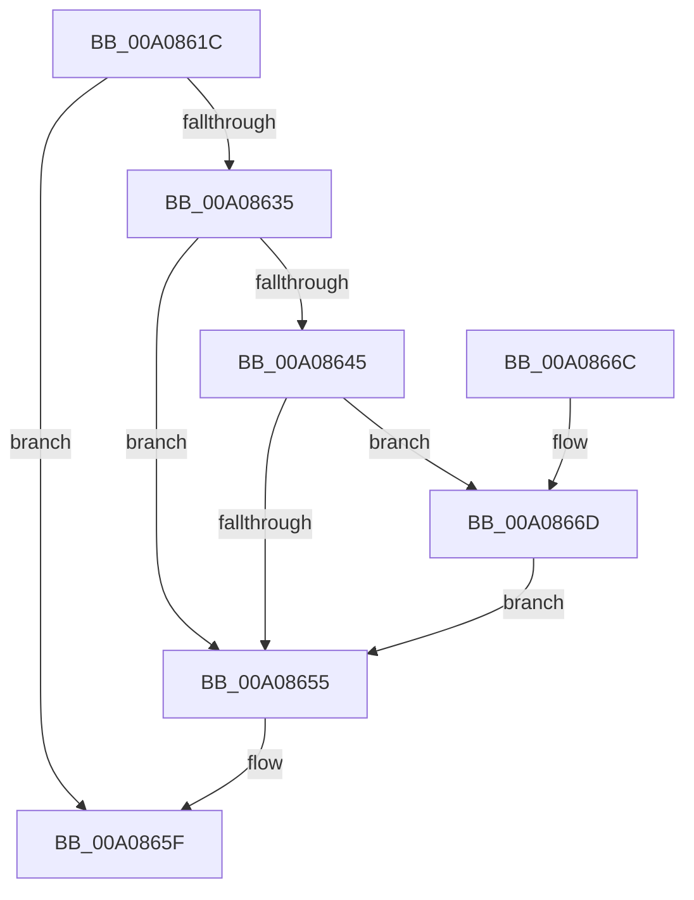

# PnpSurpriseRemovedDeviceNodeDependencyCheck

- RVA: `0x00A0861C`–`0x00A08676` (길이 `90` bytes)
- VA: `0x0000000140A0861C`
- 실행 섹션: `PAGE`
- PDB 이름 있음: `예`; PDB Function 태그: `아니요`
- unwind 정보 RVA: `0x00060BE4`
- 디코드: `28`개 명령, `90/90` bytes 표시
- 미해석 바이트: `0` (있으면 어셈블리에 `.byte`로 보존)

> 이 문서는 커널 이미지의 기계어와 PDB 기호를 분석해 생성했습니다. 4번과 5번은 함수 원형과 자료형을 바이너리 사용 방식에서 추정한 C 해석이며 원본 소스 복구 결과는 아닙니다.

## 1. Dependencies

- 직접 호출 지점: **4**; 고유 호출 대상: **4**
- 직접 호출자로 확인된 함수: **1**
- RIP 상대 이미지 참조: **0**

### Outgoing calls
- `0x00A08637` → [PnpAcquireDependencyRelationsLock](PnpAcquireDependencyRelationsLock_function_00A06788.md) (function, `0x00A06788`)
- `0x00A08655` → [PnpReleaseDependencyRelationsLock](PnpReleaseDependencyRelationsLock_function_00A06E14.md) (function, `0x00A06E14`)
- `0x00A0865A` → [PipProcessRebuildPowerRelationsQueue](PipProcessRebuildPowerRelationsQueue_function_00A06844.md) (function, `0x00A06844`)
- `0x00A0866D` → [PipConvertResolutionsToReservations](../AD/PipConvertResolutionsToReservations_function_00AD59D4.md) (function, `0x00AD59D4`)

### Direct callers
- [PnpSurpriseRemoveLockedDeviceNode](PnpSurpriseRemoveLockedDeviceNode_function_00A08370.md) at `0x00A084A2`

### Static image references
- 디코드된 RIP-relative 메모리 참조가 없습니다.

## 2. Other-region calls and transfers

- 다른 실행 섹션으로 향하는 call: **0**
- 별도 외부 분기/꼬리 이동을 확인하지 못했습니다.

## 3. Assembly (complete function range)

```asm
00A0861C  48 89 5C 24 08                  mov qword ptr [rsp + 8], rbx
00A08621  57                              push rdi
00A08622  48 83 EC 20                     sub rsp, 0x20
00A08626  8B 81 8C 01 00 00               mov eax, dword ptr [rcx + 0x18c]
00A0862C  33 DB                           xor ebx, ebx
00A0862E  48 8B F9                        mov rdi, rcx
00A08631  A8 10                           test al, 0x10
00A08633  75 2A                           jne 0x140a0865f
00A08635  B1 01                           mov cl, 1
00A08637  E8 4C E1 FF FF                  call 0x140a06788
00A0863C  48 8B 47 20                     mov rax, qword ptr [rdi + 0x20]
00A08640  48 85 C0                        test rax, rax
00A08643  74 10                           je 0x140a08655
00A08645  48 8B 80 38 01 00 00            mov rax, qword ptr [rax + 0x138]
00A0864C  48 8B 48 50                     mov rcx, qword ptr [rax + 0x50]
00A08650  48 85 C9                        test rcx, rcx
00A08653  75 18                           jne 0x140a0866d
00A08655  E8 BA E7 FF FF                  call 0x140a06e14
00A0865A  E8 E5 E1 FF FF                  call 0x140a06844
00A0865F  8B C3                           mov eax, ebx
00A08661  48 8B 5C 24 30                  mov rbx, qword ptr [rsp + 0x30]
00A08666  48 83 C4 20                     add rsp, 0x20
00A0866A  5F                              pop rdi
00A0866B  C3                              ret
00A0866C  CC                              int3
00A0866D  E8 62 D3 0C 00                  call 0x140ad59d4
00A08672  8B D8                           mov ebx, eax
00A08674  EB DF                           jmp 0x140a08655
```

## 4. C-style interpretation (structured pseudocode)

```c
__int64 __fastcall PnpSurpriseRemovedDeviceNodeDependencyCheck(__int64 a1)
{
    __int64 result;
    __int64 v_rbx;
    __int64 v_rsp;
    unsigned __int64 v_stack_p8;

    v_stack_p8 = v_rbx;
    v_rsp = (v_rsp) - (32);
    v_rbx = 0;
    if ((((unsigned __int8)((unsigned int)(*(unsigned int *)(a1 + 396)))) & (16)) != 0) goto loc_00A0865F;
    result = PnpAcquireDependencyRelationsLock(1, a2, a3, a4);
    if (*(unsigned __int64 *)(a1 + 32) == 0) goto loc_00A08655;
    if (*(unsigned __int64 *)(*(unsigned __int64 *)(*(unsigned __int64 *)(a1 + 32) + 312) + 80) != 0) goto loc_00A0866D;
loc_00A08655:
    result = PnpReleaseDependencyRelationsLock(*(unsigned __int64 *)(*(unsigned __int64 *)(*(unsigned __int64 *)(a1 + 32) + 312) + 80), a2, a3, a4);
    result = PipProcessRebuildPowerRelationsQueue(*(unsigned __int64 *)(*(unsigned __int64 *)(*(unsigned __int64 *)(a1 + 32) + 312) + 80), a2, a3, a4);
loc_00A0865F:
    v_rsp = (v_rsp) + (32);
    return 0;
loc_00A0866D:
    result = PipConvertResolutionsToReservations(*(unsigned __int64 *)(*(unsigned __int64 *)(*(unsigned __int64 *)(a1 + 32) + 312) + 80), a2, a3, a4);
    goto loc_00A08655;
}
```

## 5. (Beta) C Style

```c
int64_t PnpSurpriseRemovedDeviceNodeDependencyCheck(void *Arg1)
{
    uint8_t *arg1 = (uint8_t *)Arg1;

    int64_t result;
    int64_t local_rbx;
    int64_t local_rsp;
    uint64_t v_stack_p8;

    v_stack_p8 = local_rbx;
    local_rsp = (local_rsp) - (32);
    local_rbx = 0;
    if ((((uint8_t)((uint32_t)(*(uint32_t *)(arg1 + 0x18C)))) & (16)) != 0) goto loc_00A0865F;
    result = PnpAcquireDependencyRelationsLock(1, a2, a3, a4);
    if (*(uint64_t *)(arg1 + 0x20) == 0) goto loc_00A08655;
    if (*(uint64_t *)(*(uint64_t *)(*(uint64_t *)(arg1 + 0x20) + 0x138) + 0x50) != 0) goto loc_00A0866D;
loc_00A08655:
    result = PnpReleaseDependencyRelationsLock(*(uint64_t *)(*(uint64_t *)(*(uint64_t *)(arg1 + 0x20) + 0x138) + 0x50), a2, a3, a4);
    result = PipProcessRebuildPowerRelationsQueue(*(uint64_t *)(*(uint64_t *)(*(uint64_t *)(arg1 + 0x20) + 0x138) + 0x50), a2, a3, a4);
loc_00A0865F:
    local_rsp = (local_rsp) + (32);
    return 0;
loc_00A0866D:
    result = PipConvertResolutionsToReservations(*(uint64_t *)(*(uint64_t *)(*(uint64_t *)(arg1 + 0x20) + 0x138) + 0x50), a2, a3, a4);
    goto loc_00A08655;
}
```

### 관측된 메모리 오프셋

구조체 형식이 확인되지 않은 접근은 인자 기준의 오프셋으로만 기록했습니다.

| 기준 인자 | 오프셋 표현 | 폭 (bit) | 접근 |
|---|---:|---:|---|
| `Arg1` | `+ 0x20` | `64` | `R` |
| `Arg1` | `+ 0x18C` | `32` | `R` |

## 6. Execution-region graph

[열기: 2D/3D 그래프와 함수 탐색 컨트롤 패널](../../../control-panel.html?section=page&rva=0x00A0861C&view=graph)

- 2D 그래프는 위에서 아래로 흐르고, 3D 그래프는 빈 공간을 드래그해 회전합니다. Shift+드래그는 이동, 휠은 확대·축소, 함수 노드 선택은 대상 보고서 이동입니다.

### Static fallback


