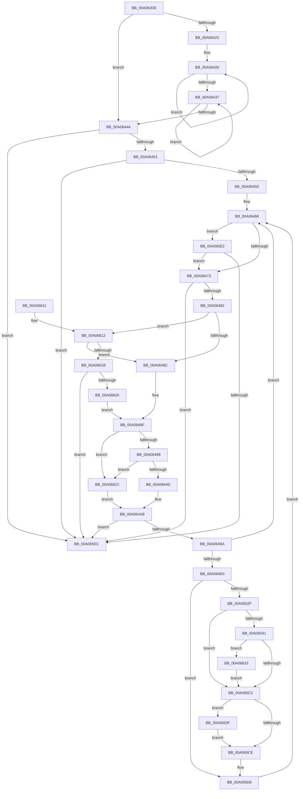

# PnpUnlinkDeviceRemovalRelations

- RVA: `0x00A063D8`–`0x00A06653` (길이 `635` bytes)
- VA: `0x0000000140A063D8`
- 실행 섹션: `PAGE`
- PDB 이름 있음: `예`; PDB Function 태그: `아니요`
- unwind 정보 RVA: `0x000A84EC`
- 디코드: `154`개 명령, `635/635` bytes 표시
- 미해석 바이트: `0` (있으면 어셈블리에 `.byte`로 보존)

> 이 문서는 커널 이미지의 기계어와 PDB 기호를 분석해 생성했습니다. 4번과 5번은 함수 원형과 자료형을 바이너리 사용 방식에서 추정한 C 해석이며 원본 소스 복구 결과는 아닙니다.

## 1. Dependencies

- 직접 호출 지점: **18**; 고유 호출 대상: **15**
- 직접 호출자로 확인된 함수: **3**
- RIP 상대 이미지 참조: **4**

### Outgoing calls
- `0x00A06415` → [ExIsResourceAcquiredSharedLite](../../text/34/ExIsResourceAcquiredSharedLite_function_00341B10.md) (function, `0x00341B10`)
- `0x00A0642D` → [ExReleaseResourceLite](../../text/25/ExReleaseResourceLite_function_0025FA10.md) (function, `0x0025FA10`)
- `0x00A06440` → [ExAcquireResourceExclusiveLite](../../text/21/ExAcquireResourceExclusiveLite_function_00214E20.md) (function, `0x00214E20`)
- `0x00A064CB` → [IopIsDescendantNode](IopIsDescendantNode_function_00A0665C.md) (function, `0x00A0665C`)
- `0x00A064FE` → [ExAcquireResourceExclusiveLite](../../text/21/ExAcquireResourceExclusiveLite_function_00214E20.md) (function, `0x00214E20`)
- `0x00A06507` → [PnpCleanupDeviceRegistryValues](PnpCleanupDeviceRegistryValues_function_00A0797C.md) (function, `0x00A0797C`)
- `0x00A0650F` → [PpDevNodeRemoveFromTree](../../text/4A/PpDevNodeRemoveFromTree_function_004AD5A0.md) (function, `0x004AD5A0`)
- `0x00A0651D` → [ExReleaseResourceLite](../../text/25/ExReleaseResourceLite_function_0025FA10.md) (function, `0x0025FA10`)
- `0x00A06522` → [KeLeaveCriticalRegion](../../text/25/KeLeaveCriticalRegion_function_0025D8B0.md) (function, `0x0025D8B0`)
- `0x00A06545` → [PiPnpRtlBeginOperation](../8E/PiPnpRtlBeginOperation_function_008E033C.md) (function, `0x008E033C`)
- `0x00A0659D` → [PnpSetObjectProperty](../8F/PnpSetObjectProperty_function_008F66E8.md) (function, `0x008F66E8`)
- `0x00A065AC` → [PnpRaiseNtPlugPlayDevicePropertyChangeEvent](../8F/PnpRaiseNtPlugPlayDevicePropertyChangeEvent_function_008F7D80.md) (function, `0x008F7D80`)
- `0x00A065B4` → [PnpSetDeviceInstanceRemovalEvent](../../text/4B/PnpSetDeviceInstanceRemovalEvent_function_004B16D8.md) (function, `0x004B16D8`)
- `0x00A065D1` → [ObfDereferenceObject](../../text/2F/ObfDereferenceObject_function_002F9350.md) (function, `0x002F9350`)
- `0x00A065F3` → [ExConvertExclusiveToSharedLite](../../text/34/ExConvertExclusiveToSharedLite_function_0034F700.md) (function, `0x0034F700`)
- `0x00A065F8` → [KeLeaveCriticalRegion](../../text/25/KeLeaveCriticalRegion_function_0025D8B0.md) (function, `0x0025D8B0`)
- `0x00A06633` → [PiPnpRtlEndOperation](../8E/PiPnpRtlEndOperation_function_008E0518.md) (function, `0x008E0518`)
- `0x00A06649` → [IopRemoveCurrentRelationFromList](../73/IopRemoveCurrentRelationFromList_function_0073DB30.md) (function, `0x0073DB30`)

### Direct callers
- [PiEventRemovalPostSurpriseRemove](PiEventRemovalPostSurpriseRemove_function_00A0596C.md) at `0x00A059A2`
- [PipRemoveDevicesInRelationList](PipRemoveDevicesInRelationList_function_00A08CF0.md) at `0x00A08DA1`
- [sub_00B33FE8](../B3/Unknown_function_00B33FE8.md) at `0x00B34237`
- [sub_00B33FE8](../B3/Unknown_function_00B33FE8.md) at `0x00B342F8`
- [sub_00B33FE8](../B3/Unknown_function_00B33FE8.md) at `0x00B343BB`

### Static image references
- `0x00A063F5` → RVA `0x00F8C560` (`.data`; read)
- `0x00A064E9` → RVA `0x00F8C600` (`.data`; read)
- `0x00A0656B` → RVA `0x00E66398` (`.data`; read)
- `0x00A06583` → RVA `0x00014D78` (`.rdata`; read)

## 2. Other-region calls and transfers

- 다른 실행 섹션으로 향하는 call: **11**
  - `0x00A06415` → [ExIsResourceAcquiredSharedLite](../../text/34/ExIsResourceAcquiredSharedLite_function_00341B10.md) (`PAGE` → `.text`)
  - `0x00A0642D` → [ExReleaseResourceLite](../../text/25/ExReleaseResourceLite_function_0025FA10.md) (`PAGE` → `.text`)
  - `0x00A06440` → [ExAcquireResourceExclusiveLite](../../text/21/ExAcquireResourceExclusiveLite_function_00214E20.md) (`PAGE` → `.text`)
  - `0x00A064FE` → [ExAcquireResourceExclusiveLite](../../text/21/ExAcquireResourceExclusiveLite_function_00214E20.md) (`PAGE` → `.text`)
  - `0x00A0650F` → [PpDevNodeRemoveFromTree](../../text/4A/PpDevNodeRemoveFromTree_function_004AD5A0.md) (`PAGE` → `.text`)
  - `0x00A0651D` → [ExReleaseResourceLite](../../text/25/ExReleaseResourceLite_function_0025FA10.md) (`PAGE` → `.text`)
  - `0x00A06522` → [KeLeaveCriticalRegion](../../text/25/KeLeaveCriticalRegion_function_0025D8B0.md) (`PAGE` → `.text`)
  - `0x00A065B4` → [PnpSetDeviceInstanceRemovalEvent](../../text/4B/PnpSetDeviceInstanceRemovalEvent_function_004B16D8.md) (`PAGE` → `.text`)
  - `0x00A065D1` → [ObfDereferenceObject](../../text/2F/ObfDereferenceObject_function_002F9350.md) (`PAGE` → `.text`)
  - `0x00A065F3` → [ExConvertExclusiveToSharedLite](../../text/34/ExConvertExclusiveToSharedLite_function_0034F700.md) (`PAGE` → `.text`)
  - `0x00A065F8` → [KeLeaveCriticalRegion](../../text/25/KeLeaveCriticalRegion_function_0025D8B0.md) (`PAGE` → `.text`)
- 별도 외부 분기/꼬리 이동을 확인하지 못했습니다.

## 3. Assembly (complete function range)

```asm
00A063D8  48 89 5C 24 18                  mov qword ptr [rsp + 0x18], rbx
00A063DD  48 89 4C 24 08                  mov qword ptr [rsp + 8], rcx
00A063E2  55                              push rbp
00A063E3  56                              push rsi
00A063E4  57                              push rdi
00A063E5  41 56                           push r14
00A063E7  41 57                           push r15
00A063E9  48 8B EC                        mov rbp, rsp
00A063EC  48 83 EC 50                     sub rsp, 0x50
00A063F0  48 83 65 48 00                  and qword ptr [rbp + 0x48], 0
00A063F5  48 8D 0D 64 61 58 00            lea rcx, [rip + 0x586164]
00A063FC  65 48 8B 04 25 88 01 00 00      mov rax, qword ptr gs:[0x188]
00A06405  48 8B F2                        mov rsi, rdx
00A06408  48 83 65 30 00                  and qword ptr [rbp + 0x30], 0
00A0640D  66 FF 88 E4 01 00 00            dec word ptr [rax + 0x1e4]
00A06414  90                              nop
00A06415  E8 F6 B6 93 FF                  call 0x140341b10
00A0641A  8B D8                           mov ebx, eax
00A0641C  8B F8                           mov edi, eax
00A0641E  85 C0                           test eax, eax
00A06420  74 28                           je 0x140a0644a
00A06422  41 83 CE FF                     or r14d, 0xffffffff
00A06426  48 8D 0D 33 61 58 00            lea rcx, [rip + 0x586133]
00A0642D  E8 DE 95 85 FF                  call 0x14025fa10
00A06432  41 03 FE                        add edi, r14d
00A06435  75 EF                           jne 0x140a06426
00A06437  B2 01                           mov dl, 1
00A06439  48 8D 0D 20 61 58 00            lea rcx, [rip + 0x586120]
00A06440  E8 DB E9 80 FF                  call 0x140214e20
00A06445  41 03 DE                        add ebx, r14d
00A06448  75 ED                           jne 0x140a06437
00A0644A  48 85 F6                        test rsi, rsi
00A0644D  0F 84 99 01 00 00               je 0x140a065ec
00A06453  80 7E 08 00                     cmp byte ptr [rsi + 8], 0
00A06457  0F 84 8F 01 00 00               je 0x140a065ec
00A0645D  BB 01 00 00 00                  mov ebx, 1
00A06462  45 33 DB                        xor r11d, r11d
00A06465  89 5D 38                        mov dword ptr [rbp + 0x38], ebx
00A06468  45 33 F6                        xor r14d, r14d
00A0646B  85 DB                           test ebx, ebx
00A0646D  0F 85 6F 01 00 00               jne 0x140a065e2
00A06473  4C 8B 06                        mov r8, qword ptr [rsi]
00A06476  41 8B 10                        mov edx, dword ptr [r8]
00A06479  44 3B DA                        cmp r11d, edx
00A0647C  0F 83 6A 01 00 00               jae 0x140a065ec
00A06482  8B CB                           mov ecx, ebx
00A06484  85 DB                           test ebx, ebx
00A06486  0F 85 86 01 00 00               jne 0x140a06612
00A0648C  41 8B C3                        mov eax, r11d
00A0648F  4D 85 C0                        test r8, r8
00A06492  0F 84 94 01 00 00               je 0x140a0662c
00A06498  3B C2                           cmp eax, edx
00A0649A  0F 83 8C 01 00 00               jae 0x140a0662c
00A064A0  48 8D 0C 40                     lea rcx, [rax + rax*2]
00A064A4  B0 01                           mov al, 1
00A064A6  4D 8B 74 C8 10                  mov r14, qword ptr [r8 + rcx*8 + 0x10]
00A064AB  41 FF C3                        inc r11d
00A064AE  44 89 5D 3C                     mov dword ptr [rbp + 0x3c], r11d
00A064B2  84 C0                           test al, al
00A064B4  0F 84 32 01 00 00               je 0x140a065ec
00A064BA  49 8B 86 38 01 00 00            mov rax, qword ptr [r14 + 0x138]
00A064C1  49 8B D6                        mov rdx, r14
00A064C4  48 8B CE                        mov rcx, rsi
00A064C7  48 8B 78 28                     mov rdi, qword ptr [rax + 0x28]
00A064CB  E8 8C 01 00 00                  call 0x140a0665c
00A064D0  8B 87 2C 01 00 00               mov eax, dword ptr [rdi + 0x12c]
00A064D6  2D 15 03 00 00                  sub eax, 0x315
00A064DB  83 F8 01                        cmp eax, 1
00A064DE  77 88                           ja 0x140a06468
00A064E0  65 48 8B 04 25 88 01 00 00      mov rax, qword ptr gs:[0x188]
00A064E9  48 8D 0D 10 61 58 00            lea rcx, [rip + 0x586110]
00A064F0  4C 8B 7F 10                     mov r15, qword ptr [rdi + 0x10]
00A064F4  B2 01                           mov dl, 1
00A064F6  66 FF 88 E4 01 00 00            dec word ptr [rax + 0x1e4]
00A064FD  90                              nop
00A064FE  E8 1D E9 80 FF                  call 0x140214e20
00A06503  48 8D 4F 28                     lea rcx, [rdi + 0x28]
00A06507  E8 70 14 00 00                  call 0x140a0797c
00A0650C  48 8B CF                        mov rcx, rdi
00A0650F  E8 8C 70 AA FF                  call 0x1404ad5a0
00A06514  48 8D 0D E5 60 58 00            lea rcx, [rip + 0x5860e5]
00A0651B  8A D8                           mov bl, al
00A0651D  E8 EE 94 85 FF                  call 0x14025fa10
00A06522  E8 89 73 85 FF                  call 0x14025d8b0
00A06527  84 DB                           test bl, bl
00A06529  0F 84 A7 00 00 00               je 0x140a065d6
00A0652F  48 83 7F 30 00                  cmp qword ptr [rdi + 0x30], 0
00A06534  4C 89 BF 88 02 00 00            mov qword ptr [rdi + 0x288], r15
00A0653B  0F 84 81 00 00 00               je 0x140a065c2
00A06541  48 8D 4D 30                     lea rcx, [rbp + 0x30]
00A06545  E8 F2 9D ED FF                  call 0x1408e033c
00A0654A  83 64 24 48 00                  and dword ptr [rsp + 0x48], 0
00A0654F  45 33 C9                        xor r9d, r9d
00A06552  C7 44 24 40 08 00 00 00         mov dword ptr [rsp + 0x40], 8
00A0655A  48 B8 14 00 00 00 80 F7 FF FF   movabs rax, 0xfffff78000000014
00A06564  45 8D 41 01                     lea r8d, [r9 + 1]
00A06568  48 8B 00                        mov rax, qword ptr [rax]
00A0656B  48 8B 0D 26 FE 45 00            mov rcx, qword ptr [rip + 0x45fe26]
00A06572  48 89 45 48                     mov qword ptr [rbp + 0x48], rax
00A06576  48 8D 45 48                     lea rax, [rbp + 0x48]
00A0657A  48 8B 57 30                     mov rdx, qword ptr [rdi + 0x30]
00A0657E  48 89 44 24 38                  mov qword ptr [rsp + 0x38], rax
00A06583  48 8D 05 EE E7 60 FF            lea rax, [rip - 0x9f1812]
00A0658A  C7 44 24 30 10 00 00 00         mov dword ptr [rsp + 0x30], 0x10
00A06592  48 89 44 24 28                  mov qword ptr [rsp + 0x28], rax
00A06597  48 83 64 24 20 00               and qword ptr [rsp + 0x20], 0
00A0659D  E8 46 01 EF FF                  call 0x1408f66e8
00A065A2  48 8B 57 30                     mov rdx, qword ptr [rdi + 0x30]
00A065A6  41 B8 01 00 00 00               mov r8d, 1
00A065AC  E8 CF 17 EF FF                  call 0x1408f7d80
00A065B1  48 8B CF                        mov rcx, rdi
00A065B4  E8 1F B1 AA FF                  call 0x1404b16d8
00A065B9  48 8B 4D 30                     mov rcx, qword ptr [rbp + 0x30]
00A065BD  48 85 C9                        test rcx, rcx
00A065C0  75 71                           jne 0x140a06633
00A065C2  81 BF 2C 01 00 00 16 03 00 00   cmp dword ptr [rdi + 0x12c], 0x316
00A065CC  74 71                           je 0x140a0663f
00A065CE  49 8B CE                        mov rcx, r14
00A065D1  E8 7A 2D 8F FF                  call 0x1402f9350
00A065D6  44 8B 5D 3C                     mov r11d, dword ptr [rbp + 0x3c]
00A065DA  8B 5D 38                        mov ebx, dword ptr [rbp + 0x38]
00A065DD  E9 86 FE FF FF                  jmp 0x140a06468
00A065E2  44 38 76 08                     cmp byte ptr [rsi + 8], r14b
00A065E6  0F 85 87 FE FF FF               jne 0x140a06473
00A065EC  48 8D 0D 6D 5F 58 00            lea rcx, [rip + 0x585f6d]
00A065F3  E8 08 91 94 FF                  call 0x14034f700
00A065F8  E8 B3 72 85 FF                  call 0x14025d8b0
00A065FD  48 8B 9C 24 90 00 00 00         mov rbx, qword ptr [rsp + 0x90]
00A06605  48 83 C4 50                     add rsp, 0x50
00A06609  41 5F                           pop r15
00A0660B  41 5E                           pop r14
00A0660D  5F                              pop rdi
00A0660E  5E                              pop rsi
00A0660F  5D                              pop rbp
00A06610  C3                              ret
00A06611  CC                              int3
00A06612  83 E9 01                        sub ecx, 1
00A06615  0F 84 71 FE FF FF               je 0x140a0648c
00A0661B  83 F9 01                        cmp ecx, 1
00A0661E  75 CC                           jne 0x140a065ec
00A06620  8B C2                           mov eax, edx
00A06622  41 2B C3                        sub eax, r11d
00A06625  FF C8                           dec eax
00A06627  E9 63 FE FF FF                  jmp 0x140a0648f
00A0662C  32 C0                           xor al, al
00A0662E  E9 78 FE FF FF                  jmp 0x140a064ab
00A06633  E8 E0 9E ED FF                  call 0x1408e0518
00A06638  48 83 65 30 00                  and qword ptr [rbp + 0x30], 0
00A0663D  EB 83                           jmp 0x140a065c2
00A0663F  4C 8D 45 38                     lea r8, [rbp + 0x38]
00A06643  49 8B D6                        mov rdx, r14
00A06646  48 8B CE                        mov rcx, rsi
00A06649  E8 E2 74 D3 FF                  call 0x14073db30
00A0664E  E9 7B FF FF FF                  jmp 0x140a065ce
```

## 4. C-style interpretation (structured pseudocode)

```c
__int64 __fastcall PnpUnlinkDeviceRemovalRelations(__int64 a1, __int64 a2, __int64 a3, int a4)
{
    __int64 result;
    __int64 v_r11;
    __int64 v_r14;
    __int64 v_rbx;
    __int64 v_rdi;
    __int64 v_rsp;
    unsigned int v_stack_m30;
    unsigned int v_stack_m38;
    unsigned __int64 v_stack_m40;
    unsigned int v_stack_m48;
    unsigned __int64 v_stack_m50;
    unsigned __int64 v_stack_m58;
    unsigned int v_stack_p10;
    unsigned int v_stack_p14;
    unsigned __int64 v_stack_p18;
    unsigned __int64 v_stack_p20;
    unsigned __int64 v_stack_p8;

    v_stack_p18 = v_rbx;
    v_stack_p8 = a1;
    v_rsp = (v_rsp) - (80);
    result = ExIsResourceAcquiredSharedLite(v_rip + 5792100, a2, a3, a4);
    if ((unsigned int)(result) == 0) goto loc_00A0644A;
    v_r14 = (unsigned int)((v_r14) | (0xFFFFFFFFULL));
loc_00A06426:
    result = ExReleaseResourceLite(v_rip + 5792051, a2, a3, a4);
    v_rdi = (unsigned int)(((unsigned int)((unsigned int)(result))) + ((unsigned int)(v_r14)));
    if (condition_is_not_equal) goto loc_00A06426;
loc_00A06437:
    result = ExAcquireResourceExclusiveLite(v_rip + 5792032, 1, a3, a4);
    v_rbx = (unsigned int)(((unsigned int)((unsigned int)(result))) + ((unsigned int)(v_r14)));
    if (condition_is_not_equal) goto loc_00A06437;
loc_00A0644A:
    if (a2 == 0) goto loc_00A065EC;
    if ((*(unsigned __int8 *)(a2 + 8)) == 0) goto loc_00A065EC;
    v_r11 = 0;
    v_stack_p10 = 1;
loc_00A06468:
    v_r14 = 0;
    if (1 != 0) goto loc_00A065E2;
loc_00A06473:
    if (0 >= ((unsigned int)((unsigned int)(*(unsigned int *)(*(unsigned __int64 *)(a2)))))) goto loc_00A065EC;
    if (1 != 0) goto loc_00A06612;
loc_00A0648C:
loc_00A0648F:
    if (*(unsigned __int64 *)(a2) == 0) goto loc_00A0662C;
    if (0 >= ((unsigned int)((unsigned int)(*(unsigned int *)(*(unsigned __int64 *)(a2)))))) goto loc_00A0662C;
loc_00A064AB:
    v_r11 = (unsigned int)((v_r11) + 1);
    v_stack_p14 = (unsigned int)(v_r11);
    if (1 == 0) goto loc_00A065EC;
    result = IopIsDescendantNode(a2, *(unsigned __int64 *)(*(unsigned __int64 *)(a2) + 0 + 0 * 2 * 8 + 16), *(unsigned __int64 *)(a2), a4);
    result = (unsigned int)(((unsigned int)(*(unsigned int *)(*(unsigned __int64 *)(*(unsigned __int64 *)(*(unsigned __int64 *)(*(unsigned __int64 *)(a2) + 0 + 0 * 2 * 8 + 16) + 312) + 40) + 300))) - (789));
    if (((unsigned int)(result)) > 1) goto loc_00A06468;
    result = ExAcquireResourceExclusiveLite(v_rip + 5792016, 1, *(unsigned __int64 *)(a2), a4);
    result = PnpCleanupDeviceRegistryValues(*(unsigned __int64 *)(*(unsigned __int64 *)(*(unsigned __int64 *)(*(unsigned __int64 *)(a2) + 0 + 0 * 2 * 8 + 16) + 312) + 40) + 40, 1, *(unsigned __int64 *)(a2), a4);
    result = PpDevNodeRemoveFromTree(*(unsigned __int64 *)(*(unsigned __int64 *)(*(unsigned __int64 *)(*(unsigned __int64 *)(a2) + 0 + 0 * 2 * 8 + 16) + 312) + 40), 1, *(unsigned __int64 *)(a2), a4);
    result = ExReleaseResourceLite(v_rip + 5791973, 1, *(unsigned __int64 *)(a2), a4);
    result = KeLeaveCriticalRegion(v_rip + 5791973, 1, *(unsigned __int64 *)(a2), a4);
    if ((unsigned __int8)((unsigned __int8)(result)) == 0) goto loc_00A065D6;
    *(unsigned __int64 *)(*(unsigned __int64 *)(*(unsigned __int64 *)(*(unsigned __int64 *)(*(unsigned __int64 *)(a2) + 0 + 0 * 2 * 8 + 16) + 312) + 40) + 648) = *(unsigned __int64 *)(*(unsigned __int64 *)(*(unsigned __int64 *)(*(unsigned __int64 *)(*(unsigned __int64 *)(a2) + 0 + 0 * 2 * 8 + 16) + 312) + 40) + 16);
    if ((*(unsigned __int64 *)(*(unsigned __int64 *)(*(unsigned __int64 *)(*(unsigned __int64 *)(*(unsigned __int64 *)(a2) + 0 + 0 * 2 * 8 + 16) + 312) + 40) + 48)) == 0) goto loc_00A065C2;
    result = PiPnpRtlBeginOperation(v_stack_p8, 1, *(unsigned __int64 *)(a2), a4);
    a4 = 0;
    v_stack_m38 = 8;
    v_stack_p20 = *(unsigned __int64 *)(result);
    v_stack_m40 = v_stack_p20;
    v_stack_m48 = 16;
    v_stack_m50 = v_rip - 10426386;
    result = PnpSetObjectProperty(*(unsigned __int64 *)(v_rip + 4587046), *(unsigned __int64 *)(*(unsigned __int64 *)(*(unsigned __int64 *)(*(unsigned __int64 *)(*(unsigned __int64 *)(a2) + 0 + 0 * 2 * 8 + 16) + 312) + 40) + 48), a4 + 1, a4);
    result = PnpRaiseNtPlugPlayDevicePropertyChangeEvent(*(unsigned __int64 *)(v_rip + 4587046), *(unsigned __int64 *)(*(unsigned __int64 *)(*(unsigned __int64 *)(*(unsigned __int64 *)(*(unsigned __int64 *)(a2) + 0 + 0 * 2 * 8 + 16) + 312) + 40) + 48), 1, a4);
    result = PnpSetDeviceInstanceRemovalEvent(*(unsigned __int64 *)(*(unsigned __int64 *)(*(unsigned __int64 *)(*(unsigned __int64 *)(a2) + 0 + 0 * 2 * 8 + 16) + 312) + 40), *(unsigned __int64 *)(*(unsigned __int64 *)(*(unsigned __int64 *)(*(unsigned __int64 *)(*(unsigned __int64 *)(a2) + 0 + 0 * 2 * 8 + 16) + 312) + 40) + 48), 1, a4);
    if (v_stack_p8 != 0) goto loc_00A06633;
loc_00A065C2:
    if ((*(unsigned int *)(*(unsigned __int64 *)(*(unsigned __int64 *)(*(unsigned __int64 *)(*(unsigned __int64 *)(a2) + 0 + 0 * 2 * 8 + 16) + 312) + 40) + 300)) == 790) goto loc_00A0663F;
loc_00A065CE:
    result = ObfDereferenceObject(*(unsigned __int64 *)(*(unsigned __int64 *)(a2) + 0 + 0 * 2 * 8 + 16), *(unsigned __int64 *)(*(unsigned __int64 *)(*(unsigned __int64 *)(*(unsigned __int64 *)(*(unsigned __int64 *)(a2) + 0 + 0 * 2 * 8 + 16) + 312) + 40) + 48), 1, a4);
loc_00A065D6:
    goto loc_00A06468;
loc_00A065E2:
    if ((*(unsigned __int8 *)(a2 + 8)) != ((unsigned __int8)(*(unsigned __int64 *)(*(unsigned __int64 *)(a2) + 0 + 0 * 2 * 8 + 16)))) goto loc_00A06473;
loc_00A065EC:
    result = ExConvertExclusiveToSharedLite(v_rip + 5791597, *(unsigned __int64 *)(*(unsigned __int64 *)(*(unsigned __int64 *)(*(unsigned __int64 *)(*(unsigned __int64 *)(a2) + 0 + 0 * 2 * 8 + 16) + 312) + 40) + 48), 1, a4);
    result = KeLeaveCriticalRegion(v_rip + 5791597, *(unsigned __int64 *)(*(unsigned __int64 *)(*(unsigned __int64 *)(*(unsigned __int64 *)(*(unsigned __int64 *)(a2) + 0 + 0 * 2 * 8 + 16) + 312) + 40) + 48), 1, a4);
    v_rsp = (v_rsp) + (80);
    return result;
loc_00A06612:
    a1 = (unsigned int)((v_rip + 5791597) - (1));
    if (condition_is_equal) goto loc_00A0648C;
    if (((unsigned int)(a1)) != 1) goto loc_00A065EC;
    result = (unsigned int)(((unsigned int)((unsigned int)(*(unsigned __int64 *)(*(unsigned __int64 *)(*(unsigned __int64 *)(*(unsigned __int64 *)(*(unsigned __int64 *)(a2) + 0 + 0 * 2 * 8 + 16) + 312) + 40) + 48)))) - ((unsigned int)((unsigned int)(v_stack_p14))));
    result = (unsigned int)((result) - 1);
    goto loc_00A0648F;
loc_00A0662C:
    result = 0;
    goto loc_00A064AB;
loc_00A06633:
    result = PiPnpRtlEndOperation(a1, *(unsigned __int64 *)(*(unsigned __int64 *)(*(unsigned __int64 *)(*(unsigned __int64 *)(*(unsigned __int64 *)(a2) + 0 + 0 * 2 * 8 + 16) + 312) + 40) + 48), 1, a4);
    goto loc_00A065C2;
loc_00A0663F:
    result = IopRemoveCurrentRelationFromList(a2, *(unsigned __int64 *)(*(unsigned __int64 *)(a2) + 0 + 0 * 2 * 8 + 16), v_stack_p10, a4);
    goto loc_00A065CE;
}
```

## 5. (Beta) C Style

```c
int64_t PnpUnlinkDeviceRemovalRelations(int64_t Arg1, int64_t Arg2, int64_t Arg3, int32_t Arg4)
{
    int64_t result;
    int64_t local_r11;
    int64_t local_r14;
    int64_t local_rbx;
    int64_t local_rdi;
    int64_t local_rsp;
    uint32_t v_stack_m30;
    uint32_t v_stack_m38;
    uint64_t v_stack_m40;
    uint32_t v_stack_m48;
    uint64_t v_stack_m50;
    uint64_t v_stack_m58;
    uint32_t v_stack_p10;
    uint32_t v_stack_p14;
    uint64_t v_stack_p18;
    uint64_t v_stack_p20;
    uint64_t v_stack_p8;

    v_stack_p18 = local_rbx;
    v_stack_p8 = Arg1;
    local_rsp = (local_rsp) - (80);
    result = ExIsResourceAcquiredSharedLite(v_rip + 5792100, Arg2, Arg3, Arg4);
    if ((uint32_t)(result) == 0) goto loc_00A0644A;
    local_r14 = (uint32_t)((local_r14) | (0xFFFFFFFFULL));
loc_00A06426:
    result = ExReleaseResourceLite(v_rip + 5792051, Arg2, Arg3, Arg4);
    local_rdi = (uint32_t)(((uint32_t)((uint32_t)(result))) + ((uint32_t)(local_r14)));
    if (condition_is_not_equal) goto loc_00A06426;
loc_00A06437:
    result = ExAcquireResourceExclusiveLite(v_rip + 5792032, 1, Arg3, Arg4);
    local_rbx = (uint32_t)(((uint32_t)((uint32_t)(result))) + ((uint32_t)(local_r14)));
    if (condition_is_not_equal) goto loc_00A06437;
loc_00A0644A:
    if (Arg2 == 0) goto loc_00A065EC;
    if ((*(uint8_t *)(Arg2 + 0x8)) == 0) goto loc_00A065EC;
    local_r11 = 0;
    v_stack_p10 = 1;
loc_00A06468:
    local_r14 = 0;
    if (1 != 0) goto loc_00A065E2;
loc_00A06473:
    if (0 >= ((uint32_t)((uint32_t)(*(uint32_t *)(*(uint64_t *)(Arg2)))))) goto loc_00A065EC;
    if (1 != 0) goto loc_00A06612;
loc_00A0648C:
loc_00A0648F:
    if (*(uint64_t *)(Arg2) == 0) goto loc_00A0662C;
    if (0 >= ((uint32_t)((uint32_t)(*(uint32_t *)(*(uint64_t *)(Arg2)))))) goto loc_00A0662C;
loc_00A064AB:
    local_r11 = (uint32_t)((local_r11) + 1);
    v_stack_p14 = (uint32_t)(local_r11);
    if (1 == 0) goto loc_00A065EC;
    result = IopIsDescendantNode(Arg2, *(uint64_t *)(*(uint64_t *)(Arg2) + 0x0 + 0x0 * 2 * 8 + 0x10), *(uint64_t *)(Arg2), Arg4);
    result = (uint32_t)(((uint32_t)(*(uint32_t *)(*(uint64_t *)(*(uint64_t *)(*(uint64_t *)(*(uint64_t *)(Arg2) + 0x0 + 0x0 * 2 * 8 + 0x10) + 0x138) + 0x28) + 0x12C))) - (789));
    if (((uint32_t)(result)) > 1) goto loc_00A06468;
    result = ExAcquireResourceExclusiveLite(v_rip + 5792016, 1, *(uint64_t *)(Arg2), Arg4);
    result = PnpCleanupDeviceRegistryValues(*(uint64_t *)(*(uint64_t *)(*(uint64_t *)(*(uint64_t *)(Arg2) + 0x0 + 0x0 * 2 * 8 + 0x10) + 0x138) + 0x28) + 40, 1, *(uint64_t *)(Arg2), Arg4);
    result = PpDevNodeRemoveFromTree(*(uint64_t *)(*(uint64_t *)(*(uint64_t *)(*(uint64_t *)(Arg2) + 0x0 + 0x0 * 2 * 8 + 0x10) + 0x138) + 0x28), 1, *(uint64_t *)(Arg2), Arg4);
    result = ExReleaseResourceLite(v_rip + 5791973, 1, *(uint64_t *)(Arg2), Arg4);
    result = KeLeaveCriticalRegion(v_rip + 5791973, 1, *(uint64_t *)(Arg2), Arg4);
    if ((uint8_t)((uint8_t)(result)) == 0) goto loc_00A065D6;
    *(uint64_t *)(*(uint64_t *)(*(uint64_t *)(*(uint64_t *)(*(uint64_t *)(Arg2) + 0x0 + 0x0 * 2 * 8 + 0x10) + 0x138) + 0x28) + 0x288) = *(uint64_t *)(*(uint64_t *)(*(uint64_t *)(*(uint64_t *)(*(uint64_t *)(Arg2) + 0x0 + 0x0 * 2 * 8 + 0x10) + 0x138) + 0x28) + 0x10);
    if ((*(uint64_t *)(*(uint64_t *)(*(uint64_t *)(*(uint64_t *)(*(uint64_t *)(Arg2) + 0x0 + 0x0 * 2 * 8 + 0x10) + 0x138) + 0x28) + 0x30)) == 0) goto loc_00A065C2;
    result = PiPnpRtlBeginOperation(v_stack_p8, 1, *(uint64_t *)(Arg2), Arg4);
    Arg4 = 0;
    v_stack_m38 = 8;
    v_stack_p20 = *(uint64_t *)(result);
    v_stack_m40 = v_stack_p20;
    v_stack_m48 = 16;
    v_stack_m50 = v_rip - 10426386;
    result = PnpSetObjectProperty(*(uint64_t *)(v_rip + 0x45FE26), *(uint64_t *)(*(uint64_t *)(*(uint64_t *)(*(uint64_t *)(*(uint64_t *)(Arg2) + 0x0 + 0x0 * 2 * 8 + 0x10) + 0x138) + 0x28) + 0x30), Arg4 + 1, Arg4);
    result = PnpRaiseNtPlugPlayDevicePropertyChangeEvent(*(uint64_t *)(v_rip + 0x45FE26), *(uint64_t *)(*(uint64_t *)(*(uint64_t *)(*(uint64_t *)(*(uint64_t *)(Arg2) + 0x0 + 0x0 * 2 * 8 + 0x10) + 0x138) + 0x28) + 0x30), 1, Arg4);
    result = PnpSetDeviceInstanceRemovalEvent(*(uint64_t *)(*(uint64_t *)(*(uint64_t *)(*(uint64_t *)(Arg2) + 0x0 + 0x0 * 2 * 8 + 0x10) + 0x138) + 0x28), *(uint64_t *)(*(uint64_t *)(*(uint64_t *)(*(uint64_t *)(*(uint64_t *)(Arg2) + 0x0 + 0x0 * 2 * 8 + 0x10) + 0x138) + 0x28) + 0x30), 1, Arg4);
    if (v_stack_p8 != 0) goto loc_00A06633;
loc_00A065C2:
    if ((*(uint32_t *)(*(uint64_t *)(*(uint64_t *)(*(uint64_t *)(*(uint64_t *)(Arg2) + 0x0 + 0x0 * 2 * 8 + 0x10) + 0x138) + 0x28) + 0x12C)) == 790) goto loc_00A0663F;
loc_00A065CE:
    result = ObfDereferenceObject(*(uint64_t *)(*(uint64_t *)(Arg2) + 0x0 + 0x0 * 2 * 8 + 0x10), *(uint64_t *)(*(uint64_t *)(*(uint64_t *)(*(uint64_t *)(*(uint64_t *)(Arg2) + 0x0 + 0x0 * 2 * 8 + 0x10) + 0x138) + 0x28) + 0x30), 1, Arg4);
loc_00A065D6:
    goto loc_00A06468;
loc_00A065E2:
    if ((*(uint8_t *)(Arg2 + 0x8)) != ((uint8_t)(*(uint64_t *)(*(uint64_t *)(Arg2) + 0x0 + 0x0 * 2 * 8 + 0x10)))) goto loc_00A06473;
loc_00A065EC:
    result = ExConvertExclusiveToSharedLite(v_rip + 5791597, *(uint64_t *)(*(uint64_t *)(*(uint64_t *)(*(uint64_t *)(*(uint64_t *)(Arg2) + 0x0 + 0x0 * 2 * 8 + 0x10) + 0x138) + 0x28) + 0x30), 1, Arg4);
    result = KeLeaveCriticalRegion(v_rip + 5791597, *(uint64_t *)(*(uint64_t *)(*(uint64_t *)(*(uint64_t *)(*(uint64_t *)(Arg2) + 0x0 + 0x0 * 2 * 8 + 0x10) + 0x138) + 0x28) + 0x30), 1, Arg4);
    local_rsp = (local_rsp) + (80);
    return result;
loc_00A06612:
    Arg1 = (uint32_t)((v_rip + 5791597) - (1));
    if (condition_is_equal) goto loc_00A0648C;
    if (((uint32_t)(Arg1)) != 1) goto loc_00A065EC;
    result = (uint32_t)(((uint32_t)((uint32_t)(*(uint64_t *)(*(uint64_t *)(*(uint64_t *)(*(uint64_t *)(*(uint64_t *)(Arg2) + 0x0 + 0x0 * 2 * 8 + 0x10) + 0x138) + 0x28) + 0x30)))) - ((uint32_t)((uint32_t)(v_stack_p14))));
    result = (uint32_t)((result) - 1);
    goto loc_00A0648F;
loc_00A0662C:
    result = 0;
    goto loc_00A064AB;
loc_00A06633:
    result = PiPnpRtlEndOperation(Arg1, *(uint64_t *)(*(uint64_t *)(*(uint64_t *)(*(uint64_t *)(*(uint64_t *)(Arg2) + 0x0 + 0x0 * 2 * 8 + 0x10) + 0x138) + 0x28) + 0x30), 1, Arg4);
    goto loc_00A065C2;
loc_00A0663F:
    result = IopRemoveCurrentRelationFromList(Arg2, *(uint64_t *)(*(uint64_t *)(Arg2) + 0x0 + 0x0 * 2 * 8 + 0x10), v_stack_p10, Arg4);
    goto loc_00A065CE;
}
```

## 6. Execution-region graph

[열기: 2D/3D 그래프와 함수 탐색 컨트롤 패널](../../../control-panel.html?section=page&rva=0x00A063D8&view=graph)

- 2D 그래프는 위에서 아래로 흐르고, 3D 그래프는 빈 공간을 드래그해 회전합니다. Shift+드래그는 이동, 휠은 확대·축소, 함수 노드 선택은 대상 보고서 이동입니다.

### Static fallback


