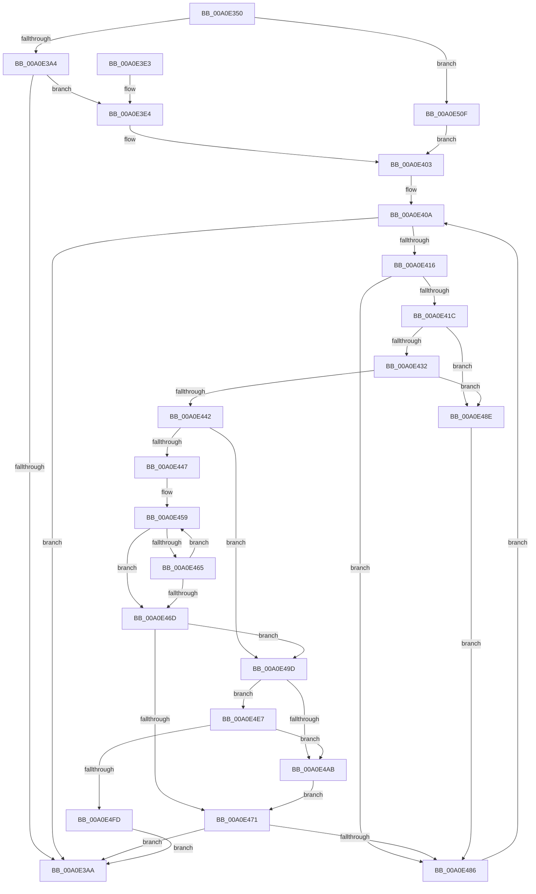

# PoThermalCounterSetCallback

- RVA: `0x00A0E350`–`0x00A0E51B` (길이 `459` bytes)
- VA: `0x0000000140A0E350`
- 실행 섹션: `PAGE`
- PDB 이름 있음: `예`; PDB Function 태그: `아니요`
- unwind 정보 RVA: `0x000A8D6C`
- 디코드: `121`개 명령, `459/459` bytes 표시
- 미해석 바이트: `0` (있으면 어셈블리에 `.byte`로 보존)

> 이 문서는 커널 이미지의 기계어와 PDB 기호를 분석해 생성했습니다. 4번과 5번은 함수 원형과 자료형을 바이너리 사용 방식에서 추정한 C 해석이며 원본 소스 복구 결과는 아닙니다.

## 1. Dependencies

- 직접 호출 지점: **10**; 고유 호출 대상: **8**
- 직접 호출자로 확인된 함수: **0**
- RIP 상대 이미지 참조: **4**

### Outgoing calls
- `0x00A0E392` → [PopAcquireRwLockShared](../../text/2D/PopAcquireRwLockShared_function_002D9A40.md) (function, `0x002D9A40`)
- `0x00A0E3B1` → [PopReleaseRwLock](../../text/2D/PopReleaseRwLock_function_002DFBBC.md) (function, `0x002DFBBC`)
- `0x00A0E3C0` → [_security_check_cookie](../../text/6A/_security_check_cookie_function_006AC640.md) (function, `0x006AC640`)
- `0x00A0E3F7` → [wcspbrk](../../text/50/wcspbrk_function_005025F0.md) (function, `0x005025F0`)
- `0x00A0E425` → [IoGetDeviceAttachmentBaseRefWithTag](../../text/27/IoGetDeviceAttachmentBaseRefWithTag_function_00272788.md) (function, `0x00272788`)
- `0x00A0E479` → [ObfDereferenceObjectWithTag](../../text/2F/ObfDereferenceObjectWithTag_function_002F78E0.md) (function, `0x002F78E0`)
- `0x00A0E496` → [ObfDereferenceObjectWithTag](../../text/2F/ObfDereferenceObjectWithTag_function_002F78E0.md) (function, `0x002F78E0`)
- `0x00A0E4DE` → [PcwAddInstance](PcwAddInstance_function_00A0E530.md) (function, `0x00A0E530`)
- `0x00A0E4F2` → [PopThermalReadCounters](PopThermalReadCounters_function_00A0E5B8.md) (function, `0x00A0E5B8`)
- `0x00A0E505` → [ObfDereferenceObjectWithTag](../../text/2F/ObfDereferenceObjectWithTag_function_002F78E0.md) (function, `0x002F78E0`)

### Direct callers
- 이 함수 시작 RVA로 연결되는 직접 call은 확인되지 않았습니다. 간접 호출은 완전히 역산할 수 없습니다.

### Static image references
- `0x00A0E36C` → RVA `0x00E0A740` (`.data`; read)
- `0x00A0E381` → RVA `0x00F0C900` (`.data`; read)
- `0x00A0E3E8` → RVA `0x00B02030` (` ?? ::NNGAKEGL::`string'`; read)
- `0x00A0E403` → RVA `0x00F0CE80` (`.data`; read)

## 2. Other-region calls and transfers

- 다른 실행 섹션으로 향하는 call: **8**
  - `0x00A0E392` → [PopAcquireRwLockShared](../../text/2D/PopAcquireRwLockShared_function_002D9A40.md) (`PAGE` → `.text`)
  - `0x00A0E3B1` → [PopReleaseRwLock](../../text/2D/PopReleaseRwLock_function_002DFBBC.md) (`PAGE` → `.text`)
  - `0x00A0E3C0` → [_security_check_cookie](../../text/6A/_security_check_cookie_function_006AC640.md) (`PAGE` → `.text`)
  - `0x00A0E3F7` → [wcspbrk](../../text/50/wcspbrk_function_005025F0.md) (`PAGE` → `.text`)
  - `0x00A0E425` → [IoGetDeviceAttachmentBaseRefWithTag](../../text/27/IoGetDeviceAttachmentBaseRefWithTag_function_00272788.md) (`PAGE` → `.text`)
  - `0x00A0E479` → [ObfDereferenceObjectWithTag](../../text/2F/ObfDereferenceObjectWithTag_function_002F78E0.md) (`PAGE` → `.text`)
  - `0x00A0E496` → [ObfDereferenceObjectWithTag](../../text/2F/ObfDereferenceObjectWithTag_function_002F78E0.md) (`PAGE` → `.text`)
  - `0x00A0E505` → [ObfDereferenceObjectWithTag](../../text/2F/ObfDereferenceObjectWithTag_function_002F78E0.md) (`PAGE` → `.text`)
- 별도 외부 분기/꼬리 이동을 확인하지 못했습니다.

## 3. Assembly (complete function range)

```asm
00A0E350  48 89 5C 24 08                  mov qword ptr [rsp + 8], rbx
00A0E355  48 89 6C 24 18                  mov qword ptr [rsp + 0x18], rbp
00A0E35A  48 89 74 24 20                  mov qword ptr [rsp + 0x20], rsi
00A0E35F  57                              push rdi
00A0E360  41 54                           push r12
00A0E362  41 55                           push r13
00A0E364  41 56                           push r14
00A0E366  41 57                           push r15
00A0E368  48 83 EC 60                     sub rsp, 0x60
00A0E36C  48 8B 05 CD C3 3F 00            mov rax, qword ptr [rip + 0x3fc3cd]
00A0E373  48 33 C4                        xor rax, rsp
00A0E376  48 89 44 24 50                  mov qword ptr [rsp + 0x50], rax
00A0E37B  44 8B F9                        mov r15d, ecx
00A0E37E  0F 57 C0                        xorps xmm0, xmm0
00A0E381  48 8D 0D 78 E5 4F 00            lea rcx, [rip + 0x4fe578]
00A0E388  48 8B F2                        mov rsi, rdx
00A0E38B  0F 11 44 24 40                  movups xmmword ptr [rsp + 0x40], xmm0
00A0E390  33 ED                           xor ebp, ebp
00A0E392  E8 A9 B6 8C FF                  call 0x1402d9a40
00A0E397  45 8B C7                        mov r8d, r15d
00A0E39A  41 83 E8 02                     sub r8d, 2
00A0E39E  0F 84 6B 01 00 00               je 0x140a0e50f
00A0E3A4  41 83 F8 01                     cmp r8d, 1
00A0E3A8  74 3A                           je 0x140a0e3e4
00A0E3AA  48 8D 0D 4F E5 4F 00            lea rcx, [rip + 0x4fe54f]
00A0E3B1  E8 06 18 8D FF                  call 0x1402dfbbc
00A0E3B6  8B C5                           mov eax, ebp
00A0E3B8  48 8B 4C 24 50                  mov rcx, qword ptr [rsp + 0x50]
00A0E3BD  48 33 CC                        xor rcx, rsp
00A0E3C0  E8 7B E2 C9 FF                  call 0x1406ac640
00A0E3C5  4C 8D 5C 24 60                  lea r11, [rsp + 0x60]
00A0E3CA  49 8B 5B 30                     mov rbx, qword ptr [r11 + 0x30]
00A0E3CE  49 8B 6B 40                     mov rbp, qword ptr [r11 + 0x40]
00A0E3D2  49 8B 73 48                     mov rsi, qword ptr [r11 + 0x48]
00A0E3D6  49 8B E3                        mov rsp, r11
00A0E3D9  41 5F                           pop r15
00A0E3DB  41 5E                           pop r14
00A0E3DD  41 5D                           pop r13
00A0E3DF  41 5C                           pop r12
00A0E3E1  5F                              pop rdi
00A0E3E2  C3                              ret
00A0E3E3  CC                              int3
00A0E3E4  48 8B 4E 08                     mov rcx, qword ptr [rsi + 8]
00A0E3E8  48 8D 15 41 3C 0F 00            lea rdx, [rip + 0xf3c41]
00A0E3EF  4C 8B 6E 18                     mov r13, qword ptr [rsi + 0x18]
00A0E3F3  48 8B 49 08                     mov rcx, qword ptr [rcx + 8]
00A0E3F7  E8 F4 41 AF FF                  call 0x1405025f0
00A0E3FC  48 85 C0                        test rax, rax
00A0E3FF  41 0F 95 C4                     setne r12b
00A0E403  48 8B 1D 76 EA 4F 00            mov rbx, qword ptr [rip + 0x4fea76]
00A0E40A  48 8D 05 6F EA 4F 00            lea rax, [rip + 0x4fea6f]
00A0E411  48 3B D8                        cmp rbx, rax
00A0E414  74 94                           je 0x140a0e3aa
00A0E416  F6 43 41 02                     test byte ptr [rbx + 0x41], 2
00A0E41A  74 6A                           je 0x140a0e486
00A0E41C  48 8B 4B 30                     mov rcx, qword ptr [rbx + 0x30]
00A0E420  BA 50 6F 54 6D                  mov edx, 0x6d546f50
00A0E425  E8 5E 43 86 FF                  call 0x140272788
00A0E42A  48 8B F8                        mov rdi, rax
00A0E42D  48 85 C0                        test rax, rax
00A0E430  74 5C                           je 0x140a0e48e
00A0E432  48 8B 88 38 01 00 00            mov rcx, qword ptr [rax + 0x138]
00A0E439  4C 8B 71 28                     mov r14, qword ptr [rcx + 0x28]
00A0E43D  4D 85 F6                        test r14, r14
00A0E440  74 4C                           je 0x140a0e48e
00A0E442  45 84 E4                        test r12b, r12b
00A0E445  75 56                           jne 0x140a0e49d
00A0E447  48 8B 4E 08                     mov rcx, qword ptr [rsi + 8]
00A0E44B  4D 8B 86 88 00 00 00            mov r8, qword ptr [r14 + 0x88]
00A0E452  48 8B 41 08                     mov rax, qword ptr [rcx + 8]
00A0E456  4C 2B C0                        sub r8, rax
00A0E459  0F B7 08                        movzx ecx, word ptr [rax]
00A0E45C  42 0F B7 14 00                  movzx edx, word ptr [rax + r8]
00A0E461  2B CA                           sub ecx, edx
00A0E463  75 08                           jne 0x140a0e46d
00A0E465  48 83 C0 02                     add rax, 2
00A0E469  85 D2                           test edx, edx
00A0E46B  75 EC                           jne 0x140a0e459
00A0E46D  85 C9                           test ecx, ecx
00A0E46F  74 2C                           je 0x140a0e49d
00A0E471  BA 50 6F 54 6D                  mov edx, 0x6d546f50
00A0E476  48 8B CF                        mov rcx, rdi
00A0E479  E8 62 94 8E FF                  call 0x1402f78e0
00A0E47E  85 ED                           test ebp, ebp
00A0E480  0F 88 24 FF FF FF               js 0x140a0e3aa
00A0E486  48 8B 1B                        mov rbx, qword ptr [rbx]
00A0E489  E9 7C FF FF FF                  jmp 0x140a0e40a
00A0E48E  BA 50 6F 54 6D                  mov edx, 0x6d546f50
00A0E493  48 8B CF                        mov rcx, rdi
00A0E496  E8 45 94 8E FF                  call 0x1402f78e0
00A0E49B  EB E9                           jmp 0x140a0e486
00A0E49D  0F 57 C0                        xorps xmm0, xmm0
00A0E4A0  0F 11 44 24 40                  movups xmmword ptr [rsp + 0x40], xmm0
00A0E4A5  41 83 FF 03                     cmp r15d, 3
00A0E4A9  74 3C                           je 0x140a0e4e7
00A0E4AB  44 8B 83 F0 01 00 00            mov r8d, dword ptr [rbx + 0x1f0]
00A0E4B2  48 8D 44 24 40                  lea rax, [rsp + 0x40]
00A0E4B7  48 89 44 24 30                  mov qword ptr [rsp + 0x30], rax
00A0E4BC  49 8D 96 80 00 00 00            lea rdx, [r14 + 0x80]
00A0E4C3  48 8D 44 24 30                  lea rax, [rsp + 0x30]
00A0E4C8  C7 44 24 38 10 00 00 00         mov dword ptr [rsp + 0x38], 0x10
00A0E4D0  41 B9 01 00 00 00               mov r9d, 1
00A0E4D6  48 89 44 24 20                  mov qword ptr [rsp + 0x20], rax
00A0E4DB  49 8B CD                        mov rcx, r13
00A0E4DE  E8 4D 00 00 00                  call 0x140a0e530
00A0E4E3  8B E8                           mov ebp, eax
00A0E4E5  EB 8A                           jmp 0x140a0e471
00A0E4E7  48 8B 16                        mov rdx, qword ptr [rsi]
00A0E4EA  4C 8D 44 24 40                  lea r8, [rsp + 0x40]
00A0E4EF  48 8B CB                        mov rcx, rbx
00A0E4F2  E8 C1 00 00 00                  call 0x140a0e5b8
00A0E4F7  8B E8                           mov ebp, eax
00A0E4F9  85 C0                           test eax, eax
00A0E4FB  79 AE                           jns 0x140a0e4ab
00A0E4FD  BA 50 6F 54 6D                  mov edx, 0x6d546f50
00A0E502  48 8B CF                        mov rcx, rdi
00A0E505  E8 D6 93 8E FF                  call 0x1402f78e0
00A0E50A  E9 9B FE FF FF                  jmp 0x140a0e3aa
00A0E50F  4C 8B 6E 18                     mov r13, qword ptr [rsi + 0x18]
00A0E513  41 B4 01                        mov r12b, 1
00A0E516  E9 E8 FE FF FF                  jmp 0x140a0e403
```

## 4. C-style interpretation (structured pseudocode)

```c
__int64 __fastcall PoThermalCounterSetCallback(int a1, __int64 a2)
{
    __int64 result;
    __int64 v_r12;
    __int64 v_rbp;
    __int64 v_rsp;
    unsigned __int64 v_stack_m20;
    unsigned __int64 v_stack_m28;
    unsigned __int64 v_stack_m30;
    unsigned __int64 v_stack_m38;
    unsigned __int64 v_stack_m40;
    unsigned __int64 v_stack_m48;
    unsigned __int64 v_stack_p18;
    unsigned __int64 v_stack_p20;
    unsigned __int64 v_stack_p8;

    v_stack_p8 = v_rbx;
    v_stack_p18 = v_rbp;
    v_stack_p20 = v_rsi;
    v_rsp = (v_rsp) - (96);
    result = (*(unsigned __int64 *)(v_rip + 4178893)) ^ (v_rsp);
    v_stack_m38 = result;
    v_stack_m48 = v_xmm0;
    v_rbp = 0;
    result = PopAcquireRwLockShared(v_rip + 5236088, a2, a3, a4);
    a3 = (unsigned int)(((unsigned int)((unsigned int)((unsigned int)(a1)))) - (2));
    if (condition_is_equal) goto loc_00A0E50F;
    if (((unsigned int)(a3)) == 1) goto loc_00A0E3E4;
loc_00A0E3AA:
    result = PopReleaseRwLock(v_rip + 5236047, a2, a3, a4);
    a1 = (v_stack_m38) ^ (v_rsp);
    result = _security_check_cookie(a1, a2, a3, a4);
    return result;
loc_00A0E3E4:
    result = wcspbrk(*(unsigned __int64 *)(*(unsigned __int64 *)(*(unsigned __int64 *)(v_stack_m28 + 72) + 8) + 8), v_rip + 998465, a3, a4);
    v_r12 = (result != 0) ? 1 : 0;
loc_00A0E403:
loc_00A0E40A:
    if ((*(unsigned __int64 *)(v_rip + 5237366)) == (v_rip + 5237359)) goto loc_00A0E3AA;
    if (((*(unsigned __int8 *)(*(unsigned __int64 *)(v_rip + 5237366) + 65)) & (2)) == 0) goto loc_00A0E486;
    result = IoGetDeviceAttachmentBaseRefWithTag(*(unsigned __int64 *)(*(unsigned __int64 *)(v_rip + 5237366) + 48), (unsigned int)(0x6D546F50ULL), a3, a4);
    if (result == 0) goto loc_00A0E48E;
    if (*(unsigned __int64 *)(*(unsigned __int64 *)(result + 312) + 40) == 0) goto loc_00A0E48E;
    if ((unsigned __int8)(v_r12) != 0) goto loc_00A0E49D;
    a3 = (*(unsigned __int64 *)(*(unsigned __int64 *)(*(unsigned __int64 *)(result + 312) + 40) + 136)) - (*(unsigned __int64 *)(*(unsigned __int64 *)(*(unsigned __int64 *)(v_stack_m28 + 72) + 8) + 8));
loc_00A0E459:
    a1 = (unsigned int)((*(unsigned __int16 *)(*(unsigned __int64 *)(*(unsigned __int64 *)(*(unsigned __int64 *)(v_stack_m28 + 72) + 8) + 8))) - ((unsigned int)(*(unsigned __int16 *)(*(unsigned __int64 *)(*(unsigned __int64 *)(*(unsigned __int64 *)(v_stack_m28 + 72) + 8) + 8) + a3 * 1))));
    if (condition_is_not_equal) goto loc_00A0E46D;
    result = (*(unsigned __int64 *)(*(unsigned __int64 *)(*(unsigned __int64 *)(v_stack_m28 + 72) + 8) + 8)) + (2);
    if ((unsigned int)(*(unsigned __int16 *)(*(unsigned __int64 *)(*(unsigned __int64 *)(*(unsigned __int64 *)(v_stack_m28 + 72) + 8) + 8) + a3 * 1)) != 0) goto loc_00A0E459;
loc_00A0E46D:
    if (a1 == 0) goto loc_00A0E49D;
loc_00A0E471:
    result = ObfDereferenceObjectWithTag(result, (unsigned int)(0x6D546F50ULL), a3, a4);
    if (sign_flag) goto loc_00A0E3AA;
loc_00A0E486:
    goto loc_00A0E40A;
loc_00A0E48E:
    result = ObfDereferenceObjectWithTag(result, (unsigned int)(0x6D546F50ULL), a3, a4);
    goto loc_00A0E486;
loc_00A0E49D:
    v_stack_m20 = v_xmm0;
    if (((unsigned int)((unsigned int)(a1))) == 3) goto loc_00A0E4E7;
loc_00A0E4AB:
    v_stack_m30 = v_stack_m20;
    v_stack_m28 = 16;
    v_stack_m40 = v_stack_m30;
    result = PcwAddInstance(*(unsigned __int64 *)(*(unsigned __int64 *)(v_stack_m28 + 72) + 24), *(unsigned __int64 *)(*(unsigned __int64 *)(result + 312) + 40) + 128, (unsigned int)(*(unsigned int *)(*(unsigned __int64 *)(*(unsigned __int64 *)(v_rip + 5237366)) + 496)), 1);
    goto loc_00A0E471;
loc_00A0E4E7:
    result = PopThermalReadCounters(*(unsigned __int64 *)(*(unsigned __int64 *)(v_rip + 5237366)), *(unsigned __int64 *)(*(unsigned __int64 *)(v_stack_m28 + 72)), v_stack_m20, 1);
    if (!sign_flag) goto loc_00A0E4AB;
    result = ObfDereferenceObjectWithTag(result, (unsigned int)(0x6D546F50ULL), v_stack_m20, 1);
    goto loc_00A0E3AA;
loc_00A0E50F:
    goto loc_00A0E403;
}
```

## 5. (Beta) C Style

```c
int64_t PoThermalCounterSetCallback(int32_t Arg1, void *Arg2)
{
    uint8_t *arg2 = (uint8_t *)Arg2;

    int64_t result;
    int64_t local_r12;
    int64_t local_rbp;
    int64_t local_rsp;
    uint64_t v_stack_m20;
    uint64_t v_stack_m28;
    uint64_t v_stack_m30;
    uint64_t v_stack_m38;
    uint64_t v_stack_m40;
    uint64_t v_stack_m48;
    uint64_t v_stack_p18;
    uint64_t v_stack_p20;
    uint64_t v_stack_p8;

    v_stack_p8 = local_rbx;
    v_stack_p18 = local_rbp;
    v_stack_p20 = local_rsi;
    local_rsp = (local_rsp) - (96);
    result = (*(uint64_t *)(v_rip + 0x3FC3CD)) ^ (local_rsp);
    v_stack_m38 = result;
    v_stack_m48 = v_xmm0;
    local_rbp = 0;
    result = PopAcquireRwLockShared(v_rip + 5236088, Arg2, a3, a4);
    a3 = (uint32_t)(((uint32_t)((uint32_t)((uint32_t)(Arg1)))) - (2));
    if (condition_is_equal) goto loc_00A0E50F;
    if (((uint32_t)(a3)) == 1) goto loc_00A0E3E4;
loc_00A0E3AA:
    result = PopReleaseRwLock(v_rip + 5236047, Arg2, a3, a4);
    Arg1 = (v_stack_m38) ^ (local_rsp);
    result = _security_check_cookie(Arg1, Arg2, a3, a4);
    return result;
loc_00A0E3E4:
    result = wcspbrk(*(uint64_t *)(*(uint64_t *)(*(uint64_t *)(v_stack_m28 + 0x48) + 0x8) + 0x8), v_rip + 998465, a3, a4);
    local_r12 = (result != 0) ? 1 : 0;
loc_00A0E403:
loc_00A0E40A:
    if ((*(uint64_t *)(v_rip + 0x4FEA76)) == (v_rip + 5237359)) goto loc_00A0E3AA;
    if (((*(uint8_t *)(*(uint64_t *)(v_rip + 0x4FEA76) + 0x41)) & (2)) == 0) goto loc_00A0E486;
    result = IoGetDeviceAttachmentBaseRefWithTag(*(uint64_t *)(*(uint64_t *)(v_rip + 0x4FEA76) + 0x30), (uint32_t)(0x6D546F50ULL), a3, a4);
    if (result == 0) goto loc_00A0E48E;
    if (*(uint64_t *)(*(uint64_t *)(result + 0x138) + 0x28) == 0) goto loc_00A0E48E;
    if ((uint8_t)(local_r12) != 0) goto loc_00A0E49D;
    a3 = (*(uint64_t *)(*(uint64_t *)(*(uint64_t *)(result + 0x138) + 0x28) + 0x88)) - (*(uint64_t *)(*(uint64_t *)(*(uint64_t *)(v_stack_m28 + 0x48) + 0x8) + 0x8));
loc_00A0E459:
    Arg1 = (uint32_t)((*(uint16_t *)(*(uint64_t *)(*(uint64_t *)(*(uint64_t *)(v_stack_m28 + 0x48) + 0x8) + 0x8))) - ((uint32_t)(*(uint16_t *)(*(uint64_t *)(*(uint64_t *)(*(uint64_t *)(v_stack_m28 + 0x48) + 0x8) + 0x8) + a3 * 1))));
    if (condition_is_not_equal) goto loc_00A0E46D;
    result = (*(uint64_t *)(*(uint64_t *)(*(uint64_t *)(v_stack_m28 + 0x48) + 0x8) + 0x8)) + (2);
    if ((uint32_t)(*(uint16_t *)(*(uint64_t *)(*(uint64_t *)(*(uint64_t *)(v_stack_m28 + 0x48) + 0x8) + 0x8) + a3 * 1)) != 0) goto loc_00A0E459;
loc_00A0E46D:
    if (Arg1 == 0) goto loc_00A0E49D;
loc_00A0E471:
    result = ObfDereferenceObjectWithTag(result, (uint32_t)(0x6D546F50ULL), a3, a4);
    if (sign_flag) goto loc_00A0E3AA;
loc_00A0E486:
    goto loc_00A0E40A;
loc_00A0E48E:
    result = ObfDereferenceObjectWithTag(result, (uint32_t)(0x6D546F50ULL), a3, a4);
    goto loc_00A0E486;
loc_00A0E49D:
    v_stack_m20 = v_xmm0;
    if (((uint32_t)((uint32_t)(Arg1))) == 3) goto loc_00A0E4E7;
loc_00A0E4AB:
    v_stack_m30 = v_stack_m20;
    v_stack_m28 = 16;
    v_stack_m40 = v_stack_m30;
    result = PcwAddInstance(*(uint64_t *)(*(uint64_t *)(v_stack_m28 + 0x48) + 0x18), *(uint64_t *)(*(uint64_t *)(result + 0x138) + 0x28) + 128, (uint32_t)(*(uint32_t *)(*(uint64_t *)(*(uint64_t *)(v_rip + 0x4FEA76)) + 0x1F0)), 1);
    goto loc_00A0E471;
loc_00A0E4E7:
    result = PopThermalReadCounters(*(uint64_t *)(*(uint64_t *)(v_rip + 0x4FEA76)), *(uint64_t *)(*(uint64_t *)(v_stack_m28 + 0x48)), v_stack_m20, 1);
    if (!sign_flag) goto loc_00A0E4AB;
    result = ObfDereferenceObjectWithTag(result, (uint32_t)(0x6D546F50ULL), v_stack_m20, 1);
    goto loc_00A0E3AA;
loc_00A0E50F:
    goto loc_00A0E403;
}
```

### 관측된 메모리 오프셋

구조체 형식이 확인되지 않은 접근은 인자 기준의 오프셋으로만 기록했습니다.

| 기준 인자 | 오프셋 표현 | 폭 (bit) | 접근 |
|---|---:|---:|---|
| `Arg2` | `+ 0x0` | `64` | `R` |
| `Arg2` | `+ 0x8` | `64` | `R` |
| `Arg2` | `+ 0x18` | `64` | `R` |

## 6. Execution-region graph

[열기: 2D/3D 그래프와 함수 탐색 컨트롤 패널](../../../control-panel.html?section=page&rva=0x00A0E350&view=graph)

- 2D 그래프는 위에서 아래로 흐르고, 3D 그래프는 빈 공간을 드래그해 회전합니다. Shift+드래그는 이동, 휠은 확대·축소, 함수 노드 선택은 대상 보고서 이동입니다.

### Static fallback


