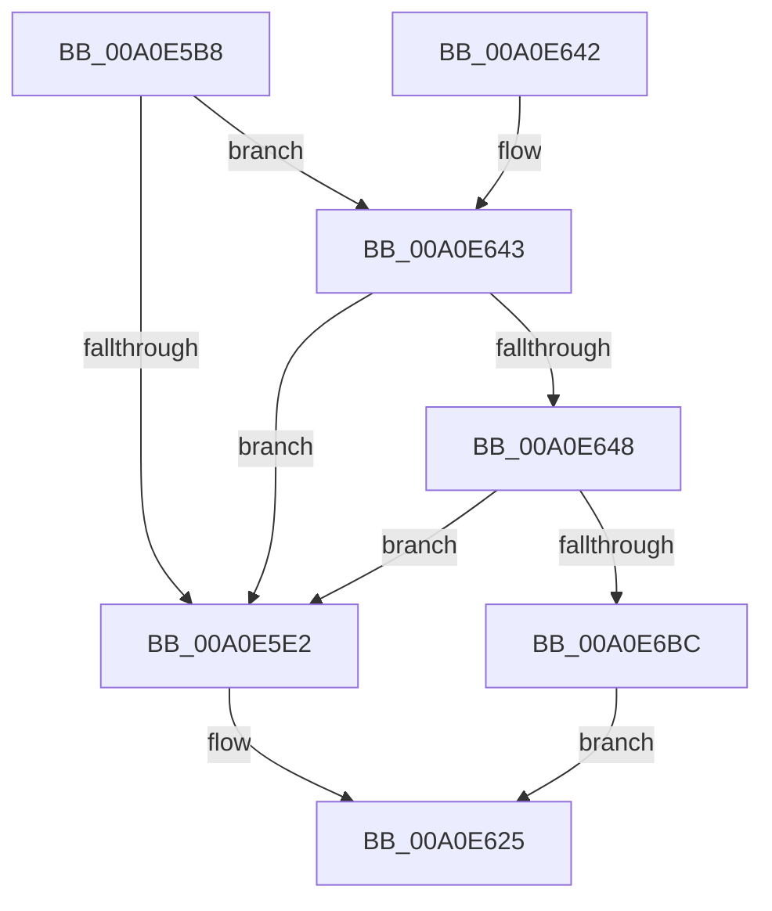

# PopThermalReadCounters

- RVA: `0x00A0E5B8`–`0x00A0E6C6` (길이 `270` bytes)
- VA: `0x0000000140A0E5B8`
- 실행 섹션: `PAGE`
- PDB 이름 있음: `예`; PDB Function 태그: `아니요`
- unwind 정보 RVA: `0x000A8D94`
- 디코드: `65`개 명령, `270/270` bytes 표시
- 미해석 바이트: `0` (있으면 어셈블리에 `.byte`로 보존)

> 이 문서는 커널 이미지의 기계어와 PDB 기호를 분석해 생성했습니다. 4번과 5번은 함수 원형과 자료형을 바이너리 사용 방식에서 추정한 C 해석이며 원본 소스 복구 결과는 아닙니다.

## 1. Dependencies

- 직접 호출 지점: **7**; 고유 호출 대상: **5**
- 직접 호출자로 확인된 함수: **1**
- RIP 상대 이미지 참조: **0**

### Outgoing calls
- `0x00A0E5EC` → [PopAcquireRwLockExclusive](../../text/43/PopAcquireRwLockExclusive_function_00430B44.md) (function, `0x00430B44`)
- `0x00A0E620` → [PopReleaseRwLock](../../text/2D/PopReleaseRwLock_function_002DFBBC.md) (function, `0x002DFBBC`)
- `0x00A0E652` → [PopAcquireRwLockExclusive](../../text/43/PopAcquireRwLockExclusive_function_00430B44.md) (function, `0x00430B44`)
- `0x00A0E661` → [KeResetEvent](../../text/24/KeResetEvent_function_00248350.md) (function, `0x00248350`)
- `0x00A0E66D` → [IoCancelIrp](../../text/27/IoCancelIrp_function_002720E0.md) (function, `0x002720E0`)
- `0x00A0E675` → [PopReleaseRwLock](../../text/2D/PopReleaseRwLock_function_002DFBBC.md) (function, `0x002DFBBC`)
- `0x00A0E6AF` → [KeWaitForMultipleObjects](../../text/20/KeWaitForMultipleObjects_function_0020D110.md) (function, `0x0020D110`)

### Direct callers
- [PoThermalCounterSetCallback](PoThermalCounterSetCallback_function_00A0E350.md) at `0x00A0E4F2`

### Static image references
- 디코드된 RIP-relative 메모리 참조가 없습니다.

## 2. Other-region calls and transfers

- 다른 실행 섹션으로 향하는 call: **7**
  - `0x00A0E5EC` → [PopAcquireRwLockExclusive](../../text/43/PopAcquireRwLockExclusive_function_00430B44.md) (`PAGE` → `.text`)
  - `0x00A0E620` → [PopReleaseRwLock](../../text/2D/PopReleaseRwLock_function_002DFBBC.md) (`PAGE` → `.text`)
  - `0x00A0E652` → [PopAcquireRwLockExclusive](../../text/43/PopAcquireRwLockExclusive_function_00430B44.md) (`PAGE` → `.text`)
  - `0x00A0E661` → [KeResetEvent](../../text/24/KeResetEvent_function_00248350.md) (`PAGE` → `.text`)
  - `0x00A0E66D` → [IoCancelIrp](../../text/27/IoCancelIrp_function_002720E0.md) (`PAGE` → `.text`)
  - `0x00A0E675` → [PopReleaseRwLock](../../text/2D/PopReleaseRwLock_function_002DFBBC.md) (`PAGE` → `.text`)
  - `0x00A0E6AF` → [KeWaitForMultipleObjects](../../text/20/KeWaitForMultipleObjects_function_0020D110.md) (`PAGE` → `.text`)
- 별도 외부 분기/꼬리 이동을 확인하지 못했습니다.

## 3. Assembly (complete function range)

```asm
00A0E5B8  48 8B C4                        mov rax, rsp
00A0E5BB  48 89 58 08                     mov qword ptr [rax + 8], rbx
00A0E5BF  48 89 68 10                     mov qword ptr [rax + 0x10], rbp
00A0E5C3  48 89 70 18                     mov qword ptr [rax + 0x18], rsi
00A0E5C7  48 89 78 20                     mov qword ptr [rax + 0x20], rdi
00A0E5CB  41 56                           push r14
00A0E5CD  48 83 EC 50                     sub rsp, 0x50
00A0E5D1  33 F6                           xor esi, esi
00A0E5D3  4D 8B F0                        mov r14, r8
00A0E5D6  48 8B E9                        mov rbp, rcx
00A0E5D9  40 38 B1 E4 00 00 00            cmp byte ptr [rcx + 0xe4], sil
00A0E5E0  74 61                           je 0x140a0e643
00A0E5E2  48 8D 9D B0 01 00 00            lea rbx, [rbp + 0x1b0]
00A0E5E9  48 8B CB                        mov rcx, rbx
00A0E5EC  E8 53 25 A2 FF                  call 0x140430b44
00A0E5F1  B8 CD CC CC CC                  mov eax, 0xcccccccd
00A0E5F6  48 8B CB                        mov rcx, rbx
00A0E5F9  F7 A5 80 00 00 00               mul dword ptr [rbp + 0x80]
00A0E5FF  C1 EA 03                        shr edx, 3
00A0E602  41 89 16                        mov dword ptr [r14], edx
00A0E605  8B 95 80 00 00 00               mov edx, dword ptr [rbp + 0x80]
00A0E60B  41 89 56 0C                     mov dword ptr [r14 + 0xc], edx
00A0E60F  8B 55 50                        mov edx, dword ptr [rbp + 0x50]
00A0E612  41 89 56 04                     mov dword ptr [r14 + 4], edx
00A0E616  8B 95 D4 00 00 00               mov edx, dword ptr [rbp + 0xd4]
00A0E61C  41 89 56 08                     mov dword ptr [r14 + 8], edx
00A0E620  E8 97 15 8D FF                  call 0x1402dfbbc
00A0E625  48 8B 5C 24 60                  mov rbx, qword ptr [rsp + 0x60]
00A0E62A  8B C6                           mov eax, esi
00A0E62C  48 8B 74 24 70                  mov rsi, qword ptr [rsp + 0x70]
00A0E631  48 8B 6C 24 68                  mov rbp, qword ptr [rsp + 0x68]
00A0E636  48 8B 7C 24 78                  mov rdi, qword ptr [rsp + 0x78]
00A0E63B  48 83 C4 50                     add rsp, 0x50
00A0E63F  41 5E                           pop r14
00A0E641  C3                              ret
00A0E642  CC                              int3
00A0E643  F6 C2 09                        test dl, 9
00A0E646  74 9A                           je 0x140a0e5e2
00A0E648  48 8D B9 B0 01 00 00            lea rdi, [rcx + 0x1b0]
00A0E64F  48 8B CF                        mov rcx, rdi
00A0E652  E8 ED 24 A2 FF                  call 0x140430b44
00A0E657  48 8D 9D D8 01 00 00            lea rbx, [rbp + 0x1d8]
00A0E65E  48 8B CB                        mov rcx, rbx
00A0E661  E8 EA 9C 83 FF                  call 0x140248350
00A0E666  48 8B 4D 38                     mov rcx, qword ptr [rbp + 0x38]
00A0E66A  89 75 70                        mov dword ptr [rbp + 0x70], esi
00A0E66D  E8 6E 3A 86 FF                  call 0x1402720e0
00A0E672  48 8B CF                        mov rcx, rdi
00A0E675  E8 42 15 8D FF                  call 0x1402dfbbc
00A0E67A  45 33 C9                        xor r9d, r9d
00A0E67D  48 89 74 24 38                  mov qword ptr [rsp + 0x38], rsi
00A0E682  48 8D 85 C0 01 00 00            lea rax, [rbp + 0x1c0]
00A0E689  48 89 74 24 30                  mov qword ptr [rsp + 0x30], rsi
00A0E68E  40 88 74 24 28                  mov byte ptr [rsp + 0x28], sil
00A0E693  48 8D 54 24 40                  lea rdx, [rsp + 0x40]
00A0E698  48 89 5C 24 40                  mov qword ptr [rsp + 0x40], rbx
00A0E69D  45 8D 41 01                     lea r8d, [r9 + 1]
00A0E6A1  48 89 44 24 48                  mov qword ptr [rsp + 0x48], rax
00A0E6A6  41 8D 49 02                     lea ecx, [r9 + 2]
00A0E6AA  40 88 74 24 20                  mov byte ptr [rsp + 0x20], sil
00A0E6AF  E8 5C EA 7F FF                  call 0x14020d110
00A0E6B4  85 C0                           test eax, eax
00A0E6B6  0F 84 26 FF FF FF               je 0x140a0e5e2
00A0E6BC  BE 01 00 00 C0                  mov esi, 0xc0000001
00A0E6C1  E9 5F FF FF FF                  jmp 0x140a0e625
```

## 4. C-style interpretation (structured pseudocode)

```c
__int64 __fastcall PopThermalReadCounters(__int64 a1, int a2, __int64 a3, int a4)
{
    __int64 result;
    __int64 v_rsi;
    __int64 v_rsp;
    unsigned __int64 v_stack_p10;
    unsigned __int64 v_stack_p18;
    unsigned __int64 v_stack_p20;
    unsigned __int8 v_stack_p28;
    unsigned __int64 v_stack_p30;
    unsigned __int64 v_stack_p38;
    unsigned __int64 v_stack_p40;
    unsigned __int64 v_stack_p48;
    unsigned __int64 v_stack_p8;

    *(unsigned __int64 *)(v_rsp + 8) = v_rbx;
    *(unsigned __int64 *)(v_rsp + 16) = v_rbp;
    *(unsigned __int64 *)(v_rsp + 24) = v_rsi;
    *(unsigned __int64 *)(v_rsp + 32) = v_rdi;
    v_rsp = (v_rsp) - (80);
    v_rsi = 0;
    if ((*(unsigned __int8 *)(a1 + 228)) == 0) goto loc_00A0E643;
loc_00A0E5E2:
    result = PopAcquireRwLockExclusive(a1 + 432, a2, a3, a4);
    a2 = (unsigned int)((a2) >> (3));
    *(unsigned int *)(a3) = a2;
    *(unsigned int *)(a3 + 12) = (unsigned int)((unsigned int)(*(unsigned int *)(a1 + 128)));
    *(unsigned int *)(a3 + 4) = (unsigned int)((unsigned int)(*(unsigned int *)(a1 + 80)));
    *(unsigned int *)(a3 + 8) = (unsigned int)((unsigned int)(*(unsigned int *)(a1 + 212)));
    result = PopReleaseRwLock(a1 + 432, (unsigned int)(*(unsigned int *)(a1 + 212)), a3, a4);
loc_00A0E625:
    v_rsp = (v_rsp) + (80);
    return 0;
loc_00A0E643:
    if ((((unsigned __int8)((unsigned int)(*(unsigned int *)(a1 + 212)))) & (9)) == 0) goto loc_00A0E5E2;
    result = PopAcquireRwLockExclusive(a1 + 432 + 432, (unsigned int)(*(unsigned int *)(a1 + 212)), a3, a4);
    result = KeResetEvent(v_stack_p10 + 472, (unsigned int)(*(unsigned int *)(a1 + 212)), a3, a4);
    *(unsigned int *)(v_stack_p10 + 112) = (unsigned int)(v_stack_p18);
    result = IoCancelIrp(*(unsigned __int64 *)(v_stack_p10 + 56), (unsigned int)(*(unsigned int *)(a1 + 212)), a3, a4);
    result = PopReleaseRwLock(a1 + 432 + 432, (unsigned int)(*(unsigned int *)(a1 + 212)), a3, a4);
    a4 = 0;
    v_stack_p38 = v_stack_p18;
    v_stack_p30 = v_stack_p18;
    v_stack_p28 = (unsigned __int8)(v_stack_p18);
    v_stack_p40 = v_stack_p10 + 472;
    v_stack_p48 = v_stack_p10 + 448;
    v_stack_p20 = (unsigned __int8)(v_stack_p18);
    result = KeWaitForMultipleObjects(a4 + 2, v_stack_p40, a4 + 1, a4);
    if ((unsigned int)(result) == 0) goto loc_00A0E5E2;
    goto loc_00A0E625;
}
```

## 5. (Beta) C Style

```c
int64_t PopThermalReadCounters(void *Arg1, int32_t Arg2, void *Arg3, int32_t Arg4)
{
    uint8_t *arg1 = (uint8_t *)Arg1;
    uint8_t *arg3 = (uint8_t *)Arg3;

    int64_t result;
    int64_t local_rsi;
    int64_t local_rsp;
    uint64_t v_stack_p10;
    uint64_t v_stack_p18;
    uint64_t v_stack_p20;
    uint8_t v_stack_p28;
    uint64_t v_stack_p30;
    uint64_t v_stack_p38;
    uint64_t v_stack_p40;
    uint64_t v_stack_p48;
    uint64_t v_stack_p8;

    *(uint64_t *)(local_rsp + 0x8) = local_rbx;
    *(uint64_t *)(local_rsp + 0x10) = local_rbp;
    *(uint64_t *)(local_rsp + 0x18) = local_rsi;
    *(uint64_t *)(local_rsp + 0x20) = local_rdi;
    local_rsp = (local_rsp) - (80);
    local_rsi = 0;
    if ((*(uint8_t *)(arg1 + 0xE4)) == 0) goto loc_00A0E643;
loc_00A0E5E2:
    result = PopAcquireRwLockExclusive(Arg1 + 432, Arg2, Arg3, Arg4);
    Arg2 = (uint32_t)((Arg2) >> (3));
    *(uint32_t *)(arg3) = Arg2;
    *(uint32_t *)(arg3 + 0xC) = (uint32_t)((uint32_t)(*(uint32_t *)(arg1 + 0x80)));
    *(uint32_t *)(arg3 + 0x4) = (uint32_t)((uint32_t)(*(uint32_t *)(arg1 + 0x50)));
    *(uint32_t *)(arg3 + 0x8) = (uint32_t)((uint32_t)(*(uint32_t *)(arg1 + 0xD4)));
    result = PopReleaseRwLock(Arg1 + 432, (uint32_t)(*(uint32_t *)(arg1 + 0xD4)), Arg3, Arg4);
loc_00A0E625:
    local_rsp = (local_rsp) + (80);
    return 0;
loc_00A0E643:
    if ((((uint8_t)((uint32_t)(*(uint32_t *)(arg1 + 0xD4)))) & (9)) == 0) goto loc_00A0E5E2;
    result = PopAcquireRwLockExclusive(Arg1 + 432 + 432, (uint32_t)(*(uint32_t *)(arg1 + 0xD4)), Arg3, Arg4);
    result = KeResetEvent(v_stack_p10 + 472, (uint32_t)(*(uint32_t *)(arg1 + 0xD4)), Arg3, Arg4);
    *(uint32_t *)(v_stack_p10 + 0x70) = (uint32_t)(v_stack_p18);
    result = IoCancelIrp(*(uint64_t *)(v_stack_p10 + 0x38), (uint32_t)(*(uint32_t *)(arg1 + 0xD4)), Arg3, Arg4);
    result = PopReleaseRwLock(Arg1 + 432 + 432, (uint32_t)(*(uint32_t *)(arg1 + 0xD4)), Arg3, Arg4);
    Arg4 = 0;
    v_stack_p38 = v_stack_p18;
    v_stack_p30 = v_stack_p18;
    v_stack_p28 = (uint8_t)(v_stack_p18);
    v_stack_p40 = v_stack_p10 + 472;
    v_stack_p48 = v_stack_p10 + 448;
    v_stack_p20 = (uint8_t)(v_stack_p18);
    result = KeWaitForMultipleObjects(Arg4 + 2, v_stack_p40, Arg4 + 1, Arg4);
    if ((uint32_t)(result) == 0) goto loc_00A0E5E2;
    goto loc_00A0E625;
}
```

### 관측된 메모리 오프셋

구조체 형식이 확인되지 않은 접근은 인자 기준의 오프셋으로만 기록했습니다.

| 기준 인자 | 오프셋 표현 | 폭 (bit) | 접근 |
|---|---:|---:|---|
| `Arg1` | `+ 0x38` | `64` | `R` |
| `Arg1` | `+ 0x50` | `32` | `R` |
| `Arg1` | `+ 0x70` | `32` | `W` |
| `Arg1` | `+ 0x80` | `32` | `R` |
| `Arg1` | `+ 0xD4` | `32` | `R` |
| `Arg1` | `+ 0xE4` | `8` | `R` |
| `Arg1` | `+ 0x1B0` | `64` | `R` |
| `Arg1` | `+ 0x1C0` | `64` | `R` |
| `Arg1` | `+ 0x1D8` | `64` | `R` |
| `Arg3` | `+ 0x0` | `32` | `W` |
| `Arg3` | `+ 0x4` | `32` | `W` |
| `Arg3` | `+ 0x8` | `32` | `W` |
| `Arg3` | `+ 0xC` | `32` | `W` |

## 6. Execution-region graph

[열기: 2D/3D 그래프와 함수 탐색 컨트롤 패널](../../../control-panel.html?section=page&rva=0x00A0E5B8&view=graph)

- 2D 그래프는 위에서 아래로 흐르고, 3D 그래프는 빈 공간을 드래그해 회전합니다. Shift+드래그는 이동, 휠은 확대·축소, 함수 노드 선택은 대상 보고서 이동입니다.

### Static fallback


