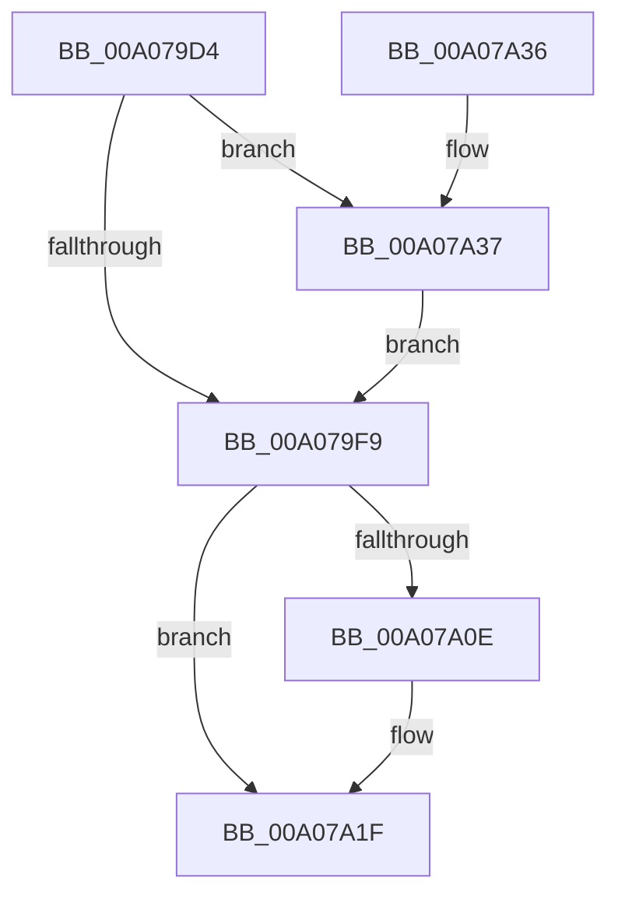

# PpDeviceRegistration

- RVA: `0x00A079D4`–`0x00A07A58` (길이 `132` bytes)
- VA: `0x0000000140A079D4`
- 실행 섹션: `PAGE`
- PDB 이름 있음: `예`; PDB Function 태그: `아니요`
- unwind 정보 RVA: `0x00069864`
- 디코드: `36`개 명령, `132/132` bytes 표시
- 미해석 바이트: `0` (있으면 어셈블리에 `.byte`로 보존)

> 이 문서는 커널 이미지의 기계어와 PDB 기호를 분석해 생성했습니다. 4번과 5번은 함수 원형과 자료형을 바이너리 사용 방식에서 추정한 C 해석이며 원본 소스 복구 결과는 아닙니다.

## 1. Dependencies

- 직접 호출 지점: **4**; 고유 호출 대상: **4**
- 직접 호출자로 확인된 함수: **6**
- RIP 상대 이미지 참조: **1**

### Outgoing calls
- `0x00A07A02` → [PiDeviceRegistration](PiDeviceRegistration_function_00A07A60.md) (function, `0x00A07A60`)
- `0x00A07A15` → [ExReleaseResourceLite](../../text/25/ExReleaseResourceLite_function_0025FA10.md) (function, `0x0025FA10`)
- `0x00A07A1A` → [KeLeaveCriticalRegion](../../text/25/KeLeaveCriticalRegion_function_0025D8B0.md) (function, `0x0025D8B0`)
- `0x00A07A51` → [ExAcquireResourceExclusiveLite](../../text/21/ExAcquireResourceExclusiveLite_function_00214E20.md) (function, `0x00214E20`)

### Direct callers
- [IoReportDetectedDevice](../72/IoReportDetectedDevice_function_00725CD0.md) at `0x007263B6`
- [PpDevCfgProcessDevices](../73/PpDevCfgProcessDevices_function_007373C0.md) at `0x007374C8`
- [PiCMDeleteDeviceWorker](../73/PiCMDeleteDeviceWorker_function_0073B420.md) at `0x0073B531`
- [PiCMDeleteDeviceWorker](../73/PiCMDeleteDeviceWorker_function_0073B420.md) at `0x0073B5F2`
- [PiProcessNewDeviceNode](../A2/PiProcessNewDeviceNode_function_00A28F20.md) at `0x00A2A2EB`
- [PiCMCreateDevice](../AC/PiCMCreateDevice_function_00ACB824.md) at `0x00ACBEEA`
- [sub_00B420B0](../B4/Unknown_function_00B420B0.md) at `0x00B423A4`

### Static image references
- `0x00A07A0E` → RVA `0x00F8C600` (`.data`; read)

## 2. Other-region calls and transfers

- 다른 실행 섹션으로 향하는 call: **3**
  - `0x00A07A15` → [ExReleaseResourceLite](../../text/25/ExReleaseResourceLite_function_0025FA10.md) (`PAGE` → `.text`)
  - `0x00A07A1A` → [KeLeaveCriticalRegion](../../text/25/KeLeaveCriticalRegion_function_0025D8B0.md) (`PAGE` → `.text`)
  - `0x00A07A51` → [ExAcquireResourceExclusiveLite](../../text/21/ExAcquireResourceExclusiveLite_function_00214E20.md) (`PAGE` → `.text`)
- 별도 외부 분기/꼬리 이동을 확인하지 못했습니다.

## 3. Assembly (complete function range)

```asm
00A079D4  48 89 5C 24 08                  mov qword ptr [rsp + 8], rbx
00A079D9  48 89 6C 24 10                  mov qword ptr [rsp + 0x10], rbp
00A079DE  48 89 74 24 18                  mov qword ptr [rsp + 0x18], rsi
00A079E3  57                              push rdi
00A079E4  48 83 EC 20                     sub rsp, 0x20
00A079E8  41 8A F9                        mov dil, r9b
00A079EB  49 8B D8                        mov rbx, r8
00A079EE  40 8A F2                        mov sil, dl
00A079F1  48 8B E9                        mov rbp, rcx
00A079F4  45 84 C9                        test r9b, r9b
00A079F7  74 3E                           je 0x140a07a37
00A079F9  4C 8B C3                        mov r8, rbx
00A079FC  40 8A D6                        mov dl, sil
00A079FF  48 8B CD                        mov rcx, rbp
00A07A02  E8 59 00 00 00                  call 0x140a07a60
00A07A07  8B D8                           mov ebx, eax
00A07A09  40 84 FF                        test dil, dil
00A07A0C  75 11                           jne 0x140a07a1f
00A07A0E  48 8D 0D EB 4B 58 00            lea rcx, [rip + 0x584beb]
00A07A15  E8 F6 7F 85 FF                  call 0x14025fa10
00A07A1A  E8 91 5E 85 FF                  call 0x14025d8b0
00A07A1F  48 8B 6C 24 38                  mov rbp, qword ptr [rsp + 0x38]
00A07A24  8B C3                           mov eax, ebx
00A07A26  48 8B 5C 24 30                  mov rbx, qword ptr [rsp + 0x30]
00A07A2B  48 8B 74 24 40                  mov rsi, qword ptr [rsp + 0x40]
00A07A30  48 83 C4 20                     add rsp, 0x20
00A07A34  5F                              pop rdi
00A07A35  C3                              ret
00A07A36  CC                              int3
00A07A37  65 48 8B 04 25 88 01 00 00      mov rax, qword ptr gs:[0x188]
00A07A40  48 8D 0D B9 4B 58 00            lea rcx, [rip + 0x584bb9]
00A07A47  B2 01                           mov dl, 1
00A07A49  66 FF 88 E4 01 00 00            dec word ptr [rax + 0x1e4]
00A07A50  90                              nop
00A07A51  E8 CA D3 80 FF                  call 0x140214e20
00A07A56  EB A1                           jmp 0x140a079f9
```

## 4. C-style interpretation (structured pseudocode)

```c
__int64 __fastcall PpDeviceRegistration(__int64 a1, unsigned __int8 a2, __int64 a3, unsigned __int8 a4)
{
    __int64 result;
    __int64 v_rsp;
    unsigned __int64 v_stack_p10;
    unsigned __int64 v_stack_p18;
    unsigned __int64 v_stack_p8;

    v_stack_p8 = v_rbx;
    v_stack_p10 = v_rbp;
    v_stack_p18 = v_rsi;
    v_rsp = (v_rsp) - (32);
    if (a4 == 0) goto loc_00A07A37;
loc_00A079F9:
    result = PiDeviceRegistration(a1, a2, a3, a4);
    if (a4 == 0) {
        a1 = v_rip + 5786603;
        result = ExReleaseResourceLite(a1, a2, a3, a4);
        result = KeLeaveCriticalRegion(a1, a2, a3, a4);
    }
    v_rsp = (v_rsp) + (32);
    return (unsigned int)((unsigned int)((unsigned int)((unsigned int)(result))));
loc_00A07A37:
    result = ExAcquireResourceExclusiveLite(v_rip + 5786553, 1, a3, a4);
    goto loc_00A079F9;
}
```

## 5. (Beta) C Style

```c
int64_t PpDeviceRegistration(int64_t Arg1, uint8_t Arg2, int64_t Arg3, uint8_t Arg4)
{
    int64_t result;
    int64_t local_rsp;
    uint64_t v_stack_p10;
    uint64_t v_stack_p18;
    uint64_t v_stack_p8;

    v_stack_p8 = local_rbx;
    v_stack_p10 = local_rbp;
    v_stack_p18 = local_rsi;
    local_rsp = (local_rsp) - (32);
    if (Arg4 == 0) goto loc_00A07A37;
loc_00A079F9:
    result = PiDeviceRegistration(Arg1, Arg2, Arg3, Arg4);
    if (Arg4 == 0) {
        Arg1 = v_rip + 5786603;
        result = ExReleaseResourceLite(Arg1, Arg2, Arg3, Arg4);
        result = KeLeaveCriticalRegion(Arg1, Arg2, Arg3, Arg4);
    }
    local_rsp = (local_rsp) + (32);
    return (uint32_t)((uint32_t)((uint32_t)((uint32_t)(result))));
loc_00A07A37:
    result = ExAcquireResourceExclusiveLite(v_rip + 5786553, 1, Arg3, Arg4);
    goto loc_00A079F9;
}
```

## 6. Execution-region graph

[열기: 2D/3D 그래프와 함수 탐색 컨트롤 패널](../../../control-panel.html?section=page&rva=0x00A079D4&view=graph)

- 2D 그래프는 위에서 아래로 흐르고, 3D 그래프는 빈 공간을 드래그해 회전합니다. Shift+드래그는 이동, 휠은 확대·축소, 함수 노드 선택은 대상 보고서 이동입니다.

### Static fallback


