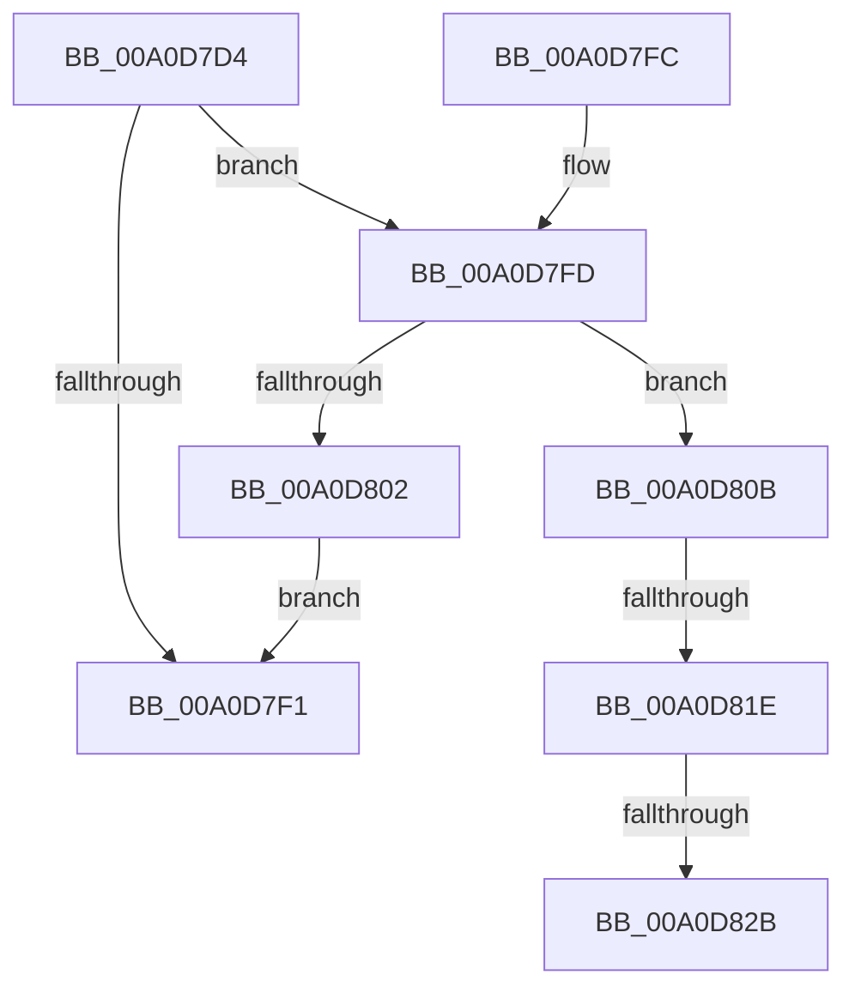

# PsDereferenceVsmEnclave

- RVA: `0x00A0D7D4`–`0x00A0D830` (길이 `92` bytes)
- VA: `0x0000000140A0D7D4`
- 실행 섹션: `PAGE`
- PDB 이름 있음: `예`; PDB Function 태그: `예`
- unwind 정보 RVA: `0x00070720`
- 디코드: `26`개 명령, `92/92` bytes 표시
- 미해석 바이트: `0` (있으면 어셈블리에 `.byte`로 보존)

> 이 문서는 커널 이미지의 기계어와 PDB 기호를 분석해 생성했습니다. 4번과 5번은 함수 원형과 자료형을 바이너리 사용 방식에서 추정한 C 해석이며 원본 소스 복구 결과는 아닙니다.

## 1. Dependencies

- 직접 호출 지점: **1**; 고유 호출 대상: **1**
- 직접 호출자로 확인된 함수: **5**
- RIP 상대 이미지 참조: **0**

### Outgoing calls
- `0x00A0D80F` → [VslCloseSecureHandle](../../text/4B/VslCloseSecureHandle_function_004BBF40.md) (function, `0x004BBF40`)

### Direct callers
- [MiCanDeleteEnclave](../../text/68/MiCanDeleteEnclave_function_00686D18.md) at `0x00686DEC`
- [PsDeleteVsmEnclave](../78/PsDeleteVsmEnclave_function_007885F0.md) at `0x0078873B`
- [MiInitializeVsmEnclave](../80/MiInitializeVsmEnclave_function_00808AE0.md) at `0x00808BD2`
- [MiTerminateEnclave](../80/MiTerminateEnclave_function_00808C18.md) at `0x00808C8D`
- [PsCallEnclave](PsCallEnclave_function_00A0CF50.md) at `0x00A0D2D4`

### Static image references
- 디코드된 RIP-relative 메모리 참조가 없습니다.

## 2. Other-region calls and transfers

- 다른 실행 섹션으로 향하는 call: **1**
  - `0x00A0D80F` → [VslCloseSecureHandle](../../text/4B/VslCloseSecureHandle_function_004BBF40.md) (`PAGE` → `.text`)
- call이 아닌 외부 분기/꼬리 이동: **3**
  - `0x00A0D818` → [sub_00B3699C + 0x41](../B3/Unknown_function_00B3699C.md) (`tail-transfer`)
  - `0x00A0D825` → [sub_00B3699C](../B3/Unknown_function_00B3699C.md) (`tail-transfer`)
  - `0x00A0D82B` → [sub_00B3699C + 0x41](../B3/Unknown_function_00B3699C.md) (`tail-transfer`)

## 3. Assembly (complete function range)

```asm
00A0D7D4  48 89 5C 24 08                  mov qword ptr [rsp + 8], rbx
00A0D7D9  57                              push rdi
00A0D7DA  48 83 EC 20                     sub rsp, 0x20
00A0D7DE  48 8B D9                        mov rbx, rcx
00A0D7E1  48 83 C8 FF                     or rax, 0xffffffffffffffff
00A0D7E5  F0 48 0F C1 41 10               lock xadd qword ptr [rcx + 0x10], rax
00A0D7EB  48 83 E8 01                     sub rax, 1
00A0D7EF  7E 0C                           jle 0x140a0d7fd
00A0D7F1  48 8B 5C 24 30                  mov rbx, qword ptr [rsp + 0x30]
00A0D7F6  48 83 C4 20                     add rsp, 0x20
00A0D7FA  5F                              pop rdi
00A0D7FB  C3                              ret
00A0D7FC  CC                              int3
00A0D7FD  48 85 C0                        test rax, rax
00A0D800  74 09                           je 0x140a0d80b
00A0D802  B9 0E 00 00 00                  mov ecx, 0xe
00A0D807  CD 29                           int 0x29
00A0D809  EB E6                           jmp 0x140a0d7f1
00A0D80B  48 8B 49 18                     mov rcx, qword ptr [rcx + 0x18]
00A0D80F  E8 2C E7 AA FF                  call 0x1404bbf40
00A0D814  80 7B 4C 00                     cmp byte ptr [rbx + 0x4c], 0
00A0D818  0F 84 BF 91 12 00               je 0x140b369dd
00A0D81E  48 8B 43 68                     mov rax, qword ptr [rbx + 0x68]
00A0D822  48 85 C0                        test rax, rax
00A0D825  0F 85 71 91 12 00               jne 0x140b3699c
00A0D82B  E9 AD 91 12 00                  jmp 0x140b369dd
```

## 4. C-style interpretation (structured pseudocode)

```c
__int64 __fastcall PsDereferenceVsmEnclave(__int64 a1)
{
    __int64 result;
    __int64 v_rsp;
    unsigned __int64 v_stack_p8;

    v_stack_p8 = v_rbx;
    v_rsp = (v_rsp) - (32);
    result = (result) | (-1);
    result = (result) - (1);
    if (condition_is_less_or_equal) goto loc_00A0D7FD;
loc_00A0D7F1:
    v_rsp = (v_rsp) + (32);
    return result;
loc_00A0D7FD:
    if (result == 0) goto loc_00A0D80B;
    goto loc_00A0D7F1;
loc_00A0D80B:
    result = VslCloseSecureHandle(*(unsigned __int64 *)(14 + 24), a2, a3, a4);
}
```

## 5. (Beta) C Style

```c
int64_t PsDereferenceVsmEnclave(void *Arg1)
{
    uint8_t *arg1 = (uint8_t *)Arg1;

    int64_t result;
    int64_t local_rsp;
    uint64_t v_stack_p8;

    v_stack_p8 = local_rbx;
    local_rsp = (local_rsp) - (32);
    result = (result) | (-1);
    result = (result) - (1);
    if (condition_is_less_or_equal) goto loc_00A0D7FD;
loc_00A0D7F1:
    local_rsp = (local_rsp) + (32);
    return result;
loc_00A0D7FD:
    if (result == 0) goto loc_00A0D80B;
    goto loc_00A0D7F1;
loc_00A0D80B:
    result = VslCloseSecureHandle(*(uint64_t *)(14 + 0x18), a2, a3, a4);
}
```

### 관측된 메모리 오프셋

구조체 형식이 확인되지 않은 접근은 인자 기준의 오프셋으로만 기록했습니다.

| 기준 인자 | 오프셋 표현 | 폭 (bit) | 접근 |
|---|---:|---:|---|
| `Arg1` | `+ 0x10` | `64` | `R/W` |
| `Arg1` | `+ 0x18` | `64` | `R` |
| `Arg1` | `+ 0x4C` | `8` | `R` |
| `Arg1` | `+ 0x68` | `64` | `R` |

## 6. Execution-region graph

[열기: 2D/3D 그래프와 함수 탐색 컨트롤 패널](../../../control-panel.html?section=page&rva=0x00A0D7D4&view=graph)

- 2D 그래프는 위에서 아래로 흐르고, 3D 그래프는 빈 공간을 드래그해 회전합니다. Shift+드래그는 이동, 휠은 확대·축소, 함수 노드 선택은 대상 보고서 이동입니다.

### Static fallback


