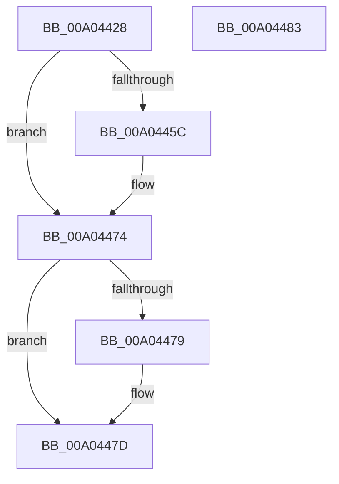

# PspLockJobListShared

- RVA: `0x00A04428`–`0x00A04484` (길이 `92` bytes)
- VA: `0x0000000140A04428`
- 실행 섹션: `PAGE`
- PDB 이름 있음: `예`; PDB Function 태그: `아니요`
- unwind 정보 RVA: `0x0005CF00`
- 디코드: `25`개 명령, `92/92` bytes 표시
- 미해석 바이트: `0` (있으면 어셈블리에 `.byte`로 보존)

> 이 문서는 커널 이미지의 기계어와 PDB 기호를 분석해 생성했습니다. 4번과 5번은 함수 원형과 자료형을 바이너리 사용 방식에서 추정한 C 해석이며 원본 소스 복구 결과는 아닙니다.

## 1. Dependencies

- 직접 호출 지점: **2**; 고유 호출 대상: **2**
- 직접 호출자로 확인된 함수: **1**
- RIP 상대 이미지 참조: **1**

### Outgoing calls
- `0x00A04442` → [KeAbPreAcquire](../../text/21/KeAbPreAcquire_function_00210230.md) (function, `0x00210230`)
- `0x00A0446F` → [ExfAcquirePushLockSharedEx](../../text/21/ExfAcquirePushLockSharedEx_function_0021044C.md) (function, `0x0021044C`)

### Direct callers
- [sub_00B316B4](../B3/Unknown_function_00B316B4.md) at `0x00B31904`

### Static image references
- `0x00A04438` → RVA `0x00FD9DA8` (`PAGEDATA`; read)

## 2. Other-region calls and transfers

- 다른 실행 섹션으로 향하는 call: **2**
  - `0x00A04442` → [KeAbPreAcquire](../../text/21/KeAbPreAcquire_function_00210230.md) (`PAGE` → `.text`)
  - `0x00A0446F` → [ExfAcquirePushLockSharedEx](../../text/21/ExfAcquirePushLockSharedEx_function_0021044C.md) (`PAGE` → `.text`)
- 별도 외부 분기/꼬리 이동을 확인하지 못했습니다.

## 3. Assembly (complete function range)

```asm
00A04428  40 53                           push rbx
00A0442A  48 83 EC 20                     sub rsp, 0x20
00A0442E  66 FF 89 E6 01 00 00            dec word ptr [rcx + 0x1e6]
00A04435  45 33 C0                        xor r8d, r8d
00A04438  48 8D 0D 69 59 5D 00            lea rcx, [rip + 0x5d5969]
00A0443F  33 D2                           xor edx, edx
00A04441  90                              nop
00A04442  E8 E9 BD 80 FF                  call 0x140210230
00A04447  48 8B D8                        mov rbx, rax
00A0444A  BA 11 00 00 00                  mov edx, 0x11
00A0444F  33 C0                           xor eax, eax
00A04451  F0 48 0F B1 15 4E 59 5D 00      lock cmpxchg qword ptr [rip + 0x5d594e], rdx
00A0445A  74 18                           je 0x140a04474
00A0445C  4C 8D 0D 45 59 5D 00            lea r9, [rip + 0x5d5945]
00A04463  4C 8B C3                        mov r8, rbx
00A04466  33 D2                           xor edx, edx
00A04468  48 8D 0D 39 59 5D 00            lea rcx, [rip + 0x5d5939]
00A0446F  E8 D8 BF 80 FF                  call 0x14021044c
00A04474  48 85 DB                        test rbx, rbx
00A04477  74 04                           je 0x140a0447d
00A04479  C6 43 0A 01                     mov byte ptr [rbx + 0xa], 1
00A0447D  48 83 C4 20                     add rsp, 0x20
00A04481  5B                              pop rbx
00A04482  C3                              ret
00A04483  CC                              int3
```

## 4. C-style interpretation (structured pseudocode)

```c
__int64 __fastcall PspLockJobListShared(__int64 a1, int a2, int a3)
{
    __int64 result;
    __int64 v_rsp;

    v_rsp = (v_rsp) - (32);
    a3 = 0;
    a2 = 0;
    result = KeAbPreAcquire(v_rip + 6117737, a2, a3, a4);
    result = 0;
    if (!(condition_is_equal)) {
        a4 = v_rip + 6117701;
        a3 = 0;
        a2 = 0;
        a1 = v_rip + 6117689;
        result = ExfAcquirePushLockSharedEx(a1, a2, a3, a4);
    }
    if (result != 0) {
        *(unsigned __int8 *)(result + 10) = 1;
    }
    v_rsp = (v_rsp) + (32);
    return result;
}
```

## 5. (Beta) C Style

```c
int64_t PspLockJobListShared(void *Arg1, int32_t Arg2, int32_t Arg3)
{
    uint8_t *arg1 = (uint8_t *)Arg1;

    int64_t result;
    int64_t local_rsp;

    local_rsp = (local_rsp) - (32);
    Arg3 = 0;
    Arg2 = 0;
    result = KeAbPreAcquire(v_rip + 6117737, Arg2, Arg3, a4);
    result = 0;
    if (!(condition_is_equal)) {
        a4 = v_rip + 6117701;
        Arg3 = 0;
        Arg2 = 0;
        Arg1 = v_rip + 6117689;
        result = ExfAcquirePushLockSharedEx(Arg1, Arg2, Arg3, a4);
    }
    if (result != 0) {
        *(uint8_t *)(result + 0xA) = 1;
    }
    local_rsp = (local_rsp) + (32);
    return result;
}
```

### 관측된 메모리 오프셋

구조체 형식이 확인되지 않은 접근은 인자 기준의 오프셋으로만 기록했습니다.

| 기준 인자 | 오프셋 표현 | 폭 (bit) | 접근 |
|---|---:|---:|---|
| `Arg1` | `+ 0x1E6` | `16` | `R/W` |

## 6. Execution-region graph

[열기: 2D/3D 그래프와 함수 탐색 컨트롤 패널](../../../control-panel.html?section=page&rva=0x00A04428&view=graph)

- 2D 그래프는 위에서 아래로 흐르고, 3D 그래프는 빈 공간을 드래그해 회전합니다. Shift+드래그는 이동, 휠은 확대·축소, 함수 노드 선택은 대상 보고서 이동입니다.

### Static fallback


