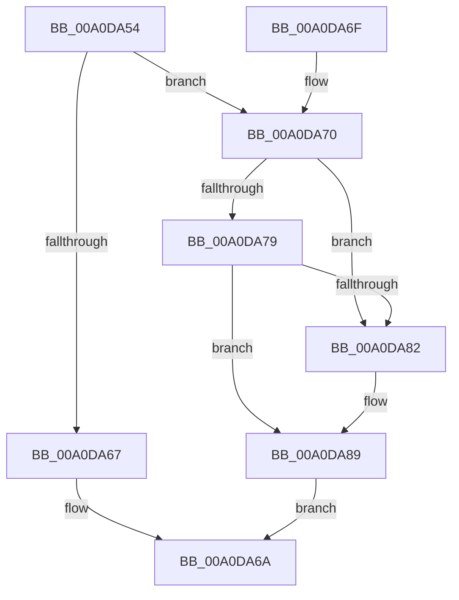

# PspReleaseEnclaveThread

- RVA: `0x00A0DA54`–`0x00A0DAA8` (길이 `84` bytes)
- VA: `0x0000000140A0DA54`
- 실행 섹션: `PAGE`
- PDB 이름 있음: `예`; PDB Function 태그: `아니요`
- unwind 정보 RVA: `0x0005C7A0`
- 디코드: `27`개 명령, `84/84` bytes 표시
- 미해석 바이트: `0` (있으면 어셈블리에 `.byte`로 보존)

> 이 문서는 커널 이미지의 기계어와 PDB 기호를 분석해 생성했습니다. 4번과 5번은 함수 원형과 자료형을 바이너리 사용 방식에서 추정한 C 해석이며 원본 소스 복구 결과는 아닙니다.

## 1. Dependencies

- 직접 호출 지점: **1**; 고유 호출 대상: **1**
- 직접 호출자로 확인된 함수: **1**
- RIP 상대 이미지 참조: **0**

### Outgoing calls
- `0x00A0DAA1` → [KeSetEvent](../../text/33/KeSetEvent_function_0033F310.md) (function, `0x0033F310`)

### Direct callers
- [PsCallEnclave](PsCallEnclave_function_00A0CF50.md) at `0x00A0D40C`

### Static image references
- 디코드된 RIP-relative 메모리 참조가 없습니다.

## 2. Other-region calls and transfers

- 다른 실행 섹션으로 향하는 call: **1**
  - `0x00A0DAA1` → [KeSetEvent](../../text/33/KeSetEvent_function_0033F310.md) (`PAGE` → `.text`)
- 별도 외부 분기/꼬리 이동을 확인하지 못했습니다.

## 3. Assembly (complete function range)

```asm
00A0DA54  48 83 EC 28                     sub rsp, 0x28
00A0DA58  48 8D 41 38                     lea rax, [rcx + 0x38]
00A0DA5C  48 8B D1                        mov rdx, rcx
00A0DA5F  48 8B 08                        mov rcx, qword ptr [rax]
00A0DA62  48 3B C8                        cmp rcx, rax
00A0DA65  75 09                           jne 0x140a0da70
00A0DA67  FF 42 48                        inc dword ptr [rdx + 0x48]
00A0DA6A  48 83 C4 28                     add rsp, 0x28
00A0DA6E  C3                              ret
00A0DA6F  CC                              int3
00A0DA70  48 8B 11                        mov rdx, qword ptr [rcx]
00A0DA73  48 39 4A 08                     cmp qword ptr [rdx + 8], rcx
00A0DA77  75 09                           jne 0x140a0da82
00A0DA79  48 8B 41 08                     mov rax, qword ptr [rcx + 8]
00A0DA7D  48 39 08                        cmp qword ptr [rax], rcx
00A0DA80  74 07                           je 0x140a0da89
00A0DA82  B9 03 00 00 00                  mov ecx, 3
00A0DA87  CD 29                           int 0x29
00A0DA89  48 89 10                        mov qword ptr [rax], rdx
00A0DA8C  45 33 C0                        xor r8d, r8d
00A0DA8F  48 89 42 08                     mov qword ptr [rdx + 8], rax
00A0DA93  33 D2                           xor edx, edx
00A0DA95  48 83 21 00                     and qword ptr [rcx], 0
00A0DA99  83 61 28 00                     and dword ptr [rcx + 0x28], 0
00A0DA9D  48 83 C1 10                     add rcx, 0x10
00A0DAA1  E8 6A 18 93 FF                  call 0x14033f310
00A0DAA6  EB C2                           jmp 0x140a0da6a
```

## 4. C-style interpretation (structured pseudocode)

```c
__int64 __fastcall PspReleaseEnclaveThread(__int64 a1, __int64 a2, int a3)
{
    __int64 result;
    __int64 v_rsp;

    v_rsp = (v_rsp) - (40);
    if ((*(unsigned __int64 *)(a1 + 56)) != (a1 + 56)) goto loc_00A0DA70;
loc_00A0DA6A:
    v_rsp = (v_rsp) + (40);
    return a1 + 56;
loc_00A0DA70:
    if ((*(unsigned __int64 *)(*(unsigned __int64 *)(*(unsigned __int64 *)(a1 + 56)) + 8)) != (*(unsigned __int64 *)(a1 + 56))) goto loc_00A0DA82;
    if ((*(unsigned __int64 *)(*(unsigned __int64 *)(*(unsigned __int64 *)(a1 + 56) + 8))) != (*(unsigned __int64 *)(a1 + 56))) {
        a1 = 3;
    }
    *(unsigned __int64 *)(*(unsigned __int64 *)(*(unsigned __int64 *)(a1 + 56) + 8)) = *(unsigned __int64 *)(*(unsigned __int64 *)(a1 + 56));
    a3 = 0;
    *(unsigned __int64 *)(*(unsigned __int64 *)(*(unsigned __int64 *)(a1 + 56)) + 8) = *(unsigned __int64 *)(*(unsigned __int64 *)(a1 + 56) + 8);
    a2 = 0;
    a1 = (a1) + (16);
    result = KeSetEvent(a1, a2, a3, a4);
    goto loc_00A0DA6A;
}
```

## 5. (Beta) C Style

```c
void *PspReleaseEnclaveThread(void *Arg1, int64_t Arg2, int32_t Arg3)
{
    uint8_t *arg1 = (uint8_t *)Arg1;

    int64_t result;
    int64_t local_rsp;

    local_rsp = (local_rsp) - (40);
    if ((*(uint64_t *)(arg1 + 0x38)) != (Arg1 + 56)) goto loc_00A0DA70;
loc_00A0DA6A:
    local_rsp = (local_rsp) + (40);
    return Arg1 + 56;
loc_00A0DA70:
    if ((*(uint64_t *)(*(uint64_t *)(*(uint64_t *)(arg1 + 0x38)) + 0x8)) != (*(uint64_t *)(arg1 + 0x38))) goto loc_00A0DA82;
    if ((*(uint64_t *)(*(uint64_t *)(*(uint64_t *)(arg1 + 0x38) + 0x8))) != (*(uint64_t *)(arg1 + 0x38))) {
        Arg1 = 3;
    }
    *(uint64_t *)(*(uint64_t *)(*(uint64_t *)(arg1 + 0x38) + 0x8)) = *(uint64_t *)(*(uint64_t *)(arg1 + 0x38));
    Arg3 = 0;
    *(uint64_t *)(*(uint64_t *)(*(uint64_t *)(arg1 + 0x38)) + 0x8) = *(uint64_t *)(*(uint64_t *)(arg1 + 0x38) + 0x8);
    Arg2 = 0;
    Arg1 = (Arg1) + (16);
    result = KeSetEvent(Arg1, Arg2, Arg3, a4);
    goto loc_00A0DA6A;
}
```

### 관측된 메모리 오프셋

구조체 형식이 확인되지 않은 접근은 인자 기준의 오프셋으로만 기록했습니다.

| 기준 인자 | 오프셋 표현 | 폭 (bit) | 접근 |
|---|---:|---:|---|
| `Arg1` | `+ 0x0` | `64` | `R` |
| `Arg1` | `+ 0x38` | `64` | `R` |
| `Arg1` | `+ 0x48` | `32` | `R/W` |

## 6. Execution-region graph

[열기: 2D/3D 그래프와 함수 탐색 컨트롤 패널](../../../control-panel.html?section=page&rva=0x00A0DA54&view=graph)

- 2D 그래프는 위에서 아래로 흐르고, 3D 그래프는 빈 공간을 드래그해 회전합니다. Shift+드래그는 이동, 휠은 확대·축소, 함수 노드 선택은 대상 보고서 이동입니다.

### Static fallback


