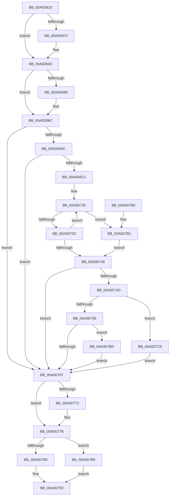

# PspSelectVsmEnclaveByNumber

- RVA: `0x00A0D610`–`0x00A0D7CB` (길이 `443` bytes)
- VA: `0x0000000140A0D610`
- 실행 섹션: `PAGE`
- PDB 이름 있음: `예`; PDB Function 태그: `아니요`
- unwind 정보 RVA: `0x000A8C2C`
- 디코드: `127`개 명령, `443/443` bytes 표시
- 미해석 바이트: `0` (있으면 어셈블리에 `.byte`로 보존)

> 이 문서는 커널 이미지의 기계어와 PDB 기호를 분석해 생성했습니다. 4번과 5번은 함수 원형과 자료형을 바이너리 사용 방식에서 추정한 C 해석이며 원본 소스 복구 결과는 아닙니다.

## 1. Dependencies

- 직접 호출 지점: **5**; 고유 호출 대상: **5**
- 직접 호출자로 확인된 함수: **1**
- RIP 상대 이미지 참조: **0**

### Outgoing calls
- `0x00A0D65F` → [KeAbPreAcquire](../../text/21/KeAbPreAcquire_function_00210230.md) (function, `0x00210230`)
- `0x00A0D67E` → [ExfAcquirePushLockSharedEx](../../text/21/ExfAcquirePushLockSharedEx_function_0021044C.md) (function, `0x0021044C`)
- `0x00A0D776` → [ExfReleasePushLockShared](../../text/26/ExfReleasePushLockShared_function_00263440.md) (function, `0x00263440`)
- `0x00A0D77E` → [KeAbPostRelease](../../text/2E/KeAbPostRelease_function_002E1600.md) (function, `0x002E1600`)
- `0x00A0D783` → [KeLeaveCriticalRegion](../../text/25/KeLeaveCriticalRegion_function_0025D8B0.md) (function, `0x0025D8B0`)

### Direct callers
- [PsCallEnclave](PsCallEnclave_function_00A0CF50.md) at `0x00A0D009`

### Static image references
- 디코드된 RIP-relative 메모리 참조가 없습니다.

## 2. Other-region calls and transfers

- 다른 실행 섹션으로 향하는 call: **5**
  - `0x00A0D65F` → [KeAbPreAcquire](../../text/21/KeAbPreAcquire_function_00210230.md) (`PAGE` → `.text`)
  - `0x00A0D67E` → [ExfAcquirePushLockSharedEx](../../text/21/ExfAcquirePushLockSharedEx_function_0021044C.md) (`PAGE` → `.text`)
  - `0x00A0D776` → [ExfReleasePushLockShared](../../text/26/ExfReleasePushLockShared_function_00263440.md) (`PAGE` → `.text`)
  - `0x00A0D77E` → [KeAbPostRelease](../../text/2E/KeAbPostRelease_function_002E1600.md) (`PAGE` → `.text`)
  - `0x00A0D783` → [KeLeaveCriticalRegion](../../text/25/KeLeaveCriticalRegion_function_0025D8B0.md) (`PAGE` → `.text`)
- 별도 외부 분기/꼬리 이동을 확인하지 못했습니다.

## 3. Assembly (complete function range)

```asm
00A0D610  48 89 5C 24 10                  mov qword ptr [rsp + 0x10], rbx
00A0D615  48 89 6C 24 18                  mov qword ptr [rsp + 0x18], rbp
00A0D61A  48 89 74 24 20                  mov qword ptr [rsp + 0x20], rsi
00A0D61F  57                              push rdi
00A0D620  41 54                           push r12
00A0D622  41 55                           push r13
00A0D624  41 56                           push r14
00A0D626  41 57                           push r15
00A0D628  48 83 EC 20                     sub rsp, 0x20
00A0D62C  65 48 8B 04 25 88 01 00 00      mov rax, qword ptr gs:[0x188]
00A0D635  48 8D 99 58 06 00 00            lea rbx, [rcx + 0x658]
00A0D63C  4D 8B E0                        mov r12, r8
00A0D63F  4C 8B FA                        mov r15, rdx
00A0D642  4C 8B F1                        mov r14, rcx
00A0D645  48 83 CE FF                     or rsi, 0xffffffffffffffff
00A0D649  45 33 ED                        xor r13d, r13d
00A0D64C  45 33 C0                        xor r8d, r8d
00A0D64F  66 01 B0 E4 01 00 00            add word ptr [rax + 0x1e4], si
00A0D656  33 D2                           xor edx, edx
00A0D658  48 8B CB                        mov rcx, rbx
00A0D65B  90                              nop
00A0D65C  41 8B FD                        mov edi, r13d
00A0D65F  E8 CC 2B 80 FF                  call 0x140210230
00A0D664  48 8B E8                        mov rbp, rax
00A0D667  8D 4E 12                        lea ecx, [rsi + 0x12]
00A0D66A  33 C0                           xor eax, eax
00A0D66C  F0 48 0F B1 0B                  lock cmpxchg qword ptr [rbx], rcx
00A0D671  74 10                           je 0x140a0d683
00A0D673  4C 8B CB                        mov r9, rbx
00A0D676  4C 8B C5                        mov r8, rbp
00A0D679  33 D2                           xor edx, edx
00A0D67B  48 8B CB                        mov rcx, rbx
00A0D67E  E8 C9 2D 80 FF                  call 0x14021044c
00A0D683  48 85 ED                        test rbp, rbp
00A0D686  74 04                           je 0x140a0d68c
00A0D688  C6 45 0A 01                     mov byte ptr [rbp + 0xa], 1
00A0D68C  4D 8B 9E 48 06 00 00            mov r11, qword ptr [r14 + 0x648]
00A0D693  4D 85 DB                        test r11, r11
00A0D696  0F 84 CB 00 00 00               je 0x140a0d767
00A0D69C  45 8B 53 04                     mov r10d, dword ptr [r11 + 4]
00A0D6A0  41 8B CA                        mov ecx, r10d
00A0D6A3  83 E1 1F                        and ecx, 0x1f
00A0D6A6  41 C1 EA 05                     shr r10d, 5
00A0D6AA  48 D3 E6                        shl rsi, cl
00A0D6AD  4C 8B CE                        mov r9, rsi
00A0D6B0  4D 23 CF                        and r9, r15
00A0D6B3  4C 89 4C 24 50                  mov qword ptr [rsp + 0x50], r9
00A0D6B8  45 85 D2                        test r10d, r10d
00A0D6BB  0F 84 A6 00 00 00               je 0x140a0d767
00A0D6C1  41 0F B6 C1                     movzx eax, r9b
00A0D6C5  48 05 CB 5D B1 00               add rax, 0xb15dcb
00A0D6CB  48 6B C8 25                     imul rcx, rax, 0x25
00A0D6CF  0F B6 44 24 51                  movzx eax, byte ptr [rsp + 0x51]
00A0D6D4  48 03 C8                        add rcx, rax
00A0D6D7  0F B6 44 24 52                  movzx eax, byte ptr [rsp + 0x52]
00A0D6DC  48 6B D1 25                     imul rdx, rcx, 0x25
00A0D6E0  48 03 D0                        add rdx, rax
00A0D6E3  0F B6 44 24 53                  movzx eax, byte ptr [rsp + 0x53]
00A0D6E8  48 6B CA 25                     imul rcx, rdx, 0x25
00A0D6EC  48 03 C8                        add rcx, rax
00A0D6EF  0F B6 44 24 54                  movzx eax, byte ptr [rsp + 0x54]
00A0D6F4  48 6B D1 25                     imul rdx, rcx, 0x25
00A0D6F8  48 03 D0                        add rdx, rax
00A0D6FB  0F B6 44 24 55                  movzx eax, byte ptr [rsp + 0x55]
00A0D700  48 6B CA 25                     imul rcx, rdx, 0x25
00A0D704  48 03 C8                        add rcx, rax
00A0D707  0F B6 44 24 56                  movzx eax, byte ptr [rsp + 0x56]
00A0D70C  48 6B D1 25                     imul rdx, rcx, 0x25
00A0D710  41 8D 4A FF                     lea ecx, [r10 - 1]
00A0D714  48 03 D0                        add rdx, rax
00A0D717  0F B6 44 24 57                  movzx eax, byte ptr [rsp + 0x57]
00A0D71C  4C 6B C2 25                     imul r8, rdx, 0x25
00A0D720  49 03 C0                        add rax, r8
00A0D723  8B C0                           mov eax, eax
00A0D725  48 23 C8                        and rcx, rax
00A0D728  49 8B 43 08                     mov rax, qword ptr [r11 + 8]
00A0D72C  48 8D 14 C8                     lea rdx, [rax + rcx*8]
00A0D730  B9 01 00 00 00                  mov ecx, 1
00A0D735  48 8B 12                        mov rdx, qword ptr [rdx]
00A0D738  84 D1                           test cl, dl
00A0D73A  75 75                           jne 0x140a0d7b1
00A0D73C  48 8B 42 08                     mov rax, qword ptr [rdx + 8]
00A0D740  48 23 C6                        and rax, rsi
00A0D743  4C 3B C8                        cmp r9, rax
00A0D746  75 ED                           jne 0x140a0d735
00A0D748  48 85 D2                        test rdx, rdx
00A0D74B  74 1A                           je 0x140a0d767
00A0D74D  48 8B FA                        mov rdi, rdx
00A0D750  44 39 6A 28                     cmp dword ptr [rdx + 0x28], r13d
00A0D754  74 70                           je 0x140a0d7c6
00A0D756  48 8B C1                        mov rax, rcx
00A0D759  F0 48 0F C1 42 10               lock xadd qword ptr [rdx + 0x10], rax
00A0D75F  48 03 C1                        add rax, rcx
00A0D762  48 3B C1                        cmp rax, rcx
00A0D765  7E 56                           jle 0x140a0d7bd
00A0D767  B8 11 00 00 00                  mov eax, 0x11
00A0D76C  F0 4C 0F B1 2B                  lock cmpxchg qword ptr [rbx], r13
00A0D771  74 08                           je 0x140a0d77b
00A0D773  48 8B CB                        mov rcx, rbx
00A0D776  E8 C5 5C 85 FF                  call 0x140263440
00A0D77B  48 8B CB                        mov rcx, rbx
00A0D77E  E8 7D 3E 8D FF                  call 0x1402e1600
00A0D783  E8 28 01 85 FF                  call 0x14025d8b0
00A0D788  48 85 FF                        test rdi, rdi
00A0D78B  74 29                           je 0x140a0d7b6
00A0D78D  49 89 3C 24                     mov qword ptr [r12], rdi
00A0D791  33 C0                           xor eax, eax
00A0D793  48 8B 5C 24 58                  mov rbx, qword ptr [rsp + 0x58]
00A0D798  48 8B 6C 24 60                  mov rbp, qword ptr [rsp + 0x60]
00A0D79D  48 8B 74 24 68                  mov rsi, qword ptr [rsp + 0x68]
00A0D7A2  48 83 C4 20                     add rsp, 0x20
00A0D7A6  41 5F                           pop r15
00A0D7A8  41 5E                           pop r14
00A0D7AA  41 5D                           pop r13
00A0D7AC  41 5C                           pop r12
00A0D7AE  5F                              pop rdi
00A0D7AF  C3                              ret
00A0D7B0  CC                              int3
00A0D7B1  49 8B D5                        mov rdx, r13
00A0D7B4  EB 92                           jmp 0x140a0d748
00A0D7B6  B8 08 00 00 C0                  mov eax, 0xc0000008
00A0D7BB  EB D6                           jmp 0x140a0d793
00A0D7BD  B9 0E 00 00 00                  mov ecx, 0xe
00A0D7C2  CD 29                           int 0x29
00A0D7C4  EB A1                           jmp 0x140a0d767
00A0D7C6  49 8B FD                        mov rdi, r13
00A0D7C9  EB 9C                           jmp 0x140a0d767
```

## 4. C-style interpretation (structured pseudocode)

```c
__int64 __fastcall PspSelectVsmEnclaveByNumber(__int64 a1, __int64 a2, __int64 a3)
{
    __int64 result;
    __int64 v_r10;
    __int64 v_r13;
    __int64 v_rsi;
    __int64 v_rsp;
    unsigned __int64 v_stack_p10;
    unsigned __int64 v_stack_p18;
    unsigned __int64 v_stack_p20;
    unsigned __int64 v_stack_p8;
    unsigned __int8 v_stack_p9;
    unsigned __int8 v_stack_pA;
    unsigned __int8 v_stack_pB;
    unsigned __int8 v_stack_pC;
    unsigned __int8 v_stack_pD;
    unsigned __int8 v_stack_pE;
    unsigned __int8 v_stack_pF;

    v_stack_p10 = v_rbx;
    v_stack_p18 = v_rbp;
    v_stack_p20 = v_rsi;
    v_rsp = (v_rsp) - (32);
    v_rsi = (v_rsi) | (-1);
    v_r13 = 0;
    a3 = 0;
    a2 = 0;
    result = KeAbPreAcquire(a1 + 1624, a2, a3, a4);
    result = 0;
    if (!(condition_is_equal)) {
        a4 = a1 + 1624;
        a3 = 0;
        a2 = 0;
        a1 = a1 + 1624;
        result = ExfAcquirePushLockSharedEx(a1, a2, a3, a4);
    }
    if (result != 0) {
        *(unsigned __int8 *)(result + 10) = 1;
    }
    if (*(unsigned __int64 *)(a1 + 1608) == 0) goto loc_00A0D767;
    a1 = (unsigned int)(((unsigned int)((unsigned int)((unsigned int)(*(unsigned int *)(*(unsigned __int64 *)(a1 + 1608) + 4))))) & (31));
    v_r10 = (unsigned int)(((unsigned int)(*(unsigned int *)(*(unsigned __int64 *)(a1 + 1608) + 4))) >> (5));
    v_rsi = (v_rsi) << ((unsigned __int8)(a1));
    a4 = (v_rsi) & (0);
    v_stack_p8 = a4;
    if ((unsigned int)(v_r10) == 0) goto loc_00A0D767;
    result = ((unsigned __int8)(a4)) + (0xB15DCBULL);
    a1 = (a1) * (result);
    a1 = (a1) + (v_stack_p9);
    a2 = (a2) * (a1);
    a2 = (a2) + (v_stack_pA);
    a1 = (a1) * (a2);
    a1 = (a1) + (v_stack_pB);
    a2 = (a2) * (a1);
    a2 = (a2) + (v_stack_pC);
    a1 = (a1) * (a2);
    a1 = (a1) + (v_stack_pD);
    a2 = (a2) * (a1);
    a2 = (a2) + (v_stack_pE);
    a3 = (a3) * (a2);
    result = (v_stack_pF) + (a3);
    a1 = (v_r10 - 1) & ((unsigned int)((unsigned int)(result)));
loc_00A0D735:
    if (((1) & ((unsigned __int8)(*(unsigned __int64 *)(*(unsigned __int64 *)(*(unsigned __int64 *)(a1 + 1608) + 8) + a1 * 8)))) != 0) goto loc_00A0D7B1;
    result = (*(unsigned __int64 *)(*(unsigned __int64 *)(*(unsigned __int64 *)(*(unsigned __int64 *)(a1 + 1608) + 8) + a1 * 8) + 8)) & (v_rsi);
    if (a4 != result) goto loc_00A0D735;
loc_00A0D748:
    if (*(unsigned __int64 *)(*(unsigned __int64 *)(*(unsigned __int64 *)(a1 + 1608) + 8) + a1 * 8) == 0) goto loc_00A0D767;
    if ((*(unsigned int *)(*(unsigned __int64 *)(*(unsigned __int64 *)(*(unsigned __int64 *)(a1 + 1608) + 8) + a1 * 8) + 40)) == 0) goto loc_00A0D7C6;
    result = (1) + (1);
    if (result <= 1) goto loc_00A0D7BD;
loc_00A0D767:
    result = 17;
    if (result != 1) {
        a1 = a1 + 1624;
        result = ExfReleasePushLockShared(a1, *(unsigned __int64 *)(*(unsigned __int64 *)(*(unsigned __int64 *)(a1 + 1608) + 8) + a1 * 8), a3, a4);
    }
    result = KeAbPostRelease(a1 + 1624, *(unsigned __int64 *)(*(unsigned __int64 *)(*(unsigned __int64 *)(a1 + 1608) + 8) + a1 * 8), a3, a4);
    result = KeLeaveCriticalRegion(a1 + 1624, *(unsigned __int64 *)(*(unsigned __int64 *)(*(unsigned __int64 *)(a1 + 1608) + 8) + a1 * 8), a3, a4);
    if (*(unsigned __int64 *)(*(unsigned __int64 *)(*(unsigned __int64 *)(a1 + 1608) + 8) + a1 * 8) == 0) goto loc_00A0D7B6;
    *(unsigned __int64 *)(a3) = *(unsigned __int64 *)(*(unsigned __int64 *)(*(unsigned __int64 *)(a1 + 1608) + 8) + a1 * 8);
    result = 0;
loc_00A0D793:
    v_rsp = (v_rsp) + (32);
    return result;
loc_00A0D7B1:
    goto loc_00A0D748;
loc_00A0D7B6:
    goto loc_00A0D793;
loc_00A0D7BD:
    goto loc_00A0D767;
loc_00A0D7C6:
    goto loc_00A0D767;
}
```

## 5. (Beta) C Style

```c
int64_t PspSelectVsmEnclaveByNumber(void *Arg1, int64_t Arg2, void *Arg3)
{
    uint8_t *arg1 = (uint8_t *)Arg1;
    uint8_t *arg3 = (uint8_t *)Arg3;

    int64_t result;
    int64_t local_r10;
    int64_t local_r13;
    int64_t local_rsi;
    int64_t local_rsp;
    uint64_t v_stack_p10;
    uint64_t v_stack_p18;
    uint64_t v_stack_p20;
    uint64_t v_stack_p8;
    uint8_t v_stack_p9;
    uint8_t v_stack_pA;
    uint8_t v_stack_pB;
    uint8_t v_stack_pC;
    uint8_t v_stack_pD;
    uint8_t v_stack_pE;
    uint8_t v_stack_pF;

    v_stack_p10 = local_rbx;
    v_stack_p18 = local_rbp;
    v_stack_p20 = local_rsi;
    local_rsp = (local_rsp) - (32);
    local_rsi = (local_rsi) | (-1);
    local_r13 = 0;
    Arg3 = 0;
    Arg2 = 0;
    result = KeAbPreAcquire(Arg1 + 1624, Arg2, Arg3, a4);
    result = 0;
    if (!(condition_is_equal)) {
        a4 = Arg1 + 1624;
        Arg3 = 0;
        Arg2 = 0;
        Arg1 = Arg1 + 1624;
        result = ExfAcquirePushLockSharedEx(Arg1, Arg2, Arg3, a4);
    }
    if (result != 0) {
        *(uint8_t *)(result + 0xA) = 1;
    }
    if (*(uint64_t *)(arg1 + 0x648) == 0) goto loc_00A0D767;
    Arg1 = (uint32_t)(((uint32_t)((uint32_t)((uint32_t)(*(uint32_t *)(*(uint64_t *)(arg1 + 0x648) + 0x4))))) & (31));
    local_r10 = (uint32_t)(((uint32_t)(*(uint32_t *)(*(uint64_t *)(arg1 + 0x648) + 0x4))) >> (5));
    local_rsi = (local_rsi) << ((uint8_t)(Arg1));
    a4 = (local_rsi) & (0);
    v_stack_p8 = a4;
    if ((uint32_t)(local_r10) == 0) goto loc_00A0D767;
    result = ((uint8_t)(a4)) + (0xB15DCBULL);
    Arg1 = (Arg1) * (result);
    Arg1 = (Arg1) + (v_stack_p9);
    Arg2 = (Arg2) * (Arg1);
    Arg2 = (Arg2) + (v_stack_pA);
    Arg1 = (Arg1) * (Arg2);
    Arg1 = (Arg1) + (v_stack_pB);
    Arg2 = (Arg2) * (Arg1);
    Arg2 = (Arg2) + (v_stack_pC);
    Arg1 = (Arg1) * (Arg2);
    Arg1 = (Arg1) + (v_stack_pD);
    Arg2 = (Arg2) * (Arg1);
    Arg2 = (Arg2) + (v_stack_pE);
    Arg3 = (Arg3) * (Arg2);
    result = (v_stack_pF) + (Arg3);
    Arg1 = (local_r10 - 1) & ((uint32_t)((uint32_t)(result)));
loc_00A0D735:
    if (((1) & ((uint8_t)(*(uint64_t *)(*(uint64_t *)(*(uint64_t *)(arg1 + 0x648) + 0x8) + arg1 * 8)))) != 0) goto loc_00A0D7B1;
    result = (*(uint64_t *)(*(uint64_t *)(*(uint64_t *)(*(uint64_t *)(arg1 + 0x648) + 0x8) + arg1 * 8) + 0x8)) & (local_rsi);
    if (a4 != result) goto loc_00A0D735;
loc_00A0D748:
    if (*(uint64_t *)(*(uint64_t *)(*(uint64_t *)(arg1 + 0x648) + 0x8) + arg1 * 8) == 0) goto loc_00A0D767;
    if ((*(uint32_t *)(*(uint64_t *)(*(uint64_t *)(*(uint64_t *)(arg1 + 0x648) + 0x8) + arg1 * 8) + 0x28)) == 0) goto loc_00A0D7C6;
    result = (1) + (1);
    if (result <= 1) goto loc_00A0D7BD;
loc_00A0D767:
    result = 17;
    if (result != 1) {
        Arg1 = Arg1 + 1624;
        result = ExfReleasePushLockShared(Arg1, *(uint64_t *)(*(uint64_t *)(*(uint64_t *)(arg1 + 0x648) + 0x8) + arg1 * 8), Arg3, a4);
    }
    result = KeAbPostRelease(Arg1 + 1624, *(uint64_t *)(*(uint64_t *)(*(uint64_t *)(arg1 + 0x648) + 0x8) + arg1 * 8), Arg3, a4);
    result = KeLeaveCriticalRegion(Arg1 + 1624, *(uint64_t *)(*(uint64_t *)(*(uint64_t *)(arg1 + 0x648) + 0x8) + arg1 * 8), Arg3, a4);
    if (*(uint64_t *)(*(uint64_t *)(*(uint64_t *)(arg1 + 0x648) + 0x8) + arg1 * 8) == 0) goto loc_00A0D7B6;
    *(uint64_t *)(arg3) = *(uint64_t *)(*(uint64_t *)(*(uint64_t *)(arg1 + 0x648) + 0x8) + arg1 * 8);
    result = 0;
loc_00A0D793:
    local_rsp = (local_rsp) + (32);
    return result;
loc_00A0D7B1:
    goto loc_00A0D748;
loc_00A0D7B6:
    goto loc_00A0D793;
loc_00A0D7BD:
    goto loc_00A0D767;
loc_00A0D7C6:
    goto loc_00A0D767;
}
```

### 관측된 메모리 오프셋

구조체 형식이 확인되지 않은 접근은 인자 기준의 오프셋으로만 기록했습니다.

| 기준 인자 | 오프셋 표현 | 폭 (bit) | 접근 |
|---|---:|---:|---|
| `Arg1` | `+ 0x0` | `64` | `R` |
| `Arg1` | `+ 0x648` | `64` | `R` |
| `Arg1` | `+ 0x658` | `64` | `R` |
| `Arg3` | `+ 0x0` | `64` | `W` |

## 6. Execution-region graph

[열기: 2D/3D 그래프와 함수 탐색 컨트롤 패널](../../../control-panel.html?section=page&rva=0x00A0D610&view=graph)

- 2D 그래프는 위에서 아래로 흐르고, 3D 그래프는 빈 공간을 드래그해 회전합니다. Shift+드래그는 이동, 휠은 확대·축소, 함수 노드 선택은 대상 보고서 이동입니다.

### Static fallback


