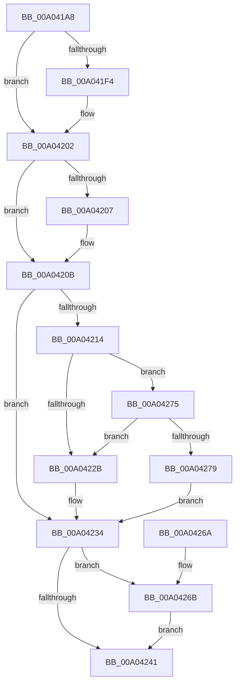

# PspSetProcessDefaultHardErrorMode

- RVA: `0x00A041A8`–`0x00A04284` (길이 `220` bytes)
- VA: `0x0000000140A041A8`
- 실행 섹션: `PAGE`
- PDB 이름 있음: `예`; PDB Function 태그: `아니요`
- unwind 정보 RVA: `0x0009AC34`
- 디코드: `60`개 명령, `220/220` bytes 표시
- 미해석 바이트: `0` (있으면 어셈블리에 `.byte`로 보존)

> 이 문서는 커널 이미지의 기계어와 PDB 기호를 분석해 생성했습니다. 4번과 5번은 함수 원형과 자료형을 바이너리 사용 방식에서 추정한 C 해석이며 원본 소스 복구 결과는 아닙니다.

## 1. Dependencies

- 직접 호출 지점: **5**; 고유 호출 대상: **5**
- 직접 호출자로 확인된 함수: **1**
- RIP 상대 이미지 참조: **0**

### Outgoing calls
- `0x00A041E4` → [KeAbPreAcquire](../../text/21/KeAbPreAcquire_function_00210230.md) (function, `0x00210230`)
- `0x00A041FD` → [ExfAcquirePushLockExclusiveEx](../../text/20/ExfAcquirePushLockExclusiveEx_function_0020FC90.md) (function, `0x0020FC90`)
- `0x00A04244` → [KeAbPostRelease](../../text/2E/KeAbPostRelease_function_002E1600.md) (function, `0x002E1600`)
- `0x00A0424C` → [KeLeaveCriticalRegionThread](../../text/25/KeLeaveCriticalRegionThread_function_0025EFF0.md) (function, `0x0025EFF0`)
- `0x00A0426E` → [ExfTryToWakePushLock](../../text/26/ExfTryToWakePushLock_function_00265DD0.md) (function, `0x00265DD0`)

### Direct callers
- [NtSetInformationProcess](../AE/NtSetInformationProcess_function_00AE5370.md) at `0x00AE5E8F`

### Static image references
- 디코드된 RIP-relative 메모리 참조가 없습니다.

## 2. Other-region calls and transfers

- 다른 실행 섹션으로 향하는 call: **5**
  - `0x00A041E4` → [KeAbPreAcquire](../../text/21/KeAbPreAcquire_function_00210230.md) (`PAGE` → `.text`)
  - `0x00A041FD` → [ExfAcquirePushLockExclusiveEx](../../text/20/ExfAcquirePushLockExclusiveEx_function_0020FC90.md) (`PAGE` → `.text`)
  - `0x00A04244` → [KeAbPostRelease](../../text/2E/KeAbPostRelease_function_002E1600.md) (`PAGE` → `.text`)
  - `0x00A0424C` → [KeLeaveCriticalRegionThread](../../text/25/KeLeaveCriticalRegionThread_function_0025EFF0.md) (`PAGE` → `.text`)
  - `0x00A0426E` → [ExfTryToWakePushLock](../../text/26/ExfTryToWakePushLock_function_00265DD0.md) (`PAGE` → `.text`)
- 별도 외부 분기/꼬리 이동을 확인하지 못했습니다.

## 3. Assembly (complete function range)

```asm
00A041A8  48 89 5C 24 08                  mov qword ptr [rsp + 8], rbx
00A041AD  48 89 6C 24 10                  mov qword ptr [rsp + 0x10], rbp
00A041B2  48 89 74 24 18                  mov qword ptr [rsp + 0x18], rsi
00A041B7  57                              push rdi
00A041B8  41 56                           push r14
00A041BA  41 57                           push r15
00A041BC  48 83 EC 20                     sub rsp, 0x20
00A041C0  48 8D B1 C8 01 00 00            lea rsi, [rcx + 0x1c8]
00A041C7  45 8B F0                        mov r14d, r8d
00A041CA  4C 8B FA                        mov r15, rdx
00A041CD  48 8B F9                        mov rdi, rcx
00A041D0  48 83 CB FF                     or rbx, 0xffffffffffffffff
00A041D4  45 33 C0                        xor r8d, r8d
00A041D7  66 01 9A E4 01 00 00            add word ptr [rdx + 0x1e4], bx
00A041DE  48 8B CE                        mov rcx, rsi
00A041E1  33 D2                           xor edx, edx
00A041E3  90                              nop
00A041E4  E8 47 C0 80 FF                  call 0x140210230
00A041E9  F0 48 0F BA 2E 00               lock bts qword ptr [rsi], 0
00A041EF  48 8B E8                        mov rbp, rax
00A041F2  73 0E                           jae 0x140a04202
00A041F4  4C 8B C6                        mov r8, rsi
00A041F7  48 8B D0                        mov rdx, rax
00A041FA  48 8B CE                        mov rcx, rsi
00A041FD  E8 8E BA 80 FF                  call 0x14020fc90
00A04202  48 85 ED                        test rbp, rbp
00A04205  74 04                           je 0x140a0420b
00A04207  C6 45 0A 01                     mov byte ptr [rbp + 0xa], 1
00A0420B  44 39 B7 88 03 00 00            cmp dword ptr [rdi + 0x388], r14d
00A04212  74 20                           je 0x140a04234
00A04214  41 8B C6                        mov eax, r14d
00A04217  44 89 B7 88 03 00 00            mov dword ptr [rdi + 0x388], r14d
00A0421E  83 E0 04                        and eax, 4
00A04221  48 83 BF 10 03 00 00 00         cmp qword ptr [rdi + 0x310], 0
00A04229  74 4A                           je 0x140a04275
00A0422B  F0 0F BA AF 88 00 00 00 00      lock bts dword ptr [rdi + 0x88], 0
00A04234  F0 48 0F C1 1E                  lock xadd qword ptr [rsi], rbx
00A04239  80 E3 06                        and bl, 6
00A0423C  80 FB 02                        cmp bl, 2
00A0423F  74 2A                           je 0x140a0426b
00A04241  48 8B CE                        mov rcx, rsi
00A04244  E8 B7 D3 8D FF                  call 0x1402e1600
00A04249  49 8B CF                        mov rcx, r15
00A0424C  E8 9F AD 85 FF                  call 0x14025eff0
00A04251  48 8B 5C 24 40                  mov rbx, qword ptr [rsp + 0x40]
00A04256  48 8B 6C 24 48                  mov rbp, qword ptr [rsp + 0x48]
00A0425B  48 8B 74 24 50                  mov rsi, qword ptr [rsp + 0x50]
00A04260  48 83 C4 20                     add rsp, 0x20
00A04264  41 5F                           pop r15
00A04266  41 5E                           pop r14
00A04268  5F                              pop rdi
00A04269  C3                              ret
00A0426A  CC                              int3
00A0426B  48 8B CE                        mov rcx, rsi
00A0426E  E8 5D 1B 86 FF                  call 0x140265dd0
00A04273  EB CC                           jmp 0x140a04241
00A04275  85 C0                           test eax, eax
00A04277  75 B2                           jne 0x140a0422b
00A04279  F0 0F BA B7 88 00 00 00 00      lock btr dword ptr [rdi + 0x88], 0
00A04282  EB B0                           jmp 0x140a04234
```

## 4. C-style interpretation (structured pseudocode)

```c
__int64 __fastcall PspSetProcessDefaultHardErrorMode(__int64 a1, __int64 a2, int a3)
{
    __int64 result;
    __int64 v_rbx;
    __int64 v_rsp;
    unsigned __int64 v_stack_p10;
    unsigned __int64 v_stack_p18;
    unsigned __int64 v_stack_p8;

    v_stack_p8 = v_rbx;
    v_stack_p10 = v_rbp;
    v_stack_p18 = v_rsi;
    v_rsp = (v_rsp) - (32);
    v_rbx = (v_rbx) | (-1);
    a3 = 0;
    a2 = 0;
    result = KeAbPreAcquire(a1 + 456, a2, a3, a4);
    if (!(condition_is_above_or_equal)) {
        a3 = a1 + 456;
        a2 = result;
        a1 = a1 + 456;
        result = ExfAcquirePushLockExclusiveEx(a1, a2, a3, a4);
    }
    if (result != 0) {
        *(unsigned __int8 *)(result + 10) = 1;
    }
    if ((*(unsigned int *)(a1 + 904)) == ((unsigned int)((unsigned int)(a3)))) goto loc_00A04234;
    *(unsigned int *)(a1 + 904) = (unsigned int)((unsigned int)(a3));
    result = (unsigned int)(((unsigned int)((unsigned int)((unsigned int)(a3)))) & (4));
    if ((*(unsigned __int64 *)(a1 + 784)) == 0) goto loc_00A04275;
loc_00A0422B:
loc_00A04234:
    v_rbx = (unsigned __int8)((v_rbx) & (6));
    if (((unsigned __int8)(v_rbx)) == 2) goto loc_00A0426B;
loc_00A04241:
    result = KeAbPostRelease(a1 + 456, a2, a3, a4);
    result = KeLeaveCriticalRegionThread(a2, a2, a3, a4);
    v_rsp = (v_rsp) + (32);
    return result;
loc_00A0426B:
    result = ExfTryToWakePushLock(v_stack_p18, a2, a3, a4);
    goto loc_00A04241;
loc_00A04275:
    if ((unsigned int)(result) != 0) goto loc_00A0422B;
    goto loc_00A04234;
}
```

## 5. (Beta) C Style

```c
int64_t PspSetProcessDefaultHardErrorMode(void *Arg1, void *Arg2, int32_t Arg3)
{
    uint8_t *arg1 = (uint8_t *)Arg1;
    uint8_t *arg2 = (uint8_t *)Arg2;

    int64_t result;
    int64_t local_rbx;
    int64_t local_rsp;
    uint64_t v_stack_p10;
    uint64_t v_stack_p18;
    uint64_t v_stack_p8;

    v_stack_p8 = local_rbx;
    v_stack_p10 = local_rbp;
    v_stack_p18 = local_rsi;
    local_rsp = (local_rsp) - (32);
    local_rbx = (local_rbx) | (-1);
    Arg3 = 0;
    Arg2 = 0;
    result = KeAbPreAcquire(Arg1 + 456, Arg2, Arg3, a4);
    if (!(condition_is_above_or_equal)) {
        Arg3 = Arg1 + 456;
        Arg2 = result;
        Arg1 = Arg1 + 456;
        result = ExfAcquirePushLockExclusiveEx(Arg1, Arg2, Arg3, a4);
    }
    if (result != 0) {
        *(uint8_t *)(result + 0xA) = 1;
    }
    if ((*(uint32_t *)(arg1 + 0x388)) == ((uint32_t)((uint32_t)(Arg3)))) goto loc_00A04234;
    *(uint32_t *)(arg1 + 0x388) = (uint32_t)((uint32_t)(Arg3));
    result = (uint32_t)(((uint32_t)((uint32_t)((uint32_t)(Arg3)))) & (4));
    if ((*(uint64_t *)(arg1 + 0x310)) == 0) goto loc_00A04275;
loc_00A0422B:
loc_00A04234:
    local_rbx = (uint8_t)((local_rbx) & (6));
    if (((uint8_t)(local_rbx)) == 2) goto loc_00A0426B;
loc_00A04241:
    result = KeAbPostRelease(Arg1 + 456, Arg2, Arg3, a4);
    result = KeLeaveCriticalRegionThread(Arg2, Arg2, Arg3, a4);
    local_rsp = (local_rsp) + (32);
    return result;
loc_00A0426B:
    result = ExfTryToWakePushLock(v_stack_p18, Arg2, Arg3, a4);
    goto loc_00A04241;
loc_00A04275:
    if ((uint32_t)(result) != 0) goto loc_00A0422B;
    goto loc_00A04234;
}
```

### 관측된 메모리 오프셋

구조체 형식이 확인되지 않은 접근은 인자 기준의 오프셋으로만 기록했습니다.

| 기준 인자 | 오프셋 표현 | 폭 (bit) | 접근 |
|---|---:|---:|---|
| `Arg1` | `+ 0x0` | `64` | `R/W` |
| `Arg1` | `+ 0x88` | `32` | `R/W` |
| `Arg1` | `+ 0x1C8` | `64` | `R` |
| `Arg1` | `+ 0x310` | `64` | `R` |
| `Arg1` | `+ 0x388` | `32` | `R` |
| `Arg1` | `+ 0x388` | `32` | `W` |
| `Arg2` | `+ 0x1E4` | `16` | `R/W` |

## 6. Execution-region graph

[열기: 2D/3D 그래프와 함수 탐색 컨트롤 패널](../../../control-panel.html?section=page&rva=0x00A041A8&view=graph)

- 2D 그래프는 위에서 아래로 흐르고, 3D 그래프는 빈 공간을 드래그해 회전합니다. Shift+드래그는 이동, 휠은 확대·축소, 함수 노드 선택은 대상 보고서 이동입니다.

### Static fallback


