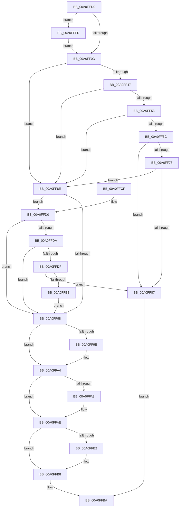

# PspThreadOpen

- RVA: `0x00A0FED0`–`0x00A10034` (길이 `356` bytes)
- VA: `0x0000000140A0FED0`
- 실행 섹션: `PAGE`
- PDB 이름 있음: `예`; PDB Function 태그: `아니요`
- unwind 정보 RVA: `0x000A91D0`
- 디코드: `94`개 명령, `356/356` bytes 표시
- 미해석 바이트: `0` (있으면 어셈블리에 `.byte`로 보존)

> 이 문서는 커널 이미지의 기계어와 PDB 기호를 분석해 생성했습니다. 4번과 5번은 함수 원형과 자료형을 바이너리 사용 방식에서 추정한 C 해석이며 원본 소스 복구 결과는 아닙니다.

## 1. Dependencies

- 직접 호출 지점: **5**; 고유 호출 대상: **5**
- 직접 호출자로 확인된 함수: **1**
- RIP 상대 이미지 참조: **5**

### Outgoing calls
- `0x00A0FF2D` → [PspIsParentProcess](../../text/45/PspIsParentProcess_function_00458BD8.md) (function, `0x00458BD8`)
- `0x00A0FF63` → [PspCheckForInvalidAccessByProtection](../A1/PspCheckForInvalidAccessByProtection_function_00A10098.md) (function, `0x00A10098`)
- `0x00A0FF7E` → [guard_dispatch_icall](../../text/6B/guard_dispatch_icall_function_006BAAD0.md) (function, `0x006BAAD0`)
- `0x00A10014` → [wil_details_FeatureReporting_ReportUsageToService](../../text/53/wil_details_FeatureReporting_ReportUsageToService_function_0053E6E4.md) (function, `0x0053E6E4`)
- `0x00A1002A` → [wil_details_FeatureStateCache_TryEnableDeviceUsageFastPath](../../text/53/wil_details_FeatureStateCache_TryEnableDeviceUsageFastPath_function_0053E774.md) (function, `0x0053E774`)

### Direct callers
- [ObpIncrementHandleCountEx](../86/ObpIncrementHandleCountEx_function_0086DA10.md) at `0x0086E2EB`

### Static image references
- `0x00A0FEFA` → RVA `0x00FC4B40` (`.data`; read)
- `0x00A0FF14` → RVA `0x00B4C278` (`PAGE`; read)
- `0x00A0FF6C` → RVA `0x00F04EF8` (`.data`; read)
- `0x00A0FFDF` → RVA `0x00F0656C` (`.data`; read)
- `0x00A10004` → RVA `0x000DF0A8` (`.rdata`; read)

## 2. Other-region calls and transfers

- 다른 실행 섹션으로 향하는 call: **4**
  - `0x00A0FF2D` → [PspIsParentProcess](../../text/45/PspIsParentProcess_function_00458BD8.md) (`PAGE` → `.text`)
  - `0x00A0FF7E` → [guard_dispatch_icall](../../text/6B/guard_dispatch_icall_function_006BAAD0.md) (`PAGE` → `.text`)
  - `0x00A10014` → [wil_details_FeatureReporting_ReportUsageToService](../../text/53/wil_details_FeatureReporting_ReportUsageToService_function_0053E6E4.md) (`PAGE` → `.text`)
  - `0x00A1002A` → [wil_details_FeatureStateCache_TryEnableDeviceUsageFastPath](../../text/53/wil_details_FeatureStateCache_TryEnableDeviceUsageFastPath_function_0053E774.md) (`PAGE` → `.text`)
- 별도 외부 분기/꼬리 이동을 확인하지 못했습니다.

## 3. Assembly (complete function range)

```asm
00A0FED0  48 89 5C 24 08                  mov qword ptr [rsp + 8], rbx
00A0FED5  48 89 6C 24 10                  mov qword ptr [rsp + 0x10], rbp
00A0FEDA  48 89 74 24 18                  mov qword ptr [rsp + 0x18], rsi
00A0FEDF  57                              push rdi
00A0FEE0  48 83 EC 20                     sub rsp, 0x20
00A0FEE4  49 8B 99 20 02 00 00            mov rbx, qword ptr [r9 + 0x220]
00A0FEEB  49 8B F1                        mov rsi, r9
00A0FEEE  49 8B F8                        mov rdi, r8
00A0FEF1  40 8A EA                        mov bpl, dl
00A0FEF4  48 83 64 24 48 00               and qword ptr [rsp + 0x48], 0
00A0FEFA  8B 0D 40 4C 5B 00               mov ecx, dword ptr [rip + 0x5b4c40]
00A0FF00  89 4C 24 48                     mov dword ptr [rsp + 0x48], ecx
00A0FF04  F6 C1 10                        test cl, 0x10
00A0FF07  0F 84 E0 00 00 00               je 0x140a0ffed
00A0FF0D  0F B6 83 FA 05 00 00            movzx eax, byte ptr [rbx + 0x5fa]
00A0FF14  4C 8D 0D 5D C3 13 00            lea r9, [rip + 0x13c35d]
00A0FF1B  48 C1 E8 04                     shr rax, 4
00A0FF1F  48 8B D3                        mov rdx, rbx
00A0FF22  48 8B CF                        mov rcx, rdi
00A0FF25  48 8D 04 40                     lea rax, [rax + rax*2]
00A0FF29  45 8B 0C 81                     mov r9d, dword ptr [r9 + rax*4]
00A0FF2D  E8 A6 8C A4 FF                  call 0x140458bd8
00A0FF32  48 8B 5C 24 50                  mov rbx, qword ptr [rsp + 0x50]
00A0FF37  41 8B C9                        mov ecx, r9d
00A0FF3A  83 E1 FE                        and ecx, 0xfffffffe
00A0FF3D  84 C0                           test al, al
00A0FF3F  41 0F 44 C9                     cmove ecx, r9d
00A0FF43  85 0B                           test dword ptr [rbx], ecx
00A0FF45  74 47                           je 0x140a0ff8e
00A0FF47  4C 8B 96 20 02 00 00            mov r10, qword ptr [rsi + 0x220]
00A0FF4E  49 3B FA                        cmp rdi, r10
00A0FF51  74 3B                           je 0x140a0ff8e
00A0FF53  8A 97 FA 05 00 00               mov dl, byte ptr [rdi + 0x5fa]
00A0FF59  40 8A CD                        mov cl, bpl
00A0FF5C  45 8A 82 FA 05 00 00            mov r8b, byte ptr [r10 + 0x5fa]
00A0FF63  E8 30 01 00 00                  call 0x140a10098
00A0FF68  84 C0                           test al, al
00A0FF6A  74 22                           je 0x140a0ff8e
00A0FF6C  48 8B 05 85 4F 4F 00            mov rax, qword ptr [rip + 0x4f4f85]
00A0FF73  48 85 C0                        test rax, rax
00A0FF76  74 0F                           je 0x140a0ff87
00A0FF78  49 8B D2                        mov rdx, r10
00A0FF7B  48 8B CF                        mov rcx, rdi
00A0FF7E  E8 4D AB CA FF                  call 0x1406baad0
00A0FF83  84 C0                           test al, al
00A0FF85  75 07                           jne 0x140a0ff8e
00A0FF87  B8 22 00 00 C0                  mov eax, 0xc0000022
00A0FF8C  EB 2C                           jmp 0x140a0ffba
00A0FF8E  48 83 BE 70 06 00 00 00         cmp qword ptr [rsi + 0x670], 0
00A0FF96  75 38                           jne 0x140a0ffd0
00A0FF98  8B 03                           mov eax, dword ptr [rbx]
00A0FF9A  A8 40                           test al, 0x40
00A0FF9C  74 06                           je 0x140a0ffa4
00A0FF9E  0F BA E8 0B                     bts eax, 0xb
00A0FFA2  89 03                           mov dword ptr [rbx], eax
00A0FFA4  A8 20                           test al, 0x20
00A0FFA6  74 06                           je 0x140a0ffae
00A0FFA8  0F BA E8 0A                     bts eax, 0xa
00A0FFAC  89 03                           mov dword ptr [rbx], eax
00A0FFAE  A8 02                           test al, 2
00A0FFB0  74 06                           je 0x140a0ffb8
00A0FFB2  0F BA E8 0C                     bts eax, 0xc
00A0FFB6  89 03                           mov dword ptr [rbx], eax
00A0FFB8  33 C0                           xor eax, eax
00A0FFBA  48 8B 5C 24 30                  mov rbx, qword ptr [rsp + 0x30]
00A0FFBF  48 8B 6C 24 38                  mov rbp, qword ptr [rsp + 0x38]
00A0FFC4  48 8B 74 24 40                  mov rsi, qword ptr [rsp + 0x40]
00A0FFC9  48 83 C4 20                     add rsp, 0x20
00A0FFCD  5F                              pop rdi
00A0FFCE  C3                              ret
00A0FFCF  CC                              int3
00A0FFD0  48 83 BF 40 06 00 00 00         cmp qword ptr [rdi + 0x640], 0
00A0FFD8  75 BE                           jne 0x140a0ff98
00A0FFDA  40 84 ED                        test bpl, bpl
00A0FFDD  74 B9                           je 0x140a0ff98
00A0FFDF  8B 05 87 65 4F 00               mov eax, dword ptr [rip + 0x4f6587]
00A0FFE5  F7 D0                           not eax
00A0FFE7  85 03                           test dword ptr [rbx], eax
00A0FFE9  75 9C                           jne 0x140a0ff87
00A0FFEB  EB AB                           jmp 0x140a0ff98
00A0FFED  48 8B 44 24 48                  mov rax, qword ptr [rsp + 0x48]
00A0FFF2  41 B9 01 00 00 00               mov r9d, 1
00A0FFF8  41 0B C9                        or ecx, r9d
00A0FFFB  48 89 44 24 48                  mov qword ptr [rsp + 0x48], rax
00A10000  89 4C 24 48                     mov dword ptr [rsp + 0x48], ecx
00A10004  48 8D 0D 9D F0 6C FF            lea rcx, [rip - 0x930f63]
00A1000B  48 8B 54 24 48                  mov rdx, qword ptr [rsp + 0x48]
00A10010  45 8D 41 02                     lea r8d, [r9 + 2]
00A10014  E8 CB E6 B2 FF                  call 0x14053e6e4
00A10019  48 8B 4C 24 48                  mov rcx, qword ptr [rsp + 0x48]
00A1001E  4C 8D 05 83 F0 6C FF            lea r8, [rip - 0x930f7d]
00A10025  BA 03 00 00 00                  mov edx, 3
00A1002A  E8 45 E7 B2 FF                  call 0x14053e774
00A1002F  E9 D9 FE FF FF                  jmp 0x140a0ff0d
```

## 4. C-style interpretation (structured pseudocode)

```c
__int64 __fastcall PspThreadOpen(__int64 a1, unsigned __int8 a2, __int64 a3, __int64 a4, __int64 a5)
{
    __int64 result;
    __int64 v_rsp;
    unsigned __int64 v_stack_p10;
    unsigned __int64 v_stack_p18;
    unsigned __int64 v_stack_p20;
    unsigned __int64 v_stack_p48;
    unsigned __int64 v_stack_p8;

    v_stack_p8 = v_rbx;
    v_stack_p10 = v_rbp;
    v_stack_p18 = v_rsi;
    v_rsp = (v_rsp) - (32);
    v_stack_p20 = (unsigned int)((unsigned int)(*(unsigned int *)(v_rip + 5983296)));
    if ((((unsigned __int8)((unsigned int)(*(unsigned int *)(v_rip + 5983296)))) & (16)) == 0) goto loc_00A0FFED;
loc_00A0FF0D:
    result = (*(unsigned __int8 *)(*(unsigned __int64 *)(a4 + 544) + 1530)) >> (4);
    result = PspIsParentProcess(a3, *(unsigned __int64 *)(a4 + 544), a3, (unsigned int)(*(unsigned int *)(v_rip + 1295197 + result + result * 2 * 4)));
    a1 = (unsigned int)(((unsigned int)((unsigned int)((unsigned int)(*(unsigned int *)(v_rip + 1295197 + result + result * 2 * 4))))) & (0xFFFFFFFEULL));
    if ((unsigned __int8)(result) == 0) { a1 = (unsigned int)((unsigned int)(*(unsigned int *)(v_rip + 1295197 + result + result * 2 * 4))); }
    if (((*(unsigned int *)(a5)) & ((unsigned int)(a1))) == 0) goto loc_00A0FF8E;
    if (a3 == (*(unsigned __int64 *)(a4 + 544))) goto loc_00A0FF8E;
    result = PspCheckForInvalidAccessByProtection(a2, *(unsigned __int8 *)(a3 + 1530), *(unsigned __int8 *)(*(unsigned __int64 *)(a4 + 544) + 1530), (unsigned int)(*(unsigned int *)(v_rip + 1295197 + result + result * 2 * 4)));
    if ((unsigned __int8)(result) == 0) goto loc_00A0FF8E;
    if (*(unsigned __int64 *)(v_rip + 5197701) == 0) goto loc_00A0FF87;
    result = guard_dispatch_icall(a3, *(unsigned __int64 *)(a4 + 544), *(unsigned __int8 *)(*(unsigned __int64 *)(a4 + 544) + 1530), (unsigned int)(*(unsigned int *)(v_rip + 1295197 + result + result * 2 * 4)));
    if ((unsigned __int8)(result) != 0) goto loc_00A0FF8E;
loc_00A0FF87:
    goto loc_00A0FFBA;
loc_00A0FF8E:
    if ((*(unsigned __int64 *)(a4 + 1648)) != 0) goto loc_00A0FFD0;
loc_00A0FF98:
    if ((((unsigned __int8)((unsigned int)(*(unsigned int *)(a5)))) & (64)) != 0) {
        *(unsigned int *)(a5) = (unsigned int)((unsigned int)(*(unsigned int *)(a5)));
    }
    if ((((unsigned __int8)((unsigned int)(*(unsigned int *)(a5)))) & (32)) != 0) {
        *(unsigned int *)(a5) = (unsigned int)((unsigned int)(*(unsigned int *)(a5)));
    }
    if ((((unsigned __int8)((unsigned int)(*(unsigned int *)(a5)))) & (2)) != 0) {
        *(unsigned int *)(a5) = (unsigned int)((unsigned int)(*(unsigned int *)(a5)));
    }
    result = 0;
loc_00A0FFBA:
    v_rsp = (v_rsp) + (32);
    return result;
loc_00A0FFD0:
    if ((*(unsigned __int64 *)(a3 + 1600)) != 0) goto loc_00A0FF98;
    if ((unsigned __int8)(v_stack_p10) == 0) goto loc_00A0FF98;
    result = (unsigned int)(~((unsigned int)(*(unsigned int *)(v_rip + 5203335))));
    if (((*(unsigned int *)(v_stack_p8)) & ((unsigned int)(result))) != 0) goto loc_00A0FF87;
    goto loc_00A0FF98;
loc_00A0FFED:
    a1 = (unsigned int)((a3) | (1));
    v_stack_p48 = v_stack_p48;
    v_stack_p48 = (unsigned int)(a1);
    result = wil_details_FeatureReporting_ReportUsageToService(v_rip - 9637731, v_stack_p48, 1 + 2, 1);
    result = wil_details_FeatureStateCache_TryEnableDeviceUsageFastPath(v_stack_p48, 3, v_rip - 9637757, 1);
    goto loc_00A0FF0D;
}
```

## 5. (Beta) C Style

```c
int64_t PspThreadOpen(int64_t Arg1, uint8_t Arg2, int64_t Arg3, void *Arg4, void *Arg5)
{
    uint8_t *arg4 = (uint8_t *)Arg4;
    uint8_t *arg5 = (uint8_t *)Arg5;

    int64_t result;
    int64_t local_rsp;
    uint64_t v_stack_p10;
    uint64_t v_stack_p18;
    uint64_t v_stack_p20;
    uint64_t v_stack_p48;
    uint64_t v_stack_p8;

    v_stack_p8 = local_rbx;
    v_stack_p10 = local_rbp;
    v_stack_p18 = local_rsi;
    local_rsp = (local_rsp) - (32);
    v_stack_p20 = (uint32_t)((uint32_t)(*(uint32_t *)(v_rip + 0x5B4C40)));
    if ((((uint8_t)((uint32_t)(*(uint32_t *)(v_rip + 0x5B4C40)))) & (16)) == 0) goto loc_00A0FFED;
loc_00A0FF0D:
    result = (*(uint8_t *)(*(uint64_t *)(arg4 + 0x220) + 0x5FA)) >> (4);
    result = PspIsParentProcess(Arg3, *(uint64_t *)(arg4 + 0x220), Arg3, (uint32_t)(*(uint32_t *)(v_rip + 0x13C35D + result + result * 2 * 4)));
    Arg1 = (uint32_t)(((uint32_t)((uint32_t)((uint32_t)(*(uint32_t *)(v_rip + 0x13C35D + result + result * 2 * 4))))) & (0xFFFFFFFEULL));
    if ((uint8_t)(result) == 0) { Arg1 = (uint32_t)((uint32_t)(*(uint32_t *)(v_rip + 0x13C35D + result + result * 2 * 4))); }
    if (((*(uint32_t *)(arg5)) & ((uint32_t)(Arg1))) == 0) goto loc_00A0FF8E;
    if (Arg3 == (*(uint64_t *)(arg4 + 0x220))) goto loc_00A0FF8E;
    result = PspCheckForInvalidAccessByProtection(Arg2, *(uint8_t *)(Arg3 + 0x5FA), *(uint8_t *)(*(uint64_t *)(arg4 + 0x220) + 0x5FA), (uint32_t)(*(uint32_t *)(v_rip + 0x13C35D + result + result * 2 * 4)));
    if ((uint8_t)(result) == 0) goto loc_00A0FF8E;
    if (*(uint64_t *)(v_rip + 0x4F4F85) == 0) goto loc_00A0FF87;
    result = guard_dispatch_icall(Arg3, *(uint64_t *)(arg4 + 0x220), *(uint8_t *)(*(uint64_t *)(arg4 + 0x220) + 0x5FA), (uint32_t)(*(uint32_t *)(v_rip + 0x13C35D + result + result * 2 * 4)));
    if ((uint8_t)(result) != 0) goto loc_00A0FF8E;
loc_00A0FF87:
    goto loc_00A0FFBA;
loc_00A0FF8E:
    if ((*(uint64_t *)(arg4 + 0x670)) != 0) goto loc_00A0FFD0;
loc_00A0FF98:
    if ((((uint8_t)((uint32_t)(*(uint32_t *)(arg5)))) & (64)) != 0) {
        *(uint32_t *)(arg5) = (uint32_t)((uint32_t)(*(uint32_t *)(arg5)));
    }
    if ((((uint8_t)((uint32_t)(*(uint32_t *)(arg5)))) & (32)) != 0) {
        *(uint32_t *)(arg5) = (uint32_t)((uint32_t)(*(uint32_t *)(arg5)));
    }
    if ((((uint8_t)((uint32_t)(*(uint32_t *)(arg5)))) & (2)) != 0) {
        *(uint32_t *)(arg5) = (uint32_t)((uint32_t)(*(uint32_t *)(arg5)));
    }
    result = 0;
loc_00A0FFBA:
    local_rsp = (local_rsp) + (32);
    return result;
loc_00A0FFD0:
    if ((*(uint64_t *)(Arg3 + 0x640)) != 0) goto loc_00A0FF98;
    if ((uint8_t)(v_stack_p10) == 0) goto loc_00A0FF98;
    result = (uint32_t)(~((uint32_t)(*(uint32_t *)(v_rip + 0x4F6587))));
    if (((*(uint32_t *)(v_stack_p8)) & ((uint32_t)(result))) != 0) goto loc_00A0FF87;
    goto loc_00A0FF98;
loc_00A0FFED:
    Arg1 = (uint32_t)((Arg3) | (1));
    v_stack_p48 = v_stack_p48;
    v_stack_p48 = (uint32_t)(Arg1);
    result = wil_details_FeatureReporting_ReportUsageToService(v_rip - 9637731, v_stack_p48, 1 + 2, 1);
    result = wil_details_FeatureStateCache_TryEnableDeviceUsageFastPath(v_stack_p48, 3, v_rip - 9637757, 1);
    goto loc_00A0FF0D;
}
```

### 관측된 메모리 오프셋

구조체 형식이 확인되지 않은 접근은 인자 기준의 오프셋으로만 기록했습니다.

| 기준 인자 | 오프셋 표현 | 폭 (bit) | 접근 |
|---|---:|---:|---|
| `Arg4` | `+ 0x220` | `64` | `R` |
| `Arg4` | `+ 0x670` | `64` | `R` |
| `Arg5` | `+ 0x0` | `32` | `R` |
| `Arg5` | `+ 0x0` | `32` | `W` |

## 6. Execution-region graph

[열기: 2D/3D 그래프와 함수 탐색 컨트롤 패널](../../../control-panel.html?section=page&rva=0x00A0FED0&view=graph)

- 2D 그래프는 위에서 아래로 흐르고, 3D 그래프는 빈 공간을 드래그해 회전합니다. Shift+드래그는 이동, 휠은 확대·축소, 함수 노드 선택은 대상 보고서 이동입니다.

### Static fallback


