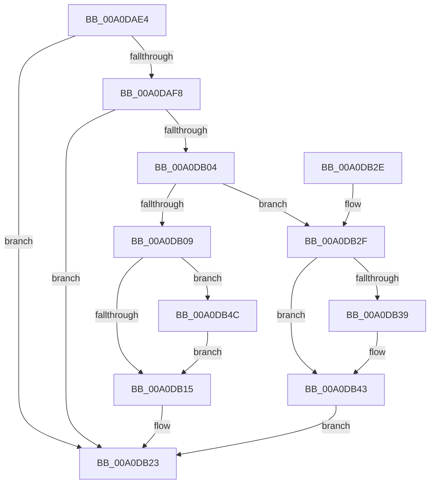

# SepSetTokenSessionById

- RVA: `0x00A0DAE4`–`0x00A0DB53` (길이 `111` bytes)
- VA: `0x0000000140A0DAE4`
- 실행 섹션: `PAGE`
- PDB 이름 있음: `예`; PDB Function 태그: `아니요`
- unwind 정보 RVA: `0x0006E554`
- 디코드: `32`개 명령, `111/111` bytes 표시
- 미해석 바이트: `0` (있으면 어셈블리에 `.byte`로 보존)

> 이 문서는 커널 이미지의 기계어와 PDB 기호를 분석해 생성했습니다. 4번과 5번은 함수 원형과 자료형을 바이너리 사용 방식에서 추정한 C 해석이며 원본 소스 복구 결과는 아닙니다.

## 1. Dependencies

- 직접 호출 지점: **2**; 고유 호출 대상: **2**
- 직접 호출자로 확인된 함수: **6**
- RIP 상대 이미지 참조: **1**

### Outgoing calls
- `0x00A0DB17` → [PsGetSessionObjectById](../../text/22/PsGetSessionObjectById_function_002250C0.md) (function, `0x002250C0`)
- `0x00A0DB4C` → [ObfDereferenceObject](../../text/2F/ObfDereferenceObject_function_002F9350.md) (function, `0x002F9350`)

### Direct callers
- [SepGetAnonymousToken](../../text/30/SepGetAnonymousToken_function_00301830.md) at `0x0030192C`
- [SeExchangePrimaryToken](../7A/SeExchangePrimaryToken_function_007A07BC.md) at `0x007A0991`
- [SeExchangePrimaryToken](../7A/SeExchangePrimaryToken_function_007A07BC.md) at `0x007A0A82`
- [SepDuplicateToken](../8B/SepDuplicateToken_function_008B87EC.md) at `0x008B8B07`
- [SepFilterToken](../9C/SepFilterToken_function_009C6B80.md) at `0x009C6F50`
- [SeSubProcessToken](../AA/SeSubProcessToken_function_00AAD570.md) at `0x00AADA38`
- [SeSubProcessToken](../AA/SeSubProcessToken_function_00AAD570.md) at `0x00AADA73`
- [SeSetSessionIdToken](../AF/SeSetSessionIdToken_function_00AF1F0C.md) at `0x00AF206A`
- [SeSetSessionIdToken](../AF/SeSetSessionIdToken_function_00AF1F0C.md) at `0x00AF20B4`

### Static image references
- `0x00A0DAFB` → RVA `0x00FD80D8` (`PAGEDATA`; read)

## 2. Other-region calls and transfers

- 다른 실행 섹션으로 향하는 call: **2**
  - `0x00A0DB17` → [PsGetSessionObjectById](../../text/22/PsGetSessionObjectById_function_002250C0.md) (`PAGE` → `.text`)
  - `0x00A0DB4C` → [ObfDereferenceObject](../../text/2F/ObfDereferenceObject_function_002F9350.md) (`PAGE` → `.text`)
- 별도 외부 분기/꼬리 이동을 확인하지 못했습니다.

## 3. Assembly (complete function range)

```asm
00A0DAE4  48 89 5C 24 08                  mov qword ptr [rsp + 8], rbx
00A0DAE9  57                              push rdi
00A0DAEA  48 83 EC 20                     sub rsp, 0x20
00A0DAEE  8B FA                           mov edi, edx
00A0DAF0  48 8B D9                        mov rbx, rcx
00A0DAF3  39 51 78                        cmp dword ptr [rcx + 0x78], edx
00A0DAF6  74 2B                           je 0x140a0db23
00A0DAF8  89 51 78                        mov dword ptr [rcx + 0x78], edx
00A0DAFB  83 3D D6 A5 5C 00 00            cmp dword ptr [rip + 0x5ca5d6], 0
00A0DB02  75 1F                           jne 0x140a0db23
00A0DB04  45 84 C0                        test r8b, r8b
00A0DB07  75 26                           jne 0x140a0db2f
00A0DB09  48 8B 89 88 04 00 00            mov rcx, qword ptr [rcx + 0x488]
00A0DB10  48 85 C9                        test rcx, rcx
00A0DB13  75 37                           jne 0x140a0db4c
00A0DB15  8B CF                           mov ecx, edi
00A0DB17  E8 A4 75 81 FF                  call 0x1402250c0
00A0DB1C  48 89 83 88 04 00 00            mov qword ptr [rbx + 0x488], rax
00A0DB23  48 8B 5C 24 30                  mov rbx, qword ptr [rsp + 0x30]
00A0DB28  48 83 C4 20                     add rsp, 0x20
00A0DB2C  5F                              pop rdi
00A0DB2D  C3                              ret
00A0DB2E  CC                              int3
00A0DB2F  48 8B 4C 24 50                  mov rcx, qword ptr [rsp + 0x50]
00A0DB34  48 85 C9                        test rcx, rcx
00A0DB37  74 0A                           je 0x140a0db43
00A0DB39  48 8B 83 88 04 00 00            mov rax, qword ptr [rbx + 0x488]
00A0DB40  48 89 01                        mov qword ptr [rcx], rax
00A0DB43  4C 89 8B 88 04 00 00            mov qword ptr [rbx + 0x488], r9
00A0DB4A  EB D7                           jmp 0x140a0db23
00A0DB4C  E8 FF B7 8E FF                  call 0x1402f9350
00A0DB51  EB C2                           jmp 0x140a0db15
```

## 4. C-style interpretation (structured pseudocode)

```c
__int64 __fastcall SepSetTokenSessionById(__int64 a1, int a2, unsigned __int8 a3, __int64 a4, __int64 a5)
{
    __int64 result;
    __int64 v_rsp;
    unsigned __int64 v_stack_p8;

    v_stack_p8 = v_rbx;
    v_rsp = (v_rsp) - (32);
    if ((*(unsigned int *)(a1 + 120)) == a2) goto loc_00A0DB23;
    *(unsigned int *)(a1 + 120) = a2;
    if ((*(unsigned int *)(v_rip + 6071766)) != 0) goto loc_00A0DB23;
    if (a3 != 0) goto loc_00A0DB2F;
    if (*(unsigned __int64 *)(a1 + 1160) != 0) goto loc_00A0DB4C;
loc_00A0DB15:
    result = PsGetSessionObjectById((unsigned int)((unsigned int)((unsigned int)(a2))), a2, a3, a4);
    *(unsigned __int64 *)(a1 + 1160) = result;
loc_00A0DB23:
    v_rsp = (v_rsp) + (32);
    return result;
loc_00A0DB2F:
    if (a5 != 0) {
        result = *(unsigned __int64 *)(v_stack_p8 + 1160);
        *(unsigned __int64 *)(a5) = result;
    }
    *(unsigned __int64 *)(v_stack_p8 + 1160) = a4;
    goto loc_00A0DB23;
loc_00A0DB4C:
    result = ObfDereferenceObject(a5, a2, a3, a4);
    goto loc_00A0DB15;
}
```

## 5. (Beta) C Style

```c
int64_t SepSetTokenSessionById(void *Arg1, int32_t Arg2, uint8_t Arg3, int64_t Arg4, int64_t Arg5)
{
    uint8_t *arg1 = (uint8_t *)Arg1;

    int64_t result;
    int64_t local_rsp;
    uint64_t v_stack_p8;

    v_stack_p8 = local_rbx;
    local_rsp = (local_rsp) - (32);
    if ((*(uint32_t *)(arg1 + 0x78)) == Arg2) goto loc_00A0DB23;
    *(uint32_t *)(arg1 + 0x78) = Arg2;
    if ((*(uint32_t *)(v_rip + 0x5CA5D6)) != 0) goto loc_00A0DB23;
    if (Arg3 != 0) goto loc_00A0DB2F;
    if (*(uint64_t *)(arg1 + 0x488) != 0) goto loc_00A0DB4C;
loc_00A0DB15:
    result = PsGetSessionObjectById((uint32_t)((uint32_t)((uint32_t)(Arg2))), Arg2, Arg3, Arg4);
    *(uint64_t *)(arg1 + 0x488) = result;
loc_00A0DB23:
    local_rsp = (local_rsp) + (32);
    return result;
loc_00A0DB2F:
    if (Arg5 != 0) {
        result = *(uint64_t *)(v_stack_p8 + 0x488);
        *(uint64_t *)(Arg5) = result;
    }
    *(uint64_t *)(v_stack_p8 + 0x488) = Arg4;
    goto loc_00A0DB23;
loc_00A0DB4C:
    result = ObfDereferenceObject(Arg5, Arg2, Arg3, Arg4);
    goto loc_00A0DB15;
}
```

### 관측된 메모리 오프셋

구조체 형식이 확인되지 않은 접근은 인자 기준의 오프셋으로만 기록했습니다.

| 기준 인자 | 오프셋 표현 | 폭 (bit) | 접근 |
|---|---:|---:|---|
| `Arg1` | `+ 0x78` | `32` | `R` |
| `Arg1` | `+ 0x78` | `32` | `W` |
| `Arg1` | `+ 0x488` | `64` | `R` |
| `Arg1` | `+ 0x488` | `64` | `W` |

## 6. Execution-region graph

[열기: 2D/3D 그래프와 함수 탐색 컨트롤 패널](../../../control-panel.html?section=page&rva=0x00A0DAE4&view=graph)

- 2D 그래프는 위에서 아래로 흐르고, 3D 그래프는 빈 공간을 드래그해 회전합니다. Shift+드래그는 이동, 휠은 확대·축소, 함수 노드 선택은 대상 보고서 이동입니다.

### Static fallback


