# SmProcessCompressionInfoRequest

- RVA: `0x00A0E980`–`0x00A0EDCD` (길이 `1,101` bytes)
- VA: `0x0000000140A0E980`
- 실행 섹션: `PAGE`
- PDB 이름 있음: `예`; PDB Function 태그: `예`
- unwind 정보 RVA: `0x000A8E14`
- 디코드: `267`개 명령, `1,101/1,101` bytes 표시
- 미해석 바이트: `0` (있으면 어셈블리에 `.byte`로 보존)

> 이 문서는 커널 이미지의 기계어와 PDB 기호를 분석해 생성했습니다. 4번과 5번은 함수 원형과 자료형을 바이너리 사용 방식에서 추정한 C 해석이며 원본 소스 복구 결과는 아닙니다.

## 1. Dependencies

- 직접 호출 지점: **19**; 고유 호출 대상: **17**
- 직접 호출자로 확인된 함수: **1**
- RIP 상대 이미지 참조: **1**

### Outgoing calls
- `0x00A0E9C3` → [memset](../../text/6C/memset_function_006C6C40.md) (function, `0x006C6C40`)
- `0x00A0EA08` → [ExRaiseDatatypeMisalignment](../89/ExRaiseDatatypeMisalignment_function_00899FD0.md) (function, `0x00899FD0`)
- `0x00A0EA38` → [ProbeForWrite](../8E/ProbeForWrite_function_008E91C0.md) (function, `0x008E91C0`)
- `0x00A0EA93` → [memcpy](../../text/6C/memcpy_function_006C6840.md) (function, `0x006C6840`)
- `0x00A0EACD` → [SmpGetProcessPartition](../../text/4A/SmpGetProcessPartition_function_004A3CCC.md) (function, `0x004A3CCC`)
- `0x00A0EAF9` → [KeAbPreAcquire](../../text/21/KeAbPreAcquire_function_00210230.md) (function, `0x00210230`)
- `0x00A0EB12` → [ExfAcquirePushLockExclusiveEx](../../text/20/ExfAcquirePushLockExclusiveEx_function_0020FC90.md) (function, `0x0020FC90`)
- `0x00A0EB5F` → [KeAbPostRelease](../../text/2E/KeAbPostRelease_function_002E1600.md) (function, `0x002E1600`)
- `0x00A0EB64` → [KeLeaveCriticalRegion](../../text/25/KeLeaveCriticalRegion_function_0025D8B0.md) (function, `0x0025D8B0`)
- `0x00A0EBFA` → [ExAcquireRundownProtection](../../text/21/ExAcquireRundownProtection_function_00216620.md) (function, `0x00216620`)
- `0x00A0EC48` → [memcpy](../../text/6C/memcpy_function_006C6840.md) (function, `0x006C6840`)
- `0x00A0EC76` → [_security_check_cookie](../../text/6A/_security_check_cookie_function_006AC640.md) (function, `0x006AC640`)
- `0x00A0ECA7` → [SMKM_STORE<SM_TRAITS>::SmStGetStoreStats](../../text/34/SMKM_STORE_SM_TRAITS_SmStGetStoreStats_function_00349F0C.md) (function, `0x00349F0C`)
- `0x00A0ECBD` → [SmKmStoreRefFromStoreIndex](../../text/43/SmKmStoreRefFromStoreIndex_function_004341A0.md) (function, `0x004341A0`)
- `0x00A0ECC6` → [ExReleaseRundownProtection](../../text/34/ExReleaseRundownProtection_function_00349E80.md) (function, `0x00349E80`)
- `0x00A0ED2E` → [ExReleaseRundownProtection](../../text/34/ExReleaseRundownProtection_function_00349E80.md) (function, `0x00349E80`)
- `0x00A0ED3D` → [ExfTryToWakePushLock](../../text/26/ExfTryToWakePushLock_function_00265DD0.md) (function, `0x00265DD0`)
- `0x00A0ED87` → [PsReferencePartitionByHandle](../90/PsReferencePartitionByHandle_function_0090337C.md) (function, `0x0090337C`)
- `0x00A0EDC3` → [PsDereferencePartition](../../text/34/PsDereferencePartition_function_00342E70.md) (function, `0x00342E70`)

### Direct callers
- [SmQueryStoreInformation](SmQueryStoreInformation_function_00A0E7BC.md) at `0x00A0E8F3`

### Static image references
- `0x00A0E993` → RVA `0x00E0A740` (`.data`; read)

## 2. Other-region calls and transfers

- 다른 실행 섹션으로 향하는 call: **16**
  - `0x00A0E9C3` → [memset](../../text/6C/memset_function_006C6C40.md) (`PAGE` → `.text`)
  - `0x00A0EA93` → [memcpy](../../text/6C/memcpy_function_006C6840.md) (`PAGE` → `.text`)
  - `0x00A0EACD` → [SmpGetProcessPartition](../../text/4A/SmpGetProcessPartition_function_004A3CCC.md) (`PAGE` → `.text`)
  - `0x00A0EAF9` → [KeAbPreAcquire](../../text/21/KeAbPreAcquire_function_00210230.md) (`PAGE` → `.text`)
  - `0x00A0EB12` → [ExfAcquirePushLockExclusiveEx](../../text/20/ExfAcquirePushLockExclusiveEx_function_0020FC90.md) (`PAGE` → `.text`)
  - `0x00A0EB5F` → [KeAbPostRelease](../../text/2E/KeAbPostRelease_function_002E1600.md) (`PAGE` → `.text`)
  - `0x00A0EB64` → [KeLeaveCriticalRegion](../../text/25/KeLeaveCriticalRegion_function_0025D8B0.md) (`PAGE` → `.text`)
  - `0x00A0EBFA` → [ExAcquireRundownProtection](../../text/21/ExAcquireRundownProtection_function_00216620.md) (`PAGE` → `.text`)
  - `0x00A0EC48` → [memcpy](../../text/6C/memcpy_function_006C6840.md) (`PAGE` → `.text`)
  - `0x00A0EC76` → [_security_check_cookie](../../text/6A/_security_check_cookie_function_006AC640.md) (`PAGE` → `.text`)
  - `0x00A0ECA7` → [SMKM_STORE<SM_TRAITS>::SmStGetStoreStats](../../text/34/SMKM_STORE_SM_TRAITS_SmStGetStoreStats_function_00349F0C.md) (`PAGE` → `.text`)
  - `0x00A0ECBD` → [SmKmStoreRefFromStoreIndex](../../text/43/SmKmStoreRefFromStoreIndex_function_004341A0.md) (`PAGE` → `.text`)
  - `0x00A0ECC6` → [ExReleaseRundownProtection](../../text/34/ExReleaseRundownProtection_function_00349E80.md) (`PAGE` → `.text`)
  - `0x00A0ED2E` → [ExReleaseRundownProtection](../../text/34/ExReleaseRundownProtection_function_00349E80.md) (`PAGE` → `.text`)
  - `0x00A0ED3D` → [ExfTryToWakePushLock](../../text/26/ExfTryToWakePushLock_function_00265DD0.md) (`PAGE` → `.text`)
  - `0x00A0EDC3` → [PsDereferencePartition](../../text/34/PsDereferencePartition_function_00342E70.md) (`PAGE` → `.text`)
- call이 아닌 외부 분기/꼬리 이동: **3**
  - `0x00A0EDA8` → [sub_00B369FE + 0x15](../B3/Unknown_function_00B369FE.md) (`tail-transfer`)
  - `0x00A0EDB8` → [sub_00B369FE](../B3/Unknown_function_00B369FE.md) (`tail-transfer`)
  - `0x00A0EDBE` → [sub_00B369FE + 0x8](../B3/Unknown_function_00B369FE.md) (`tail-transfer`)

## 3. Assembly (complete function range)

```asm
00A0E980  40 53                           push rbx
00A0E982  56                              push rsi
00A0E983  57                              push rdi
00A0E984  41 54                           push r12
00A0E986  41 55                           push r13
00A0E988  41 56                           push r14
00A0E98A  41 57                           push r15
00A0E98C  48 81 EC 90 06 00 00            sub rsp, 0x690
00A0E993  48 8B 05 A6 BD 3F 00            mov rax, qword ptr [rip + 0x3fbda6]
00A0E99A  48 33 C4                        xor rax, rsp
00A0E99D  48 89 84 24 80 06 00 00         mov qword ptr [rsp + 0x680], rax
00A0E9A5  41 8A D9                        mov bl, r9b
00A0E9A8  4C 89 44 24 70                  mov qword ptr [rsp + 0x70], r8
00A0E9AD  44 8B EA                        mov r13d, edx
00A0E9B0  48 8B F1                        mov rsi, rcx
00A0E9B3  33 D2                           xor edx, edx
00A0E9B5  41 B8 00 06 00 00               mov r8d, 0x600
00A0E9BB  48 8D 8C 24 80 00 00 00         lea rcx, [rsp + 0x80]
00A0E9C3  E8 78 82 CB FF                  call 0x1406c6c40
00A0E9C8  83 64 24 34 00                  and dword ptr [rsp + 0x34], 0
00A0E9CD  48 83 64 24 38 00               and qword ptr [rsp + 0x38], 0
00A0E9D3  0F 57 C0                        xorps xmm0, xmm0
00A0E9D6  0F 11 44 24 40                  movups xmmword ptr [rsp + 0x40], xmm0
00A0E9DB  0F 11 44 24 50                  movups xmmword ptr [rsp + 0x50], xmm0
00A0E9E0  0F 11 44 24 60                  movups xmmword ptr [rsp + 0x60], xmm0
00A0E9E5  41 83 FD 28                     cmp r13d, 0x28
00A0E9E9  0F 82 9F 01 00 00               jb 0x140a0eb8e
00A0E9EF  84 DB                           test bl, bl
00A0E9F1  74 4A                           je 0x140a0ea3d
00A0E9F3  41 8B D5                        mov edx, r13d
00A0E9F6  49 8D 45 FF                     lea rax, [r13 - 1]
00A0E9FA  48 3D FE 0F 00 00               cmp rax, 0xffe
00A0EA00  77 2D                           ja 0x140a0ea2f
00A0EA02  40 F6 C6 07                     test sil, 7
00A0EA06  74 06                           je 0x140a0ea0e
00A0EA08  E8 C3 B5 E8 FF                  call 0x140899fd0
00A0EA0D  CC                              int3
00A0EA0E  48 B9 00 00 FF FF FF 7F 00 00   movabs rcx, 0x7fffffff0000
00A0EA18  48 3B F1                        cmp rsi, rcx
00A0EA1B  48 0F 42 CE                     cmovb rcx, rsi
00A0EA1F  8A 01                           mov al, byte ptr [rcx]
00A0EA21  88 01                           mov byte ptr [rcx], al
00A0EA23  42 8A 44 29 FF                  mov al, byte ptr [rcx + r13 - 1]
00A0EA28  42 88 44 29 FF                  mov byte ptr [rcx + r13 - 1], al
00A0EA2D  EB 0E                           jmp 0x140a0ea3d
00A0EA2F  41 B8 08 00 00 00               mov r8d, 8
00A0EA35  48 8B CE                        mov rcx, rsi
00A0EA38  E8 83 A7 ED FF                  call 0x1408e91c0
00A0EA3D  0F 10 06                        movups xmm0, xmmword ptr [rsi]
00A0EA40  0F 11 44 24 40                  movups xmmword ptr [rsp + 0x40], xmm0
00A0EA45  0F 10 4E 10                     movups xmm1, xmmword ptr [rsi + 0x10]
00A0EA49  0F 11 4C 24 50                  movups xmmword ptr [rsp + 0x50], xmm1
00A0EA4E  F2 0F 10 46 20                  movsd xmm0, qword ptr [rsi + 0x20]
00A0EA53  F2 0F 11 44 24 60               movsd qword ptr [rsp + 0x60], xmm0
00A0EA59  EB 07                           jmp 0x140a0ea62
00A0EA5B  8B D8                           mov ebx, eax
00A0EA5D  E9 F9 01 00 00                  jmp 0x140a0ec5b
00A0EA62  0F B6 4C 24 40                  movzx ecx, byte ptr [rsp + 0x40]
00A0EA67  8D 41 FD                        lea eax, [rcx - 3]
00A0EA6A  83 F8 01                        cmp eax, 1
00A0EA6D  0F 87 D4 02 00 00               ja 0x140a0ed47
00A0EA73  41 83 FD 30                     cmp r13d, 0x30
00A0EA77  0F 85 03 01 00 00               jne 0x140a0eb80
00A0EA7D  83 F9 03                        cmp ecx, 3
00A0EA80  0F 84 CB 02 00 00               je 0x140a0ed51
00A0EA86  45 8D 45 D8                     lea r8d, [r13 - 0x28]
00A0EA8A  48 8D 56 28                     lea rdx, [rsi + 0x28]
00A0EA8E  48 8D 4C 24 68                  lea rcx, [rsp + 0x68]
00A0EA93  E8 A8 7D CB FF                  call 0x1406c6840
00A0EA98  EB 07                           jmp 0x140a0eaa1
00A0EA9A  8B D8                           mov ebx, eax
00A0EA9C  E9 BA 01 00 00                  jmp 0x140a0ec5b
00A0EAA1  F7 44 24 40 00 FF FF FF         test dword ptr [rsp + 0x40], 0xffffff00
00A0EAA9  0F 85 B6 02 00 00               jne 0x140a0ed65
00A0EAAF  48 8B 4C 24 68                  mov rcx, qword ptr [rsp + 0x68]
00A0EAB4  48 85 C9                        test rcx, rcx
00A0EAB7  0F 85 B2 02 00 00               jne 0x140a0ed6f
00A0EABD  65 48 8B 04 25 88 01 00 00      mov rax, qword ptr gs:[0x188]
00A0EAC6  48 8B 88 B8 00 00 00            mov rcx, qword ptr [rax + 0xb8]
00A0EACD  E8 FA 51 A9 FF                  call 0x1404a3ccc
00A0EAD2  4C 8B F0                        mov r14, rax
00A0EAD5  49 8D BE 68 08 00 00            lea rdi, [r14 + 0x868]
00A0EADC  65 48 8B 04 25 88 01 00 00      mov rax, qword ptr gs:[0x188]
00A0EAE5  48 83 CB FF                     or rbx, 0xffffffffffffffff
00A0EAE9  66 01 98 E4 01 00 00            add word ptr [rax + 0x1e4], bx
00A0EAF0  90                              nop
00A0EAF1  45 33 C0                        xor r8d, r8d
00A0EAF4  33 D2                           xor edx, edx
00A0EAF6  48 8B CF                        mov rcx, rdi
00A0EAF9  E8 32 17 80 FF                  call 0x140210230
00A0EAFE  4C 8B F8                        mov r15, rax
00A0EB01  F0 48 0F BA 2F 00               lock bts qword ptr [rdi], 0
00A0EB07  73 0E                           jae 0x140a0eb17
00A0EB09  4C 8B C7                        mov r8, rdi
00A0EB0C  48 8B D0                        mov rdx, rax
00A0EB0F  48 8B CF                        mov rcx, rdi
00A0EB12  E8 79 11 80 FF                  call 0x14020fc90
00A0EB17  4D 85 FF                        test r15, r15
00A0EB1A  74 05                           je 0x140a0eb21
00A0EB1C  41 C6 47 0A 01                  mov byte ptr [r15 + 0xa], 1
00A0EB21  49 8B 8E 78 08 00 00            mov rcx, qword ptr [r14 + 0x878]
00A0EB28  48 85 C9                        test rcx, rcx
00A0EB2B  0F 84 7C 02 00 00               je 0x140a0edad
00A0EB31  8B 81 D0 01 00 00               mov eax, dword ptr [rcx + 0x1d0]
00A0EB37  89 44 24 44                     mov dword ptr [rsp + 0x44], eax
00A0EB3B  48 8B 81 88 04 00 00            mov rax, qword ptr [rcx + 0x488]
00A0EB42  48 C1 E0 0C                     shl rax, 0xc
00A0EB46  48 89 44 24 48                  mov qword ptr [rsp + 0x48], rax
00A0EB4B  F0 48 0F C1 1F                  lock xadd qword ptr [rdi], rbx
00A0EB50  80 E3 06                        and bl, 6
00A0EB53  80 FB 02                        cmp bl, 2
00A0EB56  0F 84 DE 01 00 00               je 0x140a0ed3a
00A0EB5C  48 8B CF                        mov rcx, rdi
00A0EB5F  E8 9C 2A 8D FF                  call 0x1402e1600
00A0EB64  E8 47 ED 84 FF                  call 0x14025d8b0
00A0EB69  48 83 64 24 58 00               and qword ptr [rsp + 0x58], 0
00A0EB6F  48 83 64 24 50 00               and qword ptr [rsp + 0x50], 0
00A0EB75  33 D2                           xor edx, edx
00A0EB77  89 54 24 30                     mov dword ptr [rsp + 0x30], edx
00A0EB7B  45 33 FF                        xor r15d, r15d
00A0EB7E  EB 18                           jmp 0x140a0eb98
00A0EB80  83 F9 04                        cmp ecx, 4
00A0EB83  0F 85 F4 FE FF FF               jne 0x140a0ea7d
00A0EB89  E9 CD 01 00 00                  jmp 0x140a0ed5b
00A0EB8E  BB 06 02 00 C0                  mov ebx, 0xc0000206
00A0EB93  E9 C3 00 00 00                  jmp 0x140a0ec5b
00A0EB98  49 8B C7                        mov rax, r15
00A0EB9B  48 C1 E8 05                     shr rax, 5
00A0EB9F  49 8B 0C C6                     mov rcx, qword ptr [r14 + rax*8]
00A0EBA3  48 85 C9                        test rcx, rcx
00A0EBA6  74 79                           je 0x140a0ec21
00A0EBA8  49 8B C7                        mov rax, r15
00A0EBAB  83 E0 1F                        and eax, 0x1f
00A0EBAE  48 8D 04 80                     lea rax, [rax + rax*4]
00A0EBB2  4C 8D 04 C1                     lea r8, [rcx + rax*8]
00A0EBB6  4D 85 C0                        test r8, r8
00A0EBB9  74 66                           je 0x140a0ec21
00A0EBBB  41 0F B7 58 20                  movzx ebx, word ptr [r8 + 0x20]
00A0EBC0  83 E3 3F                        and ebx, 0x3f
00A0EBC3  C1 E3 0A                        shl ebx, 0xa
00A0EBC6  0B DA                           or ebx, edx
00A0EBC8  8B C3                           mov eax, ebx
00A0EBCA  25 FF 03 00 00                  and eax, 0x3ff
00A0EBCF  8B C8                           mov ecx, eax
00A0EBD1  48 C1 E8 05                     shr rax, 5
00A0EBD5  49 8B 14 C6                     mov rdx, qword ptr [r14 + rax*8]
00A0EBD9  48 85 D2                        test rdx, rdx
00A0EBDC  0F 84 51 01 00 00               je 0x140a0ed33
00A0EBE2  83 E1 1F                        and ecx, 0x1f
00A0EBE5  48 8D 04 89                     lea rax, [rcx + rcx*4]
00A0EBE9  48 8D 3C C2                     lea rdi, [rdx + rax*8]
00A0EBED  48 85 FF                        test rdi, rdi
00A0EBF0  0F 84 3D 01 00 00               je 0x140a0ed33
00A0EBF6  48 8D 4F 08                     lea rcx, [rdi + 8]
00A0EBFA  E8 21 7A 80 FF                  call 0x140216620
00A0EBFF  84 C0                           test al, al
00A0EC01  0F 84 2C 01 00 00               je 0x140a0ed33
00A0EC07  0F B7 47 20                     movzx eax, word ptr [rdi + 0x20]
00A0EC0B  83 E0 3F                        and eax, 0x3f
00A0EC0E  C1 EB 0A                        shr ebx, 0xa
00A0EC11  3B C3                           cmp eax, ebx
00A0EC13  0F 85 11 01 00 00               jne 0x140a0ed2a
00A0EC19  48 8B 3F                        mov rdi, qword ptr [rdi]
00A0EC1C  48 85 FF                        test rdi, rdi
00A0EC1F  75 6E                           jne 0x140a0ec8f
00A0EC21  8B 44 24 30                     mov eax, dword ptr [rsp + 0x30]
00A0EC25  FF C0                           inc eax
00A0EC27  89 44 24 30                     mov dword ptr [rsp + 0x30], eax
00A0EC2B  49 FF C7                        inc r15
00A0EC2E  3D 00 04 00 00                  cmp eax, 0x400
00A0EC33  8B D0                           mov edx, eax
00A0EC35  0F 82 5D FF FF FF               jb 0x140a0eb98
00A0EC3B  33 DB                           xor ebx, ebx
00A0EC3D  4D 8B C5                        mov r8, r13
00A0EC40  48 8D 54 24 40                  lea rdx, [rsp + 0x40]
00A0EC45  48 8B CE                        mov rcx, rsi
00A0EC48  E8 F3 7B CB FF                  call 0x1406c6840
00A0EC4D  EB 04                           jmp 0x140a0ec53
00A0EC4F  8B D8                           mov ebx, eax
00A0EC51  EB 08                           jmp 0x140a0ec5b
00A0EC53  48 8B 44 24 70                  mov rax, qword ptr [rsp + 0x70]
00A0EC58  44 89 28                        mov dword ptr [rax], r13d
00A0EC5B  48 8B 4C 24 38                  mov rcx, qword ptr [rsp + 0x38]
00A0EC60  48 85 C9                        test rcx, rcx
00A0EC63  0F 85 5A 01 00 00               jne 0x140a0edc3
00A0EC69  8B C3                           mov eax, ebx
00A0EC6B  48 8B 8C 24 80 06 00 00         mov rcx, qword ptr [rsp + 0x680]
00A0EC73  48 33 CC                        xor rcx, rsp
00A0EC76  E8 C5 D9 C9 FF                  call 0x1406ac640
00A0EC7B  48 81 C4 90 06 00 00            add rsp, 0x690
00A0EC82  41 5F                           pop r15
00A0EC84  41 5E                           pop r14
00A0EC86  41 5D                           pop r13
00A0EC88  41 5C                           pop r12
00A0EC8A  5F                              pop rdi
00A0EC8B  5E                              pop rsi
00A0EC8C  5B                              pop rbx
00A0EC8D  C3                              ret
00A0EC8E  CC                              int3
00A0EC8F  C7 44 24 34 00 06 00 00         mov dword ptr [rsp + 0x34], 0x600
00A0EC97  4C 8D 4C 24 34                  lea r9, [rsp + 0x34]
00A0EC9C  4C 8D 84 24 80 00 00 00         lea r8, [rsp + 0x80]
00A0ECA4  48 8B CF                        mov rcx, rdi
00A0ECA7  E8 60 B2 93 FF                  call 0x140349f0c
00A0ECAC  8B D8                           mov ebx, eax
00A0ECAE  8B 97 90 1A 00 00               mov edx, dword ptr [rdi + 0x1a90]
00A0ECB4  81 E2 FF 03 00 00               and edx, 0x3ff
00A0ECBA  49 8B CE                        mov rcx, r14
00A0ECBD  E8 DE 54 A2 FF                  call 0x1404341a0
00A0ECC2  48 8D 48 08                     lea rcx, [rax + 8]
00A0ECC6  E8 B5 B1 93 FF                  call 0x140349e80
00A0ECCB  85 DB                           test ebx, ebx
00A0ECCD  0F 88 4E FF FF FF               js 0x140a0ec21
00A0ECD3  44 8B 8C 24 8C 00 00 00         mov r9d, dword ptr [rsp + 0x8c]
00A0ECDB  48 8D 8C 24 AC 00 00 00         lea rcx, [rsp + 0xac]
00A0ECE3  BA 08 00 00 00                  mov edx, 8
00A0ECE8  4C 8B 44 24 58                  mov r8, qword ptr [rsp + 0x58]
00A0ECED  8B 01                           mov eax, dword ptr [rcx]
00A0ECEF  49 0F AF C1                     imul rax, r9
00A0ECF3  4C 03 C0                        add r8, rax
00A0ECF6  4C 89 44 24 58                  mov qword ptr [rsp + 0x58], r8
00A0ECFB  48 8D 49 08                     lea rcx, [rcx + 8]
00A0ECFF  48 83 EA 01                     sub rdx, 1
00A0ED03  75 E8                           jne 0x140a0eced
00A0ED05  8B 84 24 A0 00 00 00            mov eax, dword ptr [rsp + 0xa0]
00A0ED0C  48 C1 E0 0C                     shl rax, 0xc
00A0ED10  48 01 44 24 50                  add qword ptr [rsp + 0x50], rax
00A0ED15  8B 84 24 A4 00 00 00            mov eax, dword ptr [rsp + 0xa4]
00A0ED1C  48 C1 E0 0C                     shl rax, 0xc
00A0ED20  48 01 44 24 60                  add qword ptr [rsp + 0x60], rax
00A0ED25  E9 F7 FE FF FF                  jmp 0x140a0ec21
00A0ED2A  48 8D 4F 08                     lea rcx, [rdi + 8]
00A0ED2E  E8 4D B1 93 FF                  call 0x140349e80
00A0ED33  33 FF                           xor edi, edi
00A0ED35  E9 E2 FE FF FF                  jmp 0x140a0ec1c
00A0ED3A  48 8B CF                        mov rcx, rdi
00A0ED3D  E8 8E 70 85 FF                  call 0x140265dd0
00A0ED42  E9 15 FE FF FF                  jmp 0x140a0eb5c
00A0ED47  BB 59 00 00 C0                  mov ebx, 0xc0000059
00A0ED4C  E9 0A FF FF FF                  jmp 0x140a0ec5b
00A0ED51  41 83 FD 28                     cmp r13d, 0x28
00A0ED55  0F 84 2B FD FF FF               je 0x140a0ea86
00A0ED5B  BB 04 00 00 C0                  mov ebx, 0xc0000004
00A0ED60  E9 F6 FE FF FF                  jmp 0x140a0ec5b
00A0ED65  BB 0D 00 00 C0                  mov ebx, 0xc000000d
00A0ED6A  E9 EC FE FF FF                  jmp 0x140a0ec5b
00A0ED6F  48 8D 44 24 38                  lea rax, [rsp + 0x38]
00A0ED74  48 89 44 24 20                  mov qword ptr [rsp + 0x20], rax
00A0ED79  41 B9 53 6D 51 52               mov r9d, 0x52516d53
00A0ED7F  44 8A C3                        mov r8b, bl
00A0ED82  BA 01 00 00 00                  mov edx, 1
00A0ED87  E8 F0 45 EF FF                  call 0x14090337c
00A0ED8C  8B D8                           mov ebx, eax
00A0ED8E  85 C0                           test eax, eax
00A0ED90  0F 88 C5 FE FF FF               js 0x140a0ec5b
00A0ED96  48 8B 44 24 38                  mov rax, qword ptr [rsp + 0x38]
00A0ED9B  4C 8B 70 18                     mov r14, qword ptr [rax + 0x18]
00A0ED9F  4D 85 F6                        test r14, r14
00A0EDA2  0F 85 2D FD FF FF               jne 0x140a0ead5
00A0EDA8  E9 66 7C 12 00                  jmp 0x140b36a13
00A0EDAD  F0 48 0F C1 1F                  lock xadd qword ptr [rdi], rbx
00A0EDB2  80 E3 06                        and bl, 6
00A0EDB5  80 FB 02                        cmp bl, 2
00A0EDB8  0F 84 40 7C 12 00               je 0x140b369fe
00A0EDBE  E9 43 7C 12 00                  jmp 0x140b36a06
00A0EDC3  E8 A8 40 93 FF                  call 0x140342e70
00A0EDC8  E9 9C FE FF FF                  jmp 0x140a0ec69
```

## 4. C-style interpretation (structured pseudocode)

```c
__int64 __fastcall SmProcessCompressionInfoRequest(__int64 a1, int a2, __int64 a3, unsigned __int8 a4)
{
    __int64 result;
    __int64 v_r15;
    __int64 v_rbx;
    __int64 v_rdi;
    __int64 v_rsp;
    unsigned __int64 v_stack_m48;
    unsigned __int64 v_stack_m648;
    unsigned __int64 v_stack_m658;
    unsigned __int64 v_stack_m660;
    unsigned __int64 v_stack_m668;
    unsigned __int64 v_stack_m670;
    unsigned __int64 v_stack_m678;
    unsigned __int64 v_stack_m680;
    unsigned int v_stack_m684;
    unsigned __int64 v_stack_m688;
    unsigned __int64 v_stack_m690;
    unsigned int v_stack_m694;
    unsigned int v_stack_m698;
    unsigned __int64 v_stack_p20;
    unsigned int v_stack_p34;
    unsigned __int64 v_stack_p38;
    unsigned __int64 v_stack_p50;
    unsigned __int64 v_stack_p58;
    unsigned __int64 v_stack_p60;
    unsigned __int64 v_stack_p80;
    unsigned int v_stack_p8C;
    unsigned int v_stack_pA0;
    unsigned int v_stack_pA4;
    unsigned __int64 v_stack_pAC;

    v_rsp = (v_rsp) - (0x690ULL);
    result = (*(unsigned __int64 *)(v_rip + 4177318)) ^ (v_rsp);
    v_stack_m48 = result;
    v_stack_m658 = a3;
    a2 = 0;
    result = memset(v_stack_m648, a2, (unsigned int)(0x600ULL), a4);
    v_stack_m688 = v_xmm0;
    v_stack_m678 = v_xmm0;
    v_stack_m668 = v_xmm0;
    if (((unsigned int)((unsigned int)(a2))) < 40) goto loc_00A0EB8E;
    if (a4 == 0) goto loc_00A0EA3D;
    if (((unsigned int)(a2) - 1) > 0xFFEULL) goto loc_00A0EA2F;
    result = (unsigned int)(a2) - 1;
    if ((((unsigned __int8)(a1)) & (7)) != 0) {
        result = ExRaiseDatatypeMisalignment(v_stack_m648, (unsigned int)((unsigned int)((unsigned int)(a2))), (unsigned int)(0x600ULL), a4);
    }
    a1 = v_stack_m648;
    if (a1 < v_stack_m648) { a1 = a1; }
    *(unsigned __int8 *)(a1) = (unsigned __int8)(*(unsigned __int8 *)(a1));
    *(unsigned __int8 *)(a1 + (unsigned int)(a2) * 1 - 1) = (unsigned __int8)(*(unsigned __int8 *)(a1 + (unsigned int)(a2) * 1 - 1));
    goto loc_00A0EA3D;
loc_00A0EA2F:
    result = ProbeForWrite(a1, (unsigned int)((unsigned int)((unsigned int)(a2))), 8, a4);
loc_00A0EA3D:
    v_stack_m688 = v_xmm0;
    v_stack_m678 = v_xmm1;
    v_stack_m668 = v_xmm0;
    goto loc_00A0EA62;
loc_00A0EA62:
    if (((unsigned int)(v_stack_m688 - 3)) > 1) goto loc_00A0ED47;
    if (((unsigned int)((unsigned int)(a2))) != 48) goto loc_00A0EB80;
loc_00A0EA7D:
    if (((unsigned int)(v_stack_m688)) == 3) goto loc_00A0ED51;
loc_00A0EA86:
    result = memcpy(v_stack_m660, a1 + 40, (unsigned int)(a2) - 40, a4);
    goto loc_00A0EAA1;
loc_00A0EAA1:
    if (((v_stack_m688) & (0xFFFFFF00ULL)) != 0) goto loc_00A0ED65;
    if (v_stack_m660 != 0) goto loc_00A0ED6F;
    result = SmpGetProcessPartition(*(unsigned __int64 *)(*(unsigned __int64 *)(gs_base + (0 + 392)) + 184), a1 + 40, (unsigned int)(a2) - 40, a4);
loc_00A0EAD5:
    v_rbx = (a4) | (-1);
    a3 = 0;
    a2 = 0;
    result = KeAbPreAcquire(result + 2152, a2, a3, a4);
    if (!(condition_is_above_or_equal)) {
        a3 = result + 2152;
        a2 = result;
        a1 = result + 2152;
        result = ExfAcquirePushLockExclusiveEx(a1, a2, a3, a4);
    }
    if (result != 0) {
        *(unsigned __int8 *)(result + 10) = 1;
    }
    if (*(unsigned __int64 *)(result + 2168) == 0) goto loc_00A0EDAD;
    v_stack_m684 = (unsigned int)((unsigned int)(*(unsigned int *)(*(unsigned __int64 *)(result + 2168) + 464)));
    result = (*(unsigned __int64 *)(*(unsigned __int64 *)(result + 2168) + 1160)) << (12);
    v_stack_m680 = result;
    v_rbx = (unsigned __int8)((v_rbx) & (6));
    if (((unsigned __int8)(v_rbx)) == 2) goto loc_00A0ED3A;
loc_00A0EB5C:
    result = KeAbPostRelease(result + 2152, a2, a3, a4);
    result = KeLeaveCriticalRegion(result + 2152, a2, a3, a4);
    a2 = 0;
    v_stack_m698 = 0;
    v_r15 = 0;
    goto loc_00A0EB98;
loc_00A0EB80:
    if (((unsigned int)(result + 2152)) != 4) goto loc_00A0EA7D;
    goto loc_00A0ED5B;
loc_00A0EB8E:
    goto loc_00A0EC5B;
loc_00A0EB98:
    result = (0) >> (5);
    if (*(unsigned __int64 *)(result + result * 8) == 0) goto loc_00A0EC21;
    result = (unsigned int)((0) & (31));
    if (*(unsigned __int64 *)(result + result * 8) + result + result * 4 * 8 == 0) goto loc_00A0EC21;
    v_rbx = (unsigned int)((*(unsigned __int16 *)(*(unsigned __int64 *)(result + result * 8) + result + result * 4 * 8 + 32)) & (63));
    v_rbx = (unsigned int)((v_rbx) << (10));
    v_rbx = (unsigned int)((v_rbx) | (0));
    result = (unsigned int)(((unsigned int)((unsigned int)(v_rbx))) & (0x3FFULL));
    result = (result) >> (5);
    if (*(unsigned __int64 *)(result + result * 8) == 0) goto loc_00A0ED33;
    a1 = (unsigned int)(((unsigned int)((unsigned int)(result))) & (31));
    if (*(unsigned __int64 *)(result + result * 8) + a1 + a1 * 4 * 8 == 0) goto loc_00A0ED33;
    result = ExAcquireRundownProtection(*(unsigned __int64 *)(result + result * 8) + a1 + a1 * 4 * 8 + 8, *(unsigned __int64 *)(result + result * 8), *(unsigned __int64 *)(result + result * 8) + result + result * 4 * 8, a4);
    if ((unsigned __int8)(result) == 0) goto loc_00A0ED33;
    result = (unsigned int)((*(unsigned __int16 *)(*(unsigned __int64 *)(result + result * 8) + a1 + a1 * 4 * 8 + 32)) & (63));
    v_rbx = (unsigned int)((v_rbx) >> (10));
    if (((unsigned int)(result)) != ((unsigned int)(v_rbx))) goto loc_00A0ED2A;
loc_00A0EC1C:
    if (*(unsigned __int64 *)(*(unsigned __int64 *)(result + result * 8) + a1 + a1 * 4 * 8) != 0) goto loc_00A0EC8F;
loc_00A0EC21:
    result = (unsigned int)(((unsigned int)(v_stack_m698)) + 1);
    v_stack_m698 = (unsigned int)(result);
    v_r15 = (v_r15) + 1;
    if (((unsigned int)(result)) < 0x400ULL) goto loc_00A0EB98;
    v_rbx = 0;
    result = memcpy(a1, v_stack_m688, (unsigned int)(a2), a4);
    goto loc_00A0EC53;
loc_00A0EC53:
    *(unsigned int *)(v_stack_m658) = (unsigned int)((unsigned int)(a2));
loc_00A0EC5B:
    if (v_stack_m690 != 0) goto loc_00A0EDC3;
loc_00A0EC69:
    a1 = (v_stack_m48) ^ (v_rsp);
    result = _security_check_cookie(a1, v_stack_m688, (unsigned int)(a2), a4);
    v_rsp = (v_rsp) + (0x690ULL);
    return result;
loc_00A0EC8F:
    v_stack_p34 = 0x600ULL;
    result = SMKM_STORE_SM_TRAITS___SmStGetStoreStats(*(unsigned __int64 *)(*(unsigned __int64 *)(result + result * 8) + a1 + a1 * 4 * 8), v_stack_m688, v_stack_p80, v_stack_p34);
    a2 = (unsigned int)(((unsigned int)(*(unsigned int *)(*(unsigned __int64 *)(*(unsigned __int64 *)(result + result * 8) + a1 + a1 * 4 * 8) + 6800))) & (0x3FFULL));
    result = SmKmStoreRefFromStoreIndex(result, a2, v_stack_p80, v_stack_p34);
    result = ExReleaseRundownProtection(result + 8, a2, v_stack_p80, v_stack_p34);
    if (sign_flag) goto loc_00A0EC21;
loc_00A0ECED:
    result = ((unsigned int)(*(unsigned int *)(v_stack_pAC))) * ((unsigned int)(v_stack_p8C));
    a3 = (v_stack_p58) + (result);
    v_stack_p58 = a3;
    a2 = (8) - (1);
    if (condition_is_not_equal) goto loc_00A0ECED;
    result = ((unsigned int)(v_stack_pA0)) << (12);
    result = ((unsigned int)(v_stack_pA4)) << (12);
    goto loc_00A0EC21;
loc_00A0ED2A:
    result = ExReleaseRundownProtection(*(unsigned __int64 *)(*(unsigned __int64 *)(result + result * 8) + a1 + a1 * 4 * 8) + 8, a2, a3, (unsigned int)(v_stack_p8C));
loc_00A0ED33:
    v_rdi = 0;
    goto loc_00A0EC1C;
loc_00A0ED3A:
    result = ExfTryToWakePushLock(0, a2, a3, (unsigned int)(v_stack_p8C));
    goto loc_00A0EB5C;
loc_00A0ED47:
    goto loc_00A0EC5B;
loc_00A0ED51:
    if (((unsigned int)((unsigned int)(a2))) == 40) goto loc_00A0EA86;
loc_00A0ED5B:
    goto loc_00A0EC5B;
loc_00A0ED65:
    goto loc_00A0EC5B;
loc_00A0ED6F:
    v_stack_p20 = v_stack_p38;
    result = PsReferencePartitionByHandle(0, 1, (unsigned __int8)((unsigned int)(0xC000000DULL)), (unsigned int)(0x52516D53ULL));
    if (sign_flag) goto loc_00A0EC5B;
    if (*(unsigned __int64 *)(v_stack_p38 + 24) != 0) goto loc_00A0EAD5;
loc_00A0EDAD:
    v_rbx = (unsigned __int8)(((unsigned int)((unsigned int)(result))) & (6));
loc_00A0EDC3:
    result = PsDereferencePartition(0, 1, (unsigned __int8)((unsigned int)(0xC000000DULL)), (unsigned int)(0x52516D53ULL));
    goto loc_00A0EC69;
}
```

## 5. (Beta) C Style

```c
int64_t SmProcessCompressionInfoRequest(int64_t Arg1, int32_t Arg2, int64_t Arg3, uint8_t Arg4)
{
    int64_t result;
    int64_t local_r15;
    int64_t local_rbx;
    int64_t local_rdi;
    int64_t local_rsp;
    uint64_t v_stack_m48;
    uint64_t v_stack_m648;
    uint64_t v_stack_m658;
    uint64_t v_stack_m660;
    uint64_t v_stack_m668;
    uint64_t v_stack_m670;
    uint64_t v_stack_m678;
    uint64_t v_stack_m680;
    uint32_t v_stack_m684;
    uint64_t v_stack_m688;
    uint64_t v_stack_m690;
    uint32_t v_stack_m694;
    uint32_t v_stack_m698;
    uint64_t v_stack_p20;
    uint32_t v_stack_p34;
    uint64_t v_stack_p38;
    uint64_t v_stack_p50;
    uint64_t v_stack_p58;
    uint64_t v_stack_p60;
    uint64_t v_stack_p80;
    uint32_t v_stack_p8C;
    uint32_t v_stack_pA0;
    uint32_t v_stack_pA4;
    uint64_t v_stack_pAC;

    local_rsp = (local_rsp) - (0x690ULL);
    result = (*(uint64_t *)(v_rip + 0x3FBDA6)) ^ (local_rsp);
    v_stack_m48 = result;
    v_stack_m658 = Arg3;
    Arg2 = 0;
    result = memset(v_stack_m648, Arg2, (uint32_t)(0x600ULL), Arg4);
    v_stack_m688 = v_xmm0;
    v_stack_m678 = v_xmm0;
    v_stack_m668 = v_xmm0;
    if (((uint32_t)((uint32_t)(Arg2))) < 40) goto loc_00A0EB8E;
    if (Arg4 == 0) goto loc_00A0EA3D;
    if (((uint32_t)(Arg2) - 1) > 0xFFEULL) goto loc_00A0EA2F;
    result = (uint32_t)(Arg2) - 1;
    if ((((uint8_t)(Arg1)) & (7)) != 0) {
        result = ExRaiseDatatypeMisalignment(v_stack_m648, (uint32_t)((uint32_t)((uint32_t)(Arg2))), (uint32_t)(0x600ULL), Arg4);
    }
    Arg1 = v_stack_m648;
    if (Arg1 < v_stack_m648) { Arg1 = Arg1; }
    *(uint8_t *)(Arg1) = (uint8_t)(*(uint8_t *)(Arg1));
    *(uint8_t *)(Arg1 + (uint32_t)(Arg2) * 1 - 0x1) = (uint8_t)(*(uint8_t *)(Arg1 + (uint32_t)(Arg2) * 1 - 0x1));
    goto loc_00A0EA3D;
loc_00A0EA2F:
    result = ProbeForWrite(Arg1, (uint32_t)((uint32_t)((uint32_t)(Arg2))), 8, Arg4);
loc_00A0EA3D:
    v_stack_m688 = v_xmm0;
    v_stack_m678 = v_xmm1;
    v_stack_m668 = v_xmm0;
    goto loc_00A0EA62;
loc_00A0EA62:
    if (((uint32_t)(v_stack_m688 - 3)) > 1) goto loc_00A0ED47;
    if (((uint32_t)((uint32_t)(Arg2))) != 48) goto loc_00A0EB80;
loc_00A0EA7D:
    if (((uint32_t)(v_stack_m688)) == 3) goto loc_00A0ED51;
loc_00A0EA86:
    result = memcpy(v_stack_m660, Arg1 + 40, (uint32_t)(Arg2) - 40, Arg4);
    goto loc_00A0EAA1;
loc_00A0EAA1:
    if (((v_stack_m688) & (0xFFFFFF00ULL)) != 0) goto loc_00A0ED65;
    if (v_stack_m660 != 0) goto loc_00A0ED6F;
    result = SmpGetProcessPartition(*(uint64_t *)(*(uint64_t *)(gs_base + (0 + 0x188)) + 0xB8), Arg1 + 40, (uint32_t)(Arg2) - 40, Arg4);
loc_00A0EAD5:
    local_rbx = (Arg4) | (-1);
    Arg3 = 0;
    Arg2 = 0;
    result = KeAbPreAcquire(result + 2152, Arg2, Arg3, Arg4);
    if (!(condition_is_above_or_equal)) {
        Arg3 = result + 2152;
        Arg2 = result;
        Arg1 = result + 2152;
        result = ExfAcquirePushLockExclusiveEx(Arg1, Arg2, Arg3, Arg4);
    }
    if (result != 0) {
        *(uint8_t *)(result + 0xA) = 1;
    }
    if (*(uint64_t *)(result + 0x878) == 0) goto loc_00A0EDAD;
    v_stack_m684 = (uint32_t)((uint32_t)(*(uint32_t *)(*(uint64_t *)(result + 0x878) + 0x1D0)));
    result = (*(uint64_t *)(*(uint64_t *)(result + 0x878) + 0x488)) << (12);
    v_stack_m680 = result;
    local_rbx = (uint8_t)((local_rbx) & (6));
    if (((uint8_t)(local_rbx)) == 2) goto loc_00A0ED3A;
loc_00A0EB5C:
    result = KeAbPostRelease(result + 2152, Arg2, Arg3, Arg4);
    result = KeLeaveCriticalRegion(result + 2152, Arg2, Arg3, Arg4);
    Arg2 = 0;
    v_stack_m698 = 0;
    local_r15 = 0;
    goto loc_00A0EB98;
loc_00A0EB80:
    if (((uint32_t)(result + 2152)) != 4) goto loc_00A0EA7D;
    goto loc_00A0ED5B;
loc_00A0EB8E:
    goto loc_00A0EC5B;
loc_00A0EB98:
    result = (0) >> (5);
    if (*(uint64_t *)(result + result * 8) == 0) goto loc_00A0EC21;
    result = (uint32_t)((0) & (31));
    if (*(uint64_t *)(result + result * 8) + result + result * 4 * 8 == 0) goto loc_00A0EC21;
    local_rbx = (uint32_t)((*(uint16_t *)(*(uint64_t *)(result + result * 8) + result + result * 4 * 8 + 0x20)) & (63));
    local_rbx = (uint32_t)((local_rbx) << (10));
    local_rbx = (uint32_t)((local_rbx) | (0));
    result = (uint32_t)(((uint32_t)((uint32_t)(local_rbx))) & (0x3FFULL));
    result = (result) >> (5);
    if (*(uint64_t *)(result + result * 8) == 0) goto loc_00A0ED33;
    Arg1 = (uint32_t)(((uint32_t)((uint32_t)(result))) & (31));
    if (*(uint64_t *)(result + result * 8) + Arg1 + Arg1 * 4 * 8 == 0) goto loc_00A0ED33;
    result = ExAcquireRundownProtection(*(uint64_t *)(result + result * 8) + Arg1 + Arg1 * 4 * 8 + 8, *(uint64_t *)(result + result * 8), *(uint64_t *)(result + result * 8) + result + result * 4 * 8, Arg4);
    if ((uint8_t)(result) == 0) goto loc_00A0ED33;
    result = (uint32_t)((*(uint16_t *)(*(uint64_t *)(result + result * 8) + Arg1 + Arg1 * 4 * 8 + 0x20)) & (63));
    local_rbx = (uint32_t)((local_rbx) >> (10));
    if (((uint32_t)(result)) != ((uint32_t)(local_rbx))) goto loc_00A0ED2A;
loc_00A0EC1C:
    if (*(uint64_t *)(*(uint64_t *)(result + result * 8) + Arg1 + Arg1 * 4 * 8) != 0) goto loc_00A0EC8F;
loc_00A0EC21:
    result = (uint32_t)(((uint32_t)(v_stack_m698)) + 1);
    v_stack_m698 = (uint32_t)(result);
    local_r15 = (local_r15) + 1;
    if (((uint32_t)(result)) < 0x400ULL) goto loc_00A0EB98;
    local_rbx = 0;
    result = memcpy(Arg1, v_stack_m688, (uint32_t)(Arg2), Arg4);
    goto loc_00A0EC53;
loc_00A0EC53:
    *(uint32_t *)(v_stack_m658) = (uint32_t)((uint32_t)(Arg2));
loc_00A0EC5B:
    if (v_stack_m690 != 0) goto loc_00A0EDC3;
loc_00A0EC69:
    Arg1 = (v_stack_m48) ^ (local_rsp);
    result = _security_check_cookie(Arg1, v_stack_m688, (uint32_t)(Arg2), Arg4);
    local_rsp = (local_rsp) + (0x690ULL);
    return result;
loc_00A0EC8F:
    v_stack_p34 = 0x600ULL;
    result = SMKM_STORE_SM_TRAITS___SmStGetStoreStats(*(uint64_t *)(*(uint64_t *)(result + result * 8) + Arg1 + Arg1 * 4 * 8), v_stack_m688, v_stack_p80, v_stack_p34);
    Arg2 = (uint32_t)(((uint32_t)(*(uint32_t *)(*(uint64_t *)(*(uint64_t *)(result + result * 8) + Arg1 + Arg1 * 4 * 8) + 0x1A90))) & (0x3FFULL));
    result = SmKmStoreRefFromStoreIndex(result, Arg2, v_stack_p80, v_stack_p34);
    result = ExReleaseRundownProtection(result + 8, Arg2, v_stack_p80, v_stack_p34);
    if (sign_flag) goto loc_00A0EC21;
loc_00A0ECED:
    result = ((uint32_t)(*(uint32_t *)(v_stack_pAC))) * ((uint32_t)(v_stack_p8C));
    Arg3 = (v_stack_p58) + (result);
    v_stack_p58 = Arg3;
    Arg2 = (8) - (1);
    if (condition_is_not_equal) goto loc_00A0ECED;
    result = ((uint32_t)(v_stack_pA0)) << (12);
    result = ((uint32_t)(v_stack_pA4)) << (12);
    goto loc_00A0EC21;
loc_00A0ED2A:
    result = ExReleaseRundownProtection(*(uint64_t *)(*(uint64_t *)(result + result * 8) + Arg1 + Arg1 * 4 * 8) + 8, Arg2, Arg3, (uint32_t)(v_stack_p8C));
loc_00A0ED33:
    local_rdi = 0;
    goto loc_00A0EC1C;
loc_00A0ED3A:
    result = ExfTryToWakePushLock(0, Arg2, Arg3, (uint32_t)(v_stack_p8C));
    goto loc_00A0EB5C;
loc_00A0ED47:
    goto loc_00A0EC5B;
loc_00A0ED51:
    if (((uint32_t)((uint32_t)(Arg2))) == 40) goto loc_00A0EA86;
loc_00A0ED5B:
    goto loc_00A0EC5B;
loc_00A0ED65:
    goto loc_00A0EC5B;
loc_00A0ED6F:
    v_stack_p20 = v_stack_p38;
    result = PsReferencePartitionByHandle(0, 1, (uint8_t)((uint32_t)(0xC000000DULL)), (uint32_t)(0x52516D53ULL));
    if (sign_flag) goto loc_00A0EC5B;
    if (*(uint64_t *)(v_stack_p38 + 0x18) != 0) goto loc_00A0EAD5;
loc_00A0EDAD:
    local_rbx = (uint8_t)(((uint32_t)((uint32_t)(result))) & (6));
loc_00A0EDC3:
    result = PsDereferencePartition(0, 1, (uint8_t)((uint32_t)(0xC000000DULL)), (uint32_t)(0x52516D53ULL));
    goto loc_00A0EC69;
}
```

## 6. Execution-region graph

[열기: 2D/3D 그래프와 함수 탐색 컨트롤 패널](../../../control-panel.html?section=page&rva=0x00A0E980&view=graph)

- 2D 그래프는 위에서 아래로 흐르고, 3D 그래프는 빈 공간을 드래그해 회전합니다. Shift+드래그는 이동, 휠은 확대·축소, 함수 노드 선택은 대상 보고서 이동입니다.

### Static fallback

```mermaid
flowchart TD
  bb_00A0E980[BB_00A0E980]
  bb_00A0E9EF[BB_00A0E9EF]
  bb_00A0E9F3[BB_00A0E9F3]
  bb_00A0EA02[BB_00A0EA02]
  bb_00A0EA08[BB_00A0EA08]
  bb_00A0EA0E[BB_00A0EA0E]
  bb_00A0EA2F[BB_00A0EA2F]
  bb_00A0EA3D[BB_00A0EA3D]
  bb_00A0EA5B[BB_00A0EA5B]
  bb_00A0EA62[BB_00A0EA62]
  bb_00A0EA73[BB_00A0EA73]
  bb_00A0EA7D[BB_00A0EA7D]
  bb_00A0EA86[BB_00A0EA86]
  bb_00A0EA9A[BB_00A0EA9A]
  bb_00A0EAA1[BB_00A0EAA1]
  bb_00A0EAAF[BB_00A0EAAF]
  bb_00A0EABD[BB_00A0EABD]
  bb_00A0EAD5[BB_00A0EAD5]
  bb_00A0EB09[BB_00A0EB09]
  bb_00A0EB17[BB_00A0EB17]
  bb_00A0EB1C[BB_00A0EB1C]
  bb_00A0EB21[BB_00A0EB21]
  bb_00A0EB31[BB_00A0EB31]
  bb_00A0EB5C[BB_00A0EB5C]
  bb_00A0EB80[BB_00A0EB80]
  bb_00A0EB89[BB_00A0EB89]
  bb_00A0EB8E[BB_00A0EB8E]
  bb_00A0EB98[BB_00A0EB98]
  bb_00A0EBA8[BB_00A0EBA8]
  bb_00A0EBBB[BB_00A0EBBB]
  bb_00A0EBE2[BB_00A0EBE2]
  bb_00A0EBF6[BB_00A0EBF6]
  bb_00A0EC07[BB_00A0EC07]
  bb_00A0EC19[BB_00A0EC19]
  bb_00A0EC1C[BB_00A0EC1C]
  bb_00A0EC21[BB_00A0EC21]
  bb_00A0EC3B[BB_00A0EC3B]
  bb_00A0EC4F[BB_00A0EC4F]
  bb_00A0EC53[BB_00A0EC53]
  bb_00A0EC5B[BB_00A0EC5B]
  bb_00A0EC69[BB_00A0EC69]
  bb_00A0EC8E[BB_00A0EC8E]
  bb_00A0EC8F[BB_00A0EC8F]
  bb_00A0ECD3[BB_00A0ECD3]
  bb_00A0ECED[BB_00A0ECED]
  bb_00A0ED05[BB_00A0ED05]
  bb_00A0ED2A[BB_00A0ED2A]
  bb_00A0ED33[BB_00A0ED33]
  bb_00A0ED3A[BB_00A0ED3A]
  bb_00A0ED47[BB_00A0ED47]
  bb_00A0ED51[BB_00A0ED51]
  bb_00A0ED5B[BB_00A0ED5B]
  bb_00A0ED65[BB_00A0ED65]
  bb_00A0ED6F[BB_00A0ED6F]
  bb_00A0ED96[BB_00A0ED96]
  bb_00A0EDA8[BB_00A0EDA8]
  bb_00A0EDAD[BB_00A0EDAD]
  bb_00A0EDBE[BB_00A0EDBE]
  bb_00A0EDC3[BB_00A0EDC3]
  bb_00A0E980 -->|branch| bb_00A0EB8E
  bb_00A0E980 -->|fallthrough| bb_00A0E9EF
  bb_00A0E9EF -->|branch| bb_00A0EA3D
  bb_00A0E9EF -->|fallthrough| bb_00A0E9F3
  bb_00A0E9F3 -->|branch| bb_00A0EA2F
  bb_00A0E9F3 -->|fallthrough| bb_00A0EA02
  bb_00A0EA02 -->|branch| bb_00A0EA0E
  bb_00A0EA02 -->|fallthrough| bb_00A0EA08
  bb_00A0EA08 -->|flow| bb_00A0EA0E
  bb_00A0EA0E -->|branch| bb_00A0EA3D
  bb_00A0EA2F -->|flow| bb_00A0EA3D
  bb_00A0EA3D -->|branch| bb_00A0EA62
  bb_00A0EA5B -->|branch| bb_00A0EC5B
  bb_00A0EA62 -->|branch| bb_00A0ED47
  bb_00A0EA62 -->|fallthrough| bb_00A0EA73
  bb_00A0EA73 -->|branch| bb_00A0EB80
  bb_00A0EA73 -->|fallthrough| bb_00A0EA7D
  bb_00A0EA7D -->|branch| bb_00A0ED51
  bb_00A0EA7D -->|fallthrough| bb_00A0EA86
  bb_00A0EA86 -->|branch| bb_00A0EAA1
  bb_00A0EA9A -->|branch| bb_00A0EC5B
  bb_00A0EAA1 -->|branch| bb_00A0ED65
  bb_00A0EAA1 -->|fallthrough| bb_00A0EAAF
  bb_00A0EAAF -->|branch| bb_00A0ED6F
  bb_00A0EAAF -->|fallthrough| bb_00A0EABD
  bb_00A0EABD -->|flow| bb_00A0EAD5
  bb_00A0EAD5 -->|branch| bb_00A0EB17
  bb_00A0EAD5 -->|fallthrough| bb_00A0EB09
  bb_00A0EB09 -->|flow| bb_00A0EB17
  bb_00A0EB17 -->|branch| bb_00A0EB21
  bb_00A0EB17 -->|fallthrough| bb_00A0EB1C
  bb_00A0EB1C -->|flow| bb_00A0EB21
  bb_00A0EB21 -->|branch| bb_00A0EDAD
  bb_00A0EB21 -->|fallthrough| bb_00A0EB31
  bb_00A0EB31 -->|branch| bb_00A0ED3A
  bb_00A0EB31 -->|fallthrough| bb_00A0EB5C
  bb_00A0EB5C -->|branch| bb_00A0EB98
  bb_00A0EB80 -->|branch| bb_00A0EA7D
  bb_00A0EB80 -->|fallthrough| bb_00A0EB89
  bb_00A0EB89 -->|branch| bb_00A0ED5B
  bb_00A0EB8E -->|branch| bb_00A0EC5B
  bb_00A0EB98 -->|branch| bb_00A0EC21
  bb_00A0EB98 -->|fallthrough| bb_00A0EBA8
  bb_00A0EBA8 -->|branch| bb_00A0EC21
  bb_00A0EBA8 -->|fallthrough| bb_00A0EBBB
  bb_00A0EBBB -->|branch| bb_00A0ED33
  bb_00A0EBBB -->|fallthrough| bb_00A0EBE2
  bb_00A0EBE2 -->|branch| bb_00A0ED33
  bb_00A0EBE2 -->|fallthrough| bb_00A0EBF6
  bb_00A0EBF6 -->|branch| bb_00A0ED33
  bb_00A0EBF6 -->|fallthrough| bb_00A0EC07
  bb_00A0EC07 -->|branch| bb_00A0ED2A
  bb_00A0EC07 -->|fallthrough| bb_00A0EC19
  bb_00A0EC19 -->|flow| bb_00A0EC1C
  bb_00A0EC1C -->|branch| bb_00A0EC8F
  bb_00A0EC1C -->|fallthrough| bb_00A0EC21
  bb_00A0EC21 -->|branch| bb_00A0EB98
  bb_00A0EC21 -->|fallthrough| bb_00A0EC3B
  bb_00A0EC3B -->|branch| bb_00A0EC53
  bb_00A0EC4F -->|branch| bb_00A0EC5B
  bb_00A0EC53 -->|flow| bb_00A0EC5B
  bb_00A0EC5B -->|branch| bb_00A0EDC3
  bb_00A0EC5B -->|fallthrough| bb_00A0EC69
  bb_00A0EC8E -->|flow| bb_00A0EC8F
  bb_00A0EC8F -->|branch| bb_00A0EC21
  bb_00A0EC8F -->|fallthrough| bb_00A0ECD3
  bb_00A0ECD3 -->|flow| bb_00A0ECED
  bb_00A0ECED -->|branch| bb_00A0ECED
  bb_00A0ECED -->|fallthrough| bb_00A0ED05
  bb_00A0ED05 -->|branch| bb_00A0EC21
  bb_00A0ED2A -->|flow| bb_00A0ED33
  bb_00A0ED33 -->|branch| bb_00A0EC1C
  bb_00A0ED3A -->|branch| bb_00A0EB5C
  bb_00A0ED47 -->|branch| bb_00A0EC5B
  bb_00A0ED51 -->|branch| bb_00A0EA86
  bb_00A0ED51 -->|fallthrough| bb_00A0ED5B
  bb_00A0ED5B -->|branch| bb_00A0EC5B
  bb_00A0ED65 -->|branch| bb_00A0EC5B
  bb_00A0ED6F -->|branch| bb_00A0EC5B
  bb_00A0ED6F -->|fallthrough| bb_00A0ED96
  bb_00A0ED96 -->|branch| bb_00A0EAD5
  bb_00A0ED96 -->|fallthrough| bb_00A0EDA8
  bb_00A0EDAD -->|fallthrough| bb_00A0EDBE
  bb_00A0EDC3 -->|branch| bb_00A0EC69
```


