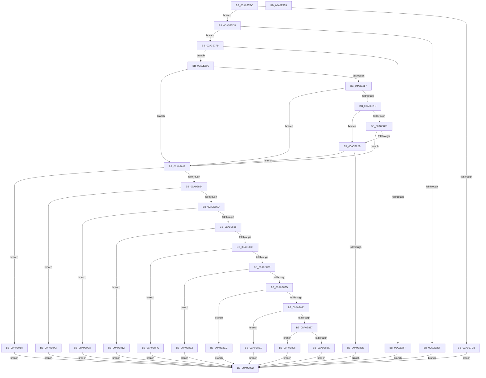

# SmQueryStoreInformation

- RVA: `0x00A0E7BC`–`0x00A0E979` (길이 `445` bytes)
- VA: `0x0000000140A0E7BC`
- 실행 섹션: `PAGE`
- PDB 이름 있음: `예`; PDB Function 태그: `아니요`
- unwind 정보 RVA: `0x000A8DF0`
- 디코드: `115`개 명령, `445/445` bytes 표시
- 미해석 바이트: `0` (있으면 어셈블리에 `.byte`로 보존)

> 이 문서는 커널 이미지의 기계어와 PDB 기호를 분석해 생성했습니다. 4번과 5번은 함수 원형과 자료형을 바이너리 사용 방식에서 추정한 C 해석이며 원본 소스 복구 결과는 아닙니다.

## 1. Dependencies

- 직접 호출 지점: **10**; 고유 호출 대상: **10**
- 직접 호출자로 확인된 함수: **1**
- RIP 상대 이미지 참조: **1**

### Outgoing calls
- `0x00A0E834` → [SeSinglePrivilegeCheck](../87/SeSinglePrivilegeCheck_function_00871E20.md) (function, `0x00871E20`)
- `0x00A0E8A7` → [SmProcessCompressionAcceleratorRequest](../7A/SmProcessCompressionAcceleratorRequest_function_007A5EEC.md) (function, `0x007A5EEC`)
- `0x00A0E8C2` → [SmProcessCompressionReadStatsRequest](../7A/SmProcessCompressionReadStatsRequest_function_007A6090.md) (function, `0x007A6090`)
- `0x00A0E8D8` → [SmProcessProcessStoreInfoRequest](../7A/SmProcessProcessStoreInfoRequest_function_007A6B48.md) (function, `0x007A6B48`)
- `0x00A0E8F3` → [SmProcessCompressionInfoRequest](SmProcessCompressionInfoRequest_function_00A0E980.md) (function, `0x00A0E980`)
- `0x00A0E90B` → [SmProcessRegistrationRequest](../7A/SmProcessRegistrationRequest_function_007A6C8C.md) (function, `0x007A6C8C`)
- `0x00A0E923` → [SmcProcessStatsRequest](../7A/SmcProcessStatsRequest_function_007A7BFC.md) (function, `0x007A7BFC`)
- `0x00A0E93B` → [SmcProcessListRequest](../7A/SmcProcessListRequest_function_007A7988.md) (function, `0x007A7988`)
- `0x00A0E953` → [SmProcessListRequest](../7A/SmProcessListRequest_function_007A67A8.md) (function, `0x007A67A8`)
- `0x00A0E96B` → [SmProcessStatsRequest](../7A/SmProcessStatsRequest_function_007A6E68.md) (function, `0x007A6E68`)

### Direct callers
- [ExpQuerySystemInformation](../A5/ExpQuerySystemInformation_function_00A57858.md) at `0x00A595DA`

### Static image references
- `0x00A0E82D` → RVA `0x00FD9B08` (`PAGEDATA`; read)

## 2. Other-region calls and transfers

- 다른 실행 섹션으로 향하는 call: **0**
- 별도 외부 분기/꼬리 이동을 확인하지 못했습니다.

## 3. Assembly (complete function range)

```asm
00A0E7BC  40 53                           push rbx
00A0E7BE  48 83 EC 40                     sub rsp, 0x40
00A0E7C2  41 8A D9                        mov bl, r9b
00A0E7C5  41 83 F8 18                     cmp r8d, 0x18
00A0E7C9  73 0A                           jae 0x140a0e7d5
00A0E7CB  B8 06 02 00 C0                  mov eax, 0xc0000206
00A0E7D0  E9 9D 01 00 00                  jmp 0x140a0e972
00A0E7D5  0F 10 02                        movups xmm0, xmmword ptr [rdx]
00A0E7D8  0F 11 44 24 20                  movups xmmword ptr [rsp + 0x20], xmm0
00A0E7DD  F2 0F 10 4A 10                  movsd xmm1, qword ptr [rdx + 0x10]
00A0E7E2  F2 0F 11 4C 24 30               movsd qword ptr [rsp + 0x30], xmm1
00A0E7E8  83 7C 24 20 01                  cmp dword ptr [rsp + 0x20], 1
00A0E7ED  74 0A                           je 0x140a0e7f9
00A0E7EF  B8 59 00 00 C0                  mov eax, 0xc0000059
00A0E7F4  E9 79 01 00 00                  jmp 0x140a0e972
00A0E7F9  41 83 F8 18                     cmp r8d, 0x18
00A0E7FD  74 0A                           je 0x140a0e809
00A0E7FF  B8 04 00 00 C0                  mov eax, 0xc0000004
00A0E804  E9 69 01 00 00                  jmp 0x140a0e972
00A0E809  48 8B 44 24 20                  mov rax, qword ptr [rsp + 0x20]
00A0E80E  48 C1 E8 20                     shr rax, 0x20
00A0E812  83 F8 02                        cmp eax, 2
00A0E815  74 30                           je 0x140a0e847
00A0E817  83 F8 05                        cmp eax, 5
00A0E81A  74 2B                           je 0x140a0e847
00A0E81C  83 F8 18                        cmp eax, 0x18
00A0E81F  77 0A                           ja 0x140a0e82b
00A0E821  B9 00 21 C0 01                  mov ecx, 0x1c02100
00A0E826  0F A3 C1                        bt ecx, eax
00A0E829  72 1C                           jb 0x140a0e847
00A0E82B  8A D3                           mov dl, bl
00A0E82D  48 8B 0D D4 B2 5C 00            mov rcx, qword ptr [rip + 0x5cb2d4]
00A0E834  E8 E7 35 E6 FF                  call 0x140871e20
00A0E839  84 C0                           test al, al
00A0E83B  75 0A                           jne 0x140a0e847
00A0E83D  B8 22 00 00 C0                  mov eax, 0xc0000022
00A0E842  E9 2B 01 00 00                  jmp 0x140a0e972
00A0E847  8B 4C 24 24                     mov ecx, dword ptr [rsp + 0x24]
00A0E84B  83 E9 02                        sub ecx, 2
00A0E84E  0F 84 06 01 00 00               je 0x140a0e95a
00A0E854  83 E9 03                        sub ecx, 3
00A0E857  0F 84 E5 00 00 00               je 0x140a0e942
00A0E85D  83 E9 03                        sub ecx, 3
00A0E860  0F 84 C4 00 00 00               je 0x140a0e92a
00A0E866  83 E9 05                        sub ecx, 5
00A0E869  0F 84 A3 00 00 00               je 0x140a0e912
00A0E86F  83 E9 02                        sub ecx, 2
00A0E872  0F 84 82 00 00 00               je 0x140a0e8fa
00A0E878  83 E9 07                        sub ecx, 7
00A0E87B  74 65                           je 0x140a0e8e2
00A0E87D  83 E9 01                        sub ecx, 1
00A0E880  74 4A                           je 0x140a0e8cc
00A0E882  83 E9 01                        sub ecx, 1
00A0E885  74 2A                           je 0x140a0e8b1
00A0E887  83 F9 01                        cmp ecx, 1
00A0E88A  74 0A                           je 0x140a0e896
00A0E88C  B8 03 00 00 C0                  mov eax, 0xc0000003
00A0E891  E9 DC 00 00 00                  jmp 0x140a0e972
00A0E896  44 8A CB                        mov r9b, bl
00A0E899  4C 8B 44 24 70                  mov r8, qword ptr [rsp + 0x70]
00A0E89E  8B 54 24 30                     mov edx, dword ptr [rsp + 0x30]
00A0E8A2  48 8B 4C 24 28                  mov rcx, qword ptr [rsp + 0x28]
00A0E8A7  E8 40 76 D9 FF                  call 0x1407a5eec
00A0E8AC  E9 C1 00 00 00                  jmp 0x140a0e972
00A0E8B1  44 8A CB                        mov r9b, bl
00A0E8B4  4C 8B 44 24 70                  mov r8, qword ptr [rsp + 0x70]
00A0E8B9  8B 54 24 30                     mov edx, dword ptr [rsp + 0x30]
00A0E8BD  48 8B 4C 24 28                  mov rcx, qword ptr [rsp + 0x28]
00A0E8C2  E8 C9 77 D9 FF                  call 0x1407a6090
00A0E8C7  E9 A6 00 00 00                  jmp 0x140a0e972
00A0E8CC  44 8A C3                        mov r8b, bl
00A0E8CF  8B 54 24 30                     mov edx, dword ptr [rsp + 0x30]
00A0E8D3  48 8B 4C 24 28                  mov rcx, qword ptr [rsp + 0x28]
00A0E8D8  E8 6B 82 D9 FF                  call 0x1407a6b48
00A0E8DD  E9 90 00 00 00                  jmp 0x140a0e972
00A0E8E2  44 8A CB                        mov r9b, bl
00A0E8E5  4C 8B 44 24 70                  mov r8, qword ptr [rsp + 0x70]
00A0E8EA  8B 54 24 30                     mov edx, dword ptr [rsp + 0x30]
00A0E8EE  48 8B 4C 24 28                  mov rcx, qword ptr [rsp + 0x28]
00A0E8F3  E8 88 00 00 00                  call 0x140a0e980
00A0E8F8  EB 78                           jmp 0x140a0e972
00A0E8FA  44 8A CB                        mov r9b, bl
00A0E8FD  4C 8B 44 24 70                  mov r8, qword ptr [rsp + 0x70]
00A0E902  8B 54 24 30                     mov edx, dword ptr [rsp + 0x30]
00A0E906  48 8B 4C 24 28                  mov rcx, qword ptr [rsp + 0x28]
00A0E90B  E8 7C 83 D9 FF                  call 0x1407a6c8c
00A0E910  EB 60                           jmp 0x140a0e972
00A0E912  44 8A CB                        mov r9b, bl
00A0E915  4C 8B 44 24 70                  mov r8, qword ptr [rsp + 0x70]
00A0E91A  8B 54 24 30                     mov edx, dword ptr [rsp + 0x30]
00A0E91E  48 8B 4C 24 28                  mov rcx, qword ptr [rsp + 0x28]
00A0E923  E8 D4 92 D9 FF                  call 0x1407a7bfc
00A0E928  EB 48                           jmp 0x140a0e972
00A0E92A  44 8A CB                        mov r9b, bl
00A0E92D  4C 8B 44 24 70                  mov r8, qword ptr [rsp + 0x70]
00A0E932  8B 54 24 30                     mov edx, dword ptr [rsp + 0x30]
00A0E936  48 8B 4C 24 28                  mov rcx, qword ptr [rsp + 0x28]
00A0E93B  E8 48 90 D9 FF                  call 0x1407a7988
00A0E940  EB 30                           jmp 0x140a0e972
00A0E942  44 8A CB                        mov r9b, bl
00A0E945  4C 8B 44 24 70                  mov r8, qword ptr [rsp + 0x70]
00A0E94A  8B 54 24 30                     mov edx, dword ptr [rsp + 0x30]
00A0E94E  48 8B 4C 24 28                  mov rcx, qword ptr [rsp + 0x28]
00A0E953  E8 50 7E D9 FF                  call 0x1407a67a8
00A0E958  EB 18                           jmp 0x140a0e972
00A0E95A  44 8A CB                        mov r9b, bl
00A0E95D  4C 8B 44 24 70                  mov r8, qword ptr [rsp + 0x70]
00A0E962  8B 54 24 30                     mov edx, dword ptr [rsp + 0x30]
00A0E966  48 8B 4C 24 28                  mov rcx, qword ptr [rsp + 0x28]
00A0E96B  E8 F8 84 D9 FF                  call 0x1407a6e68
00A0E970  EB 00                           jmp 0x140a0e972
00A0E972  48 83 C4 40                     add rsp, 0x40
00A0E976  5B                              pop rbx
00A0E977  C3                              ret
00A0E978  CC                              int3
```

## 4. C-style interpretation (structured pseudocode)

```c
__int64 __fastcall SmQueryStoreInformation(__int64 a1, __int64 a2, int a3, unsigned __int8 a4, __int64 a5)
{
    __int64 result;
    __int64 v_rsp;
    unsigned __int64 v_stack_m18;
    unsigned __int64 v_stack_m20;
    unsigned int v_stack_m24;
    unsigned __int64 v_stack_m28;

    v_rsp = (v_rsp) - (64);
    if (a3 >= 24) goto loc_00A0E7D5;
    goto loc_00A0E972;
loc_00A0E7D5:
    v_stack_m28 = v_xmm0;
    v_stack_m18 = v_xmm1;
    if (v_stack_m28 == 1) goto loc_00A0E7F9;
    goto loc_00A0E972;
loc_00A0E7F9:
    if (a3 == 24) goto loc_00A0E809;
    goto loc_00A0E972;
loc_00A0E809:
    result = (v_stack_m28) >> (32);
    if (((unsigned int)(result)) == 2) goto loc_00A0E847;
    if (((unsigned int)(result)) == 5) goto loc_00A0E847;
    if (((unsigned int)(result)) > 24) goto loc_00A0E82B;
    if (((unsigned int)(result)) < 24) goto loc_00A0E847;
loc_00A0E82B:
    result = SeSinglePrivilegeCheck(*(unsigned __int64 *)(v_rip + 6075092), a4, a3, a4);
    if ((unsigned __int8)(result) != 0) goto loc_00A0E847;
    goto loc_00A0E972;
loc_00A0E847:
    a1 = (unsigned int)(((unsigned int)(v_stack_m24)) - (2));
    if (condition_is_equal) goto loc_00A0E95A;
    a1 = (unsigned int)((a1) - (3));
    if (condition_is_equal) goto loc_00A0E942;
    a1 = (unsigned int)((a1) - (3));
    if (condition_is_equal) goto loc_00A0E92A;
    a1 = (unsigned int)((a1) - (5));
    if (condition_is_equal) goto loc_00A0E912;
    a1 = (unsigned int)((a1) - (2));
    if (condition_is_equal) goto loc_00A0E8FA;
    a1 = (unsigned int)((a1) - (7));
    if (condition_is_equal) goto loc_00A0E8E2;
    a1 = (unsigned int)((a1) - (1));
    if (condition_is_equal) goto loc_00A0E8CC;
    a1 = (unsigned int)((a1) - (1));
    if (condition_is_equal) goto loc_00A0E8B1;
    if (((unsigned int)(a1)) == 1) goto loc_00A0E896;
    goto loc_00A0E972;
loc_00A0E896:
    result = SmProcessCompressionAcceleratorRequest(v_stack_m20, (unsigned int)(v_stack_m18), a5, a4);
    goto loc_00A0E972;
loc_00A0E8B1:
    result = SmProcessCompressionReadStatsRequest(v_stack_m20, (unsigned int)(v_stack_m18), a5, a4);
    goto loc_00A0E972;
loc_00A0E8CC:
    result = SmProcessProcessStoreInfoRequest(v_stack_m20, (unsigned int)(v_stack_m18), a4, a4);
    goto loc_00A0E972;
loc_00A0E8E2:
    result = SmProcessCompressionInfoRequest(v_stack_m20, (unsigned int)(v_stack_m18), a5, a4);
    goto loc_00A0E972;
loc_00A0E8FA:
    result = SmProcessRegistrationRequest(v_stack_m20, (unsigned int)(v_stack_m18), a5, a4);
    goto loc_00A0E972;
loc_00A0E912:
    result = SmcProcessStatsRequest(v_stack_m20, (unsigned int)(v_stack_m18), a5, a4);
    goto loc_00A0E972;
loc_00A0E92A:
    result = SmcProcessListRequest(v_stack_m20, (unsigned int)(v_stack_m18), a5, a4);
    goto loc_00A0E972;
loc_00A0E942:
    result = SmProcessListRequest(v_stack_m20, (unsigned int)(v_stack_m18), a5, a4);
    goto loc_00A0E972;
loc_00A0E95A:
    result = SmProcessStatsRequest(v_stack_m20, (unsigned int)(v_stack_m18), a5, a4);
    goto loc_00A0E972;
loc_00A0E972:
    v_rsp = (v_rsp) + (64);
    return result;
}
```

## 5. (Beta) C Style

```c
int64_t SmQueryStoreInformation(int64_t Arg1, void *Arg2, int32_t Arg3, uint8_t Arg4, int64_t Arg5)
{
    uint8_t *arg2 = (uint8_t *)Arg2;

    int64_t result;
    int64_t local_rsp;
    uint64_t v_stack_m18;
    uint64_t v_stack_m20;
    uint32_t v_stack_m24;
    uint64_t v_stack_m28;

    local_rsp = (local_rsp) - (64);
    if (Arg3 >= 24) goto loc_00A0E7D5;
    goto loc_00A0E972;
loc_00A0E7D5:
    v_stack_m28 = v_xmm0;
    v_stack_m18 = v_xmm1;
    if (v_stack_m28 == 1) goto loc_00A0E7F9;
    goto loc_00A0E972;
loc_00A0E7F9:
    if (Arg3 == 24) goto loc_00A0E809;
    goto loc_00A0E972;
loc_00A0E809:
    result = (v_stack_m28) >> (32);
    if (((uint32_t)(result)) == 2) goto loc_00A0E847;
    if (((uint32_t)(result)) == 5) goto loc_00A0E847;
    if (((uint32_t)(result)) > 24) goto loc_00A0E82B;
    if (((uint32_t)(result)) < 24) goto loc_00A0E847;
loc_00A0E82B:
    result = SeSinglePrivilegeCheck(*(uint64_t *)(v_rip + 0x5CB2D4), Arg4, Arg3, Arg4);
    if ((uint8_t)(result) != 0) goto loc_00A0E847;
    goto loc_00A0E972;
loc_00A0E847:
    Arg1 = (uint32_t)(((uint32_t)(v_stack_m24)) - (2));
    if (condition_is_equal) goto loc_00A0E95A;
    Arg1 = (uint32_t)((Arg1) - (3));
    if (condition_is_equal) goto loc_00A0E942;
    Arg1 = (uint32_t)((Arg1) - (3));
    if (condition_is_equal) goto loc_00A0E92A;
    Arg1 = (uint32_t)((Arg1) - (5));
    if (condition_is_equal) goto loc_00A0E912;
    Arg1 = (uint32_t)((Arg1) - (2));
    if (condition_is_equal) goto loc_00A0E8FA;
    Arg1 = (uint32_t)((Arg1) - (7));
    if (condition_is_equal) goto loc_00A0E8E2;
    Arg1 = (uint32_t)((Arg1) - (1));
    if (condition_is_equal) goto loc_00A0E8CC;
    Arg1 = (uint32_t)((Arg1) - (1));
    if (condition_is_equal) goto loc_00A0E8B1;
    if (((uint32_t)(Arg1)) == 1) goto loc_00A0E896;
    goto loc_00A0E972;
loc_00A0E896:
    result = SmProcessCompressionAcceleratorRequest(v_stack_m20, (uint32_t)(v_stack_m18), Arg5, Arg4);
    goto loc_00A0E972;
loc_00A0E8B1:
    result = SmProcessCompressionReadStatsRequest(v_stack_m20, (uint32_t)(v_stack_m18), Arg5, Arg4);
    goto loc_00A0E972;
loc_00A0E8CC:
    result = SmProcessProcessStoreInfoRequest(v_stack_m20, (uint32_t)(v_stack_m18), Arg4, Arg4);
    goto loc_00A0E972;
loc_00A0E8E2:
    result = SmProcessCompressionInfoRequest(v_stack_m20, (uint32_t)(v_stack_m18), Arg5, Arg4);
    goto loc_00A0E972;
loc_00A0E8FA:
    result = SmProcessRegistrationRequest(v_stack_m20, (uint32_t)(v_stack_m18), Arg5, Arg4);
    goto loc_00A0E972;
loc_00A0E912:
    result = SmcProcessStatsRequest(v_stack_m20, (uint32_t)(v_stack_m18), Arg5, Arg4);
    goto loc_00A0E972;
loc_00A0E92A:
    result = SmcProcessListRequest(v_stack_m20, (uint32_t)(v_stack_m18), Arg5, Arg4);
    goto loc_00A0E972;
loc_00A0E942:
    result = SmProcessListRequest(v_stack_m20, (uint32_t)(v_stack_m18), Arg5, Arg4);
    goto loc_00A0E972;
loc_00A0E95A:
    result = SmProcessStatsRequest(v_stack_m20, (uint32_t)(v_stack_m18), Arg5, Arg4);
    goto loc_00A0E972;
loc_00A0E972:
    local_rsp = (local_rsp) + (64);
    return result;
}
```

### 관측된 메모리 오프셋

구조체 형식이 확인되지 않은 접근은 인자 기준의 오프셋으로만 기록했습니다.

| 기준 인자 | 오프셋 표현 | 폭 (bit) | 접근 |
|---|---:|---:|---|
| `Arg2` | `+ 0x0` | `128` | `R` |
| `Arg2` | `+ 0x10` | `64` | `R` |

## 6. Execution-region graph

[열기: 2D/3D 그래프와 함수 탐색 컨트롤 패널](../../../control-panel.html?section=page&rva=0x00A0E7BC&view=graph)

- 2D 그래프는 위에서 아래로 흐르고, 3D 그래프는 빈 공간을 드래그해 회전합니다. Shift+드래그는 이동, 휠은 확대·축소, 함수 노드 선택은 대상 보고서 이동입니다.

### Static fallback


