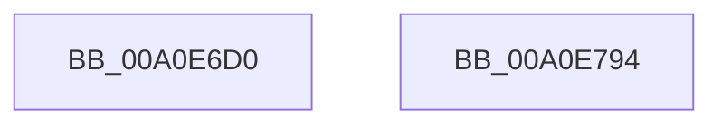

# sub_00A0E6D0

- RVA: `0x00A0E6D0`–`0x00A0E795` (길이 `197` bytes)
- VA: `0x0000000140A0E6D0`
- 실행 섹션: `PAGE`
- PDB 이름 있음: `아니요`; PDB Function 태그: `아니요`
- unwind 정보 RVA: `0x00069588`
- 디코드: `52`개 명령, `197/197` bytes 표시
- 미해석 바이트: `0` (있으면 어셈블리에 `.byte`로 보존)

> 이 문서는 커널 이미지의 기계어와 PDB 기호를 분석해 생성했습니다. 4번과 5번은 함수 원형과 자료형을 바이너리 사용 방식에서 추정한 C 해석이며 원본 소스 복구 결과는 아닙니다.

## 1. Dependencies

- 직접 호출 지점: **0**; 고유 호출 대상: **0**
- 직접 호출자로 확인된 함수: **0**
- RIP 상대 이미지 참조: **0**

### Outgoing calls
- 직접 디코드된 call 명령이 없습니다.

### Direct callers
- 이 함수 시작 RVA로 연결되는 직접 call은 확인되지 않았습니다. 간접 호출은 완전히 역산할 수 없습니다.

### Static image references
- 디코드된 RIP-relative 메모리 참조가 없습니다.

## 2. Other-region calls and transfers

- 다른 실행 섹션으로 향하는 call: **0**
- 별도 외부 분기/꼬리 이동을 확인하지 못했습니다.

## 3. Assembly (complete function range)

```asm
00A0E6D0  48 89 5C 24 08                  mov qword ptr [rsp + 8], rbx
00A0E6D5  48 89 74 24 10                  mov qword ptr [rsp + 0x10], rsi
00A0E6DA  48 89 7C 24 18                  mov qword ptr [rsp + 0x18], rdi
00A0E6DF  8B 7C 24 38                     mov edi, dword ptr [rsp + 0x38]
00A0E6E3  4C 8B D2                        mov r10, rdx
00A0E6E6  48 8B D9                        mov rbx, rcx
00A0E6E9  49 8B F1                        mov rsi, r9
00A0E6EC  4D 8B D8                        mov r11, r8
00A0E6EF  83 E3 03                        and ebx, 3
00A0E6F2  48 B8 AB AA AA AA AA AA AA AA   movabs rax, 0xaaaaaaaaaaaaaaab
00A0E6FC  48 F7 E2                        mul rdx
00A0E6FF  49 8D 42 01                     lea rax, [r10 + 1]
00A0E703  4C 8B 54 24 30                  mov r10, qword ptr [rsp + 0x30]
00A0E708  48 D1 EA                        shr rdx, 1
00A0E70B  48 03 D3                        add rdx, rbx
00A0E70E  48 03 C2                        add rax, rdx
00A0E711  83 E0 03                        and eax, 3
00A0E714  45 0F B7 0C 42                  movzx r9d, word ptr [r10 + rax*2]
00A0E719  48 B8 93 24 49 92 24 49 92 24   movabs rax, 0x2492492492492493
00A0E723  49 F7 E0                        mul r8
00A0E726  49 8B C0                        mov rax, r8
00A0E729  44 33 CF                        xor r9d, edi
00A0E72C  48 2B C2                        sub rax, rdx
00A0E72F  48 D1 E8                        shr rax, 1
00A0E732  48 03 C2                        add rax, rdx
00A0E735  48 C1 E8 02                     shr rax, 2
00A0E739  48 6B D0 07                     imul rdx, rax, 7
00A0E73D  41 0F B7 04 5A                  movzx eax, word ptr [r10 + rbx*2]
00A0E742  48 8B 5C 24 08                  mov rbx, qword ptr [rsp + 8]
00A0E747  8A CA                           mov cl, dl
00A0E749  41 2A C8                        sub cl, r8b
00A0E74C  44 2A DA                        sub r11b, dl
00A0E74F  80 C1 1F                        add cl, 0x1f
00A0E752  45 8B C1                        mov r8d, r9d
00A0E755  41 D3 E8                        shr r8d, cl
00A0E758  41 8D 4B 01                     lea ecx, [r11 + 1]
00A0E75C  41 D3 E1                        shl r9d, cl
00A0E75F  45 0B C1                        or r8d, r9d
00A0E762  44 0F AF C0                     imul r8d, eax
00A0E766  48 B8 89 88 88 88 88 88 88 88   movabs rax, 0x8888888888888889
00A0E770  48 F7 E6                        mul rsi
00A0E773  48 C1 EA 03                     shr rdx, 3
00A0E777  0F B6 CA                        movzx ecx, dl
00A0E77A  6B D1 0F                        imul edx, ecx, 0xf
00A0E77D  40 2A F2                        sub sil, dl
00A0E780  8D 4E 01                        lea ecx, [rsi + 1]
00A0E783  48 8B 74 24 10                  mov rsi, qword ptr [rsp + 0x10]
00A0E788  D3 EF                           shr edi, cl
00A0E78A  42 8D 04 07                     lea eax, [rdi + r8]
00A0E78E  48 8B 7C 24 18                  mov rdi, qword ptr [rsp + 0x18]
00A0E793  C3                              ret
00A0E794  CC                              int3
```

## 4. C-style interpretation (structured pseudocode)

```c
__int64 __fastcall sub_00A0E6D0(__int64 a1, __int64 a2, __int64 a3, __int64 a4, __int64 a5, __int64 a6, unsigned int a7)
{
    __int64 result;
    __int64 v_r11;
    __int64 v_rbx;
    __int64 v_rdi;
    __int64 v_rsi;
    unsigned __int64 v_stack_p10;
    unsigned __int64 v_stack_p18;
    unsigned __int64 v_stack_p8;

    v_stack_p8 = v_rbx;
    v_stack_p10 = v_rsi;
    v_stack_p18 = v_rdi;
    v_rbx = (unsigned int)((a1) & (3));
    a2 = (a2) >> (1);
    a2 = (a2) + (v_rbx);
    result = (a2 + 1) + (a2);
    result = (unsigned int)((result) & (3));
    a4 = (unsigned int)((*(unsigned __int16 *)(a6 + result * 2)) ^ ((unsigned int)((unsigned int)(a7))));
    result = (a3) - (a2);
    result = (result) >> (1);
    result = (result) + (a2);
    result = (result) >> (2);
    a2 = (a2) * (result);
    a1 = (unsigned __int8)(((unsigned __int8)(a2)) - ((unsigned __int8)(a3)));
    v_r11 = (unsigned __int8)((a3) - ((unsigned __int8)(a2)));
    a1 = (unsigned __int8)((a1) + (31));
    a3 = (unsigned int)(((unsigned int)((unsigned int)(a4))) >> ((unsigned __int8)(a1)));
    a4 = (unsigned int)((a4) << ((unsigned __int8)(v_r11 + 1)));
    a3 = (unsigned int)((a3) | ((unsigned int)(a4)));
    a3 = (unsigned int)((a3) * ((unsigned int)(*(unsigned __int16 *)(a6 + v_rbx * 2))));
    a2 = (a2) >> (3);
    a2 = (unsigned int)((a2) * ((unsigned int)((unsigned __int8)(a2))));
    v_rsi = (unsigned __int8)((a4) - ((unsigned __int8)(a2)));
    v_rdi = (unsigned int)(((unsigned int)(a7)) >> ((unsigned __int8)(v_rsi + 1)));
    return v_rdi + a3 * 1;
}
```

## 5. (Beta) C Style

```c
int64_t sub_00A0E6D0(int64_t Arg1, void *Arg2, void *Arg3, int64_t Arg4, uint64_t Arg5, void *Arg6, uint32_t Arg7)
{
    uint8_t *arg2 = (uint8_t *)Arg2;
    uint8_t *arg3 = (uint8_t *)Arg3;
    uint8_t *arg6 = (uint8_t *)Arg6;

    int64_t result;
    int64_t local_r11;
    int64_t local_rbx;
    int64_t local_rdi;
    int64_t local_rsi;
    uint64_t v_stack_p10;
    uint64_t v_stack_p18;
    uint64_t v_stack_p8;

    v_stack_p8 = local_rbx;
    v_stack_p10 = local_rsi;
    v_stack_p18 = local_rdi;
    local_rbx = (uint32_t)((Arg1) & (3));
    Arg2 = (Arg2) >> (1);
    Arg2 = (Arg2) + (local_rbx);
    result = (Arg2 + 1) + (Arg2);
    result = (uint32_t)((result) & (3));
    Arg4 = (uint32_t)((*(uint16_t *)(arg6 + result * 2)) ^ ((uint32_t)((uint32_t)(Arg7))));
    result = (Arg3) - (Arg2);
    result = (result) >> (1);
    result = (result) + (Arg2);
    result = (result) >> (2);
    Arg2 = (Arg2) * (result);
    Arg1 = (uint8_t)(((uint8_t)(Arg2)) - ((uint8_t)(Arg3)));
    local_r11 = (uint8_t)((Arg3) - ((uint8_t)(Arg2)));
    Arg1 = (uint8_t)((Arg1) + (31));
    Arg3 = (uint32_t)(((uint32_t)((uint32_t)(Arg4))) >> ((uint8_t)(Arg1)));
    Arg4 = (uint32_t)((Arg4) << ((uint8_t)(local_r11 + 1)));
    Arg3 = (uint32_t)((Arg3) | ((uint32_t)(Arg4)));
    Arg3 = (uint32_t)((Arg3) * ((uint32_t)(*(uint16_t *)(arg6 + local_rbx * 2))));
    Arg2 = (Arg2) >> (3);
    Arg2 = (uint32_t)((Arg2) * ((uint32_t)((uint8_t)(Arg2))));
    local_rsi = (uint8_t)((Arg4) - ((uint8_t)(Arg2)));
    local_rdi = (uint32_t)(((uint32_t)(Arg7)) >> ((uint8_t)(local_rsi + 1)));
    return local_rdi + Arg3 * 1;
}
```

### 관측된 메모리 오프셋

구조체 형식이 확인되지 않은 접근은 인자 기준의 오프셋으로만 기록했습니다.

| 기준 인자 | 오프셋 표현 | 폭 (bit) | 접근 |
|---|---:|---:|---|
| `Arg2` | `+ 0x1` | `64` | `R` |
| `Arg3` | `+ 0x1` | `32` | `R` |
| `Arg6` | `+ 0x0 + rax*2` | `16` | `R` |
| `Arg6` | `+ 0x0 + rbx*2` | `16` | `R` |

## 6. Execution-region graph

[열기: 2D/3D 그래프와 함수 탐색 컨트롤 패널](../../../control-panel.html?section=page&rva=0x00A0E6D0&view=graph)

- 2D 그래프는 위에서 아래로 흐르고, 3D 그래프는 빈 공간을 드래그해 회전합니다. Shift+드래그는 이동, 휠은 확대·축소, 함수 노드 선택은 대상 보고서 이동입니다.

### Static fallback


