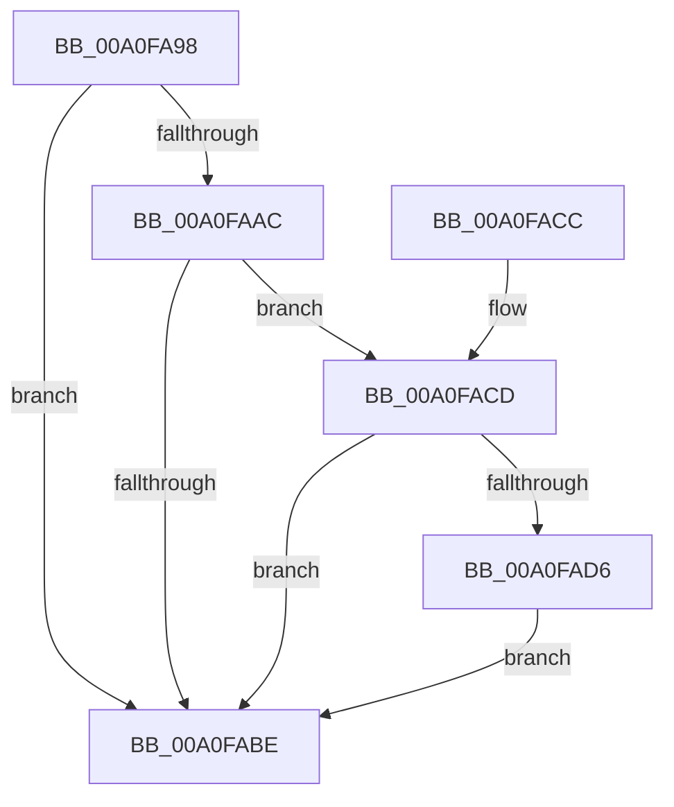

# sub_00A0FA98

- RVA: `0x00A0FA98`–`0x00A0FAE9` (길이 `81` bytes)
- VA: `0x0000000140A0FA98`
- 실행 섹션: `PAGE`
- PDB 이름 있음: `아니요`; PDB Function 태그: `아니요`
- unwind 정보 RVA: `0x0005D394`
- 디코드: `26`개 명령, `81/81` bytes 표시
- 미해석 바이트: `0` (있으면 어셈블리에 `.byte`로 보존)

> 이 문서는 커널 이미지의 기계어와 PDB 기호를 분석해 생성했습니다. 4번과 5번은 함수 원형과 자료형을 바이너리 사용 방식에서 추정한 C 해석이며 원본 소스 복구 결과는 아닙니다.

## 1. Dependencies

- 직접 호출 지점: **3**; 고유 호출 대상: **2**
- 직접 호출자로 확인된 함수: **2**
- RIP 상대 이미지 참조: **0**

### Outgoing calls
- `0x00A0FACD` → [sub_008D2220](../8D/Unknown_function_008D2220.md) (function, `0x008D2220`)
- `0x00A0FADA` → [PdcCloseEvent](../8D/PdcCloseEvent_function_008D2404.md) (function, `0x008D2404`)
- `0x00A0FAE2` → [PdcCloseEvent](../8D/PdcCloseEvent_function_008D2404.md) (function, `0x008D2404`)

### Direct callers
- [sub_008D215C](../8D/Unknown_function_008D215C.md) at `0x008D21F7`
- [sub_008D4104](../8D/Unknown_function_008D4104.md) at `0x008D4235`

### Static image references
- 디코드된 RIP-relative 메모리 참조가 없습니다.

## 2. Other-region calls and transfers

- 다른 실행 섹션으로 향하는 call: **0**
- 별도 외부 분기/꼬리 이동을 확인하지 못했습니다.

## 3. Assembly (complete function range)

```asm
00A0FA98  48 89 5C 24 08                  mov qword ptr [rsp + 8], rbx
00A0FA9D  57                              push rdi
00A0FA9E  48 83 EC 20                     sub rsp, 0x20
00A0FAA2  33 DB                           xor ebx, ebx
00A0FAA4  48 8B FA                        mov rdi, rdx
00A0FAA7  48 85 D2                        test rdx, rdx
00A0FAAA  74 12                           je 0x140a0fabe
00A0FAAC  49 83 C8 FF                     or r8, 0xffffffffffffffff
00A0FAB0  49 8B D8                        mov rbx, r8
00A0FAB3  F0 48 0F C1 5A 08               lock xadd qword ptr [rdx + 8], rbx
00A0FAB9  49 03 D8                        add rbx, r8
00A0FABC  74 0F                           je 0x140a0facd
00A0FABE  48 8B C3                        mov rax, rbx
00A0FAC1  48 8B 5C 24 30                  mov rbx, qword ptr [rsp + 0x30]
00A0FAC6  48 83 C4 20                     add rsp, 0x20
00A0FACA  5F                              pop rdi
00A0FACB  C3                              ret
00A0FACC  CC                              int3
00A0FACD  E8 4E 27 EC FF                  call 0x1408d2220
00A0FAD2  85 C0                           test eax, eax
00A0FAD4  78 E8                           js 0x140a0fabe
00A0FAD6  48 8B 4F 18                     mov rcx, qword ptr [rdi + 0x18]
00A0FADA  E8 25 29 EC FF                  call 0x1408d2404
00A0FADF  48 8B CF                        mov rcx, rdi
00A0FAE2  E8 1D 29 EC FF                  call 0x1408d2404
00A0FAE7  EB D5                           jmp 0x140a0fabe
```

## 4. C-style interpretation (structured pseudocode)

```c
__int64 __fastcall sub_00A0FA98(__int64 a1, __int64 a2, __int64 a3)
{
    __int64 result;
    __int64 v_rbx;
    __int64 v_rsp;
    unsigned __int64 v_stack_p8;

    v_stack_p8 = v_rbx;
    v_rsp = (v_rsp) - (32);
    v_rbx = 0;
    if (a2 == 0) goto loc_00A0FABE;
    a3 = (a3) | (-1);
    v_rbx = (a3) + (a3);
    if (condition_is_equal) goto loc_00A0FACD;
loc_00A0FABE:
    v_rsp = (v_rsp) + (32);
    return v_rbx;
loc_00A0FACD:
    result = sub_008D2220(a1, a2, a3, a4);
    if (sign_flag) goto loc_00A0FABE;
    result = PdcCloseEvent(*(unsigned __int64 *)(a2 + 24), a2, a3, a4);
    result = PdcCloseEvent(a2, a2, a3, a4);
    goto loc_00A0FABE;
}
```

## 5. (Beta) C Style

```c
int64_t sub_00A0FA98(int64_t Arg1, void *Arg2, int64_t Arg3)
{
    uint8_t *arg2 = (uint8_t *)Arg2;

    int64_t result;
    int64_t local_rbx;
    int64_t local_rsp;
    uint64_t v_stack_p8;

    v_stack_p8 = local_rbx;
    local_rsp = (local_rsp) - (32);
    local_rbx = 0;
    if (Arg2 == NULL) goto loc_00A0FABE;
    Arg3 = (Arg3) | (-1);
    local_rbx = (Arg3) + (Arg3);
    if (condition_is_equal) goto loc_00A0FACD;
loc_00A0FABE:
    local_rsp = (local_rsp) + (32);
    return local_rbx;
loc_00A0FACD:
    result = sub_008D2220(Arg1, Arg2, Arg3, a4);
    if (sign_flag) goto loc_00A0FABE;
    result = PdcCloseEvent(*(uint64_t *)(arg2 + 0x18), Arg2, Arg3, a4);
    result = PdcCloseEvent(Arg2, Arg2, Arg3, a4);
    goto loc_00A0FABE;
}
```

### 관측된 메모리 오프셋

구조체 형식이 확인되지 않은 접근은 인자 기준의 오프셋으로만 기록했습니다.

| 기준 인자 | 오프셋 표현 | 폭 (bit) | 접근 |
|---|---:|---:|---|
| `Arg2` | `+ 0x18` | `64` | `R` |

## 6. Execution-region graph

[열기: 2D/3D 그래프와 함수 탐색 컨트롤 패널](../../../control-panel.html?section=page&rva=0x00A0FA98&view=graph)

- 2D 그래프는 위에서 아래로 흐르고, 3D 그래프는 빈 공간을 드래그해 회전합니다. Shift+드래그는 이동, 휠은 확대·축소, 함수 노드 선택은 대상 보고서 이동입니다.

### Static fallback


