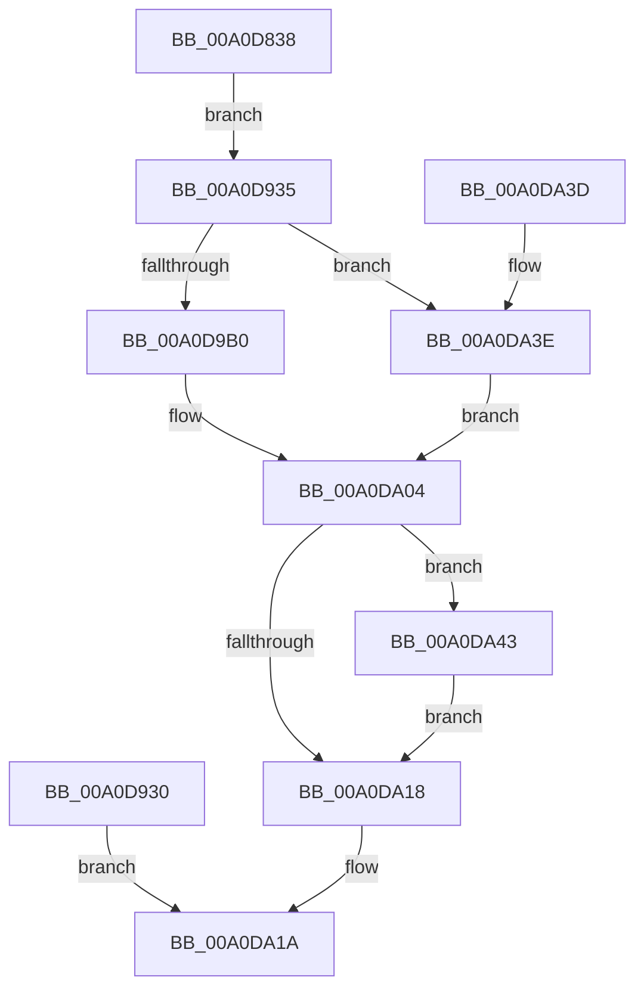

# VslCallEnclave

- RVA: `0x00A0D838`–`0x00A0DA4D` (길이 `533` bytes)
- VA: `0x0000000140A0D838`
- 실행 섹션: `PAGE`
- PDB 이름 있음: `예`; PDB Function 태그: `아니요`
- unwind 정보 RVA: `0x000A8C5C`
- 디코드: `119`개 명령, `533/533` bytes 표시
- 미해석 바이트: `0` (있으면 어셈블리에 `.byte`로 보존)

> 이 문서는 커널 이미지의 기계어와 PDB 기호를 분석해 생성했습니다. 4번과 5번은 함수 원형과 자료형을 바이너리 사용 방식에서 추정한 C 해석이며 원본 소스 복구 결과는 아닙니다.

## 1. Dependencies

- 직접 호출 지점: **6**; 고유 호출 대상: **6**
- 직접 호출자로 확인된 함수: **1**
- RIP 상대 이미지 참조: **1**

### Outgoing calls
- `0x00A0D8AD` → [memset](../../text/6C/memset_function_006C6C40.md) (function, `0x006C6C40`)
- `0x00A0D929` → [MmProbeAndLockPages](../../text/23/MmProbeAndLockPages_function_0023B990.md) (function, `0x0023B990`)
- `0x00A0D9A1` → [VslpEnterIumSecureMode](../../text/23/VslpEnterIumSecureMode_function_00235E50.md) (function, `0x00235E50`)
- `0x00A0DA09` → [MmUnlockPages](../../text/29/MmUnlockPages_function_0029EEE0.md) (function, `0x0029EEE0`)
- `0x00A0DA25` → [_security_check_cookie](../../text/6A/_security_check_cookie_function_006AC640.md) (function, `0x006AC640`)
- `0x00A0DA46` → [KeAlertThreadByThreadId](../../text/4C/KeAlertThreadByThreadId_function_004C3900.md) (function, `0x004C3900`)

### Direct callers
- [PsCallEnclave](PsCallEnclave_function_00A0CF50.md) at `0x00A0D1D0`

### Static image references
- `0x00A0D84B` → RVA `0x00E0A740` (`.data`; read)

## 2. Other-region calls and transfers

- 다른 실행 섹션으로 향하는 call: **6**
  - `0x00A0D8AD` → [memset](../../text/6C/memset_function_006C6C40.md) (`PAGE` → `.text`)
  - `0x00A0D929` → [MmProbeAndLockPages](../../text/23/MmProbeAndLockPages_function_0023B990.md) (`PAGE` → `.text`)
  - `0x00A0D9A1` → [VslpEnterIumSecureMode](../../text/23/VslpEnterIumSecureMode_function_00235E50.md) (`PAGE` → `.text`)
  - `0x00A0DA09` → [MmUnlockPages](../../text/29/MmUnlockPages_function_0029EEE0.md) (`PAGE` → `.text`)
  - `0x00A0DA25` → [_security_check_cookie](../../text/6A/_security_check_cookie_function_006AC640.md) (`PAGE` → `.text`)
  - `0x00A0DA46` → [KeAlertThreadByThreadId](../../text/4C/KeAlertThreadByThreadId_function_004C3900.md) (`PAGE` → `.text`)
- 별도 외부 분기/꼬리 이동을 확인하지 못했습니다.

## 3. Assembly (complete function range)

```asm
00A0D838  40 53                           push rbx
00A0D83A  56                              push rsi
00A0D83B  57                              push rdi
00A0D83C  41 54                           push r12
00A0D83E  41 55                           push r13
00A0D840  41 56                           push r14
00A0D842  41 57                           push r15
00A0D844  48 81 EC 00 01 00 00            sub rsp, 0x100
00A0D84B  48 8B 05 EE CE 3F 00            mov rax, qword ptr [rip + 0x3fceee]
00A0D852  48 33 C4                        xor rax, rsp
00A0D855  48 89 84 24 F0 00 00 00         mov qword ptr [rsp + 0xf0], rax
00A0D85D  44 89 4C 24 20                  mov dword ptr [rsp + 0x20], r9d
00A0D862  4D 8B F8                        mov r15, r8
00A0D865  4C 8B F2                        mov r14, rdx
00A0D868  48 89 4C 24 28                  mov qword ptr [rsp + 0x28], rcx
00A0D86D  4C 8B A4 24 60 01 00 00         mov r12, qword ptr [rsp + 0x160]
00A0D875  4C 8B AC 24 68 01 00 00         mov r13, qword ptr [rsp + 0x168]
00A0D87D  48 8B 9C 24 70 01 00 00         mov rbx, qword ptr [rsp + 0x170]
00A0D885  48 89 5C 24 38                  mov qword ptr [rsp + 0x38], rbx
00A0D88A  48 8B 84 24 78 01 00 00         mov rax, qword ptr [rsp + 0x178]
00A0D892  48 89 44 24 30                  mov qword ptr [rsp + 0x30], rax
00A0D897  48 8B BC 24 80 01 00 00         mov rdi, qword ptr [rsp + 0x180]
00A0D89F  33 D2                           xor edx, edx
00A0D8A1  44 8D 42 68                     lea r8d, [rdx + 0x68]
00A0D8A5  48 8D 8C 24 80 00 00 00         lea rcx, [rsp + 0x80]
00A0D8AD  E8 8E 93 CB FF                  call 0x1406c6c40
00A0D8B2  0F 57 C0                        xorps xmm0, xmm0
00A0D8B5  F3 0F 7F 44 24 4C               movdqu xmmword ptr [rsp + 0x4c], xmm0
00A0D8BB  45 33 C0                        xor r8d, r8d
00A0D8BE  44 89 44 24 5C                  mov dword ptr [rsp + 0x5c], r8d
00A0D8C3  4C 89 44 24 70                  mov qword ptr [rsp + 0x70], r8
00A0D8C8  65 48 8B 34 25 88 01 00 00      mov rsi, qword ptr gs:[0x188]
00A0D8D1  4C 89 44 24 40                  mov qword ptr [rsp + 0x40], r8
00A0D8D6  0F B7 C6                        movzx eax, si
00A0D8D9  BA FF 0F 00 00                  mov edx, 0xfff
00A0D8DE  66 23 C2                        and ax, dx
00A0D8E1  B9 97 17 00 00                  mov ecx, 0x1797
00A0D8E6  66 03 C1                        add ax, cx
00A0D8E9  66 C1 E8 0C                     shr ax, 0xc
00A0D8ED  66 83 C0 06                     add ax, 6
00A0D8F1  66 C1 E0 03                     shl ax, 3
00A0D8F5  66 89 44 24 48                  mov word ptr [rsp + 0x48], ax
00A0D8FA  66 44 89 44 24 4A               mov word ptr [rsp + 0x4a], r8w
00A0D900  48 8B C6                        mov rax, rsi
00A0D903  48 25 00 F0 FF FF               and rax, 0xfffffffffffff000
00A0D909  48 89 44 24 60                  mov qword ptr [rsp + 0x60], rax
00A0D90E  8B C6                           mov eax, esi
00A0D910  23 C2                           and eax, edx
00A0D912  89 44 24 6C                     mov dword ptr [rsp + 0x6c], eax
00A0D916  C7 44 24 68 98 07 00 00         mov dword ptr [rsp + 0x68], 0x798
00A0D91E  33 D2                           xor edx, edx
00A0D920  44 8D 42 01                     lea r8d, [rdx + 1]
00A0D924  48 8D 4C 24 40                  lea rcx, [rsp + 0x40]
00A0D929  E8 62 E0 82 FF                  call 0x14023b990
00A0D92E  EB 05                           jmp 0x140a0d935
00A0D930  E9 E5 00 00 00                  jmp 0x140a0da1a
00A0D935  8B 44 24 20                     mov eax, dword ptr [rsp + 0x20]
00A0D939  89 84 24 88 00 00 00            mov dword ptr [rsp + 0x88], eax
00A0D940  48 8B 44 24 28                  mov rax, qword ptr [rsp + 0x28]
00A0D945  8B 40 28                        mov eax, dword ptr [rax + 0x28]
00A0D948  89 84 24 8C 00 00 00            mov dword ptr [rsp + 0x8c], eax
00A0D94F  49 8B 07                        mov rax, qword ptr [r15]
00A0D952  48 89 84 24 90 00 00 00         mov qword ptr [rsp + 0x90], rax
00A0D95A  49 8B 04 24                     mov rax, qword ptr [r12]
00A0D95E  48 89 84 24 98 00 00 00         mov qword ptr [rsp + 0x98], rax
00A0D966  48 8B 44 24 70                  mov rax, qword ptr [rsp + 0x70]
00A0D96B  48 89 84 24 A0 00 00 00         mov qword ptr [rsp + 0xa0], rax
00A0D973  C6 84 24 BC 00 00 00 00         mov byte ptr [rsp + 0xbc], 0
00A0D97B  49 8B 45 00                     mov rax, qword ptr [r13]
00A0D97F  48 89 84 24 A8 00 00 00         mov qword ptr [rsp + 0xa8], rax
00A0D987  48 8B 03                        mov rax, qword ptr [rbx]
00A0D98A  48 89 84 24 B0 00 00 00         mov qword ptr [rsp + 0xb0], rax
00A0D992  33 D2                           xor edx, edx
00A0D994  4C 8D 8C 24 80 00 00 00         lea r9, [rsp + 0x80]
00A0D99C  45 8B 06                        mov r8d, dword ptr [r14]
00A0D99F  B1 01                           mov cl, 1
00A0D9A1  E8 AA 84 82 FF                  call 0x140235e50
00A0D9A6  8B D8                           mov ebx, eax
00A0D9A8  85 C0                           test eax, eax
00A0D9AA  0F 88 8E 00 00 00               js 0x140a0da3e
00A0D9B0  8B 8C 24 84 00 00 00            mov ecx, dword ptr [rsp + 0x84]
00A0D9B7  41 89 0E                        mov dword ptr [r14], ecx
00A0D9BA  48 8B 8C 24 90 00 00 00         mov rcx, qword ptr [rsp + 0x90]
00A0D9C2  49 89 0F                        mov qword ptr [r15], rcx
00A0D9C5  48 8B 8C 24 98 00 00 00         mov rcx, qword ptr [rsp + 0x98]
00A0D9CD  49 89 0C 24                     mov qword ptr [r12], rcx
00A0D9D1  8B 8C 24 B8 00 00 00            mov ecx, dword ptr [rsp + 0xb8]
00A0D9D8  48 8B 44 24 30                  mov rax, qword ptr [rsp + 0x30]
00A0D9DD  89 08                           mov dword ptr [rax], ecx
00A0D9DF  48 8B 8C 24 A8 00 00 00         mov rcx, qword ptr [rsp + 0xa8]
00A0D9E7  49 89 4D 00                     mov qword ptr [r13], rcx
00A0D9EB  48 8B 8C 24 B0 00 00 00         mov rcx, qword ptr [rsp + 0xb0]
00A0D9F3  48 8B 44 24 38                  mov rax, qword ptr [rsp + 0x38]
00A0D9F8  48 89 08                        mov qword ptr [rax], rcx
00A0D9FB  8A 84 24 BD 00 00 00            mov al, byte ptr [rsp + 0xbd]
00A0DA02  88 07                           mov byte ptr [rdi], al
00A0DA04  48 8D 4C 24 40                  lea rcx, [rsp + 0x40]
00A0DA09  E8 D2 14 89 FF                  call 0x14029eee0
00A0DA0E  80 BC 24 BC 00 00 00 00         cmp byte ptr [rsp + 0xbc], 0
00A0DA16  75 2B                           jne 0x140a0da43
00A0DA18  8B C3                           mov eax, ebx
00A0DA1A  48 8B 8C 24 F0 00 00 00         mov rcx, qword ptr [rsp + 0xf0]
00A0DA22  48 33 CC                        xor rcx, rsp
00A0DA25  E8 16 EC C9 FF                  call 0x1406ac640
00A0DA2A  48 81 C4 00 01 00 00            add rsp, 0x100
00A0DA31  41 5F                           pop r15
00A0DA33  41 5E                           pop r14
00A0DA35  41 5D                           pop r13
00A0DA37  41 5C                           pop r12
00A0DA39  5F                              pop rdi
00A0DA3A  5E                              pop rsi
00A0DA3B  5B                              pop rbx
00A0DA3C  C3                              ret
00A0DA3D  CC                              int3
00A0DA3E  C6 07 00                        mov byte ptr [rdi], 0
00A0DA41  EB C1                           jmp 0x140a0da04
00A0DA43  48 8B CE                        mov rcx, rsi
00A0DA46  E8 B5 5E AB FF                  call 0x1404c3900
00A0DA4B  EB CB                           jmp 0x140a0da18
```

## 4. C-style interpretation (structured pseudocode)

```c
__int64 __fastcall VslCallEnclave(__int64 a1, __int64 a2, __int64 a3, int a4, __int64 a5, __int64 a6, __int64 a7, __int64 a8, __int64 a9)
{
    __int64 result;
    __int64 v_rsp;
    unsigned __int64 v_stack_m100;
    unsigned __int64 v_stack_m108;
    unsigned __int64 v_stack_m110;
    unsigned int v_stack_m118;
    unsigned __int64 v_stack_m48;
    unsigned __int8 v_stack_m7B;
    unsigned __int8 v_stack_m7C;
    unsigned int v_stack_m80;
    unsigned __int64 v_stack_m88;
    unsigned __int64 v_stack_m90;
    unsigned __int64 v_stack_m98;
    unsigned __int64 v_stack_mA0;
    unsigned __int64 v_stack_mA8;
    unsigned int v_stack_mAC;
    unsigned int v_stack_mB0;
    unsigned int v_stack_mB4;
    unsigned __int64 v_stack_mB8;
    unsigned __int64 v_stack_mC8;
    unsigned int v_stack_mCC;
    unsigned int v_stack_mD0;
    unsigned __int64 v_stack_mD8;
    unsigned int v_stack_mDC;
    unsigned __int64 v_stack_mEC;
    unsigned __int16 v_stack_mEE;
    unsigned __int16 v_stack_mF0;
    unsigned __int64 v_stack_mF8;

    v_rsp = (v_rsp) - (256);
    result = (*(unsigned __int64 *)(v_rip + 4181742)) ^ (v_rsp);
    v_stack_m48 = result;
    v_stack_m118 = a4;
    v_stack_m110 = a1;
    v_stack_m100 = a7;
    v_stack_m108 = a8;
    a2 = 0;
    result = memset(v_stack_mB8, a2, a2 + 104, a4);
    v_stack_mEC = v_xmm0;
    a3 = 0;
    v_stack_mDC = 0;
    v_stack_mC8 = 0;
    v_stack_mF8 = 0;
    result = (unsigned __int16)(((unsigned __int16)(*(unsigned __int64 *)(gs_base + (0 + 392)))) & ((unsigned __int16)((unsigned int)(0xFFFULL))));
    result = (unsigned __int16)((result) + ((unsigned __int16)((unsigned int)(0x1797ULL))));
    result = (unsigned __int16)((result) >> (12));
    result = (unsigned __int16)((result) + (6));
    result = (unsigned __int16)((result) << (3));
    v_stack_mF0 = (unsigned __int16)(result);
    v_stack_mEE = 0;
    result = (*(unsigned __int64 *)(gs_base + (0 + 392))) & (0xFFFFFFFFFFFFF000ULL);
    v_stack_mD8 = result;
    result = (unsigned int)(((unsigned int)((unsigned int)(*(unsigned __int64 *)(gs_base + (0 + 392))))) & ((unsigned int)((unsigned int)(0xFFFULL))));
    v_stack_mCC = (unsigned int)(result);
    v_stack_mD0 = 0x798ULL;
    a2 = 0;
    result = MmProbeAndLockPages(v_stack_mF8, a2, a2 + 1, a4);
    goto loc_00A0D935;
loc_00A0D935:
    v_stack_mB0 = (unsigned int)((unsigned int)(v_stack_m118));
    v_stack_mAC = (unsigned int)((unsigned int)(*(unsigned int *)(v_stack_m110 + 40)));
    v_stack_mA8 = *(unsigned __int64 *)(a3);
    v_stack_mA0 = *(unsigned __int64 *)(a5);
    v_stack_m98 = v_stack_mC8;
    v_stack_m7C = 0;
    v_stack_m90 = *(unsigned __int64 *)(a6);
    v_stack_m88 = *(unsigned __int64 *)(a7);
    a2 = 0;
    result = VslpEnterIumSecureMode(1, a2, (unsigned int)(*(unsigned int *)(a2)), v_stack_mB8);
    if (sign_flag) goto loc_00A0DA3E;
    *(unsigned int *)(a2) = (unsigned int)((unsigned int)(v_stack_mB4));
    *(unsigned __int64 *)(a3) = v_stack_mA8;
    *(unsigned __int64 *)(a5) = v_stack_mA0;
    *(unsigned int *)(v_stack_m108) = (unsigned int)((unsigned int)(v_stack_m80));
    *(unsigned __int64 *)(a6) = v_stack_m90;
    *(unsigned __int64 *)(v_stack_m100) = v_stack_m88;
    *(unsigned __int8 *)(a9) = (unsigned __int8)(v_stack_m7B);
loc_00A0DA04:
    result = MmUnlockPages(v_stack_mF8, a2, (unsigned int)(*(unsigned int *)(a2)), v_stack_mB8);
    if (v_stack_m7C != 0) goto loc_00A0DA43;
loc_00A0DA18:
loc_00A0DA1A:
    a1 = (v_stack_m48) ^ (v_rsp);
    result = _security_check_cookie(a1, a2, (unsigned int)(*(unsigned int *)(a2)), v_stack_mB8);
    v_rsp = (v_rsp) + (256);
    return result;
loc_00A0DA3E:
    *(unsigned __int8 *)(a9) = 0;
    goto loc_00A0DA04;
loc_00A0DA43:
    result = KeAlertThreadByThreadId(*(unsigned __int64 *)(gs_base + (0 + 392)), a2, (unsigned int)(*(unsigned int *)(a2)), v_stack_mB8);
    goto loc_00A0DA18;
}
```

## 5. (Beta) C Style

```c
int64_t VslCallEnclave(int64_t Arg1, void *Arg2, void *Arg3, int32_t Arg4, void *Arg5, void *Arg6, void *Arg7, int64_t Arg8, void *Arg9)
{
    uint8_t *arg2 = (uint8_t *)Arg2;
    uint8_t *arg3 = (uint8_t *)Arg3;
    uint8_t *arg5 = (uint8_t *)Arg5;
    uint8_t *arg6 = (uint8_t *)Arg6;
    uint8_t *arg7 = (uint8_t *)Arg7;
    uint8_t *arg9 = (uint8_t *)Arg9;

    int64_t result;
    int64_t local_rsp;
    uint64_t v_stack_m100;
    uint64_t v_stack_m108;
    uint64_t v_stack_m110;
    uint32_t v_stack_m118;
    uint64_t v_stack_m48;
    uint8_t v_stack_m7B;
    uint8_t v_stack_m7C;
    uint32_t v_stack_m80;
    uint64_t v_stack_m88;
    uint64_t v_stack_m90;
    uint64_t v_stack_m98;
    uint64_t v_stack_mA0;
    uint64_t v_stack_mA8;
    uint32_t v_stack_mAC;
    uint32_t v_stack_mB0;
    uint32_t v_stack_mB4;
    uint64_t v_stack_mB8;
    uint64_t v_stack_mC8;
    uint32_t v_stack_mCC;
    uint32_t v_stack_mD0;
    uint64_t v_stack_mD8;
    uint32_t v_stack_mDC;
    uint64_t v_stack_mEC;
    uint16_t v_stack_mEE;
    uint16_t v_stack_mF0;
    uint64_t v_stack_mF8;

    local_rsp = (local_rsp) - (256);
    result = (*(uint64_t *)(v_rip + 0x3FCEEE)) ^ (local_rsp);
    v_stack_m48 = result;
    v_stack_m118 = Arg4;
    v_stack_m110 = Arg1;
    v_stack_m100 = Arg7;
    v_stack_m108 = Arg8;
    Arg2 = 0;
    result = memset(v_stack_mB8, Arg2, Arg2 + 104, Arg4);
    v_stack_mEC = v_xmm0;
    Arg3 = 0;
    v_stack_mDC = 0;
    v_stack_mC8 = 0;
    v_stack_mF8 = 0;
    result = (uint16_t)(((uint16_t)(*(uint64_t *)(gs_base + (0 + 0x188)))) & ((uint16_t)((uint32_t)(0xFFFULL))));
    result = (uint16_t)((result) + ((uint16_t)((uint32_t)(0x1797ULL))));
    result = (uint16_t)((result) >> (12));
    result = (uint16_t)((result) + (6));
    result = (uint16_t)((result) << (3));
    v_stack_mF0 = (uint16_t)(result);
    v_stack_mEE = 0;
    result = (*(uint64_t *)(gs_base + (0 + 0x188))) & (0xFFFFFFFFFFFFF000ULL);
    v_stack_mD8 = result;
    result = (uint32_t)(((uint32_t)((uint32_t)(*(uint64_t *)(gs_base + (0 + 0x188))))) & ((uint32_t)((uint32_t)(0xFFFULL))));
    v_stack_mCC = (uint32_t)(result);
    v_stack_mD0 = 0x798ULL;
    Arg2 = 0;
    result = MmProbeAndLockPages(v_stack_mF8, Arg2, Arg2 + 1, Arg4);
    goto loc_00A0D935;
loc_00A0D935:
    v_stack_mB0 = (uint32_t)((uint32_t)(v_stack_m118));
    v_stack_mAC = (uint32_t)((uint32_t)(*(uint32_t *)(v_stack_m110 + 0x28)));
    v_stack_mA8 = *(uint64_t *)(arg3);
    v_stack_mA0 = *(uint64_t *)(arg5);
    v_stack_m98 = v_stack_mC8;
    v_stack_m7C = 0;
    v_stack_m90 = *(uint64_t *)(arg6);
    v_stack_m88 = *(uint64_t *)(arg7);
    Arg2 = 0;
    result = VslpEnterIumSecureMode(1, Arg2, (uint32_t)(*(uint32_t *)(arg2)), v_stack_mB8);
    if (sign_flag) goto loc_00A0DA3E;
    *(uint32_t *)(arg2) = (uint32_t)((uint32_t)(v_stack_mB4));
    *(uint64_t *)(arg3) = v_stack_mA8;
    *(uint64_t *)(arg5) = v_stack_mA0;
    *(uint32_t *)(v_stack_m108) = (uint32_t)((uint32_t)(v_stack_m80));
    *(uint64_t *)(arg6) = v_stack_m90;
    *(uint64_t *)(v_stack_m100) = v_stack_m88;
    *(uint8_t *)(arg9) = (uint8_t)(v_stack_m7B);
loc_00A0DA04:
    result = MmUnlockPages(v_stack_mF8, Arg2, (uint32_t)(*(uint32_t *)(arg2)), v_stack_mB8);
    if (v_stack_m7C != 0) goto loc_00A0DA43;
loc_00A0DA18:
loc_00A0DA1A:
    Arg1 = (v_stack_m48) ^ (local_rsp);
    result = _security_check_cookie(Arg1, Arg2, (uint32_t)(*(uint32_t *)(arg2)), v_stack_mB8);
    local_rsp = (local_rsp) + (256);
    return result;
loc_00A0DA3E:
    *(uint8_t *)(arg9) = 0;
    goto loc_00A0DA04;
loc_00A0DA43:
    result = KeAlertThreadByThreadId(*(uint64_t *)(gs_base + (0 + 0x188)), Arg2, (uint32_t)(*(uint32_t *)(arg2)), v_stack_mB8);
    goto loc_00A0DA18;
}
```

### 관측된 메모리 오프셋

구조체 형식이 확인되지 않은 접근은 인자 기준의 오프셋으로만 기록했습니다.

| 기준 인자 | 오프셋 표현 | 폭 (bit) | 접근 |
|---|---:|---:|---|
| `Arg2` | `+ 0x0` | `32` | `R` |
| `Arg2` | `+ 0x0` | `32` | `W` |
| `Arg3` | `+ 0x0` | `64` | `R` |
| `Arg3` | `+ 0x0` | `64` | `W` |
| `Arg5` | `+ 0x0` | `64` | `R` |
| `Arg5` | `+ 0x0` | `64` | `W` |
| `Arg6` | `+ 0x0` | `64` | `R` |
| `Arg6` | `+ 0x0` | `64` | `W` |
| `Arg7` | `+ 0x0` | `64` | `R` |
| `Arg9` | `+ 0x0` | `8` | `W` |

## 6. Execution-region graph

[열기: 2D/3D 그래프와 함수 탐색 컨트롤 패널](../../../control-panel.html?section=page&rva=0x00A0D838&view=graph)

- 2D 그래프는 위에서 아래로 흐르고, 3D 그래프는 빈 공간을 드래그해 회전합니다. Shift+드래그는 이동, 휠은 확대·축소, 함수 노드 선택은 대상 보고서 이동입니다.

### Static fallback


