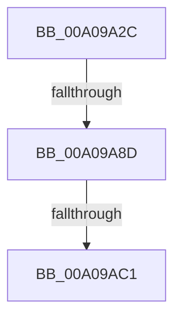

# _CmDeleteDeviceRegKey

- RVA: `0x00A09A2C`–`0x00A09AC8` (길이 `156` bytes)
- VA: `0x0000000140A09A2C`
- 실행 섹션: `PAGE`
- PDB 이름 있음: `예`; PDB Function 태그: `예`
- unwind 정보 RVA: `0x000A883C`
- 디코드: `40`개 명령, `156/156` bytes 표시
- 미해석 바이트: `0` (있으면 어셈블리에 `.byte`로 보존)

> 이 문서는 커널 이미지의 기계어와 PDB 기호를 분석해 생성했습니다. 4번과 5번은 함수 원형과 자료형을 바이너리 사용 방식에서 추정한 C 해석이며 원본 소스 복구 결과는 아닙니다.

## 1. Dependencies

- 직접 호출 지점: **2**; 고유 호출 대상: **2**
- 직접 호출자로 확인된 함수: **5**
- RIP 상대 이미지 참조: **1**

### Outgoing calls
- `0x00A09A65` → [memset](../../text/6C/memset_function_006C6C40.md) (function, `0x006C6C40`)
- `0x00A09AB1` → [guard_dispatch_icall](../../text/6B/guard_dispatch_icall_function_006BAAD0.md) (function, `0x006BAAD0`)

### Direct callers
- [PiDevCfgConfigureDevice](../97/PiDevCfgConfigureDevice_function_00977BB4.md) at `0x009788F7`
- [PiDevCfgConfigureDevice](../97/PiDevCfgConfigureDevice_function_00977BB4.md) at `0x0097890E`
- [PiDevCfgConfigureDevice](../97/PiDevCfgConfigureDevice_function_00977BB4.md) at `0x00978977`
- [_CmDeleteDeviceWorker](_CmDeleteDeviceWorker_function_00A08F48.md) at `0x00A09227`
- [_CmDeleteDeviceWorker](_CmDeleteDeviceWorker_function_00A08F48.md) at `0x00A092F7`
- [PiCMDeleteDeviceKey](../AD/PiCMDeleteDeviceKey_function_00AD6780.md) at `0x00AD6929`
- [PiCMDeleteDeviceKey](../AD/PiCMDeleteDeviceKey_function_00AD6780.md) at `0x00AD69C4`
- [sub_00B47098](../B4/Unknown_function_00B47098.md) at `0x00B4711C`
- [PipResetDevice](../../init/C3/PipResetDevice_function_00C31F90.md) at `0x00C320A9`
- [PipResetDevice](../../init/C3/PipResetDevice_function_00C31F90.md) at `0x00C320C2`

### Static image references
- `0x00A09A41` → RVA `0x00E0A740` (`.data`; read)

## 2. Other-region calls and transfers

- 다른 실행 섹션으로 향하는 call: **2**
  - `0x00A09A65` → [memset](../../text/6C/memset_function_006C6C40.md) (`PAGE` → `.text`)
  - `0x00A09AB1` → [guard_dispatch_icall](../../text/6B/guard_dispatch_icall_function_006BAAD0.md) (`PAGE` → `.text`)
- call이 아닌 외부 분기/꼬리 이동: **3**
  - `0x00A09A87` → [sub_00B34AC2 + 0x14](../B3/Unknown_function_00B34AC2.md) (`tail-transfer`)
  - `0x00A09ABB` → [sub_00B34AC2](../B3/Unknown_function_00B34AC2.md) (`tail-transfer`)
  - `0x00A09AC3` → [sub_00B34AC2 + 0x14](../B3/Unknown_function_00B34AC2.md) (`tail-transfer`)

## 3. Assembly (complete function range)

```asm
00A09A2C  40 55                           push rbp
00A09A2E  53                              push rbx
00A09A2F  56                              push rsi
00A09A30  57                              push rdi
00A09A31  41 56                           push r14
00A09A33  41 57                           push r15
00A09A35  48 8D 6C 24 D9                  lea rbp, [rsp - 0x27]
00A09A3A  48 81 EC B8 00 00 00            sub rsp, 0xb8
00A09A41  48 8B 05 F8 0C 40 00            mov rax, qword ptr [rip + 0x400cf8]
00A09A48  48 33 C4                        xor rax, rsp
00A09A4B  48 89 45 0F                     mov qword ptr [rbp + 0xf], rax
00A09A4F  4C 8B FA                        mov r15, rdx
00A09A52  41 8B D8                        mov ebx, r8d
00A09A55  33 D2                           xor edx, edx
00A09A57  4C 8B F1                        mov r14, rcx
00A09A5A  48 8D 4D AF                     lea rcx, [rbp - 0x51]
00A09A5E  41 8B F9                        mov edi, r9d
00A09A61  44 8D 42 58                     lea r8d, [rdx + 0x58]
00A09A65  E8 D6 D1 CB FF                  call 0x1406c6c40
00A09A6A  49 8B B6 F8 01 00 00            mov rsi, qword ptr [r14 + 0x1f8]
00A09A71  83 65 CB 00                     and dword ptr [rbp - 0x35], 0
00A09A75  89 7D C3                        mov dword ptr [rbp - 0x3d], edi
00A09A78  BF 20 01 00 C0                  mov edi, 0xc0000120
00A09A7D  89 5D BF                        mov dword ptr [rbp - 0x41], ebx
00A09A80  C6 45 C7 01                     mov byte ptr [rbp - 0x39], 1
00A09A84  48 85 F6                        test rsi, rsi
00A09A87  0F 84 49 B0 12 00               je 0x140b34ad6
00A09A8D  41 B9 0C 00 00 00               mov r9d, 0xc
00A09A93  48 8D 45 AF                     lea rax, [rbp - 0x51]
00A09A97  48 89 44 24 28                  mov qword ptr [rsp + 0x28], rax
00A09A9C  49 8B D7                        mov rdx, r15
00A09A9F  49 8B CE                        mov rcx, r14
00A09AA2  C7 44 24 20 01 00 00 00         mov dword ptr [rsp + 0x20], 1
00A09AAA  48 8B C6                        mov rax, rsi
00A09AAD  45 8D 41 F5                     lea r8d, [r9 - 0xb]
00A09AB1  E8 1A 10 CB FF                  call 0x1406baad0
00A09AB6  3D 02 00 00 C0                  cmp eax, 0xc0000002
00A09ABB  0F 85 01 B0 12 00               jne 0x140b34ac2
00A09AC1  33 F6                           xor esi, esi
00A09AC3  E9 0E B0 12 00                  jmp 0x140b34ad6
```

## 4. C-style interpretation (structured pseudocode)

```c
__int64 __fastcall _CmDeleteDeviceRegKey(__int64 a1, __int64 a2, int a3, int a4)
{
    __int64 result;
    __int64 v_rsi;
    __int64 v_rsp;
    unsigned __int64 v_stack_m48;
    unsigned __int64 v_stack_m57;
    unsigned int v_stack_m8C;
    unsigned __int8 v_stack_m90;
    unsigned int v_stack_m94;
    unsigned int v_stack_m98;
    unsigned __int64 v_stack_mA8;
    unsigned __int64 v_stack_mC0;
    unsigned int v_stack_mC8;

    v_rsp = (v_rsp) - (184);
    result = (*(unsigned __int64 *)(v_rip + 4197624)) ^ (v_rsp);
    v_stack_m48 = result;
    a2 = 0;
    result = memset(v_stack_mA8, a2, a2 + 88, a4);
    v_stack_m94 = (unsigned int)((unsigned int)(a4));
    v_stack_m98 = (unsigned int)((unsigned int)(a3));
    v_stack_m90 = 1;
    v_stack_mC0 = v_stack_mA8;
    v_stack_mC8 = 1;
    result = guard_dispatch_icall(a1, 0, 12 - 11, 12);
    v_rsi = 0;
}
```

## 5. (Beta) C Style

```c
int64_t _CmDeleteDeviceRegKey(void *Arg1, int64_t Arg2, int32_t Arg3, int32_t Arg4)
{
    uint8_t *arg1 = (uint8_t *)Arg1;

    int64_t result;
    int64_t local_rsi;
    int64_t local_rsp;
    uint64_t v_stack_m48;
    uint64_t v_stack_m57;
    uint32_t v_stack_m8C;
    uint8_t v_stack_m90;
    uint32_t v_stack_m94;
    uint32_t v_stack_m98;
    uint64_t v_stack_mA8;
    uint64_t v_stack_mC0;
    uint32_t v_stack_mC8;

    local_rsp = (local_rsp) - (184);
    result = (*(uint64_t *)(v_rip + 0x400CF8)) ^ (local_rsp);
    v_stack_m48 = result;
    Arg2 = 0;
    result = memset(v_stack_mA8, Arg2, Arg2 + 88, Arg4);
    v_stack_m94 = (uint32_t)((uint32_t)(Arg4));
    v_stack_m98 = (uint32_t)((uint32_t)(Arg3));
    v_stack_m90 = 1;
    v_stack_mC0 = v_stack_mA8;
    v_stack_mC8 = 1;
    result = guard_dispatch_icall(Arg1, 0, 12 - 11, 12);
    local_rsi = 0;
}
```

### 관측된 메모리 오프셋

구조체 형식이 확인되지 않은 접근은 인자 기준의 오프셋으로만 기록했습니다.

| 기준 인자 | 오프셋 표현 | 폭 (bit) | 접근 |
|---|---:|---:|---|
| `Arg1` | `+ 0x1F8` | `64` | `R` |

## 6. Execution-region graph

[열기: 2D/3D 그래프와 함수 탐색 컨트롤 패널](../../../control-panel.html?section=page&rva=0x00A09A2C&view=graph)

- 2D 그래프는 위에서 아래로 흐르고, 3D 그래프는 빈 공간을 드래그해 회전합니다. Shift+드래그는 이동, 휠은 확대·축소, 함수 노드 선택은 대상 보고서 이동입니다.

### Static fallback


