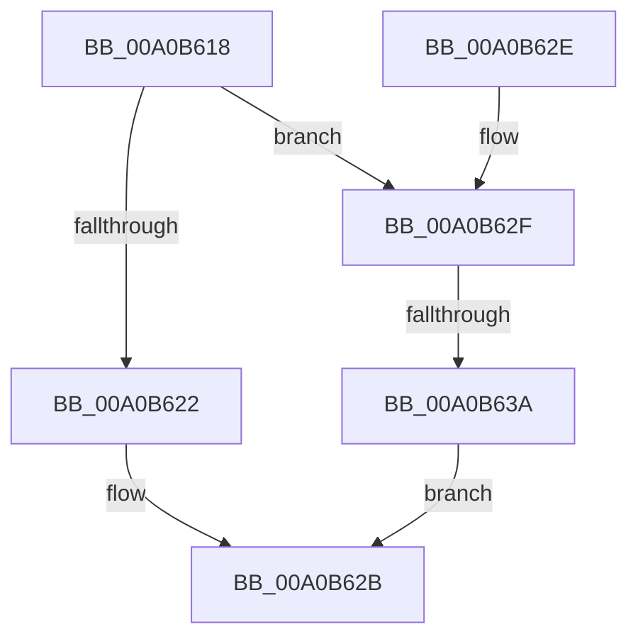

# _CmGetDevicePanelGroup

- RVA: `0x00A0B618`–`0x00A0B641` (길이 `41` bytes)
- VA: `0x0000000140A0B618`
- 실행 섹션: `PAGE`
- PDB 이름 있음: `예`; PDB Function 태그: `예`
- unwind 정보 RVA: `0x000DB714`
- 디코드: `16`개 명령, `41/41` bytes 표시
- 미해석 바이트: `0` (있으면 어셈블리에 `.byte`로 보존)

> 이 문서는 커널 이미지의 기계어와 PDB 기호를 분석해 생성했습니다. 4번과 5번은 함수 원형과 자료형을 바이너리 사용 방식에서 추정한 C 해석이며 원본 소스 복구 결과는 아닙니다.

## 1. Dependencies

- 직접 호출 지점: **0**; 고유 호출 대상: **0**
- 직접 호출자로 확인된 함수: **3**
- RIP 상대 이미지 참조: **0**

### Outgoing calls
- 직접 디코드된 call 명령이 없습니다.

### Direct callers
- [_CmUpdateDevicePanel](_CmUpdateDevicePanel_function_00A0A16C.md) at `0x00A0A4E2`
- [sub_00B34C12](../B3/Unknown_function_00B34C12.md) at `0x00B34C42`
- [sub_00B34E9C](../B3/Unknown_function_00B34E9C.md) at `0x00B3569D`

### Static image references
- 디코드된 RIP-relative 메모리 참조가 없습니다.

## 2. Other-region calls and transfers

- 다른 실행 섹션으로 향하는 call: **0**
- call이 아닌 외부 분기/꼬리 이동: **1**
  - `0x00A0B634` → `0x00B36700` (`tail-transfer`)

## 3. Assembly (complete function range)

```asm
00A0B618  8A 01                           mov al, byte ptr [rcx]
00A0B61A  33 D2                           xor edx, edx
00A0B61C  24 7F                           and al, 0x7f
00A0B61E  3C 02                           cmp al, 2
00A0B620  72 0D                           jb 0x140a0b62f
00A0B622  8B 41 0C                        mov eax, dword ptr [rcx + 0xc]
00A0B625  C1 E8 02                        shr eax, 2
00A0B628  0F B6 D0                        movzx edx, al
00A0B62B  8B C2                           mov eax, edx
00A0B62D  C3                              ret
00A0B62E  CC                              int3
00A0B62F  8B 41 08                        mov eax, dword ptr [rcx + 8]
00A0B632  A8 04                           test al, 4
00A0B634  0F 84 C6 B0 12 00               je 0x140b36700
00A0B63A  BA 00 01 00 00                  mov edx, 0x100
00A0B63F  EB EA                           jmp 0x140a0b62b
```

## 4. C-style interpretation (structured pseudocode)

```c
__int64 __fastcall _CmGetDevicePanelGroup(__int64 a1, int a2)
{
    __int64 result;

    a2 = 0;
    result = (unsigned __int8)((*(unsigned __int8 *)(a1)) & (127));
    if (((unsigned __int8)(result)) < 2) goto loc_00A0B62F;
    result = (unsigned int)(((unsigned int)(*(unsigned int *)(a1 + 12))) >> (2));
loc_00A0B62B:
    return (unsigned int)((unsigned int)((unsigned __int8)(result)));
loc_00A0B62F:
    goto loc_00A0B62B;
}
```

## 5. (Beta) C Style

```c
int64_t _CmGetDevicePanelGroup(void *Arg1, int32_t Arg2)
{
    uint8_t *arg1 = (uint8_t *)Arg1;

    int64_t result;

    Arg2 = 0;
    result = (uint8_t)((*(uint8_t *)(arg1)) & (127));
    if (((uint8_t)(result)) < 2) goto loc_00A0B62F;
    result = (uint32_t)(((uint32_t)(*(uint32_t *)(arg1 + 0xC))) >> (2));
loc_00A0B62B:
    return (uint32_t)((uint32_t)((uint8_t)(result)));
loc_00A0B62F:
    goto loc_00A0B62B;
}
```

### 관측된 메모리 오프셋

구조체 형식이 확인되지 않은 접근은 인자 기준의 오프셋으로만 기록했습니다.

| 기준 인자 | 오프셋 표현 | 폭 (bit) | 접근 |
|---|---:|---:|---|
| `Arg1` | `+ 0x0` | `8` | `R` |
| `Arg1` | `+ 0x8` | `32` | `R` |
| `Arg1` | `+ 0xC` | `32` | `R` |

## 6. Execution-region graph

[열기: 2D/3D 그래프와 함수 탐색 컨트롤 패널](../../../control-panel.html?section=page&rva=0x00A0B618&view=graph)

- 2D 그래프는 위에서 아래로 흐르고, 3D 그래프는 빈 공간을 드래그해 회전합니다. Shift+드래그는 이동, 휠은 확대·축소, 함수 노드 선택은 대상 보고서 이동입니다.

### Static fallback


