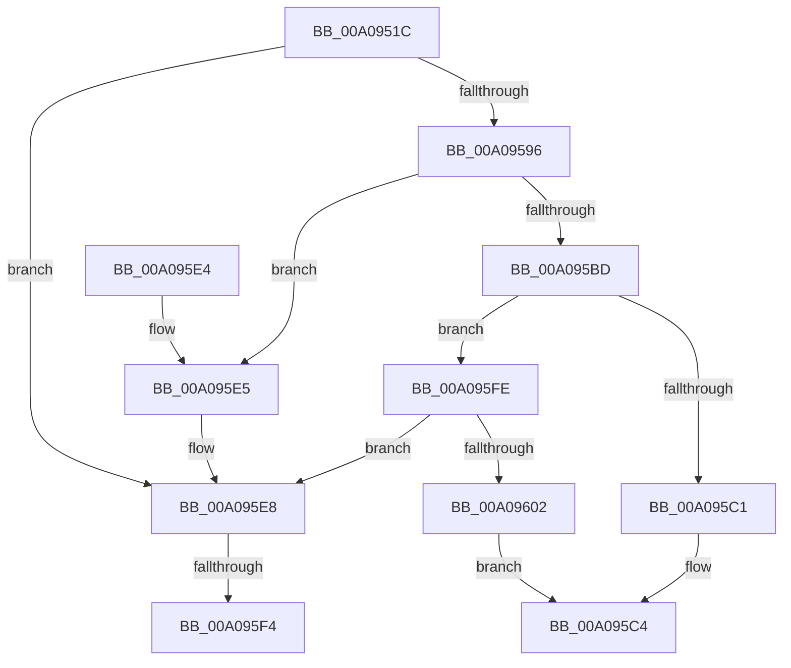

# _CmGetMatchingDeviceList

- RVA: `0x00A0951C`–`0x00A09609` (길이 `237` bytes)
- VA: `0x0000000140A0951C`
- 실행 섹션: `PAGE`
- PDB 이름 있음: `예`; PDB Function 태그: `예`
- unwind 정보 RVA: `0x000A87B8`
- 디코드: `73`개 명령, `237/237` bytes 표시
- 미해석 바이트: `0` (있으면 어셈블리에 `.byte`로 보존)

> 이 문서는 커널 이미지의 기계어와 PDB 기호를 분석해 생성했습니다. 4번과 5번은 함수 원형과 자료형을 바이너리 사용 방식에서 추정한 C 해석이며 원본 소스 복구 결과는 아닙니다.

## 1. Dependencies

- 직접 호출 지점: **3**; 고유 호출 대상: **3**
- 직접 호출자로 확인된 함수: **3**
- RIP 상대 이미지 참조: **1**

### Outgoing calls
- `0x00A0955B` → [memset](../../text/6C/memset_function_006C6C40.md) (function, `0x006C6C40`)
- `0x00A095B1` → [guard_dispatch_icall](../../text/6B/guard_dispatch_icall_function_006BAAD0.md) (function, `0x006BAAD0`)
- `0x00A095CD` → [_security_check_cookie](../../text/6A/_security_check_cookie_function_006AC640.md) (function, `0x006AC640`)

### Direct callers
- [_CmDeleteDeviceWorker](_CmDeleteDeviceWorker_function_00A08F48.md) at `0x00A0912C`
- [sub_00B1D0DA](../B1/Unknown_function_00B1D0DA.md) at `0x00B1D0FF`
- [PipMigratePnpState](../../init/C3/PipMigratePnpState_function_00C317D4.md) at `0x00C31C6D`

### Static image references
- `0x00A09533` → RVA `0x00E0A740` (`.data`; read)

## 2. Other-region calls and transfers

- 다른 실행 섹션으로 향하는 call: **3**
  - `0x00A0955B` → [memset](../../text/6C/memset_function_006C6C40.md) (`PAGE` → `.text`)
  - `0x00A095B1` → [guard_dispatch_icall](../../text/6B/guard_dispatch_icall_function_006BAAD0.md) (`PAGE` → `.text`)
  - `0x00A095CD` → [_security_check_cookie](../../text/6A/_security_check_cookie_function_006AC640.md) (`PAGE` → `.text`)
- call이 아닌 외부 분기/꼬리 이동: **2**
  - `0x00A095EE` → [sub_00B34A28](../B3/Unknown_function_00B34A28.md) (`tail-transfer`)
  - `0x00A095F9` → [sub_00B34A28 + 0x35](../B3/Unknown_function_00B34A28.md) (`tail-transfer`)

## 3. Assembly (complete function range)

```asm
00A0951C  40 55                           push rbp
00A0951E  53                              push rbx
00A0951F  56                              push rsi
00A09520  57                              push rdi
00A09521  41 55                           push r13
00A09523  41 56                           push r14
00A09525  41 57                           push r15
00A09527  48 8D 6C 24 F1                  lea rbp, [rsp - 0xf]
00A0952C  48 81 EC B0 00 00 00            sub rsp, 0xb0
00A09533  48 8B 05 06 12 40 00            mov rax, qword ptr [rip + 0x401206]
00A0953A  48 33 C4                        xor rax, rsp
00A0953D  48 89 45 FF                     mov qword ptr [rbp - 1], rax
00A09541  48 8B 5D 77                     mov rbx, qword ptr [rbp + 0x77]
00A09545  48 8B FA                        mov rdi, rdx
00A09548  33 D2                           xor edx, edx
00A0954A  49 8B F0                        mov rsi, r8
00A0954D  4C 8B E9                        mov r13, rcx
00A09550  4D 8B F1                        mov r14, r9
00A09553  48 8D 4D 9F                     lea rcx, [rbp - 0x61]
00A09557  44 8D 42 58                     lea r8d, [rdx + 0x58]
00A0955B  E8 E0 D6 CB FF                  call 0x1406c6c40
00A09560  8B 45 6F                        mov eax, dword ptr [rbp + 0x6f]
00A09563  4D 8B BD F8 01 00 00            mov r15, qword ptr [r13 + 0x1f8]
00A0956A  48 89 75 B7                     mov qword ptr [rbp - 0x49], rsi
00A0956E  BE 01 00 00 00                  mov esi, 1
00A09573  89 45 C7                        mov dword ptr [rbp - 0x39], eax
00A09576  8B 45 7F                        mov eax, dword ptr [rbp + 0x7f]
00A09579  48 89 7D AF                     mov qword ptr [rbp - 0x51], rdi
00A0957D  BF 20 01 00 C0                  mov edi, 0xc0000120
00A09582  4C 89 75 BF                     mov qword ptr [rbp - 0x41], r14
00A09586  44 8D 76 03                     lea r14d, [rsi + 3]
00A0958A  48 89 5D CF                     mov qword ptr [rbp - 0x31], rbx
00A0958E  89 45 D7                        mov dword ptr [rbp - 0x29], eax
00A09591  4D 85 FF                        test r15, r15
00A09594  74 52                           je 0x140a095e8
00A09596  48 8D 45 9F                     lea rax, [rbp - 0x61]
00A0959A  45 8B CE                        mov r9d, r14d
00A0959D  48 89 44 24 28                  mov qword ptr [rsp + 0x28], rax
00A095A2  44 8B C6                        mov r8d, esi
00A095A5  49 8B C7                        mov rax, r15
00A095A8  89 74 24 20                     mov dword ptr [rsp + 0x20], esi
00A095AC  33 D2                           xor edx, edx
00A095AE  49 8B CD                        mov rcx, r13
00A095B1  E8 1A 15 CB FF                  call 0x1406baad0
00A095B6  3D 02 00 00 C0                  cmp eax, 0xc0000002
00A095BB  74 28                           je 0x140a095e5
00A095BD  3B C7                           cmp eax, edi
00A095BF  75 3D                           jne 0x140a095fe
00A095C1  8B 5D 9F                        mov ebx, dword ptr [rbp - 0x61]
00A095C4  8B C3                           mov eax, ebx
00A095C6  48 8B 4D FF                     mov rcx, qword ptr [rbp - 1]
00A095CA  48 33 CC                        xor rcx, rsp
00A095CD  E8 6E 30 CA FF                  call 0x1406ac640
00A095D2  48 81 C4 B0 00 00 00            add rsp, 0xb0
00A095D9  41 5F                           pop r15
00A095DB  41 5E                           pop r14
00A095DD  41 5D                           pop r13
00A095DF  5F                              pop rdi
00A095E0  5E                              pop rsi
00A095E1  5B                              pop rbx
00A095E2  5D                              pop rbp
00A095E3  C3                              ret
00A095E4  CC                              int3
00A095E5  45 33 FF                        xor r15d, r15d
00A095E8  0F B7 45 D7                     movzx eax, word ptr [rbp - 0x29]
00A095EC  85 C0                           test eax, eax
00A095EE  0F 84 34 B4 12 00               je 0x140b34a28
00A095F4  BB 0D 00 00 C0                  mov ebx, 0xc000000d
00A095F9  E9 5F B4 12 00                  jmp 0x140b34a5d
00A095FE  85 C0                           test eax, eax
00A09600  74 E6                           je 0x140a095e8
00A09602  BB E5 00 00 C0                  mov ebx, 0xc00000e5
00A09607  EB BB                           jmp 0x140a095c4
```

## 4. C-style interpretation (structured pseudocode)

```c
__int64 __fastcall _CmGetMatchingDeviceList(__int64 a1, __int64 a2, __int64 a3, __int64 a4, unsigned int a5, __int64 a6, unsigned int a7)
{
    __int64 result;
    __int64 v_r15;
    __int64 v_rsp;
    unsigned __int64 v_stack_m47;
    unsigned __int64 v_stack_m48;
    unsigned int v_stack_m70;
    unsigned __int64 v_stack_m78;
    unsigned int v_stack_m80;
    unsigned __int64 v_stack_m88;
    unsigned __int64 v_stack_m90;
    unsigned __int64 v_stack_m98;
    unsigned __int64 v_stack_mA8;
    unsigned __int64 v_stack_mC0;
    unsigned int v_stack_mC8;

    v_rsp = (v_rsp) - (176);
    result = (*(unsigned __int64 *)(v_rip + 4198918)) ^ (v_rsp);
    v_stack_m48 = result;
    a2 = 0;
    result = memset(v_stack_mA8, a2, a2 + 88, a4);
    v_stack_m90 = a3;
    v_stack_m80 = (unsigned int)((unsigned int)(a5));
    v_stack_m98 = 0;
    v_stack_m88 = a4;
    v_stack_m78 = a6;
    v_stack_m70 = (unsigned int)((unsigned int)(a7));
    if (*(unsigned __int64 *)(a1 + 504) == 0) goto loc_00A095E8;
    v_stack_mC0 = v_stack_mA8;
    v_stack_mC8 = 1;
    a2 = 0;
    result = guard_dispatch_icall(a1, a2, 1, (unsigned int)((unsigned int)(1 + 3)));
    if (((unsigned int)(result)) == 0xC0000002ULL) goto loc_00A095E5;
    if (((unsigned int)(result)) != ((unsigned int)((unsigned int)(0xC0000120ULL)))) goto loc_00A095FE;
loc_00A095C4:
    a1 = (v_stack_m48) ^ (v_rsp);
    result = _security_check_cookie(a1, a2, 1, (unsigned int)((unsigned int)(1 + 3)));
    v_rsp = (v_rsp) + (176);
    return result;
loc_00A095E5:
    v_r15 = 0;
loc_00A095E8:
loc_00A095FE:
    if ((unsigned int)(v_stack_m70) == 0) goto loc_00A095E8;
    goto loc_00A095C4;
}
```

## 5. (Beta) C Style

```c
int64_t _CmGetMatchingDeviceList(void *Arg1, int64_t Arg2, int64_t Arg3, int64_t Arg4, uint32_t Arg5, int64_t Arg6, uint32_t Arg7)
{
    uint8_t *arg1 = (uint8_t *)Arg1;

    int64_t result;
    int64_t local_r15;
    int64_t local_rsp;
    uint64_t v_stack_m47;
    uint64_t v_stack_m48;
    uint32_t v_stack_m70;
    uint64_t v_stack_m78;
    uint32_t v_stack_m80;
    uint64_t v_stack_m88;
    uint64_t v_stack_m90;
    uint64_t v_stack_m98;
    uint64_t v_stack_mA8;
    uint64_t v_stack_mC0;
    uint32_t v_stack_mC8;

    local_rsp = (local_rsp) - (176);
    result = (*(uint64_t *)(v_rip + 0x401206)) ^ (local_rsp);
    v_stack_m48 = result;
    Arg2 = 0;
    result = memset(v_stack_mA8, Arg2, Arg2 + 88, Arg4);
    v_stack_m90 = Arg3;
    v_stack_m80 = (uint32_t)((uint32_t)(Arg5));
    v_stack_m98 = 0;
    v_stack_m88 = Arg4;
    v_stack_m78 = Arg6;
    v_stack_m70 = (uint32_t)((uint32_t)(Arg7));
    if (*(uint64_t *)(arg1 + 0x1F8) == 0) goto loc_00A095E8;
    v_stack_mC0 = v_stack_mA8;
    v_stack_mC8 = 1;
    Arg2 = 0;
    result = guard_dispatch_icall(Arg1, Arg2, 1, (uint32_t)((uint32_t)(1 + 3)));
    if (((uint32_t)(result)) == 0xC0000002ULL) goto loc_00A095E5;
    if (((uint32_t)(result)) != ((uint32_t)((uint32_t)(0xC0000120ULL)))) goto loc_00A095FE;
loc_00A095C4:
    Arg1 = (v_stack_m48) ^ (local_rsp);
    result = _security_check_cookie(Arg1, Arg2, 1, (uint32_t)((uint32_t)(1 + 3)));
    local_rsp = (local_rsp) + (176);
    return result;
loc_00A095E5:
    local_r15 = 0;
loc_00A095E8:
loc_00A095FE:
    if ((uint32_t)(v_stack_m70) == 0) goto loc_00A095E8;
    goto loc_00A095C4;
}
```

### 관측된 메모리 오프셋

구조체 형식이 확인되지 않은 접근은 인자 기준의 오프셋으로만 기록했습니다.

| 기준 인자 | 오프셋 표현 | 폭 (bit) | 접근 |
|---|---:|---:|---|
| `Arg1` | `+ 0x1F8` | `64` | `R` |

## 6. Execution-region graph

[열기: 2D/3D 그래프와 함수 탐색 컨트롤 패널](../../../control-panel.html?section=page&rva=0x00A0951C&view=graph)

- 2D 그래프는 위에서 아래로 흐르고, 3D 그래프는 빈 공간을 드래그해 회전합니다. Shift+드래그는 이동, 휠은 확대·축소, 함수 노드 선택은 대상 보고서 이동입니다.

### Static fallback


