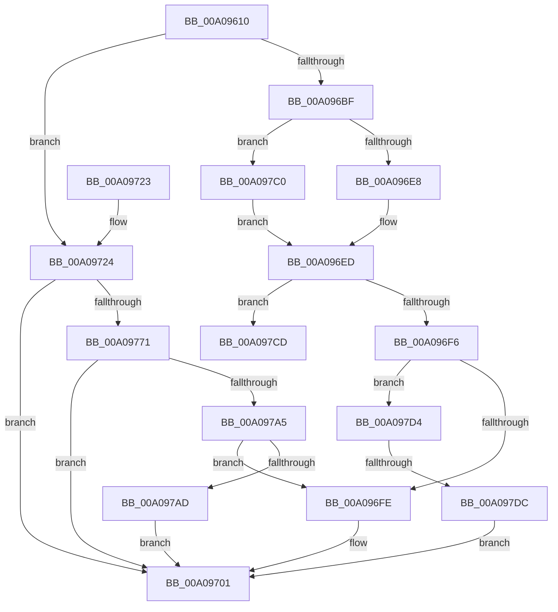

# _CmGetMatchingFilteredDeviceInterfaceList

- RVA: `0x00A09610`–`0x00A097E6` (길이 `470` bytes)
- VA: `0x0000000140A09610`
- 실행 섹션: `PAGE`
- PDB 이름 있음: `예`; PDB Function 태그: `예`
- unwind 정보 RVA: `0x000A87EC`
- 디코드: `125`개 명령, `470/470` bytes 표시
- 미해석 바이트: `0` (있으면 어셈블리에 `.byte`로 보존)

> 이 문서는 커널 이미지의 기계어와 PDB 기호를 분석해 생성했습니다. 4번과 5번은 함수 원형과 자료형을 바이너리 사용 방식에서 추정한 C 해석이며 원본 소스 복구 결과는 아닙니다.

## 1. Dependencies

- 직접 호출 지점: **6**; 고유 호출 대상: **5**
- 직접 호출자로 확인된 함수: **7**
- RIP 상대 이미지 참조: **2**

### Outgoing calls
- `0x00A09662` → [memset](../../text/6C/memset_function_006C6C40.md) (function, `0x006C6C40`)
- `0x00A096E8` → [PiPnpRtlCmActionCallback](../8E/PiPnpRtlCmActionCallback_function_008EF110.md) (function, `0x008EF110`)
- `0x00A0970A` → [_security_check_cookie](../../text/6A/_security_check_cookie_function_006AC640.md) (function, `0x006AC640`)
- `0x00A09765` → [CmGetMatchingFilteredDeviceInterfaceListWorker](CmGetMatchingFilteredDeviceInterfaceListWorker_function_00A097EC.md) (function, `0x00A097EC`)
- `0x00A09795` → [guard_dispatch_icall](../../text/6B/guard_dispatch_icall_function_006BAAD0.md) (function, `0x006BAAD0`)
- `0x00A097C3` → [guard_dispatch_icall](../../text/6B/guard_dispatch_icall_function_006BAAD0.md) (function, `0x006BAAD0`)

### Direct callers
- [CmDeleteInterfaceClassWorker](../82/CmDeleteInterfaceClassWorker_function_0082A838.md) at `0x0082A89B`
- [CmGetMatchingDeviceInterfaceList](../82/CmGetMatchingDeviceInterfaceList_function_0082D41C.md) at `0x0082D527`
- [PnpDeviceRaisePropertyChangeEventWorker](../8F/PnpDeviceRaisePropertyChangeEventWorker_function_008F80E0.md) at `0x008F8540`
- [PnpDeleteDeviceInterfaces](../97/PnpDeleteDeviceInterfaces_function_0097A08C.md) at `0x0097A259`
- [PnpDisableDeviceInterfaces](PnpDisableDeviceInterfaces_function_00A0885C.md) at `0x00A089F7`
- [_CmDeleteDeviceWorker](_CmDeleteDeviceWorker_function_00A08F48.md) at `0x00A090DB`
- [sub_00B467A6](../B4/Unknown_function_00B467A6.md) at `0x00B467F9`

### Static image references
- `0x00A09629` → RVA `0x00E0A740` (`.data`; read)
- `0x00A096BF` → RVA `0x008EF110` (`PiPnpRtlCmActionCallback`; read)

## 2. Other-region calls and transfers

- 다른 실행 섹션으로 향하는 call: **4**
  - `0x00A09662` → [memset](../../text/6C/memset_function_006C6C40.md) (`PAGE` → `.text`)
  - `0x00A0970A` → [_security_check_cookie](../../text/6A/_security_check_cookie_function_006AC640.md) (`PAGE` → `.text`)
  - `0x00A09795` → [guard_dispatch_icall](../../text/6B/guard_dispatch_icall_function_006BAAD0.md) (`PAGE` → `.text`)
  - `0x00A097C3` → [guard_dispatch_icall](../../text/6B/guard_dispatch_icall_function_006BAAD0.md) (`PAGE` → `.text`)
- call이 아닌 외부 분기/꼬리 이동: **2**
  - `0x00A097CF` → [sub_00B34AB4 + 0x4](../B3/Unknown_function_00B34AB4.md) (`tail-transfer`)
  - `0x00A097D6` → [sub_00B34AB4](../B3/Unknown_function_00B34AB4.md) (`tail-transfer`)

## 3. Assembly (complete function range)

```asm
00A09610  40 55                           push rbp
00A09612  53                              push rbx
00A09613  56                              push rsi
00A09614  57                              push rdi
00A09615  41 54                           push r12
00A09617  41 55                           push r13
00A09619  41 56                           push r14
00A0961B  41 57                           push r15
00A0961D  48 8D 6C 24 F9                  lea rbp, [rsp - 7]
00A09622  48 81 EC D8 00 00 00            sub rsp, 0xd8
00A09629  48 8B 05 10 11 40 00            mov rax, qword ptr [rip + 0x401110]
00A09630  48 33 C4                        xor rax, rsp
00A09633  48 89 45 EF                     mov qword ptr [rbp - 0x11], rax
00A09637  48 8B 75 6F                     mov rsi, qword ptr [rbp + 0x6f]
00A0963B  4C 8B FA                        mov r15, rdx
00A0963E  48 8B 5D 77                     mov rbx, qword ptr [rbp + 0x77]
00A09642  33 D2                           xor edx, edx
00A09644  48 8B 7D 7F                     mov rdi, qword ptr [rbp + 0x7f]
00A09648  4D 8B E0                        mov r12, r8
00A0964B  4C 8B B5 8F 00 00 00            mov r14, qword ptr [rbp + 0x8f]
00A09652  45 8B E9                        mov r13d, r9d
00A09655  48 89 4C 24 50                  mov qword ptr [rsp + 0x50], rcx
00A0965A  48 8D 4D 8F                     lea rcx, [rbp - 0x71]
00A0965E  44 8D 42 58                     lea r8d, [rdx + 0x58]
00A09662  E8 D9 D5 CB FF                  call 0x1406c6c40
00A09667  8B 85 87 00 00 00               mov eax, dword ptr [rbp + 0x87]
00A0966D  48 8B 4C 24 50                  mov rcx, qword ptr [rsp + 0x50]
00A09672  4C 89 75 D7                     mov qword ptr [rbp - 0x29], r14
00A09676  41 BE 11 00 00 00               mov r14d, 0x11
00A0967C  89 45 CF                        mov dword ptr [rbp - 0x31], eax
00A0967F  8B 85 97 00 00 00               mov eax, dword ptr [rbp + 0x97]
00A09685  4C 8B 91 F8 01 00 00            mov r10, qword ptr [rcx + 0x1f8]
00A0968C  4C 89 7D 9F                     mov qword ptr [rbp - 0x61], r15
00A09690  45 8D 7E F2                     lea r15d, [r14 - 0xe]
00A09694  4C 89 65 A7                     mov qword ptr [rbp - 0x59], r12
00A09698  41 BC 02 00 00 C0               mov r12d, 0xc0000002
00A0969E  48 89 75 B7                     mov qword ptr [rbp - 0x49], rsi
00A096A2  BE 20 01 00 C0                  mov esi, 0xc0000120
00A096A7  4C 89 55 87                     mov qword ptr [rbp - 0x79], r10
00A096AB  44 89 6D AF                     mov dword ptr [rbp - 0x51], r13d
00A096AF  48 89 5D BF                     mov qword ptr [rbp - 0x41], rbx
00A096B3  48 89 7D C7                     mov qword ptr [rbp - 0x39], rdi
00A096B7  89 45 DF                        mov dword ptr [rbp - 0x21], eax
00A096BA  4D 85 D2                        test r10, r10
00A096BD  74 65                           je 0x140a09724
00A096BF  48 8D 05 4A 5A EE FF            lea rax, [rip - 0x11a5b6]
00A096C6  33 D2                           xor edx, edx
00A096C8  4C 3B D0                        cmp r10, rax
00A096CB  45 8B CE                        mov r9d, r14d
00A096CE  48 8D 45 8F                     lea rax, [rbp - 0x71]
00A096D2  45 8B C7                        mov r8d, r15d
00A096D5  48 89 44 24 28                  mov qword ptr [rsp + 0x28], rax
00A096DA  C7 44 24 20 01 00 00 00         mov dword ptr [rsp + 0x20], 1
00A096E2  0F 85 D8 00 00 00               jne 0x140a097c0
00A096E8  E8 23 5A EE FF                  call 0x1408ef110
00A096ED  41 3B C4                        cmp eax, r12d
00A096F0  0F 84 D7 00 00 00               je 0x140a097cd
00A096F6  3B C6                           cmp eax, esi
00A096F8  0F 85 D6 00 00 00               jne 0x140a097d4
00A096FE  8B 5D 8F                        mov ebx, dword ptr [rbp - 0x71]
00A09701  8B C3                           mov eax, ebx
00A09703  48 8B 4D EF                     mov rcx, qword ptr [rbp - 0x11]
00A09707  48 33 CC                        xor rcx, rsp
00A0970A  E8 31 2F CA FF                  call 0x1406ac640
00A0970F  48 81 C4 D8 00 00 00            add rsp, 0xd8
00A09716  41 5F                           pop r15
00A09718  41 5E                           pop r14
00A0971A  41 5D                           pop r13
00A0971C  41 5C                           pop r12
00A0971E  5F                              pop rdi
00A0971F  5E                              pop rsi
00A09720  5B                              pop rbx
00A09721  5D                              pop rbp
00A09722  C3                              ret
00A09723  CC                              int3
00A09724  49 8B FA                        mov rdi, r10
00A09727  8B 45 DF                        mov eax, dword ptr [rbp - 0x21]
00A0972A  44 8B 4D AF                     mov r9d, dword ptr [rbp - 0x51]
00A0972E  4C 8B 45 A7                     mov r8, qword ptr [rbp - 0x59]
00A09732  48 8B 55 9F                     mov rdx, qword ptr [rbp - 0x61]
00A09736  89 44 24 48                     mov dword ptr [rsp + 0x48], eax
00A0973A  48 8B 45 D7                     mov rax, qword ptr [rbp - 0x29]
00A0973E  48 89 44 24 40                  mov qword ptr [rsp + 0x40], rax
00A09743  8B 45 CF                        mov eax, dword ptr [rbp - 0x31]
00A09746  89 44 24 38                     mov dword ptr [rsp + 0x38], eax
00A0974A  48 8B 45 C7                     mov rax, qword ptr [rbp - 0x39]
00A0974E  48 89 44 24 30                  mov qword ptr [rsp + 0x30], rax
00A09753  48 8B 45 BF                     mov rax, qword ptr [rbp - 0x41]
00A09757  48 89 44 24 28                  mov qword ptr [rsp + 0x28], rax
00A0975C  48 8B 45 B7                     mov rax, qword ptr [rbp - 0x49]
00A09760  48 89 44 24 20                  mov qword ptr [rsp + 0x20], rax
00A09765  E8 82 00 00 00                  call 0x140a097ec
00A0976A  8B D8                           mov ebx, eax
00A0976C  48 85 FF                        test rdi, rdi
00A0976F  74 90                           je 0x140a09701
00A09771  48 8B 4C 24 50                  mov rcx, qword ptr [rsp + 0x50]
00A09776  45 8B CE                        mov r9d, r14d
00A09779  89 45 8F                        mov dword ptr [rbp - 0x71], eax
00A0977C  45 8B C7                        mov r8d, r15d
00A0977F  48 8D 45 8F                     lea rax, [rbp - 0x71]
00A09783  33 D2                           xor edx, edx
00A09785  48 89 44 24 28                  mov qword ptr [rsp + 0x28], rax
00A0978A  48 8B C7                        mov rax, rdi
00A0978D  C7 44 24 20 02 00 00 00         mov dword ptr [rsp + 0x20], 2
00A09795  E8 36 13 CB FF                  call 0x1406baad0
00A0979A  8B C8                           mov ecx, eax
00A0979C  41 3B C4                        cmp eax, r12d
00A0979F  0F 84 5C FF FF FF               je 0x140a09701
00A097A5  3B C6                           cmp eax, esi
00A097A7  0F 84 51 FF FF FF               je 0x140a096fe
00A097AD  8B C3                           mov eax, ebx
00A097AF  85 C9                           test ecx, ecx
00A097B1  BB E5 00 00 C0                  mov ebx, 0xc00000e5
00A097B6  0F 45 C3                        cmovne eax, ebx
00A097B9  8B D8                           mov ebx, eax
00A097BB  E9 41 FF FF FF                  jmp 0x140a09701
00A097C0  49 8B C2                        mov rax, r10
00A097C3  E8 08 13 CB FF                  call 0x1406baad0
00A097C8  E9 20 FF FF FF                  jmp 0x140a096ed
00A097CD  33 FF                           xor edi, edi
00A097CF  E9 E4 B2 12 00                  jmp 0x140b34ab8
00A097D4  85 C0                           test eax, eax
00A097D6  0F 84 D8 B2 12 00               je 0x140b34ab4
00A097DC  BB E5 00 00 C0                  mov ebx, 0xc00000e5
00A097E1  E9 1B FF FF FF                  jmp 0x140a09701
```

## 4. C-style interpretation (structured pseudocode)

```c
__int64 __fastcall _CmGetMatchingFilteredDeviceInterfaceList(__int64 a1, __int64 a2, __int64 a3, int a4, __int64 a5, __int64 a6, __int64 a7, unsigned int a8, __int64 a9, unsigned int a10)
{
    __int64 result;
    __int64 v_rdi;
    __int64 v_rsp;
    unsigned __int64 v_stack_m47;
    unsigned __int64 v_stack_m58;
    unsigned int v_stack_m68;
    unsigned __int64 v_stack_m70;
    unsigned int v_stack_m78;
    unsigned __int64 v_stack_m80;
    unsigned __int64 v_stack_m88;
    unsigned __int64 v_stack_m90;
    unsigned int v_stack_m98;
    unsigned __int64 v_stack_mA0;
    unsigned __int64 v_stack_mA8;
    unsigned __int64 v_stack_mB8;
    unsigned __int64 v_stack_mC0;
    unsigned __int64 v_stack_mC8;
    unsigned __int64 v_stack_mF0;
    unsigned int v_stack_mF8;
    unsigned __int64 v_stack_p20;
    unsigned __int64 v_stack_p28;
    unsigned __int64 v_stack_p30;
    unsigned int v_stack_p38;
    unsigned __int64 v_stack_p40;
    unsigned int v_stack_p48;
    unsigned __int64 v_stack_p50;

    v_rsp = (v_rsp) - (216);
    result = (*(unsigned __int64 *)(v_rip + 4198672)) ^ (v_rsp);
    v_stack_m58 = result;
    a2 = 0;
    v_stack_mC8 = a1;
    result = memset(v_stack_mB8, a2, a2 + 88, a4);
    v_stack_m70 = a9;
    v_stack_m78 = (unsigned int)((unsigned int)(a8));
    v_stack_mA8 = 0;
    v_stack_mA0 = a3;
    v_stack_m90 = a5;
    v_stack_mC0 = *(unsigned __int64 *)(v_stack_mC8 + 504);
    v_stack_m98 = (unsigned int)((unsigned int)(a4));
    v_stack_m88 = a6;
    v_stack_m80 = a7;
    v_stack_m68 = (unsigned int)((unsigned int)(a10));
    if (*(unsigned __int64 *)(v_stack_mC8 + 504) == 0) goto loc_00A09724;
    a2 = 0;
    v_stack_mF0 = v_stack_mB8;
    v_stack_mF8 = 1;
    if ((*(unsigned __int64 *)(v_stack_mC8 + 504)) != (v_rip - 1156534)) goto loc_00A097C0;
    result = PiPnpRtlCmActionCallback(v_stack_mC8, a2, (unsigned int)((unsigned int)(17 - 14)), 17);
loc_00A096ED:
    if (((unsigned int)(result)) == ((unsigned int)((unsigned int)(0xC0000002ULL)))) goto loc_00A097CD;
    if (((unsigned int)(result)) != ((unsigned int)((unsigned int)(0xC0000120ULL)))) goto loc_00A097D4;
loc_00A096FE:
loc_00A09701:
    a1 = (v_stack_m58) ^ (v_rsp);
    result = _security_check_cookie(a1, a2, (unsigned int)((unsigned int)(17 - 14)), 17);
    v_rsp = (v_rsp) + (216);
    return result;
loc_00A09724:
    v_stack_p48 = (unsigned int)((unsigned int)(v_stack_m68));
    v_stack_p40 = v_stack_m70;
    v_stack_p38 = (unsigned int)((unsigned int)(v_stack_m78));
    v_stack_p30 = v_stack_m80;
    v_stack_p28 = v_stack_m88;
    v_stack_p20 = v_stack_m90;
    result = CmGetMatchingFilteredDeviceInterfaceListWorker(a1, v_stack_mA8, v_stack_mA0, (unsigned int)(v_stack_m98));
    if (*(unsigned __int64 *)(v_stack_mC8 + 504) == 0) goto loc_00A09701;
    v_stack_mB8 = (unsigned int)(result);
    a2 = 0;
    v_stack_p28 = v_stack_mB8;
    v_stack_p20 = 2;
    result = guard_dispatch_icall(v_stack_p50, a2, (unsigned int)((unsigned int)(17 - 14)), 17);
    if (((unsigned int)(result)) == ((unsigned int)((unsigned int)(0xC0000002ULL)))) goto loc_00A09701;
    if (((unsigned int)(result)) == ((unsigned int)((unsigned int)(0xC0000120ULL)))) goto loc_00A096FE;
    result = (unsigned int)((unsigned int)((unsigned int)((unsigned int)(result))));
    if ((unsigned int)((unsigned int)((unsigned int)(result))) != 0) { result = (unsigned int)((unsigned int)(0xC00000E5ULL)); }
    goto loc_00A09701;
loc_00A097C0:
    result = guard_dispatch_icall((unsigned int)((unsigned int)(result)), a2, (unsigned int)((unsigned int)(17 - 14)), 17);
    goto loc_00A096ED;
loc_00A097CD:
    v_rdi = 0;
loc_00A097D4:
    goto loc_00A09701;
}
```

## 5. (Beta) C Style

```c
int64_t _CmGetMatchingFilteredDeviceInterfaceList(int64_t Arg1, int64_t Arg2, int64_t Arg3, int32_t Arg4, int64_t Arg5, int64_t Arg6, int64_t Arg7, uint32_t Arg8, int64_t Arg9, uint32_t Arg10)
{
    int64_t result;
    int64_t local_rdi;
    int64_t local_rsp;
    uint64_t v_stack_m47;
    uint64_t v_stack_m58;
    uint32_t v_stack_m68;
    uint64_t v_stack_m70;
    uint32_t v_stack_m78;
    uint64_t v_stack_m80;
    uint64_t v_stack_m88;
    uint64_t v_stack_m90;
    uint32_t v_stack_m98;
    uint64_t v_stack_mA0;
    uint64_t v_stack_mA8;
    uint64_t v_stack_mB8;
    uint64_t v_stack_mC0;
    uint64_t v_stack_mC8;
    uint64_t v_stack_mF0;
    uint32_t v_stack_mF8;
    uint64_t v_stack_p20;
    uint64_t v_stack_p28;
    uint64_t v_stack_p30;
    uint32_t v_stack_p38;
    uint64_t v_stack_p40;
    uint32_t v_stack_p48;
    uint64_t v_stack_p50;

    local_rsp = (local_rsp) - (216);
    result = (*(uint64_t *)(v_rip + 0x401110)) ^ (local_rsp);
    v_stack_m58 = result;
    Arg2 = 0;
    v_stack_mC8 = Arg1;
    result = memset(v_stack_mB8, Arg2, Arg2 + 88, Arg4);
    v_stack_m70 = Arg9;
    v_stack_m78 = (uint32_t)((uint32_t)(Arg8));
    v_stack_mA8 = 0;
    v_stack_mA0 = Arg3;
    v_stack_m90 = Arg5;
    v_stack_mC0 = *(uint64_t *)(v_stack_mC8 + 0x1F8);
    v_stack_m98 = (uint32_t)((uint32_t)(Arg4));
    v_stack_m88 = Arg6;
    v_stack_m80 = Arg7;
    v_stack_m68 = (uint32_t)((uint32_t)(Arg10));
    if (*(uint64_t *)(v_stack_mC8 + 0x1F8) == 0) goto loc_00A09724;
    Arg2 = 0;
    v_stack_mF0 = v_stack_mB8;
    v_stack_mF8 = 1;
    if ((*(uint64_t *)(v_stack_mC8 + 0x1F8)) != (v_rip - 1156534)) goto loc_00A097C0;
    result = PiPnpRtlCmActionCallback(v_stack_mC8, Arg2, (uint32_t)((uint32_t)(17 - 14)), 17);
loc_00A096ED:
    if (((uint32_t)(result)) == ((uint32_t)((uint32_t)(0xC0000002ULL)))) goto loc_00A097CD;
    if (((uint32_t)(result)) != ((uint32_t)((uint32_t)(0xC0000120ULL)))) goto loc_00A097D4;
loc_00A096FE:
loc_00A09701:
    Arg1 = (v_stack_m58) ^ (local_rsp);
    result = _security_check_cookie(Arg1, Arg2, (uint32_t)((uint32_t)(17 - 14)), 17);
    local_rsp = (local_rsp) + (216);
    return result;
loc_00A09724:
    v_stack_p48 = (uint32_t)((uint32_t)(v_stack_m68));
    v_stack_p40 = v_stack_m70;
    v_stack_p38 = (uint32_t)((uint32_t)(v_stack_m78));
    v_stack_p30 = v_stack_m80;
    v_stack_p28 = v_stack_m88;
    v_stack_p20 = v_stack_m90;
    result = CmGetMatchingFilteredDeviceInterfaceListWorker(Arg1, v_stack_mA8, v_stack_mA0, (uint32_t)(v_stack_m98));
    if (*(uint64_t *)(v_stack_mC8 + 0x1F8) == 0) goto loc_00A09701;
    v_stack_mB8 = (uint32_t)(result);
    Arg2 = 0;
    v_stack_p28 = v_stack_mB8;
    v_stack_p20 = 2;
    result = guard_dispatch_icall(v_stack_p50, Arg2, (uint32_t)((uint32_t)(17 - 14)), 17);
    if (((uint32_t)(result)) == ((uint32_t)((uint32_t)(0xC0000002ULL)))) goto loc_00A09701;
    if (((uint32_t)(result)) == ((uint32_t)((uint32_t)(0xC0000120ULL)))) goto loc_00A096FE;
    result = (uint32_t)((uint32_t)((uint32_t)((uint32_t)(result))));
    if ((uint32_t)((uint32_t)((uint32_t)(result))) != 0) { result = (uint32_t)((uint32_t)(0xC00000E5ULL)); }
    goto loc_00A09701;
loc_00A097C0:
    result = guard_dispatch_icall((uint32_t)((uint32_t)(result)), Arg2, (uint32_t)((uint32_t)(17 - 14)), 17);
    goto loc_00A096ED;
loc_00A097CD:
    local_rdi = 0;
loc_00A097D4:
    goto loc_00A09701;
}
```

## 6. Execution-region graph

[열기: 2D/3D 그래프와 함수 탐색 컨트롤 패널](../../../control-panel.html?section=page&rva=0x00A09610&view=graph)

- 2D 그래프는 위에서 아래로 흐르고, 3D 그래프는 빈 공간을 드래그해 회전합니다. Shift+드래그는 이동, 휠은 확대·축소, 함수 노드 선택은 대상 보고서 이동입니다.

### Static fallback


