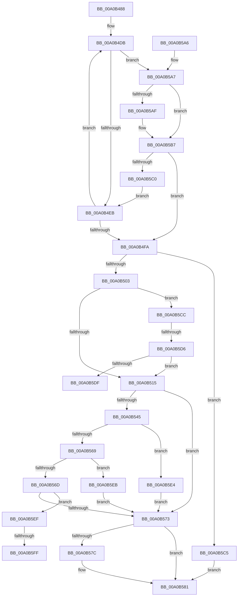

# _CmSetDeviceMappedPropertyFromDriverKeyRegValue

- RVA: `0x00A0B488`–`0x00A0B60F` (길이 `391` bytes)
- VA: `0x0000000140A0B488`
- 실행 섹션: `PAGE`
- PDB 이름 있음: `예`; PDB Function 태그: `예`
- unwind 정보 RVA: `0x000A8A08`
- 디코드: `105`개 명령, `391/391` bytes 표시
- 미해석 바이트: `0` (있으면 어셈블리에 `.byte`로 보존)

> 이 문서는 커널 이미지의 기계어와 PDB 기호를 분석해 생성했습니다. 4번과 5번은 함수 원형과 자료형을 바이너리 사용 방식에서 추정한 C 해석이며 원본 소스 복구 결과는 아닙니다.

## 1. Dependencies

- 직접 호출 지점: **4**; 고유 호출 대상: **4**
- 직접 호출자로 확인된 함수: **1**
- RIP 상대 이미지 참조: **4**

### Outgoing calls
- `0x00A0B53A` → [_CmOpenDeviceRegKey](../8E/_CmOpenDeviceRegKey_function_008EE540.md) (function, `0x008EE540`)
- `0x00A0B55D` → [PnpCtxRegSetValue](../99/PnpCtxRegSetValue_function_00991B8C.md) (function, `0x00991B8C`)
- `0x00A0B57C` → [ZwClose](../../text/6A/ZwClose_function_006AD2B0.md) (function, `0x006AD2B0`)
- `0x00A0B58A` → [_security_check_cookie](../../text/6A/_security_check_cookie_function_006AC640.md) (function, `0x006AC640`)

### Direct callers
- [_CmSetDeviceMappedProperty](_CmSetDeviceMappedProperty_function_00A0B098.md) at `0x00A0B17F`

### Static image references
- `0x00A0B49E` → RVA `0x00E0A740` (`.data`; read)
- `0x00A0B4C7` → RVA `0x00B4E6D0` (`PAGE`; read)
- `0x00A0B5F2` → RVA `0x00012F58` (`.rdata`; read)
- `0x00A0B603` → RVA `0x00012F60` (`.rdata`; read)

## 2. Other-region calls and transfers

- 다른 실행 섹션으로 향하는 call: **2**
  - `0x00A0B57C` → [ZwClose](../../text/6A/ZwClose_function_006AD2B0.md) (`PAGE` → `.text`)
  - `0x00A0B58A` → [_security_check_cookie](../../text/6A/_security_check_cookie_function_006AC640.md) (`PAGE` → `.text`)
- call이 아닌 외부 분기/꼬리 이동: **4**
  - `0x00A0B5D0` → [sub_00B3665A + 0xA](../B3/Unknown_function_00B3665A.md) (`tail-transfer`)
  - `0x00A0B5DF` → [sub_00B3665A](../B3/Unknown_function_00B3665A.md) (`tail-transfer`)
  - `0x00A0B5F9` → [sub_00B3665A + 0x15](../B3/Unknown_function_00B3665A.md) (`tail-transfer`)
  - `0x00A0B60A` → [sub_00B3665A + 0x15](../B3/Unknown_function_00B3665A.md) (`tail-transfer`)

## 3. Assembly (complete function range)

```asm
00A0B488  48 89 5C 24 18                  mov qword ptr [rsp + 0x18], rbx
00A0B48D  55                              push rbp
00A0B48E  56                              push rsi
00A0B48F  57                              push rdi
00A0B490  41 56                           push r14
00A0B492  41 57                           push r15
00A0B494  48 8B EC                        mov rbp, rsp
00A0B497  48 81 EC 80 00 00 00            sub rsp, 0x80
00A0B49E  48 8B 05 9B F2 3F 00            mov rax, qword ptr [rip + 0x3ff29b]
00A0B4A5  48 33 C4                        xor rax, rsp
00A0B4A8  48 89 45 F8                     mov qword ptr [rbp - 8], rax
00A0B4AC  48 83 65 C0 00                  and qword ptr [rbp - 0x40], 0
00A0B4B1  0F 57 C0                        xorps xmm0, xmm0
00A0B4B4  48 83 65 C8 00                  and qword ptr [rbp - 0x38], 0
00A0B4B9  45 8B D1                        mov r10d, r9d
00A0B4BC  4C 8B 75 50                     mov r14, qword ptr [rbp + 0x50]
00A0B4C0  4C 8B FA                        mov r15, rdx
00A0B4C3  45 8B 58 10                     mov r11d, dword ptr [r8 + 0x10]
00A0B4C7  48 8D 15 02 32 14 00            lea rdx, [rip + 0x143202]
00A0B4CE  0F 11 45 D0                     movups xmmword ptr [rbp - 0x30], xmm0
00A0B4D2  45 33 C9                        xor r9d, r9d
00A0B4D5  49 8B F8                        mov rdi, r8
00A0B4D8  48 8B D9                        mov rbx, rcx
00A0B4DB  4C 8B 02                        mov r8, qword ptr [rdx]
00A0B4DE  48 8B F2                        mov rsi, rdx
00A0B4E1  45 3B 58 10                     cmp r11d, dword ptr [r8 + 0x10]
00A0B4E5  0F 84 BC 00 00 00               je 0x140a0b5a7
00A0B4EB  33 F6                           xor esi, esi
00A0B4ED  41 FF C1                        inc r9d
00A0B4F0  48 83 C2 20                     add rdx, 0x20
00A0B4F4  41 83 F9 0D                     cmp r9d, 0xd
00A0B4F8  72 E1                           jb 0x140a0b4db
00A0B4FA  48 85 F6                        test rsi, rsi
00A0B4FD  0F 84 C2 00 00 00               je 0x140a0b5c5
00A0B503  8B 46 08                        mov eax, dword ptr [rsi + 8]
00A0B506  41 B8 12 00 00 00               mov r8d, 0x12
00A0B50C  44 3B D0                        cmp r10d, eax
00A0B50F  0F 85 B7 00 00 00               jne 0x140a0b5cc
00A0B515  48 83 64 24 38 00               and qword ptr [rsp + 0x38], 0
00A0B51B  48 8D 45 C0                     lea rax, [rbp - 0x40]
00A0B51F  48 89 44 24 30                  mov qword ptr [rsp + 0x30], rax
00A0B524  45 33 C9                        xor r9d, r9d
00A0B527  C6 44 24 28 01                  mov byte ptr [rsp + 0x28], 1
00A0B52C  49 8B D7                        mov rdx, r15
00A0B52F  48 8B CB                        mov rcx, rbx
00A0B532  C7 44 24 20 02 00 00 00         mov dword ptr [rsp + 0x20], 2
00A0B53A  E8 01 30 EE FF                  call 0x1408ee540
00A0B53F  8B D8                           mov ebx, eax
00A0B541  85 C0                           test eax, eax
00A0B543  78 2E                           js 0x140a0b573
00A0B545  8B 4D 58                        mov ecx, dword ptr [rbp + 0x58]
00A0B548  4C 8B 46 10                     mov r8, qword ptr [rsi + 0x10]
00A0B54C  44 8B 4E 18                     mov r9d, dword ptr [rsi + 0x18]
00A0B550  48 8B 55 C0                     mov rdx, qword ptr [rbp - 0x40]
00A0B554  89 4C 24 28                     mov dword ptr [rsp + 0x28], ecx
00A0B558  4C 89 74 24 20                  mov qword ptr [rsp + 0x20], r14
00A0B55D  E8 2A 66 F8 FF                  call 0x140991b8c
00A0B562  3D 7C 01 00 C0                  cmp eax, 0xc000017c
00A0B567  74 7B                           je 0x140a0b5e4
00A0B569  85 C0                           test eax, eax
00A0B56B  78 7E                           js 0x140a0b5eb
00A0B56D  83 7F 10 02                     cmp dword ptr [rdi + 0x10], 2
00A0B571  74 7C                           je 0x140a0b5ef
00A0B573  48 8B 4D C0                     mov rcx, qword ptr [rbp - 0x40]
00A0B577  48 85 C9                        test rcx, rcx
00A0B57A  74 05                           je 0x140a0b581
00A0B57C  E8 2F 1D CA FF                  call 0x1406ad2b0
00A0B581  8B C3                           mov eax, ebx
00A0B583  48 8B 4D F8                     mov rcx, qword ptr [rbp - 8]
00A0B587  48 33 CC                        xor rcx, rsp
00A0B58A  E8 B1 10 CA FF                  call 0x1406ac640
00A0B58F  48 8B 9C 24 C0 00 00 00         mov rbx, qword ptr [rsp + 0xc0]
00A0B597  48 81 C4 80 00 00 00            add rsp, 0x80
00A0B59E  41 5F                           pop r15
00A0B5A0  41 5E                           pop r14
00A0B5A2  5F                              pop rdi
00A0B5A3  5E                              pop rsi
00A0B5A4  5D                              pop rbp
00A0B5A5  C3                              ret
00A0B5A6  CC                              int3
00A0B5A7  48 8B 0F                        mov rcx, qword ptr [rdi]
00A0B5AA  49 2B 08                        sub rcx, qword ptr [r8]
00A0B5AD  75 08                           jne 0x140a0b5b7
00A0B5AF  48 8B 4F 08                     mov rcx, qword ptr [rdi + 8]
00A0B5B3  49 2B 48 08                     sub rcx, qword ptr [r8 + 8]
00A0B5B7  48 85 C9                        test rcx, rcx
00A0B5BA  0F 84 3A FF FF FF               je 0x140a0b4fa
00A0B5C0  E9 26 FF FF FF                  jmp 0x140a0b4eb
00A0B5C5  BB 16 00 00 C0                  mov ebx, 0xc0000016
00A0B5CA  EB B5                           jmp 0x140a0b581
00A0B5CC  41 83 FA 19                     cmp r10d, 0x19
00A0B5D0  0F 85 8E B0 12 00               jne 0x140b36664
00A0B5D6  41 3B C0                        cmp eax, r8d
00A0B5D9  0F 84 36 FF FF FF               je 0x140a0b515
00A0B5DF  E9 76 B0 12 00                  jmp 0x140b3665a
00A0B5E4  BB 34 00 00 C0                  mov ebx, 0xc0000034
00A0B5E9  EB 88                           jmp 0x140a0b573
00A0B5EB  8B D8                           mov ebx, eax
00A0B5ED  EB 84                           jmp 0x140a0b573
00A0B5EF  48 8B 07                        mov rax, qword ptr [rdi]
00A0B5F2  48 2B 05 5F 79 60 FF            sub rax, qword ptr [rip - 0x9f86a1]
00A0B5F9  0F 85 70 B0 12 00               jne 0x140b3666f
00A0B5FF  48 8B 47 08                     mov rax, qword ptr [rdi + 8]
00A0B603  48 2B 05 56 79 60 FF            sub rax, qword ptr [rip - 0x9f86aa]
00A0B60A  E9 60 B0 12 00                  jmp 0x140b3666f
```

## 4. C-style interpretation (structured pseudocode)

```c
__int64 __fastcall _CmSetDeviceMappedPropertyFromDriverKeyRegValue(__int64 a1, __int64 a2, __int64 a3, int a4, __int64 a5, unsigned int a6)
{
    __int64 result;
    __int64 v_rsi;
    __int64 v_rsp;
    unsigned __int64 v_stack_m30;
    unsigned __int64 v_stack_m58;
    unsigned __int64 v_stack_m60;
    unsigned __int64 v_stack_m68;
    unsigned __int64 v_stack_m70;
    unsigned __int64 v_stack_m78;
    unsigned __int8 v_stack_m80;
    unsigned int v_stack_m88;
    unsigned __int64 v_stack_p18;

    v_stack_p18 = v_rbx;
    v_rsp = (v_rsp) - (128);
    result = (*(unsigned __int64 *)(v_rip + 4190875)) ^ (v_rsp);
    v_stack_m30 = result;
    v_stack_m58 = v_xmm0;
    a4 = 0;
loc_00A0B4DB:
    if (((unsigned int)((unsigned int)(*(unsigned int *)(a3 + 16)))) == (*(unsigned int *)(*(unsigned __int64 *)(v_rip + 1323522) + 16))) goto loc_00A0B5A7;
loc_00A0B4EB:
    v_rsi = 0;
    a4 = (unsigned int)((a4) + 1);
    a2 = (v_rip + 1323522) + (32);
    if (a4 < 13) goto loc_00A0B4DB;
loc_00A0B4FA:
    if (0 == 0) goto loc_00A0B5C5;
    if (((unsigned int)((unsigned int)(a4))) != ((unsigned int)((unsigned int)(*(unsigned int *)(v_rsi + 8))))) goto loc_00A0B5CC;
loc_00A0B515:
    v_stack_m78 = v_stack_m68;
    a4 = 0;
    v_stack_m80 = 1;
    v_stack_m88 = 2;
    result = _CmOpenDeviceRegKey(a1, a2, 18, a4);
    if (sign_flag) goto loc_00A0B573;
    v_stack_m80 = (unsigned int)((unsigned int)(a6));
    v_stack_m88 = a5;
    result = PnpCtxRegSetValue((unsigned int)(a6), v_stack_m68, *(unsigned __int64 *)(v_rsi + 16), (unsigned int)(*(unsigned int *)(v_rsi + 24)));
    if (((unsigned int)(result)) == 0xC000017CULL) goto loc_00A0B5E4;
    if (sign_flag) goto loc_00A0B5EB;
    if ((*(unsigned int *)(a3 + 16)) == 2) goto loc_00A0B5EF;
loc_00A0B573:
    if (v_stack_m68 != 0) {
        result = ZwClose(v_stack_m68, v_stack_m68, *(unsigned __int64 *)(v_rsi + 16), (unsigned int)(*(unsigned int *)(v_rsi + 24)));
    }
    a1 = (v_stack_m30) ^ (v_rsp);
    result = _security_check_cookie(a1, v_stack_m68, *(unsigned __int64 *)(v_rsi + 16), (unsigned int)(*(unsigned int *)(v_rsi + 24)));
    v_rsp = (v_rsp) + (128);
    return result;
loc_00A0B5A7:
    a1 = (*(unsigned __int64 *)(a3)) - (*(unsigned __int64 *)(*(unsigned __int64 *)(v_rsi + 16)));
    if (!(condition_is_not_equal)) {
        a1 = *(unsigned __int64 *)(a3 + 8);
        a1 = (a1) - (*(unsigned __int64 *)(*(unsigned __int64 *)(v_rsi + 16) + 8));
    }
    if (a1 == 0) goto loc_00A0B4FA;
    goto loc_00A0B4EB;
loc_00A0B5C5:
    goto loc_00A0B581;
loc_00A0B5CC:
    if (((unsigned int)(result)) == ((unsigned int)(*(unsigned __int64 *)(v_rsi + 16)))) goto loc_00A0B515;
loc_00A0B5E4:
    goto loc_00A0B573;
loc_00A0B5EB:
    goto loc_00A0B573;
loc_00A0B5EF:
    result = (*(unsigned __int64 *)(a3)) - (*(unsigned __int64 *)(v_rip - 10454689));
    result = (*(unsigned __int64 *)(a3 + 8)) - (*(unsigned __int64 *)(v_rip - 10454698));
}
```

## 5. (Beta) C Style

```c
int64_t _CmSetDeviceMappedPropertyFromDriverKeyRegValue(int64_t Arg1, int64_t Arg2, void *Arg3, int32_t Arg4, int64_t Arg5, uint32_t Arg6)
{
    uint8_t *arg3 = (uint8_t *)Arg3;

    int64_t result;
    int64_t local_rsi;
    int64_t local_rsp;
    uint64_t v_stack_m30;
    uint64_t v_stack_m58;
    uint64_t v_stack_m60;
    uint64_t v_stack_m68;
    uint64_t v_stack_m70;
    uint64_t v_stack_m78;
    uint8_t v_stack_m80;
    uint32_t v_stack_m88;
    uint64_t v_stack_p18;

    v_stack_p18 = local_rbx;
    local_rsp = (local_rsp) - (128);
    result = (*(uint64_t *)(v_rip + 0x3FF29B)) ^ (local_rsp);
    v_stack_m30 = result;
    v_stack_m58 = v_xmm0;
    Arg4 = 0;
loc_00A0B4DB:
    if (((uint32_t)((uint32_t)(*(uint32_t *)(arg3 + 0x10)))) == (*(uint32_t *)(*(uint64_t *)(v_rip + 0x143202) + 0x10))) goto loc_00A0B5A7;
loc_00A0B4EB:
    local_rsi = 0;
    Arg4 = (uint32_t)((Arg4) + 1);
    Arg2 = (v_rip + 1323522) + (32);
    if (Arg4 < 13) goto loc_00A0B4DB;
loc_00A0B4FA:
    if (0 == 0) goto loc_00A0B5C5;
    if (((uint32_t)((uint32_t)(Arg4))) != ((uint32_t)((uint32_t)(*(uint32_t *)(local_rsi + 0x8))))) goto loc_00A0B5CC;
loc_00A0B515:
    v_stack_m78 = v_stack_m68;
    Arg4 = 0;
    v_stack_m80 = 1;
    v_stack_m88 = 2;
    result = _CmOpenDeviceRegKey(Arg1, Arg2, 18, Arg4);
    if (sign_flag) goto loc_00A0B573;
    v_stack_m80 = (uint32_t)((uint32_t)(Arg6));
    v_stack_m88 = Arg5;
    result = PnpCtxRegSetValue((uint32_t)(Arg6), v_stack_m68, *(uint64_t *)(local_rsi + 0x10), (uint32_t)(*(uint32_t *)(local_rsi + 0x18)));
    if (((uint32_t)(result)) == 0xC000017CULL) goto loc_00A0B5E4;
    if (sign_flag) goto loc_00A0B5EB;
    if ((*(uint32_t *)(arg3 + 0x10)) == 2) goto loc_00A0B5EF;
loc_00A0B573:
    if (v_stack_m68 != 0) {
        result = ZwClose(v_stack_m68, v_stack_m68, *(uint64_t *)(local_rsi + 0x10), (uint32_t)(*(uint32_t *)(local_rsi + 0x18)));
    }
    Arg1 = (v_stack_m30) ^ (local_rsp);
    result = _security_check_cookie(Arg1, v_stack_m68, *(uint64_t *)(local_rsi + 0x10), (uint32_t)(*(uint32_t *)(local_rsi + 0x18)));
    local_rsp = (local_rsp) + (128);
    return result;
loc_00A0B5A7:
    Arg1 = (*(uint64_t *)(arg3)) - (*(uint64_t *)(*(uint64_t *)(local_rsi + 0x10)));
    if (!(condition_is_not_equal)) {
        Arg1 = *(uint64_t *)(arg3 + 0x8);
        Arg1 = (Arg1) - (*(uint64_t *)(*(uint64_t *)(local_rsi + 0x10) + 0x8));
    }
    if (Arg1 == 0) goto loc_00A0B4FA;
    goto loc_00A0B4EB;
loc_00A0B5C5:
    goto loc_00A0B581;
loc_00A0B5CC:
    if (((uint32_t)(result)) == ((uint32_t)(*(uint64_t *)(local_rsi + 0x10)))) goto loc_00A0B515;
loc_00A0B5E4:
    goto loc_00A0B573;
loc_00A0B5EB:
    goto loc_00A0B573;
loc_00A0B5EF:
    result = (*(uint64_t *)(arg3)) - (*(uint64_t *)(v_rip - 0x9F86A1));
    result = (*(uint64_t *)(arg3 + 0x8)) - (*(uint64_t *)(v_rip - 0x9F86AA));
}
```

### 관측된 메모리 오프셋

구조체 형식이 확인되지 않은 접근은 인자 기준의 오프셋으로만 기록했습니다.

| 기준 인자 | 오프셋 표현 | 폭 (bit) | 접근 |
|---|---:|---:|---|
| `Arg3` | `+ 0x0` | `64` | `R` |
| `Arg3` | `+ 0x8` | `64` | `R` |
| `Arg3` | `+ 0x10` | `32` | `R` |

## 6. Execution-region graph

[열기: 2D/3D 그래프와 함수 탐색 컨트롤 패널](../../../control-panel.html?section=page&rva=0x00A0B488&view=graph)

- 2D 그래프는 위에서 아래로 흐르고, 3D 그래프는 빈 공간을 드래그해 회전합니다. Shift+드래그는 이동, 휠은 확대·축소, 함수 노드 선택은 대상 보고서 이동입니다.

### Static fallback


