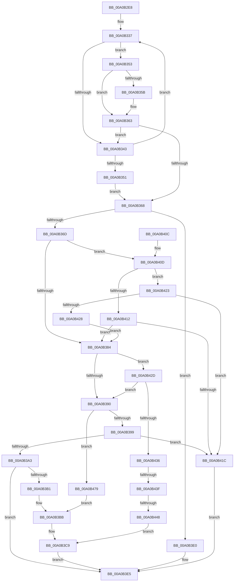

# _CmSetDeviceMappedPropertyFromRegProp

- RVA: `0x00A0B2E8`–`0x00A0B482` (길이 `410` bytes)
- VA: `0x0000000140A0B2E8`
- 실행 섹션: `PAGE`
- PDB 이름 있음: `예`; PDB Function 태그: `예`
- unwind 정보 RVA: `0x000A89D4`
- 디코드: `110`개 명령, `410/410` bytes 표시
- 미해석 바이트: `0` (있으면 어셈블리에 `.byte`로 보존)

> 이 문서는 커널 이미지의 기계어와 PDB 기호를 분석해 생성했습니다. 4번과 5번은 함수 원형과 자료형을 바이너리 사용 방식에서 추정한 C 해석이며 원본 소스 복구 결과는 아닙니다.

## 1. Dependencies

- 직접 호출 지점: **3**; 고유 호출 대상: **3**
- 직접 호출자로 확인된 함수: **1**
- RIP 상대 이미지 참조: **2**

### Outgoing calls
- `0x00A0B3A8` → [PnpStringFromGuid](../8F/PnpStringFromGuid_function_008F5A2C.md) (function, `0x008F5A2C`)
- `0x00A0B3D9` → [CmSetDeviceRegProp](../8F/CmSetDeviceRegProp_function_008FD68C.md) (function, `0x008FD68C`)
- `0x00A0B3F0` → [_security_check_cookie](../../text/6A/_security_check_cookie_function_006AC640.md) (function, `0x006AC640`)

### Direct callers
- [_CmSetDeviceMappedProperty](_CmSetDeviceMappedProperty_function_00A0B098.md) at `0x00A0B24D`

### Static image references
- `0x00A0B2FB` → RVA `0x00E0A740` (`.data`; read)
- `0x00A0B312` → RVA `0x00B4DEA0` (`CmDeviceRegPropMap`; read)

## 2. Other-region calls and transfers

- 다른 실행 섹션으로 향하는 call: **1**
  - `0x00A0B3F0` → [_security_check_cookie](../../text/6A/_security_check_cookie_function_006AC640.md) (`PAGE` → `.text`)
- call이 아닌 외부 분기/꼬리 이동: **2**
  - `0x00A0B439` → [sub_00B36614 + 0x3C](../B3/Unknown_function_00B36614.md) (`tail-transfer`)
  - `0x00A0B442` → [sub_00B36614](../B3/Unknown_function_00B36614.md) (`tail-transfer`)

## 3. Assembly (complete function range)

```asm
00A0B2E8  48 89 5C 24 20                  mov qword ptr [rsp + 0x20], rbx
00A0B2ED  55                              push rbp
00A0B2EE  56                              push rsi
00A0B2EF  57                              push rdi
00A0B2F0  41 56                           push r14
00A0B2F2  41 57                           push r15
00A0B2F4  48 81 EC B0 00 00 00            sub rsp, 0xb0
00A0B2FB  48 8B 05 3E F4 3F 00            mov rax, qword ptr [rip + 0x3ff43e]
00A0B302  48 33 C4                        xor rax, rsp
00A0B305  48 89 84 24 A0 00 00 00         mov qword ptr [rsp + 0xa0], rax
00A0B30D  83 64 24 40 00                  and dword ptr [rsp + 0x40], 0
00A0B312  4C 8D 15 87 2B 14 00            lea r10, [rip + 0x142b87]
00A0B319  41 8B 71 10                     mov esi, dword ptr [r9 + 0x10]
00A0B31D  33 DB                           xor ebx, ebx
00A0B31F  49 8B F9                        mov rdi, r9
00A0B322  48 8B E9                        mov rbp, rcx
00A0B325  48 8B 8C 24 08 01 00 00         mov rcx, qword ptr [rsp + 0x108]
00A0B32D  4D 8B F8                        mov r15, r8
00A0B330  4C 8B F2                        mov r14, rdx
00A0B333  44 8D 4B 01                     lea r9d, [rbx + 1]
00A0B337  4D 8B 1A                        mov r11, qword ptr [r10]
00A0B33A  49 8B D2                        mov rdx, r10
00A0B33D  41 3B 73 10                     cmp esi, dword ptr [r11 + 0x10]
00A0B341  74 10                           je 0x140a0b353
00A0B343  33 D2                           xor edx, edx
00A0B345  41 03 D9                        add ebx, r9d
00A0B348  49 83 C2 18                     add r10, 0x18
00A0B34C  83 FB 21                        cmp ebx, 0x21
00A0B34F  72 E6                           jb 0x140a0b337
00A0B351  EB 15                           jmp 0x140a0b368
00A0B353  4C 8B 07                        mov r8, qword ptr [rdi]
00A0B356  4D 2B 03                        sub r8, qword ptr [r11]
00A0B359  75 08                           jne 0x140a0b363
00A0B35B  4C 8B 47 08                     mov r8, qword ptr [rdi + 8]
00A0B35F  4D 2B 43 08                     sub r8, qword ptr [r11 + 8]
00A0B363  4D 85 C0                        test r8, r8
00A0B366  75 DB                           jne 0x140a0b343
00A0B368  48 85 D2                        test rdx, rdx
00A0B36B  74 73                           je 0x140a0b3e0
00A0B36D  44 8B 42 08                     mov r8d, dword ptr [rdx + 8]
00A0B371  8B 84 24 00 01 00 00            mov eax, dword ptr [rsp + 0x100]
00A0B378  8B 5A 0C                        mov ebx, dword ptr [rdx + 0xc]
00A0B37B  41 3B C0                        cmp eax, r8d
00A0B37E  0F 85 89 00 00 00               jne 0x140a0b40d
00A0B384  8B 7A 10                        mov edi, dword ptr [rdx + 0x10]
00A0B387  83 FB 25                        cmp ebx, 0x25
00A0B38A  0F 85 9D 00 00 00               jne 0x140a0b42d
00A0B390  48 85 C9                        test rcx, rcx
00A0B393  0F 84 E0 00 00 00               je 0x140a0b479
00A0B399  83 BC 24 10 01 00 00 10         cmp dword ptr [rsp + 0x110], 0x10
00A0B3A1  72 79                           jb 0x140a0b41c
00A0B3A3  48 8D 54 24 50                  lea rdx, [rsp + 0x50]
00A0B3A8  E8 7F A6 EE FF                  call 0x1408f5a2c
00A0B3AD  85 C0                           test eax, eax
00A0B3AF  78 34                           js 0x140a0b3e5
00A0B3B1  48 8D 44 24 50                  lea rax, [rsp + 0x50]
00A0B3B6  B9 4E 00 00 00                  mov ecx, 0x4e
00A0B3BB  83 64 24 38 00                  and dword ptr [rsp + 0x38], 0
00A0B3C0  89 4C 24 30                     mov dword ptr [rsp + 0x30], ecx
00A0B3C4  48 89 44 24 28                  mov qword ptr [rsp + 0x28], rax
00A0B3C9  44 8B CB                        mov r9d, ebx
00A0B3CC  89 7C 24 20                     mov dword ptr [rsp + 0x20], edi
00A0B3D0  4D 8B C7                        mov r8, r15
00A0B3D3  49 8B D6                        mov rdx, r14
00A0B3D6  48 8B CD                        mov rcx, rbp
00A0B3D9  E8 AE 22 EF FF                  call 0x1408fd68c
00A0B3DE  EB 05                           jmp 0x140a0b3e5
00A0B3E0  B8 30 02 00 C0                  mov eax, 0xc0000230
00A0B3E5  48 8B 8C 24 A0 00 00 00         mov rcx, qword ptr [rsp + 0xa0]
00A0B3ED  48 33 CC                        xor rcx, rsp
00A0B3F0  E8 4B 12 CA FF                  call 0x1406ac640
00A0B3F5  48 8B 9C 24 F8 00 00 00         mov rbx, qword ptr [rsp + 0xf8]
00A0B3FD  48 81 C4 B0 00 00 00            add rsp, 0xb0
00A0B404  41 5F                           pop r15
00A0B406  41 5E                           pop r14
00A0B408  5F                              pop rdi
00A0B409  5E                              pop rsi
00A0B40A  5D                              pop rbp
00A0B40B  C3                              ret
00A0B40C  CC                              int3
00A0B40D  83 F8 19                        cmp eax, 0x19
00A0B410  75 11                           jne 0x140a0b423
00A0B412  41 83 F8 12                     cmp r8d, 0x12
00A0B416  0F 84 68 FF FF FF               je 0x140a0b384
00A0B41C  B8 0D 00 00 C0                  mov eax, 0xc000000d
00A0B421  EB C2                           jmp 0x140a0b3e5
00A0B423  83 F8 02                        cmp eax, 2
00A0B426  73 F4                           jae 0x140a0b41c
00A0B428  E9 57 FF FF FF                  jmp 0x140a0b384
00A0B42D  83 FB 09                        cmp ebx, 9
00A0B430  0F 84 5A FF FF FF               je 0x140a0b390
00A0B436  83 FB 19                        cmp ebx, 0x19
00A0B439  0F 84 11 B2 12 00               je 0x140b36650
00A0B43F  83 FB 1B                        cmp ebx, 0x1b
00A0B442  0F 84 CC B1 12 00               je 0x140b36614
00A0B448  48 8B C1                        mov rax, rcx
00A0B44B  48 F7 D8                        neg rax
00A0B44E  48 8B C1                        mov rax, rcx
00A0B451  45 1B DB                        sbb r11d, r11d
00A0B454  44 23 9C 24 10 01 00 00         and r11d, dword ptr [rsp + 0x110]
00A0B45C  48 F7 D8                        neg rax
00A0B45F  4D 1B D2                        sbb r10, r10
00A0B462  4C 23 D1                        and r10, rcx
00A0B465  83 64 24 38 00                  and dword ptr [rsp + 0x38], 0
00A0B46A  44 89 5C 24 30                  mov dword ptr [rsp + 0x30], r11d
00A0B46F  4C 89 54 24 28                  mov qword ptr [rsp + 0x28], r10
00A0B474  E9 50 FF FF FF                  jmp 0x140a0b3c9
00A0B479  33 C0                           xor eax, eax
00A0B47B  33 C9                           xor ecx, ecx
00A0B47D  E9 39 FF FF FF                  jmp 0x140a0b3bb
```

## 4. C-style interpretation (structured pseudocode)

```c
__int64 __fastcall _CmSetDeviceMappedPropertyFromRegProp(__int64 a1, __int64 a2, __int64 a3, __int64 a4, unsigned int a5, __int64 a6, unsigned int a7)
{
    __int64 result;
    __int64 v_r10;
    __int64 v_r11;
    __int64 v_rbx;
    __int64 v_rsp;
    unsigned __int64 v_stack_m38;
    unsigned __int64 v_stack_m88;
    unsigned int v_stack_m98;
    unsigned int v_stack_mA0;
    unsigned int v_stack_mA8;
    unsigned __int64 v_stack_mB0;
    unsigned int v_stack_mB8;
    unsigned __int64 v_stack_p20;
    unsigned __int64 v_stack_p28;
    unsigned int v_stack_p30;
    unsigned int v_stack_p38;

    v_stack_p20 = v_rbx;
    v_rsp = (v_rsp) - (176);
    result = (*(unsigned __int64 *)(v_rip + 4191294)) ^ (v_rsp);
    v_stack_m38 = result;
    v_rbx = 0;
loc_00A0B337:
    if (((unsigned int)((unsigned int)(*(unsigned int *)(a4 + 16)))) == (*(unsigned int *)(*(unsigned __int64 *)(v_rip + 1321863) + 16))) goto loc_00A0B353;
loc_00A0B343:
    a2 = 0;
    v_rbx = (unsigned int)((v_rbx) + ((unsigned int)(v_rbx + 1)));
    v_r10 = (v_rip + 1321863) + (24);
    if (((unsigned int)(v_rbx)) < 33) goto loc_00A0B337;
    goto loc_00A0B368;
loc_00A0B353:
    a3 = (*(unsigned __int64 *)(a4)) - (*(unsigned __int64 *)(*(unsigned __int64 *)(v_rip + 1321863)));
    if (!(condition_is_not_equal)) {
        a3 = *(unsigned __int64 *)(a4 + 8);
        a3 = (a3) - (*(unsigned __int64 *)(*(unsigned __int64 *)(v_rip + 1321863) + 8));
    }
    if (a3 != 0) goto loc_00A0B343;
loc_00A0B368:
    if (0 == 0) goto loc_00A0B3E0;
    if (((unsigned int)((unsigned int)(a5))) != ((unsigned int)((unsigned int)(*(unsigned int *)(a2 + 8))))) goto loc_00A0B40D;
loc_00A0B384:
    if (((unsigned int)((unsigned int)(*(unsigned int *)(a2 + 12)))) != 37) goto loc_00A0B42D;
loc_00A0B390:
    if (a6 == 0) goto loc_00A0B479;
    if (a7 < 16) goto loc_00A0B41C;
    result = PnpStringFromGuid(a6, v_stack_m88, (unsigned int)(*(unsigned int *)(a2 + 8)), v_rbx + 1);
    if (sign_flag) goto loc_00A0B3E5;
loc_00A0B3BB:
    v_stack_mA8 = 78;
    v_stack_mB0 = v_stack_m88;
loc_00A0B3C9:
    v_stack_mB8 = (unsigned int)((unsigned int)(*(unsigned int *)(a2 + 16)));
    result = CmSetDeviceRegProp(a1, 0, a3, (unsigned int)((unsigned int)((unsigned int)(*(unsigned int *)(a2 + 12)))));
    goto loc_00A0B3E5;
loc_00A0B3E0:
loc_00A0B3E5:
    a1 = (v_stack_m38) ^ (v_rsp);
    result = _security_check_cookie(a1, 0, a3, (unsigned int)((unsigned int)((unsigned int)(*(unsigned int *)(a2 + 12)))));
    v_rsp = (v_rsp) + (176);
    return result;
loc_00A0B40D:
    if (((unsigned int)(result)) != 25) goto loc_00A0B423;
    if (((unsigned int)(a3)) == 18) goto loc_00A0B384;
loc_00A0B41C:
    goto loc_00A0B3E5;
loc_00A0B423:
    if (((unsigned int)((unsigned int)(0xC000000DULL))) >= 2) goto loc_00A0B41C;
    goto loc_00A0B384;
loc_00A0B42D:
    if (((unsigned int)(v_stack_p20)) == 9) goto loc_00A0B390;
    result = -(a1);
    v_r11 = (unsigned int)((*(unsigned __int64 *)(v_rip + 1321863)) & (a7));
    result = -(a1);
    v_r10 = (v_r10) & (a1);
    v_stack_p30 = (unsigned int)(v_r11);
    v_stack_p28 = v_r10;
    goto loc_00A0B3C9;
loc_00A0B479:
    result = 0;
    a1 = 0;
    goto loc_00A0B3BB;
}
```

## 5. (Beta) C Style

```c
int64_t _CmSetDeviceMappedPropertyFromRegProp(int64_t Arg1, int64_t Arg2, int64_t Arg3, void *Arg4, uint32_t Arg5, int64_t Arg6, uint32_t Arg7)
{
    uint8_t *arg4 = (uint8_t *)Arg4;

    int64_t result;
    int64_t local_r10;
    int64_t local_r11;
    int64_t local_rbx;
    int64_t local_rsp;
    uint64_t v_stack_m38;
    uint64_t v_stack_m88;
    uint32_t v_stack_m98;
    uint32_t v_stack_mA0;
    uint32_t v_stack_mA8;
    uint64_t v_stack_mB0;
    uint32_t v_stack_mB8;
    uint64_t v_stack_p20;
    uint64_t v_stack_p28;
    uint32_t v_stack_p30;
    uint32_t v_stack_p38;

    v_stack_p20 = local_rbx;
    local_rsp = (local_rsp) - (176);
    result = (*(uint64_t *)(v_rip + 0x3FF43E)) ^ (local_rsp);
    v_stack_m38 = result;
    local_rbx = 0;
loc_00A0B337:
    if (((uint32_t)((uint32_t)(*(uint32_t *)(arg4 + 0x10)))) == (*(uint32_t *)(*(uint64_t *)(v_rip + 0x142B87) + 0x10))) goto loc_00A0B353;
loc_00A0B343:
    Arg2 = 0;
    local_rbx = (uint32_t)((local_rbx) + ((uint32_t)(local_rbx + 1)));
    local_r10 = (v_rip + 1321863) + (24);
    if (((uint32_t)(local_rbx)) < 33) goto loc_00A0B337;
    goto loc_00A0B368;
loc_00A0B353:
    Arg3 = (*(uint64_t *)(arg4)) - (*(uint64_t *)(*(uint64_t *)(v_rip + 0x142B87)));
    if (!(condition_is_not_equal)) {
        Arg3 = *(uint64_t *)(arg4 + 0x8);
        Arg3 = (Arg3) - (*(uint64_t *)(*(uint64_t *)(v_rip + 0x142B87) + 0x8));
    }
    if (Arg3 != 0) goto loc_00A0B343;
loc_00A0B368:
    if (0 == 0) goto loc_00A0B3E0;
    if (((uint32_t)((uint32_t)(Arg5))) != ((uint32_t)((uint32_t)(*(uint32_t *)(Arg2 + 0x8))))) goto loc_00A0B40D;
loc_00A0B384:
    if (((uint32_t)((uint32_t)(*(uint32_t *)(Arg2 + 0xC)))) != 37) goto loc_00A0B42D;
loc_00A0B390:
    if (Arg6 == 0) goto loc_00A0B479;
    if (Arg7 < 16) goto loc_00A0B41C;
    result = PnpStringFromGuid(Arg6, v_stack_m88, (uint32_t)(*(uint32_t *)(Arg2 + 0x8)), local_rbx + 1);
    if (sign_flag) goto loc_00A0B3E5;
loc_00A0B3BB:
    v_stack_mA8 = 78;
    v_stack_mB0 = v_stack_m88;
loc_00A0B3C9:
    v_stack_mB8 = (uint32_t)((uint32_t)(*(uint32_t *)(Arg2 + 0x10)));
    result = CmSetDeviceRegProp(Arg1, 0, Arg3, (uint32_t)((uint32_t)((uint32_t)(*(uint32_t *)(Arg2 + 0xC)))));
    goto loc_00A0B3E5;
loc_00A0B3E0:
loc_00A0B3E5:
    Arg1 = (v_stack_m38) ^ (local_rsp);
    result = _security_check_cookie(Arg1, 0, Arg3, (uint32_t)((uint32_t)((uint32_t)(*(uint32_t *)(Arg2 + 0xC)))));
    local_rsp = (local_rsp) + (176);
    return result;
loc_00A0B40D:
    if (((uint32_t)(result)) != 25) goto loc_00A0B423;
    if (((uint32_t)(Arg3)) == 18) goto loc_00A0B384;
loc_00A0B41C:
    goto loc_00A0B3E5;
loc_00A0B423:
    if (((uint32_t)((uint32_t)(0xC000000DULL))) >= 2) goto loc_00A0B41C;
    goto loc_00A0B384;
loc_00A0B42D:
    if (((uint32_t)(v_stack_p20)) == 9) goto loc_00A0B390;
    result = -(Arg1);
    local_r11 = (uint32_t)((*(uint64_t *)(v_rip + 0x142B87)) & (Arg7));
    result = -(Arg1);
    local_r10 = (local_r10) & (Arg1);
    v_stack_p30 = (uint32_t)(local_r11);
    v_stack_p28 = local_r10;
    goto loc_00A0B3C9;
loc_00A0B479:
    result = 0;
    Arg1 = 0;
    goto loc_00A0B3BB;
}
```

### 관측된 메모리 오프셋

구조체 형식이 확인되지 않은 접근은 인자 기준의 오프셋으로만 기록했습니다.

| 기준 인자 | 오프셋 표현 | 폭 (bit) | 접근 |
|---|---:|---:|---|
| `Arg4` | `+ 0x0` | `64` | `R` |
| `Arg4` | `+ 0x8` | `64` | `R` |
| `Arg4` | `+ 0x10` | `32` | `R` |

## 6. Execution-region graph

[열기: 2D/3D 그래프와 함수 탐색 컨트롤 패널](../../../control-panel.html?section=page&rva=0x00A0B2E8&view=graph)

- 2D 그래프는 위에서 아래로 흐르고, 3D 그래프는 빈 공간을 드래그해 회전합니다. Shift+드래그는 이동, 휠은 확대·축소, 함수 노드 선택은 대상 보고서 이동입니다.

### Static fallback


