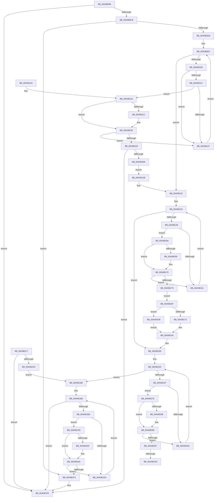

# _CmSetDeviceMappedProperty

- RVA: `0x00A0B098`–`0x00A0B2E2` (길이 `586` bytes)
- VA: `0x0000000140A0B098`
- 실행 섹션: `PAGE`
- PDB 이름 있음: `예`; PDB Function 태그: `예`
- unwind 정보 RVA: `0x000A89A4`
- 디코드: `155`개 명령, `586/586` bytes 표시
- 미해석 바이트: `0` (있으면 어셈블리에 `.byte`로 보존)

> 이 문서는 커널 이미지의 기계어와 PDB 기호를 분석해 생성했습니다. 4번과 5번은 함수 원형과 자료형을 바이너리 사용 방식에서 추정한 C 해석이며 원본 소스 복구 결과는 아닙니다.

## 1. Dependencies

- 직접 호출 지점: **5**; 고유 호출 대상: **5**
- 직접 호출자로 확인된 함수: **2**
- RIP 상대 이미지 참조: **1**

### Outgoing calls
- `0x00A0B0CE` → [CmIsRootDevice](../93/CmIsRootDevice_function_009325E4.md) (function, `0x009325E4`)
- `0x00A0B17F` → [_CmSetDeviceMappedPropertyFromDriverKeyRegValue](_CmSetDeviceMappedPropertyFromDriverKeyRegValue_function_00A0B488.md) (function, `0x00A0B488`)
- `0x00A0B24D` → [_CmSetDeviceMappedPropertyFromRegProp](_CmSetDeviceMappedPropertyFromRegProp_function_00A0B2E8.md) (function, `0x00A0B2E8`)
- `0x00A0B2BC` → [CmSetDeviceMappedPropertyFromInstanceKeyRegValue](../83/CmSetDeviceMappedPropertyFromInstanceKeyRegValue_function_00830F40.md) (function, `0x00830F40`)
- `0x00A0B2D8` → [CmDeleteDeviceMappedPropertyFromDriverKeyRegValue](../82/CmDeleteDeviceMappedPropertyFromDriverKeyRegValue_function_0082F944.md) (function, `0x0082F944`)

### Direct callers
- [sub_008E200E](../8E/Unknown_function_008E200E.md) at `0x008E203F`
- [_CmDeleteDeviceWorker](_CmDeleteDeviceWorker_function_00A08F48.md) at `0x00A09205`

### Static image references
- `0x00A0B0ED` → RVA `0x00000000` (`image boundary/outside`; read)

## 2. Other-region calls and transfers

- 다른 실행 섹션으로 향하는 call: **0**
- call이 아닌 외부 분기/꼬리 이동: **2**
  - `0x00A0B2A7` → [sub_00B365E0](../B3/Unknown_function_00B365E0.md) (`tail-transfer`)
  - `0x00A0B2C2` → [sub_00B365E0 + 0x5](../B3/Unknown_function_00B365E0.md) (`tail-transfer`)

## 3. Assembly (complete function range)

```asm
00A0B098  48 89 5C 24 08                  mov qword ptr [rsp + 8], rbx
00A0B09D  48 89 6C 24 10                  mov qword ptr [rsp + 0x10], rbp
00A0B0A2  48 89 74 24 18                  mov qword ptr [rsp + 0x18], rsi
00A0B0A7  57                              push rdi
00A0B0A8  41 54                           push r12
00A0B0AA  41 55                           push r13
00A0B0AC  41 56                           push r14
00A0B0AE  41 57                           push r15
00A0B0B0  48 83 EC 40                     sub rsp, 0x40
00A0B0B4  4D 8B F8                        mov r15, r8
00A0B0B7  48 8B F2                        mov rsi, rdx
00A0B0BA  48 8B E9                        mov rbp, rcx
00A0B0BD  BB 16 00 00 C0                  mov ebx, 0xc0000016
00A0B0C2  4D 85 C9                        test r9, r9
00A0B0C5  0F 85 2D 01 00 00               jne 0x140a0b1f8
00A0B0CB  48 8B CA                        mov rcx, rdx
00A0B0CE  E8 11 75 F2 FF                  call 0x1409325e4
00A0B0D3  84 C0                           test al, al
00A0B0D5  0F 85 18 01 00 00               jne 0x140a0b1f3
00A0B0DB  48 8B BC 24 90 00 00 00         mov rdi, qword ptr [rsp + 0x90]
00A0B0E3  33 D2                           xor edx, edx
00A0B0E5  44 8B A4 24 A8 00 00 00         mov r12d, dword ptr [rsp + 0xa8]
00A0B0ED  4C 8D 05 0C 4F 5F FF            lea r8, [rip - 0xa0b0f4]
00A0B0F4  4C 8B AC 24 A0 00 00 00         mov r13, qword ptr [rsp + 0xa0]
00A0B0FC  44 8B B4 24 98 00 00 00         mov r14d, dword ptr [rsp + 0x98]
00A0B104  83 FA 21                        cmp edx, 0x21
00A0B107  73 29                           jae 0x140a0b132
00A0B109  48 8D 0C 52                     lea rcx, [rdx + rdx*2]
00A0B10D  4D 8B 84 C8 A0 DE B4 00         mov r8, qword ptr [r8 + rcx*8 + 0xb4dea0]
00A0B115  4D 85 C0                        test r8, r8
00A0B118  74 0D                           je 0x140a0b127
00A0B11A  41 8B 40 10                     mov eax, dword ptr [r8 + 0x10]
00A0B11E  39 47 10                        cmp dword ptr [rdi + 0x10], eax
00A0B121  0F 84 F2 00 00 00               je 0x140a0b219
00A0B127  FF C2                           inc edx
00A0B129  EB BA                           jmp 0x140a0b0e5
00A0B12B  4C 8D 05 CE 4E 5F FF            lea r8, [rip - 0xa0b132]
00A0B132  33 D2                           xor edx, edx
00A0B134  83 FA 0D                        cmp edx, 0xd
00A0B137  73 50                           jae 0x140a0b189
00A0B139  8B CA                           mov ecx, edx
00A0B13B  48 C1 E1 05                     shl rcx, 5
00A0B13F  4E 8B 84 01 D0 E6 B4 00         mov r8, qword ptr [rcx + r8 + 0xb4e6d0]
00A0B147  41 8B 40 10                     mov eax, dword ptr [r8 + 0x10]
00A0B14B  39 47 10                        cmp dword ptr [rdi + 0x10], eax
00A0B14E  0F 84 0C 01 00 00               je 0x140a0b260
00A0B154  FF C2                           inc edx
00A0B156  4C 8D 05 A3 4E 5F FF            lea r8, [rip - 0xa0b15d]
00A0B15D  EB D5                           jmp 0x140a0b134
00A0B15F  4C 8B C7                        mov r8, rdi
00A0B162  48 8B D6                        mov rdx, rsi
00A0B165  48 8B CD                        mov rcx, rbp
00A0B168  41 83 FE 02                     cmp r14d, 2
00A0B16C  0F 82 66 01 00 00               jb 0x140a0b2d8
00A0B172  44 89 64 24 28                  mov dword ptr [rsp + 0x28], r12d
00A0B177  45 8B CE                        mov r9d, r14d
00A0B17A  4C 89 6C 24 20                  mov qword ptr [rsp + 0x20], r13
00A0B17F  E8 04 03 00 00                  call 0x140a0b488
00A0B184  BB 16 00 00 C0                  mov ebx, 0xc0000016
00A0B189  33 D2                           xor edx, edx
00A0B18B  4C 8D 0D 6E 4E 5F FF            lea r9, [rip - 0xa0b192]
00A0B192  83 FA 02                        cmp edx, 2
00A0B195  73 1F                           jae 0x140a0b1b6
00A0B197  8B C2                           mov eax, edx
00A0B199  48 C1 E0 05                     shl rax, 5
00A0B19D  4E 8B 84 08 20 B7 B4 00         mov r8, qword ptr [rax + r9 + 0xb4b720]
00A0B1A5  41 8B 40 10                     mov eax, dword ptr [r8 + 0x10]
00A0B1A9  39 47 10                        cmp dword ptr [rdi + 0x10], eax
00A0B1AC  0F 84 CC 00 00 00               je 0x140a0b27e
00A0B1B2  FF C2                           inc edx
00A0B1B4  EB DC                           jmp 0x140a0b192
00A0B1B6  33 D2                           xor edx, edx
00A0B1B8  83 FA 1C                        cmp edx, 0x1c
00A0B1BB  73 3B                           jae 0x140a0b1f8
00A0B1BD  8B C2                           mov eax, edx
00A0B1BF  48 8D 0D 3A 4E 5F FF            lea rcx, [rip - 0xa0b1c6]
00A0B1C6  48 03 C0                        add rax, rax
00A0B1C9  4C 8B 84 C1 A0 DB B4 00         mov r8, qword ptr [rcx + rax*8 + 0xb4dba0]
00A0B1D1  41 8B 40 10                     mov eax, dword ptr [r8 + 0x10]
00A0B1D5  39 47 10                        cmp dword ptr [rdi + 0x10], eax
00A0B1D8  74 04                           je 0x140a0b1de
00A0B1DA  FF C2                           inc edx
00A0B1DC  EB DA                           jmp 0x140a0b1b8
00A0B1DE  48 8B 0F                        mov rcx, qword ptr [rdi]
00A0B1E1  49 2B 08                        sub rcx, qword ptr [r8]
00A0B1E4  75 08                           jne 0x140a0b1ee
00A0B1E6  48 8B 4F 08                     mov rcx, qword ptr [rdi + 8]
00A0B1EA  49 2B 48 08                     sub rcx, qword ptr [r8 + 8]
00A0B1EE  48 85 C9                        test rcx, rcx
00A0B1F1  75 E7                           jne 0x140a0b1da
00A0B1F3  BB 22 00 00 C0                  mov ebx, 0xc0000022
00A0B1F8  4C 8D 5C 24 40                  lea r11, [rsp + 0x40]
00A0B1FD  8B C3                           mov eax, ebx
00A0B1FF  49 8B 5B 30                     mov rbx, qword ptr [r11 + 0x30]
00A0B203  49 8B 6B 38                     mov rbp, qword ptr [r11 + 0x38]
00A0B207  49 8B 73 40                     mov rsi, qword ptr [r11 + 0x40]
00A0B20B  49 8B E3                        mov rsp, r11
00A0B20E  41 5F                           pop r15
00A0B210  41 5E                           pop r14
00A0B212  41 5D                           pop r13
00A0B214  41 5C                           pop r12
00A0B216  5F                              pop rdi
00A0B217  C3                              ret
00A0B218  CC                              int3
00A0B219  48 8B 0F                        mov rcx, qword ptr [rdi]
00A0B21C  49 2B 08                        sub rcx, qword ptr [r8]
00A0B21F  75 08                           jne 0x140a0b229
00A0B221  48 8B 4F 08                     mov rcx, qword ptr [rdi + 8]
00A0B225  49 2B 48 08                     sub rcx, qword ptr [r8 + 8]
00A0B229  48 85 C9                        test rcx, rcx
00A0B22C  0F 85 F5 FE FF FF               jne 0x140a0b127
00A0B232  44 89 64 24 30                  mov dword ptr [rsp + 0x30], r12d
00A0B237  4C 8B CF                        mov r9, rdi
00A0B23A  4C 89 6C 24 28                  mov qword ptr [rsp + 0x28], r13
00A0B23F  4D 8B C7                        mov r8, r15
00A0B242  48 8B D6                        mov rdx, rsi
00A0B245  44 89 74 24 20                  mov dword ptr [rsp + 0x20], r14d
00A0B24A  48 8B CD                        mov rcx, rbp
00A0B24D  E8 96 00 00 00                  call 0x140a0b2e8
00A0B252  8B D8                           mov ebx, eax
00A0B254  3D 16 00 00 C0                  cmp eax, 0xc0000016
00A0B259  75 9D                           jne 0x140a0b1f8
00A0B25B  E9 CB FE FF FF                  jmp 0x140a0b12b
00A0B260  48 8B 0F                        mov rcx, qword ptr [rdi]
00A0B263  49 2B 08                        sub rcx, qword ptr [r8]
00A0B266  75 08                           jne 0x140a0b270
00A0B268  48 8B 4F 08                     mov rcx, qword ptr [rdi + 8]
00A0B26C  49 2B 48 08                     sub rcx, qword ptr [r8 + 8]
00A0B270  48 85 C9                        test rcx, rcx
00A0B273  0F 85 DB FE FF FF               jne 0x140a0b154
00A0B279  E9 E1 FE FF FF                  jmp 0x140a0b15f
00A0B27E  48 8B 0F                        mov rcx, qword ptr [rdi]
00A0B281  49 2B 08                        sub rcx, qword ptr [r8]
00A0B284  75 08                           jne 0x140a0b28e
00A0B286  48 8B 4F 08                     mov rcx, qword ptr [rdi + 8]
00A0B28A  49 2B 48 08                     sub rcx, qword ptr [r8 + 8]
00A0B28E  48 85 C9                        test rcx, rcx
00A0B291  0F 85 1B FF FF FF               jne 0x140a0b1b2
00A0B297  4C 8B CF                        mov r9, rdi
00A0B29A  4D 8B C7                        mov r8, r15
00A0B29D  48 8B D6                        mov rdx, rsi
00A0B2A0  48 8B CD                        mov rcx, rbp
00A0B2A3  41 83 FE 02                     cmp r14d, 2
00A0B2A7  0F 82 33 B3 12 00               jb 0x140b365e0
00A0B2AD  44 89 64 24 30                  mov dword ptr [rsp + 0x30], r12d
00A0B2B2  4C 89 6C 24 28                  mov qword ptr [rsp + 0x28], r13
00A0B2B7  44 89 74 24 20                  mov dword ptr [rsp + 0x20], r14d
00A0B2BC  E8 7F 5C E2 FF                  call 0x140830f40
00A0B2C1  90                              nop
00A0B2C2  E9 1E B3 12 00                  jmp 0x140b365e5
00A0B2C7  81 FB 16 00 00 C0               cmp ebx, 0xc0000016
00A0B2CD  0F 85 25 FF FF FF               jne 0x140a0b1f8
00A0B2D3  E9 DE FE FF FF                  jmp 0x140a0b1b6
00A0B2D8  E8 67 46 E2 FF                  call 0x14082f944
00A0B2DD  E9 A2 FE FF FF                  jmp 0x140a0b184
```

## 4. C-style interpretation (structured pseudocode)

```c
__int64 __fastcall _CmSetDeviceMappedProperty(__int64 a1, __int64 a2, __int64 a3, __int64 a4, __int64 a5, unsigned int a6, __int64 a7, unsigned int a8)
{
    __int64 result;
    __int64 v_rsp;
    unsigned int v_stack_m10;
    unsigned __int64 v_stack_m18;
    unsigned int v_stack_m20;
    unsigned __int64 v_stack_m28;
    unsigned int v_stack_m40;
    unsigned __int64 v_stack_m48;
    unsigned __int64 v_stack_p10;
    unsigned __int64 v_stack_p18;
    unsigned __int64 v_stack_p8;

    v_stack_p8 = v_rbx;
    v_stack_p10 = v_rbp;
    v_stack_p18 = v_rsi;
    v_rsp = (v_rsp) - (64);
    if (a4 != 0) goto loc_00A0B1F8;
    result = CmIsRootDevice(a2, a2, a3, a4);
    if ((unsigned __int8)(result) != 0) goto loc_00A0B1F3;
    a2 = 0;
loc_00A0B0E5:
    if (0 >= 33) goto loc_00A0B132;
    if (*(unsigned __int64 *)(v_rip - 10531060 + a2 + a2 * 2 * 8 + 11853472) == 0) goto loc_00A0B127;
    if ((*(unsigned int *)(a5 + 16)) == ((unsigned int)((unsigned int)(*(unsigned int *)(*(unsigned __int64 *)(v_rip - 10531060 + a2 + a2 * 2 * 8 + 11853472) + 16))))) goto loc_00A0B219;
loc_00A0B127:
    a2 = (unsigned int)((a2) + 1);
    goto loc_00A0B0E5;
loc_00A0B12B:
loc_00A0B132:
    a2 = 0;
loc_00A0B134:
    if (0 >= 13) goto loc_00A0B189;
    a1 = (0) << (5);
    if ((*(unsigned int *)(a5 + 16)) == ((unsigned int)((unsigned int)(*(unsigned int *)(*(unsigned __int64 *)(a1 + v_rip - 10531122 * 1 + 11855568) + 16))))) goto loc_00A0B260;
loc_00A0B154:
    a2 = (unsigned int)((a2) + 1);
    goto loc_00A0B134;
loc_00A0B15F:
    if (((unsigned int)((unsigned int)(a6))) < 2) goto loc_00A0B2D8;
    v_stack_m40 = (unsigned int)((unsigned int)(a8));
    v_stack_m48 = a7;
    result = _CmSetDeviceMappedPropertyFromDriverKeyRegValue(a1, a2, a5, (unsigned int)((unsigned int)((unsigned int)(a6))));
loc_00A0B184:
loc_00A0B189:
    a2 = 0;
loc_00A0B192:
    if (0 >= 2) goto loc_00A0B1B6;
    result = (0) << (5);
    if ((*(unsigned int *)(a5 + 16)) == ((unsigned int)((unsigned int)(*(unsigned int *)(*(unsigned __int64 *)(result + v_rip - 10531218 * 1 + 11843360) + 16))))) goto loc_00A0B27E;
loc_00A0B1B2:
    a2 = (unsigned int)((a2) + 1);
    goto loc_00A0B192;
loc_00A0B1B6:
    a2 = 0;
loc_00A0B1B8:
    if (0 >= 28) goto loc_00A0B1F8;
    result = (0) + (0);
    if ((*(unsigned int *)(a5 + 16)) == ((unsigned int)((unsigned int)(*(unsigned int *)(*(unsigned __int64 *)(v_rip - 10531270 + result * 8 + 11852704) + 16))))) goto loc_00A0B1DE;
loc_00A0B1DA:
    a2 = (unsigned int)((a2) + 1);
    goto loc_00A0B1B8;
loc_00A0B1DE:
    a1 = (*(unsigned __int64 *)(a5)) - (*(unsigned __int64 *)(*(unsigned __int64 *)(v_rip - 10531270 + result * 8 + 11852704)));
    if (!(condition_is_not_equal)) {
        a1 = *(unsigned __int64 *)(a5 + 8);
        a1 = (a1) - (*(unsigned __int64 *)(*(unsigned __int64 *)(v_rip - 10531270 + result * 8 + 11852704) + 8));
    }
    if (a1 != 0) goto loc_00A0B1DA;
loc_00A0B1F3:
loc_00A0B1F8:
    return (unsigned int)((unsigned int)((unsigned int)(0xC0000022ULL)));
loc_00A0B219:
    a1 = (*(unsigned __int64 *)(a5)) - (*(unsigned __int64 *)(*(unsigned __int64 *)(v_rip - 10531270 + result * 8 + 11852704)));
    if (!(condition_is_not_equal)) {
        a1 = *(unsigned __int64 *)(a5 + 8);
        a1 = (a1) - (*(unsigned __int64 *)(*(unsigned __int64 *)(v_rip - 10531270 + result * 8 + 11852704) + 8));
    }
    if (a1 != 0) goto loc_00A0B127;
    v_stack_m10 = (unsigned int)((unsigned int)(a8));
    v_stack_m18 = a7;
    v_stack_m20 = (unsigned int)((unsigned int)(a6));
    result = _CmSetDeviceMappedPropertyFromRegProp(*(unsigned __int64 *)(v_stack_m28 + 56), *(unsigned __int64 *)(v_stack_m28 + 64), a3, a5);
    if (((unsigned int)(result)) != 0xC0000016ULL) goto loc_00A0B1F8;
    goto loc_00A0B12B;
loc_00A0B260:
    a1 = (*(unsigned __int64 *)(a5)) - (*(unsigned __int64 *)(a3));
    if (!(condition_is_not_equal)) {
        a1 = *(unsigned __int64 *)(a5 + 8);
        a1 = (a1) - (*(unsigned __int64 *)(a3 + 8));
    }
    if (a1 != 0) goto loc_00A0B154;
    goto loc_00A0B15F;
loc_00A0B27E:
    a1 = (*(unsigned __int64 *)(a5)) - (*(unsigned __int64 *)(a3));
    if (!(condition_is_not_equal)) {
        a1 = *(unsigned __int64 *)(a5 + 8);
        a1 = (a1) - (*(unsigned __int64 *)(a3 + 8));
    }
    if (a1 != 0) goto loc_00A0B1B2;
    v_stack_m10 = (unsigned int)((unsigned int)(a8));
    v_stack_m18 = a7;
    v_stack_m20 = (unsigned int)((unsigned int)(a6));
    result = CmSetDeviceMappedPropertyFromInstanceKeyRegValue(*(unsigned __int64 *)(v_stack_m28 + 56), *(unsigned __int64 *)(v_stack_m28 + 64), a3, a5);
loc_00A0B2D8:
    result = CmDeleteDeviceMappedPropertyFromDriverKeyRegValue(*(unsigned __int64 *)(v_stack_m28 + 56), *(unsigned __int64 *)(v_stack_m28 + 64), a3, a5);
    goto loc_00A0B184;
}
```

## 5. (Beta) C Style

```c
int64_t _CmSetDeviceMappedProperty(int64_t Arg1, int64_t Arg2, int64_t Arg3, int64_t Arg4, void *Arg5, uint32_t Arg6, int64_t Arg7, uint32_t Arg8)
{
    uint8_t *arg5 = (uint8_t *)Arg5;

    int64_t result;
    int64_t local_rsp;
    uint32_t v_stack_m10;
    uint64_t v_stack_m18;
    uint32_t v_stack_m20;
    uint64_t v_stack_m28;
    uint32_t v_stack_m40;
    uint64_t v_stack_m48;
    uint64_t v_stack_p10;
    uint64_t v_stack_p18;
    uint64_t v_stack_p8;

    v_stack_p8 = local_rbx;
    v_stack_p10 = local_rbp;
    v_stack_p18 = local_rsi;
    local_rsp = (local_rsp) - (64);
    if (Arg4 != 0) goto loc_00A0B1F8;
    result = CmIsRootDevice(Arg2, Arg2, Arg3, Arg4);
    if ((uint8_t)(result) != 0) goto loc_00A0B1F3;
    Arg2 = 0;
loc_00A0B0E5:
    if (0 >= 33) goto loc_00A0B132;
    if (*(uint64_t *)(v_rip - 0xA0B0F4 + Arg2 + Arg2 * 2 * 8 + 0xB4DEA0) == 0) goto loc_00A0B127;
    if ((*(uint32_t *)(arg5 + 0x10)) == ((uint32_t)((uint32_t)(*(uint32_t *)(*(uint64_t *)(v_rip - 0xA0B0F4 + Arg2 + Arg2 * 2 * 8 + 0xB4DEA0) + 0x10))))) goto loc_00A0B219;
loc_00A0B127:
    Arg2 = (uint32_t)((Arg2) + 1);
    goto loc_00A0B0E5;
loc_00A0B12B:
loc_00A0B132:
    Arg2 = 0;
loc_00A0B134:
    if (0 >= 13) goto loc_00A0B189;
    Arg1 = (0) << (5);
    if ((*(uint32_t *)(arg5 + 0x10)) == ((uint32_t)((uint32_t)(*(uint32_t *)(*(uint64_t *)(Arg1 + v_rip - 0xA0B132 * 1 + 0xB4E6D0) + 0x10))))) goto loc_00A0B260;
loc_00A0B154:
    Arg2 = (uint32_t)((Arg2) + 1);
    goto loc_00A0B134;
loc_00A0B15F:
    if (((uint32_t)((uint32_t)(Arg6))) < 2) goto loc_00A0B2D8;
    v_stack_m40 = (uint32_t)((uint32_t)(Arg8));
    v_stack_m48 = Arg7;
    result = _CmSetDeviceMappedPropertyFromDriverKeyRegValue(Arg1, Arg2, Arg5, (uint32_t)((uint32_t)((uint32_t)(Arg6))));
loc_00A0B184:
loc_00A0B189:
    Arg2 = 0;
loc_00A0B192:
    if (0 >= 2) goto loc_00A0B1B6;
    result = (0) << (5);
    if ((*(uint32_t *)(arg5 + 0x10)) == ((uint32_t)((uint32_t)(*(uint32_t *)(*(uint64_t *)(result + v_rip - 0xA0B192 * 1 + 0xB4B720) + 0x10))))) goto loc_00A0B27E;
loc_00A0B1B2:
    Arg2 = (uint32_t)((Arg2) + 1);
    goto loc_00A0B192;
loc_00A0B1B6:
    Arg2 = 0;
loc_00A0B1B8:
    if (0 >= 28) goto loc_00A0B1F8;
    result = (0) + (0);
    if ((*(uint32_t *)(arg5 + 0x10)) == ((uint32_t)((uint32_t)(*(uint32_t *)(*(uint64_t *)(v_rip - 0xA0B1C6 + result * 8 + 0xB4DBA0) + 0x10))))) goto loc_00A0B1DE;
loc_00A0B1DA:
    Arg2 = (uint32_t)((Arg2) + 1);
    goto loc_00A0B1B8;
loc_00A0B1DE:
    Arg1 = (*(uint64_t *)(arg5)) - (*(uint64_t *)(*(uint64_t *)(v_rip - 0xA0B1C6 + result * 8 + 0xB4DBA0)));
    if (!(condition_is_not_equal)) {
        Arg1 = *(uint64_t *)(arg5 + 0x8);
        Arg1 = (Arg1) - (*(uint64_t *)(*(uint64_t *)(v_rip - 0xA0B1C6 + result * 8 + 0xB4DBA0) + 0x8));
    }
    if (Arg1 != 0) goto loc_00A0B1DA;
loc_00A0B1F3:
loc_00A0B1F8:
    return (uint32_t)((uint32_t)((uint32_t)(0xC0000022ULL)));
loc_00A0B219:
    Arg1 = (*(uint64_t *)(arg5)) - (*(uint64_t *)(*(uint64_t *)(v_rip - 0xA0B1C6 + result * 8 + 0xB4DBA0)));
    if (!(condition_is_not_equal)) {
        Arg1 = *(uint64_t *)(arg5 + 0x8);
        Arg1 = (Arg1) - (*(uint64_t *)(*(uint64_t *)(v_rip - 0xA0B1C6 + result * 8 + 0xB4DBA0) + 0x8));
    }
    if (Arg1 != 0) goto loc_00A0B127;
    v_stack_m10 = (uint32_t)((uint32_t)(Arg8));
    v_stack_m18 = Arg7;
    v_stack_m20 = (uint32_t)((uint32_t)(Arg6));
    result = _CmSetDeviceMappedPropertyFromRegProp(*(uint64_t *)(v_stack_m28 + 0x38), *(uint64_t *)(v_stack_m28 + 0x40), Arg3, Arg5);
    if (((uint32_t)(result)) != 0xC0000016ULL) goto loc_00A0B1F8;
    goto loc_00A0B12B;
loc_00A0B260:
    Arg1 = (*(uint64_t *)(arg5)) - (*(uint64_t *)(Arg3));
    if (!(condition_is_not_equal)) {
        Arg1 = *(uint64_t *)(arg5 + 0x8);
        Arg1 = (Arg1) - (*(uint64_t *)(Arg3 + 0x8));
    }
    if (Arg1 != 0) goto loc_00A0B154;
    goto loc_00A0B15F;
loc_00A0B27E:
    Arg1 = (*(uint64_t *)(arg5)) - (*(uint64_t *)(Arg3));
    if (!(condition_is_not_equal)) {
        Arg1 = *(uint64_t *)(arg5 + 0x8);
        Arg1 = (Arg1) - (*(uint64_t *)(Arg3 + 0x8));
    }
    if (Arg1 != 0) goto loc_00A0B1B2;
    v_stack_m10 = (uint32_t)((uint32_t)(Arg8));
    v_stack_m18 = Arg7;
    v_stack_m20 = (uint32_t)((uint32_t)(Arg6));
    result = CmSetDeviceMappedPropertyFromInstanceKeyRegValue(*(uint64_t *)(v_stack_m28 + 0x38), *(uint64_t *)(v_stack_m28 + 0x40), Arg3, Arg5);
loc_00A0B2D8:
    result = CmDeleteDeviceMappedPropertyFromDriverKeyRegValue(*(uint64_t *)(v_stack_m28 + 0x38), *(uint64_t *)(v_stack_m28 + 0x40), Arg3, Arg5);
    goto loc_00A0B184;
}
```

### 관측된 메모리 오프셋

구조체 형식이 확인되지 않은 접근은 인자 기준의 오프셋으로만 기록했습니다.

| 기준 인자 | 오프셋 표현 | 폭 (bit) | 접근 |
|---|---:|---:|---|
| `Arg5` | `+ 0x0` | `64` | `R` |
| `Arg5` | `+ 0x8` | `64` | `R` |
| `Arg5` | `+ 0x10` | `32` | `R` |

## 6. Execution-region graph

[열기: 2D/3D 그래프와 함수 탐색 컨트롤 패널](../../../control-panel.html?section=page&rva=0x00A0B098&view=graph)

- 2D 그래프는 위에서 아래로 흐르고, 3D 그래프는 빈 공간을 드래그해 회전합니다. Shift+드래그는 이동, 휠은 확대·축소, 함수 노드 선택은 대상 보고서 이동입니다.

### Static fallback


