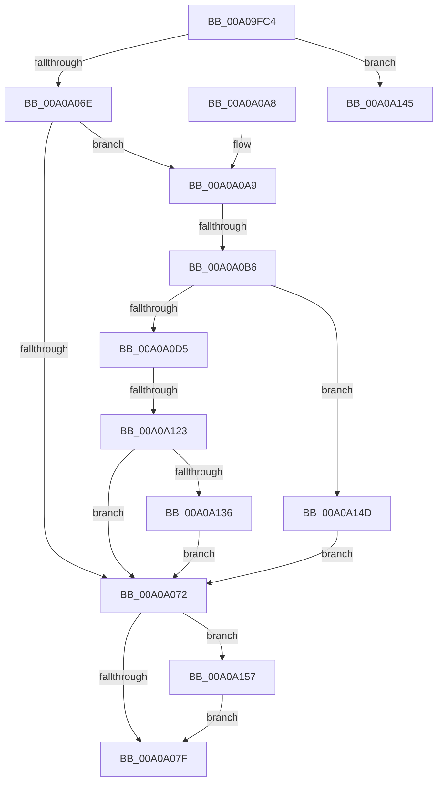

# _CmUpdateDevicePanelInterface

- RVA: `0x00A09FC4`–`0x00A0A163` (길이 `415` bytes)
- VA: `0x0000000140A09FC4`
- 실행 섹션: `PAGE`
- PDB 이름 있음: `예`; PDB Function 태그: `예`
- unwind 정보 RVA: `0x000A88E0`
- 디코드: `109`개 명령, `415/415` bytes 표시
- 미해석 바이트: `0` (있으면 어셈블리에 `.byte`로 보존)

> 이 문서는 커널 이미지의 기계어와 PDB 기호를 분석해 생성했습니다. 4번과 5번은 함수 원형과 자료형을 바이너리 사용 방식에서 추정한 C 해석이며 원본 소스 복구 결과는 아닙니다.

## 1. Dependencies

- 직접 호출 지점: **7**; 고유 호출 대상: **5**
- 직접 호출자로 확인된 함수: **1**
- RIP 상대 이미지 참조: **3**

### Outgoing calls
- `0x00A0A05C` → [CmQueryDevicePanelPldProperty](CmQueryDevicePanelPldProperty_function_00A0AD88.md) (function, `0x00A0AD88`)
- `0x00A0A088` → [_security_check_cookie](../../text/6A/_security_check_cookie_function_006AC640.md) (function, `0x006AC640`)
- `0x00A0A0C8` → [ExAllocatePool2](../../poolcode/B8/ExAllocatePool2_function_00B820F0.md) (function, `0x00B820F0`)
- `0x00A0A114` → [PnpGetObjectProperty](../8E/PnpGetObjectProperty_function_008E2180.md) (function, `0x008E2180`)
- `0x00A0A128` → [ExFreePoolWithTag](../../poolcode/B8/ExFreePoolWithTag_function_00B82870.md) (function, `0x00B82870`)
- `0x00A0A13B` → [ExFreePoolWithTag](../../poolcode/B8/ExFreePoolWithTag_function_00B82870.md) (function, `0x00B82870`)
- `0x00A0A159` → [ExFreePoolWithTag](../../poolcode/B8/ExFreePoolWithTag_function_00B82870.md) (function, `0x00B82870`)

### Direct callers
- [PiPnpRtlSetObjectProperty](../8F/PiPnpRtlSetObjectProperty_function_008F62A0.md) at `0x008F63FB`

### Static image references
- `0x00A09FE0` → RVA `0x00E0A740` (`.data`; read)
- `0x00A0A02F` → RVA `0x00014DB0` (`.rdata`; read)
- `0x00A0A100` → RVA `0x00011490` (`.rdata`; read)

## 2. Other-region calls and transfers

- 다른 실행 섹션으로 향하는 call: **5**
  - `0x00A0A088` → [_security_check_cookie](../../text/6A/_security_check_cookie_function_006AC640.md) (`PAGE` → `.text`)
  - `0x00A0A0C8` → [ExAllocatePool2](../../poolcode/B8/ExAllocatePool2_function_00B820F0.md) (`PAGE` → `POOLCODE`)
  - `0x00A0A128` → [ExFreePoolWithTag](../../poolcode/B8/ExFreePoolWithTag_function_00B82870.md) (`PAGE` → `POOLCODE`)
  - `0x00A0A13B` → [ExFreePoolWithTag](../../poolcode/B8/ExFreePoolWithTag_function_00B82870.md) (`PAGE` → `POOLCODE`)
  - `0x00A0A159` → [ExFreePoolWithTag](../../poolcode/B8/ExFreePoolWithTag_function_00B82870.md) (`PAGE` → `POOLCODE`)
- call이 아닌 외부 분기/꼬리 이동: **3**
  - `0x00A0A0B0` → [sub_00B34C12 + 0x196](../B3/Unknown_function_00B34C12.md) (`tail-transfer`)
  - `0x00A0A11D` → [sub_00B34C12](../B3/Unknown_function_00B34C12.md) (`tail-transfer`)
  - `0x00A0A148` → [sub_00B34C12 + 0x196](../B3/Unknown_function_00B34C12.md) (`tail-transfer`)

## 3. Assembly (complete function range)

```asm
00A09FC4  48 89 5C 24 20                  mov qword ptr [rsp + 0x20], rbx
00A09FC9  55                              push rbp
00A09FCA  56                              push rsi
00A09FCB  57                              push rdi
00A09FCC  41 54                           push r12
00A09FCE  41 55                           push r13
00A09FD0  41 56                           push r14
00A09FD2  41 57                           push r15
00A09FD4  48 8D 6C 24 D9                  lea rbp, [rsp - 0x27]
00A09FD9  48 81 EC A0 00 00 00            sub rsp, 0xa0
00A09FE0  48 8B 05 59 07 40 00            mov rax, qword ptr [rip + 0x400759]
00A09FE7  48 33 C4                        xor rax, rsp
00A09FEA  48 89 45 1F                     mov qword ptr [rbp + 0x1f], rax
00A09FEE  45 33 E4                        xor r12d, r12d
00A09FF1  48 8D 45 F7                     lea rax, [rbp - 9]
00A09FF5  48 89 44 24 40                  mov qword ptr [rsp + 0x40], rax
00A09FFA  4D 8B E8                        mov r13, r8
00A09FFD  48 8D 45 FF                     lea rax, [rbp - 1]
00A0A001  4C 89 65 07                     mov qword ptr [rbp + 7], r12
00A0A005  48 89 44 24 38                  mov qword ptr [rsp + 0x38], rax
00A0A00A  0F 57 C0                        xorps xmm0, xmm0
00A0A00D  48 8D 45 FB                     lea rax, [rbp - 5]
00A0A011  44 89 65 FB                     mov dword ptr [rbp - 5], r12d
00A0A015  48 89 44 24 30                  mov qword ptr [rsp + 0x30], rax
00A0A01A  4D 8B C8                        mov r9, r8
00A0A01D  48 8D 45 07                     lea rax, [rbp + 7]
00A0A021  4C 89 65 FF                     mov qword ptr [rbp - 1], r12
00A0A025  48 89 44 24 28                  mov qword ptr [rsp + 0x28], rax
00A0A02A  45 8D 44 24 03                  lea r8d, [r12 + 3]
00A0A02F  48 8D 05 7A AD 60 FF            lea rax, [rip - 0x9f5286]
00A0A036  44 89 65 F7                     mov dword ptr [rbp - 9], r12d
00A0A03A  48 89 44 24 20                  mov qword ptr [rsp + 0x20], rax
00A0A03F  4C 8B FA                        mov r15, rdx
00A0A042  48 8B F1                        mov rsi, rcx
00A0A045  44 89 65 E7                     mov dword ptr [rbp - 0x19], r12d
00A0A049  0F 11 45 0F                     movups xmmword ptr [rbp + 0xf], xmm0
00A0A04D  44 89 65 EB                     mov dword ptr [rbp - 0x15], r12d
00A0A051  41 8B FC                        mov edi, r12d
00A0A054  44 89 65 F3                     mov dword ptr [rbp - 0xd], r12d
00A0A058  44 89 65 EF                     mov dword ptr [rbp - 0x11], r12d
00A0A05C  E8 27 0D 00 00                  call 0x140a0ad88
00A0A061  8B D8                           mov ebx, eax
00A0A063  3D 25 02 00 C0                  cmp eax, 0xc0000225
00A0A068  0F 84 D7 00 00 00               je 0x140a0a145
00A0A06E  85 C0                           test eax, eax
00A0A070  79 37                           jns 0x140a0a0a9
00A0A072  48 8B 4D 07                     mov rcx, qword ptr [rbp + 7]
00A0A076  48 85 C9                        test rcx, rcx
00A0A079  0F 85 D8 00 00 00               jne 0x140a0a157
00A0A07F  8B C3                           mov eax, ebx
00A0A081  48 8B 4D 1F                     mov rcx, qword ptr [rbp + 0x1f]
00A0A085  48 33 CC                        xor rcx, rsp
00A0A088  E8 B3 25 CA FF                  call 0x1406ac640
00A0A08D  48 8B 9C 24 F8 00 00 00         mov rbx, qword ptr [rsp + 0xf8]
00A0A095  48 81 C4 A0 00 00 00            add rsp, 0xa0
00A0A09C  41 5F                           pop r15
00A0A09E  41 5E                           pop r14
00A0A0A0  41 5D                           pop r13
00A0A0A2  41 5C                           pop r12
00A0A0A4  5F                              pop rdi
00A0A0A5  5E                              pop rsi
00A0A0A6  5D                              pop rbp
00A0A0A7  C3                              ret
00A0A0A8  CC                              int3
00A0A0A9  4C 8B 75 FF                     mov r14, qword ptr [rbp - 1]
00A0A0AD  4D 85 F6                        test r14, r14
00A0A0B0  0F 84 F2 AC 12 00               je 0x140b34da8
00A0A0B6  BB 90 01 00 00                  mov ebx, 0x190
00A0A0BB  41 B8 50 4E 50 52               mov r8d, 0x52504e50
00A0A0C1  8B D3                           mov edx, ebx
00A0A0C3  B9 00 01 00 00                  mov ecx, 0x100
00A0A0C8  E8 23 80 17 00                  call 0x140b820f0
00A0A0CD  4C 8B E0                        mov r12, rax
00A0A0D0  48 85 C0                        test rax, rax
00A0A0D3  74 78                           je 0x140a0a14d
00A0A0D5  21 7C 24 50                     and dword ptr [rsp + 0x50], edi
00A0A0D9  48 8D 45 EF                     lea rax, [rbp - 0x11]
00A0A0DD  48 89 44 24 48                  mov qword ptr [rsp + 0x48], rax
00A0A0E2  4D 8B CD                        mov r9, r13
00A0A0E5  89 5C 24 40                     mov dword ptr [rsp + 0x40], ebx
00A0A0E9  48 8D 45 F3                     lea rax, [rbp - 0xd]
00A0A0ED  4C 89 64 24 38                  mov qword ptr [rsp + 0x38], r12
00A0A0F2  41 B8 03 00 00 00               mov r8d, 3
00A0A0F8  48 89 44 24 30                  mov qword ptr [rsp + 0x30], rax
00A0A0FD  49 8B D7                        mov rdx, r15
00A0A100  48 8D 05 89 73 60 FF            lea rax, [rip - 0x9f8c77]
00A0A107  48 8B CE                        mov rcx, rsi
00A0A10A  48 89 44 24 28                  mov qword ptr [rsp + 0x28], rax
00A0A10F  48 21 7C 24 20                  and qword ptr [rsp + 0x20], rdi
00A0A114  E8 67 80 ED FF                  call 0x1408e2180
00A0A119  8B D8                           mov ebx, eax
00A0A11B  85 C0                           test eax, eax
00A0A11D  0F 89 EF AA 12 00               jns 0x140b34c12
00A0A123  33 D2                           xor edx, edx
00A0A125  49 8B CC                        mov rcx, r12
00A0A128  E8 43 87 17 00                  call 0x140b82870
00A0A12D  48 85 FF                        test rdi, rdi
00A0A130  0F 84 3C FF FF FF               je 0x140a0a072
00A0A136  33 D2                           xor edx, edx
00A0A138  48 8B CF                        mov rcx, rdi
00A0A13B  E8 30 87 17 00                  call 0x140b82870
00A0A140  E9 2D FF FF FF                  jmp 0x140a0a072
00A0A145  41 8B DC                        mov ebx, r12d
00A0A148  E9 5B AC 12 00                  jmp 0x140b34da8
00A0A14D  BB 17 00 00 C0                  mov ebx, 0xc0000017
00A0A152  E9 1B FF FF FF                  jmp 0x140a0a072
00A0A157  33 D2                           xor edx, edx
00A0A159  E8 12 87 17 00                  call 0x140b82870
00A0A15E  E9 1C FF FF FF                  jmp 0x140a0a07f
```

## 4. C-style interpretation (structured pseudocode)

```c
__int64 __fastcall _CmUpdateDevicePanelInterface(__int64 a1, __int64 a2, __int64 a3)
{
    __int64 result;
    __int64 v_r12;
    __int64 v_rsp;
    unsigned __int64 v_stack_m40;
    unsigned __int64 v_stack_m50;
    unsigned __int64 v_stack_m58;
    unsigned __int64 v_stack_m5F;
    unsigned __int64 v_stack_m60;
    unsigned __int64 v_stack_m64;
    unsigned __int64 v_stack_m68;
    unsigned int v_stack_m6C;
    unsigned int v_stack_m70;
    unsigned int v_stack_m74;
    unsigned int v_stack_m78;
    unsigned __int64 v_stack_m98;
    unsigned __int64 v_stack_mA0;
    unsigned __int64 v_stack_mA8;
    unsigned __int64 v_stack_mB0;
    unsigned __int64 v_stack_mB8;
    unsigned __int64 v_stack_p20;
    unsigned __int64 v_stack_p28;
    unsigned __int64 v_stack_p30;
    unsigned __int64 v_stack_p38;
    unsigned int v_stack_p40;
    unsigned __int64 v_stack_p48;
    unsigned int v_stack_p50;

    v_stack_p20 = v_rbx;
    v_rsp = (v_rsp) - (160);
    result = (*(unsigned __int64 *)(v_rip + 4196185)) ^ (v_rsp);
    v_stack_m40 = result;
    v_r12 = 0;
    v_stack_m98 = v_stack_m68;
    v_stack_m58 = 0;
    v_stack_mA0 = v_stack_m60;
    v_stack_m64 = 0;
    v_stack_mA8 = v_stack_m64;
    v_stack_m60 = 0;
    v_stack_mB0 = v_stack_m58;
    v_stack_m68 = 0;
    v_stack_mB8 = v_rip - 10441350;
    v_stack_m78 = 0;
    v_stack_m50 = v_xmm0;
    v_stack_m74 = 0;
    v_stack_m6C = 0;
    v_stack_m70 = 0;
    result = CmQueryDevicePanelPldProperty(a1, a2, v_r12 + 3, a3);
    if (((unsigned int)(result)) == 0xC0000225ULL) goto loc_00A0A145;
    if (!sign_flag) goto loc_00A0A0A9;
loc_00A0A072:
    if (v_stack_m58 != 0) goto loc_00A0A157;
loc_00A0A07F:
    a1 = (v_stack_m40) ^ (v_rsp);
    result = _security_check_cookie(a1, a2, v_r12 + 3, a3);
    v_rsp = (v_rsp) + (160);
    return result;
loc_00A0A0A9:
    result = ExAllocatePool2(256, 400, (unsigned int)(0x52504E50ULL), a3);
    if (result == 0) goto loc_00A0A14D;
    v_stack_p48 = v_stack_m70;
    v_stack_p40 = 400;
    v_stack_p38 = result;
    v_stack_p30 = v_stack_m6C;
    v_stack_p28 = v_rip - 10456183;
    result = PnpGetObjectProperty(a1, a2, 3, a3);
    a2 = 0;
    result = ExFreePoolWithTag(result, a2, 3, a3);
    if (0 == 0) goto loc_00A0A072;
    a2 = 0;
    result = ExFreePoolWithTag(0, a2, 3, a3);
    goto loc_00A0A072;
loc_00A0A145:
loc_00A0A14D:
    goto loc_00A0A072;
loc_00A0A157:
    a2 = 0;
    result = ExFreePoolWithTag(0, a2, 3, a3);
    goto loc_00A0A07F;
}
```

## 5. (Beta) C Style

```c
int64_t _CmUpdateDevicePanelInterface(int64_t Arg1, int64_t Arg2, int64_t Arg3)
{
    int64_t result;
    int64_t local_r12;
    int64_t local_rsp;
    uint64_t v_stack_m40;
    uint64_t v_stack_m50;
    uint64_t v_stack_m58;
    uint64_t v_stack_m5F;
    uint64_t v_stack_m60;
    uint64_t v_stack_m64;
    uint64_t v_stack_m68;
    uint32_t v_stack_m6C;
    uint32_t v_stack_m70;
    uint32_t v_stack_m74;
    uint32_t v_stack_m78;
    uint64_t v_stack_m98;
    uint64_t v_stack_mA0;
    uint64_t v_stack_mA8;
    uint64_t v_stack_mB0;
    uint64_t v_stack_mB8;
    uint64_t v_stack_p20;
    uint64_t v_stack_p28;
    uint64_t v_stack_p30;
    uint64_t v_stack_p38;
    uint32_t v_stack_p40;
    uint64_t v_stack_p48;
    uint32_t v_stack_p50;

    v_stack_p20 = local_rbx;
    local_rsp = (local_rsp) - (160);
    result = (*(uint64_t *)(v_rip + 0x400759)) ^ (local_rsp);
    v_stack_m40 = result;
    local_r12 = 0;
    v_stack_m98 = v_stack_m68;
    v_stack_m58 = 0;
    v_stack_mA0 = v_stack_m60;
    v_stack_m64 = 0;
    v_stack_mA8 = v_stack_m64;
    v_stack_m60 = 0;
    v_stack_mB0 = v_stack_m58;
    v_stack_m68 = 0;
    v_stack_mB8 = v_rip - 10441350;
    v_stack_m78 = 0;
    v_stack_m50 = v_xmm0;
    v_stack_m74 = 0;
    v_stack_m6C = 0;
    v_stack_m70 = 0;
    result = CmQueryDevicePanelPldProperty(Arg1, Arg2, local_r12 + 3, Arg3);
    if (((uint32_t)(result)) == 0xC0000225ULL) goto loc_00A0A145;
    if (!sign_flag) goto loc_00A0A0A9;
loc_00A0A072:
    if (v_stack_m58 != 0) goto loc_00A0A157;
loc_00A0A07F:
    Arg1 = (v_stack_m40) ^ (local_rsp);
    result = _security_check_cookie(Arg1, Arg2, local_r12 + 3, Arg3);
    local_rsp = (local_rsp) + (160);
    return result;
loc_00A0A0A9:
    result = ExAllocatePool2(256, 400, (uint32_t)(0x52504E50ULL), Arg3);
    if (result == 0) goto loc_00A0A14D;
    v_stack_p48 = v_stack_m70;
    v_stack_p40 = 400;
    v_stack_p38 = result;
    v_stack_p30 = v_stack_m6C;
    v_stack_p28 = v_rip - 10456183;
    result = PnpGetObjectProperty(Arg1, Arg2, 3, Arg3);
    Arg2 = 0;
    result = ExFreePoolWithTag(result, Arg2, 3, Arg3);
    if (0 == 0) goto loc_00A0A072;
    Arg2 = 0;
    result = ExFreePoolWithTag(0, Arg2, 3, Arg3);
    goto loc_00A0A072;
loc_00A0A145:
loc_00A0A14D:
    goto loc_00A0A072;
loc_00A0A157:
    Arg2 = 0;
    result = ExFreePoolWithTag(0, Arg2, 3, Arg3);
    goto loc_00A0A07F;
}
```

## 6. Execution-region graph

[열기: 2D/3D 그래프와 함수 탐색 컨트롤 패널](../../../control-panel.html?section=page&rva=0x00A09FC4&view=graph)

- 2D 그래프는 위에서 아래로 흐르고, 3D 그래프는 빈 공간을 드래그해 회전합니다. Shift+드래그는 이동, 휠은 확대·축소, 함수 노드 선택은 대상 보고서 이동입니다.

### Static fallback


