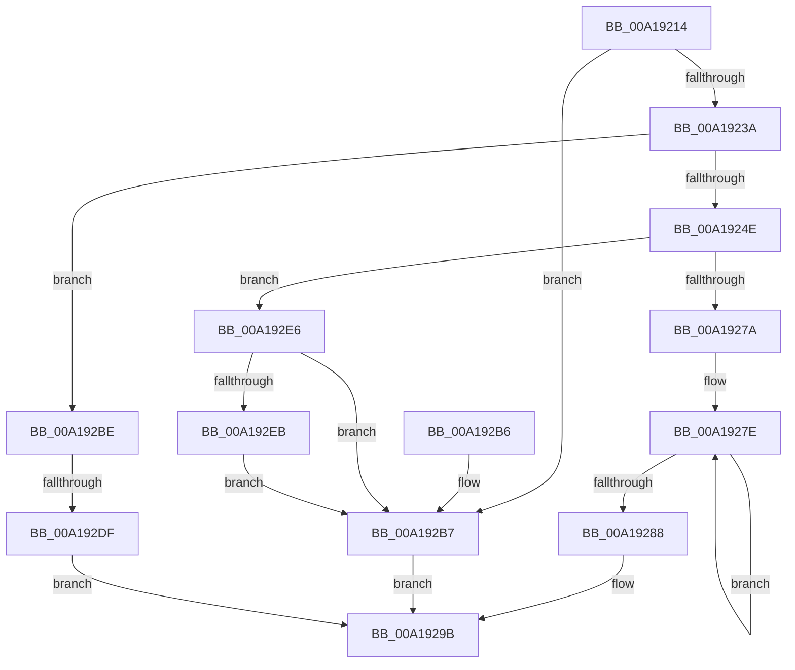

# AdtpBuildMessageString

- RVA: `0x00A19214`–`0x00A192FA` (길이 `230` bytes)
- VA: `0x0000000140A19214`
- 실행 섹션: `PAGE`
- PDB 이름 있음: `예`; PDB Function 태그: `예`
- unwind 정보 RVA: `0x0009A1E4`
- 디코드: `64`개 명령, `230/230` bytes 표시
- 미해석 바이트: `0` (있으면 어셈블리에 `.byte`로 보존)

> 이 문서는 커널 이미지의 기계어와 PDB 기호를 분석해 생성했습니다. 4번과 5번은 함수 원형과 자료형을 바이너리 사용 방식에서 추정한 C 해석이며 원본 소스 복구 결과는 아닙니다.

## 1. Dependencies

- 직접 호출 지점: **3**; 고유 호출 대상: **3**
- 직접 호출자로 확인된 함수: **1**
- RIP 상대 이미지 참조: **1**

### Outgoing calls
- `0x00A19271` → [StringCchPrintfW](../../text/47/StringCchPrintfW_function_0047BAD0.md) (function, `0x0047BAD0`)
- `0x00A192CE` → [ExAllocatePool2](../../poolcode/B8/ExAllocatePool2_function_00B820F0.md) (function, `0x00B820F0`)
- `0x00A192F0` → [ExFreePoolWithTag](../../poolcode/B8/ExFreePoolWithTag_function_00B82870.md) (function, `0x00B82870`)

### Direct callers
- [AdtpPackageParameters](../../text/45/AdtpPackageParameters_function_00459964.md) at `0x00459A73`

### Static image references
- `0x00A1925D` → RVA `0x00019A00` (`.rdata`; read)

## 2. Other-region calls and transfers

- 다른 실행 섹션으로 향하는 call: **3**
  - `0x00A19271` → [StringCchPrintfW](../../text/47/StringCchPrintfW_function_0047BAD0.md) (`PAGE` → `.text`)
  - `0x00A192CE` → [ExAllocatePool2](../../poolcode/B8/ExAllocatePool2_function_00B820F0.md) (`PAGE` → `POOLCODE`)
  - `0x00A192F0` → [ExFreePoolWithTag](../../poolcode/B8/ExFreePoolWithTag_function_00B82870.md) (`PAGE` → `POOLCODE`)
- call이 아닌 외부 분기/꼬리 이동: **1**
  - `0x00A192D9` → [sub_00B372CC](../B3/Unknown_function_00B372CC.md) (`tail-transfer`)

## 3. Assembly (complete function range)

```asm
00A19214  48 8B C4                        mov rax, rsp
00A19217  48 89 58 08                     mov qword ptr [rax + 8], rbx
00A1921B  48 89 68 10                     mov qword ptr [rax + 0x10], rbp
00A1921F  48 89 70 18                     mov qword ptr [rax + 0x18], rsi
00A19223  48 89 78 20                     mov qword ptr [rax + 0x20], rdi
00A19227  41 56                           push r14
00A19229  48 83 EC 20                     sub rsp, 0x20
00A1922D  45 33 F6                        xor r14d, r14d
00A19230  49 8B F8                        mov rdi, r8
00A19233  8B E9                           mov ebp, ecx
00A19235  4D 85 C0                        test r8, r8
00A19238  74 7D                           je 0x140a192b7
00A1923A  48 8B 54 24 50                  mov rdx, qword ptr [rsp + 0x50]
00A1923F  8B 02                           mov eax, dword ptr [rdx]
00A19241  44 8D 40 0D                     lea r8d, [rax + 0xd]
00A19245  41 81 F8 00 04 00 00            cmp r8d, 0x400
00A1924C  73 70                           jae 0x140a192be
00A1924E  49 8D 1C 41                     lea rbx, [r9 + rax*2]
00A19252  44 89 02                        mov dword ptr [rdx], r8d
00A19255  41 8A C6                        mov al, r14b
00A19258  48 8B 74 24 58                  mov rsi, qword ptr [rsp + 0x58]
00A1925D  4C 8D 05 9C 07 60 FF            lea r8, [rip - 0x9ff864]
00A19264  44 8B CD                        mov r9d, ebp
00A19267  BA 0D 00 00 00                  mov edx, 0xd
00A1926C  48 8B CB                        mov rcx, rbx
00A1926F  88 06                           mov byte ptr [rsi], al
00A19271  E8 5A 28 A6 FF                  call 0x14047bad0
00A19276  85 C0                           test eax, eax
00A19278  78 6C                           js 0x140a192e6
00A1927A  48 83 C8 FF                     or rax, 0xffffffffffffffff
00A1927E  48 FF C0                        inc rax
00A19281  66 44 39 34 43                  cmp word ptr [rbx + rax*2], r14w
00A19286  75 F6                           jne 0x140a1927e
00A19288  8D 04 45 02 00 00 00            lea eax, [rax*2 + 2]
00A1928F  48 89 1F                        mov qword ptr [rdi], rbx
00A19292  89 47 08                        mov dword ptr [rdi + 8], eax
00A19295  33 C0                           xor eax, eax
00A19297  44 89 77 0C                     mov dword ptr [rdi + 0xc], r14d
00A1929B  48 8B 5C 24 30                  mov rbx, qword ptr [rsp + 0x30]
00A192A0  48 8B 6C 24 38                  mov rbp, qword ptr [rsp + 0x38]
00A192A5  48 8B 74 24 40                  mov rsi, qword ptr [rsp + 0x40]
00A192AA  48 8B 7C 24 48                  mov rdi, qword ptr [rsp + 0x48]
00A192AF  48 83 C4 20                     add rsp, 0x20
00A192B3  41 5E                           pop r14
00A192B5  C3                              ret
00A192B6  CC                              int3
00A192B7  B8 0D 00 00 C0                  mov eax, 0xc000000d
00A192BC  EB DD                           jmp 0x140a1929b
00A192BE  BA 1A 00 00 00                  mov edx, 0x1a
00A192C3  B9 00 01 00 00                  mov ecx, 0x100
00A192C8  41 B8 53 65 41 6B               mov r8d, 0x6b416553
00A192CE  E8 1D 8E 16 00                  call 0x140b820f0
00A192D3  48 8B D8                        mov rbx, rax
00A192D6  48 85 C0                        test rax, rax
00A192D9  0F 85 ED DF 11 00               jne 0x140b372cc
00A192DF  B8 17 00 00 C0                  mov eax, 0xc0000017
00A192E4  EB B5                           jmp 0x140a1929b
00A192E6  80 3E 01                        cmp byte ptr [rsi], 1
00A192E9  75 CC                           jne 0x140a192b7
00A192EB  33 D2                           xor edx, edx
00A192ED  48 8B CB                        mov rcx, rbx
00A192F0  E8 7B 95 16 00                  call 0x140b82870
00A192F5  44 88 36                        mov byte ptr [rsi], r14b
00A192F8  EB BD                           jmp 0x140a192b7
```

## 4. C-style interpretation (structured pseudocode)

```c
__int64 __fastcall AdtpBuildMessageString(int a1, __int64 a2, __int64 a3, __int64 a4, __int64 a5, __int64 a6)
{
    __int64 result;
    __int64 v_r14;
    __int64 v_rsp;
    unsigned __int64 v_stack_p10;
    unsigned __int64 v_stack_p18;
    unsigned __int64 v_stack_p20;
    unsigned __int64 v_stack_p8;

    *(unsigned __int64 *)(v_rsp + 8) = v_rbx;
    *(unsigned __int64 *)(v_rsp + 16) = v_rbp;
    *(unsigned __int64 *)(v_rsp + 24) = v_rsi;
    *(unsigned __int64 *)(v_rsp + 32) = v_rdi;
    v_rsp = (v_rsp) - (32);
    v_r14 = 0;
    if (a3 == 0) goto loc_00A192B7;
    if (((unsigned int)((unsigned int)(*(unsigned int *)(a5)) + 13)) >= 0x400ULL) goto loc_00A192BE;
    *(unsigned int *)(a5) = (unsigned int)((unsigned int)(*(unsigned int *)(a5)) + 13);
    *(unsigned __int8 *)(a6) = 0;
    result = StringCchPrintfW(a4 + (unsigned int)(*(unsigned int *)(a5)) * 2, 13, v_rip - 10483812, (unsigned int)((unsigned int)((unsigned int)(a1))));
    if (sign_flag) goto loc_00A192E6;
    result = (result) | (-1);
loc_00A1927E:
    result = (result) + 1;
    if ((*(unsigned __int16 *)(a4 + (unsigned int)(*(unsigned int *)(a5)) * 2 + result * 2)) != 0) goto loc_00A1927E;
    *(unsigned __int64 *)(a3) = a4 + (unsigned int)(*(unsigned int *)(a5)) * 2;
    *(unsigned int *)(a3 + 8) = (unsigned int)(result * 2 + 2);
    result = 0;
    *(unsigned int *)(a3 + 12) = 0;
loc_00A1929B:
    v_rsp = (v_rsp) + (32);
    return result;
loc_00A192B7:
    goto loc_00A1929B;
loc_00A192BE:
    result = ExAllocatePool2(256, 26, (unsigned int)(0x6B416553ULL), (unsigned int)((unsigned int)((unsigned int)(a1))));
    goto loc_00A1929B;
loc_00A192E6:
    if ((*(unsigned __int8 *)(v_stack_p18)) != 1) goto loc_00A192B7;
    a2 = 0;
    result = ExFreePoolWithTag(result, a2, (unsigned int)(0x6B416553ULL), (unsigned int)((unsigned int)((unsigned int)(a1))));
    *(unsigned __int8 *)(v_stack_p18) = 0;
    goto loc_00A192B7;
}
```

## 5. (Beta) C Style

```c
int64_t AdtpBuildMessageString(int32_t Arg1, int64_t Arg2, void *Arg3, void *Arg4, void *Arg5, void *Arg6)
{
    uint8_t *arg3 = (uint8_t *)Arg3;
    uint8_t *arg4 = (uint8_t *)Arg4;
    uint8_t *arg5 = (uint8_t *)Arg5;
    uint8_t *arg6 = (uint8_t *)Arg6;

    int64_t result;
    int64_t local_r14;
    int64_t local_rsp;
    uint64_t v_stack_p10;
    uint64_t v_stack_p18;
    uint64_t v_stack_p20;
    uint64_t v_stack_p8;

    *(uint64_t *)(local_rsp + 0x8) = local_rbx;
    *(uint64_t *)(local_rsp + 0x10) = local_rbp;
    *(uint64_t *)(local_rsp + 0x18) = local_rsi;
    *(uint64_t *)(local_rsp + 0x20) = local_rdi;
    local_rsp = (local_rsp) - (32);
    local_r14 = 0;
    if (Arg3 == NULL) goto loc_00A192B7;
    if (((uint32_t)((uint32_t)(*(uint32_t *)(arg5)) + 13)) >= 0x400ULL) goto loc_00A192BE;
    *(uint32_t *)(arg5) = (uint32_t)((uint32_t)(*(uint32_t *)(arg5)) + 13);
    *(uint8_t *)(arg6) = 0;
    result = StringCchPrintfW(Arg4 + (uint32_t)(*(uint32_t *)(arg5)) * 2, 13, v_rip - 10483812, (uint32_t)((uint32_t)((uint32_t)(Arg1))));
    if (sign_flag) goto loc_00A192E6;
    result = (result) | (-1);
loc_00A1927E:
    result = (result) + 1;
    if ((*(uint16_t *)(arg4 + (uint32_t)(*(uint32_t *)(arg5)) * 2 + result * 2)) != 0) goto loc_00A1927E;
    *(void **)(arg3) = Arg4 + (uint32_t)(*(uint32_t *)(arg5)) * 2;
    *(uint32_t *)(arg3 + 0x8) = (uint32_t)(result * 2 + 2);
    result = 0;
    *(uint32_t *)(arg3 + 0xC) = 0;
loc_00A1929B:
    local_rsp = (local_rsp) + (32);
    return result;
loc_00A192B7:
    goto loc_00A1929B;
loc_00A192BE:
    result = ExAllocatePool2(256, 26, (uint32_t)(0x6B416553ULL), (uint32_t)((uint32_t)((uint32_t)(Arg1))));
    goto loc_00A1929B;
loc_00A192E6:
    if ((*(uint8_t *)(v_stack_p18)) != 1) goto loc_00A192B7;
    Arg2 = 0;
    result = ExFreePoolWithTag(result, Arg2, (uint32_t)(0x6B416553ULL), (uint32_t)((uint32_t)((uint32_t)(Arg1))));
    *(uint8_t *)(v_stack_p18) = 0;
    goto loc_00A192B7;
}
```

### 관측된 메모리 오프셋

구조체 형식이 확인되지 않은 접근은 인자 기준의 오프셋으로만 기록했습니다.

| 기준 인자 | 오프셋 표현 | 폭 (bit) | 접근 |
|---|---:|---:|---|
| `Arg3` | `+ 0x0` | `64` | `W` |
| `Arg3` | `+ 0x8` | `32` | `W` |
| `Arg3` | `+ 0xC` | `32` | `W` |
| `Arg4` | `+ 0x0 + rax*2` | `16` | `R` |
| `Arg4` | `+ 0x0 + rax*2` | `64` | `R` |
| `Arg5` | `+ 0x0` | `32` | `R` |
| `Arg5` | `+ 0x0` | `32` | `W` |
| `Arg6` | `+ 0x0` | `8` | `R` |
| `Arg6` | `+ 0x0` | `8` | `W` |

## 6. Execution-region graph

[열기: 2D/3D 그래프와 함수 탐색 컨트롤 패널](../../../control-panel.html?section=page&rva=0x00A19214&view=graph)

- 2D 그래프는 위에서 아래로 흐르고, 3D 그래프는 빈 공간을 드래그해 회전합니다. Shift+드래그는 이동, 휠은 확대·축소, 함수 노드 선택은 대상 보고서 이동입니다.

### Static fallback


