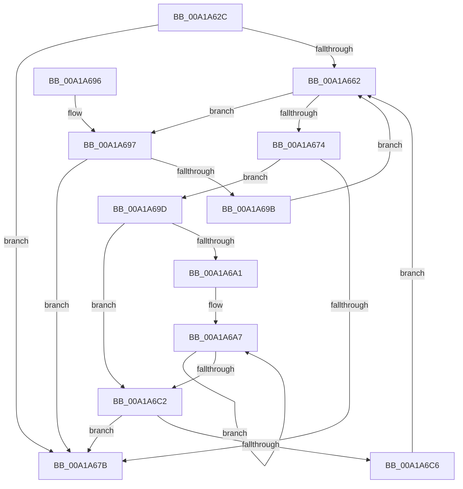

# AlpcpAdjustCompletionListConcurrencyCount

- RVA: `0x00A1A62C`–`0x00A1A6C8` (길이 `156` bytes)
- VA: `0x0000000140A1A62C`
- 실행 섹션: `PAGE`
- PDB 이름 있음: `예`; PDB Function 태그: `아니요`
- unwind 정보 RVA: `0x000AA494`
- 디코드: `48`개 명령, `156/156` bytes 표시
- 미해석 바이트: `0` (있으면 어셈블리에 `.byte`로 보존)

> 이 문서는 커널 이미지의 기계어와 PDB 기호를 분석해 생성했습니다. 4번과 5번은 함수 원형과 자료형을 바이너리 사용 방식에서 추정한 C 해석이며 원본 소스 복구 결과는 아닙니다.

## 1. Dependencies

- 직접 호출 지점: **1**; 고유 호출 대상: **1**
- 직접 호출자로 확인된 함수: **1**
- RIP 상대 이미지 참조: **0**

### Outgoing calls
- `0x00A1A6B7` → [AlpcpQueueIoCompletionPort](../../text/3F/AlpcpQueueIoCompletionPort_function_003FF760.md) (function, `0x003FF760`)

### Direct callers
- [NtAlpcSetInformation](NtAlpcSetInformation_function_00A19DC0.md) at `0x00A19FCE`

### Static image references
- 디코드된 RIP-relative 메모리 참조가 없습니다.

## 2. Other-region calls and transfers

- 다른 실행 섹션으로 향하는 call: **1**
  - `0x00A1A6B7` → [AlpcpQueueIoCompletionPort](../../text/3F/AlpcpQueueIoCompletionPort_function_003FF760.md) (`PAGE` → `.text`)
- 별도 외부 분기/꼬리 이동을 확인하지 못했습니다.

## 3. Assembly (complete function range)

```asm
00A1A62C  48 8B C4                        mov rax, rsp
00A1A62F  48 89 58 08                     mov qword ptr [rax + 8], rbx
00A1A633  48 89 68 10                     mov qword ptr [rax + 0x10], rbp
00A1A637  48 89 70 18                     mov qword ptr [rax + 0x18], rsi
00A1A63B  48 89 78 20                     mov qword ptr [rax + 0x20], rdi
00A1A63F  41 56                           push r14
00A1A641  48 83 EC 30                     sub rsp, 0x30
00A1A645  48 8B B1 68 01 00 00            mov rsi, qword ptr [rcx + 0x168]
00A1A64C  8B DA                           mov ebx, edx
00A1A64E  48 8B E9                        mov rbp, rcx
00A1A651  0F 0D 8E 90 00 00 00            prefetchw byte ptr [rsi + 0x90]
00A1A658  8B BE 90 00 00 00               mov edi, dword ptr [rsi + 0x90]
00A1A65E  3B FA                           cmp edi, edx
00A1A660  74 19                           je 0x140a1a67b
00A1A662  8B CF                           mov ecx, edi
00A1A664  8B C7                           mov eax, edi
00A1A666  F0 0F B1 9E 90 00 00 00         lock cmpxchg dword ptr [rsi + 0x90], ebx
00A1A66E  8B F8                           mov edi, eax
00A1A670  3B C1                           cmp eax, ecx
00A1A672  75 23                           jne 0x140a1a697
00A1A674  48 83 7D 20 00                  cmp qword ptr [rbp + 0x20], 0
00A1A679  75 22                           jne 0x140a1a69d
00A1A67B  48 8B 5C 24 40                  mov rbx, qword ptr [rsp + 0x40]
00A1A680  48 8B 6C 24 48                  mov rbp, qword ptr [rsp + 0x48]
00A1A685  48 8B 74 24 50                  mov rsi, qword ptr [rsp + 0x50]
00A1A68A  48 8B 7C 24 58                  mov rdi, qword ptr [rsp + 0x58]
00A1A68F  48 83 C4 30                     add rsp, 0x30
00A1A693  41 5E                           pop r14
00A1A695  C3                              ret
00A1A696  CC                              int3
00A1A697  3B FB                           cmp edi, ebx
00A1A699  73 E0                           jae 0x140a1a67b
00A1A69B  EB C5                           jmp 0x140a1a662
00A1A69D  3B CB                           cmp ecx, ebx
00A1A69F  73 21                           jae 0x140a1a6c2
00A1A6A1  44 8B F3                        mov r14d, ebx
00A1A6A4  44 2B F1                        sub r14d, ecx
00A1A6A7  83 64 24 20 00                  and dword ptr [rsp + 0x20], 0
00A1A6AC  45 33 C9                        xor r9d, r9d
00A1A6AF  45 33 C0                        xor r8d, r8d
00A1A6B2  B2 01                           mov dl, 1
00A1A6B4  48 8B CD                        mov rcx, rbp
00A1A6B7  E8 A4 50 9E FF                  call 0x1403ff760
00A1A6BC  49 83 EE 01                     sub r14, 1
00A1A6C0  75 E5                           jne 0x140a1a6a7
00A1A6C2  3B FB                           cmp edi, ebx
00A1A6C4  74 B5                           je 0x140a1a67b
00A1A6C6  EB 9A                           jmp 0x140a1a662
```

## 4. C-style interpretation (structured pseudocode)

```c
__int64 __fastcall AlpcpAdjustCompletionListConcurrencyCount(__int64 a1, int a2, int a3, int a4)
{
    __int64 result;
    __int64 v_r14;
    __int64 v_rsp;
    unsigned __int64 v_stack_p10;
    unsigned __int64 v_stack_p18;
    unsigned __int64 v_stack_p20;
    unsigned __int64 v_stack_p8;

    *(unsigned __int64 *)(v_rsp + 8) = v_rbx;
    *(unsigned __int64 *)(v_rsp + 16) = v_rbp;
    *(unsigned __int64 *)(v_rsp + 24) = v_rsi;
    *(unsigned __int64 *)(v_rsp + 32) = v_rdi;
    v_rsp = (v_rsp) - (48);
    if (((unsigned int)((unsigned int)(*(unsigned int *)(*(unsigned __int64 *)(a1 + 360) + 144)))) == a2) goto loc_00A1A67B;
loc_00A1A662:
    if (((unsigned int)((unsigned int)((unsigned int)((unsigned int)(*(unsigned int *)(*(unsigned __int64 *)(a1 + 360) + 144)))))) != ((unsigned int)((unsigned int)((unsigned int)((unsigned int)(*(unsigned int *)(*(unsigned __int64 *)(a1 + 360) + 144))))))) goto loc_00A1A697;
    if ((*(unsigned __int64 *)(a1 + 32)) != 0) goto loc_00A1A69D;
loc_00A1A67B:
    v_rsp = (v_rsp) + (48);
    return (unsigned int)((unsigned int)((unsigned int)(*(unsigned int *)(*(unsigned __int64 *)(a1 + 360) + 144))));
loc_00A1A697:
    if (((unsigned int)(v_stack_p20)) >= ((unsigned int)(v_stack_p8))) goto loc_00A1A67B;
    goto loc_00A1A662;
loc_00A1A69D:
    if (((unsigned int)((unsigned int)((unsigned int)((unsigned int)(*(unsigned int *)(*(unsigned __int64 *)(a1 + 360) + 144)))))) >= ((unsigned int)(v_stack_p8))) goto loc_00A1A6C2;
    v_r14 = (unsigned int)(((unsigned int)((unsigned int)(v_stack_p8))) - ((unsigned int)((unsigned int)((unsigned int)((unsigned int)(*(unsigned int *)(*(unsigned __int64 *)(a1 + 360) + 144)))))));
loc_00A1A6A7:
    a4 = 0;
    a3 = 0;
    result = AlpcpQueueIoCompletionPort(v_stack_p10, 1, a3, a4);
    v_r14 = (v_r14) - (1);
    if (condition_is_not_equal) goto loc_00A1A6A7;
loc_00A1A6C2:
    if (((unsigned int)(v_stack_p20)) == ((unsigned int)(v_stack_p8))) goto loc_00A1A67B;
    goto loc_00A1A662;
}
```

## 5. (Beta) C Style

```c
int64_t AlpcpAdjustCompletionListConcurrencyCount(void *Arg1, int32_t Arg2, int32_t Arg3, int32_t Arg4)
{
    uint8_t *arg1 = (uint8_t *)Arg1;

    int64_t result;
    int64_t local_r14;
    int64_t local_rsp;
    uint64_t v_stack_p10;
    uint64_t v_stack_p18;
    uint64_t v_stack_p20;
    uint64_t v_stack_p8;

    *(uint64_t *)(local_rsp + 0x8) = local_rbx;
    *(uint64_t *)(local_rsp + 0x10) = local_rbp;
    *(uint64_t *)(local_rsp + 0x18) = local_rsi;
    *(uint64_t *)(local_rsp + 0x20) = local_rdi;
    local_rsp = (local_rsp) - (48);
    if (((uint32_t)((uint32_t)(*(uint32_t *)(*(uint64_t *)(arg1 + 0x168) + 0x90)))) == Arg2) goto loc_00A1A67B;
loc_00A1A662:
    if (((uint32_t)((uint32_t)((uint32_t)((uint32_t)(*(uint32_t *)(*(uint64_t *)(arg1 + 0x168) + 0x90)))))) != ((uint32_t)((uint32_t)((uint32_t)((uint32_t)(*(uint32_t *)(*(uint64_t *)(arg1 + 0x168) + 0x90))))))) goto loc_00A1A697;
    if ((*(uint64_t *)(arg1 + 0x20)) != 0) goto loc_00A1A69D;
loc_00A1A67B:
    local_rsp = (local_rsp) + (48);
    return (uint32_t)((uint32_t)((uint32_t)(*(uint32_t *)(*(uint64_t *)(arg1 + 0x168) + 0x90))));
loc_00A1A697:
    if (((uint32_t)(v_stack_p20)) >= ((uint32_t)(v_stack_p8))) goto loc_00A1A67B;
    goto loc_00A1A662;
loc_00A1A69D:
    if (((uint32_t)((uint32_t)((uint32_t)((uint32_t)(*(uint32_t *)(*(uint64_t *)(arg1 + 0x168) + 0x90)))))) >= ((uint32_t)(v_stack_p8))) goto loc_00A1A6C2;
    local_r14 = (uint32_t)(((uint32_t)((uint32_t)(v_stack_p8))) - ((uint32_t)((uint32_t)((uint32_t)((uint32_t)(*(uint32_t *)(*(uint64_t *)(arg1 + 0x168) + 0x90)))))));
loc_00A1A6A7:
    Arg4 = 0;
    Arg3 = 0;
    result = AlpcpQueueIoCompletionPort(v_stack_p10, 1, Arg3, Arg4);
    local_r14 = (local_r14) - (1);
    if (condition_is_not_equal) goto loc_00A1A6A7;
loc_00A1A6C2:
    if (((uint32_t)(v_stack_p20)) == ((uint32_t)(v_stack_p8))) goto loc_00A1A67B;
    goto loc_00A1A662;
}
```

### 관측된 메모리 오프셋

구조체 형식이 확인되지 않은 접근은 인자 기준의 오프셋으로만 기록했습니다.

| 기준 인자 | 오프셋 표현 | 폭 (bit) | 접근 |
|---|---:|---:|---|
| `Arg1` | `+ 0x20` | `64` | `R` |
| `Arg1` | `+ 0x168` | `64` | `R` |

## 6. Execution-region graph

[열기: 2D/3D 그래프와 함수 탐색 컨트롤 패널](../../../control-panel.html?section=page&rva=0x00A1A62C&view=graph)

- 2D 그래프는 위에서 아래로 흐르고, 3D 그래프는 빈 공간을 드래그해 회전합니다. Shift+드래그는 이동, 휠은 확대·축소, 함수 노드 선택은 대상 보고서 이동입니다.

### Static fallback


