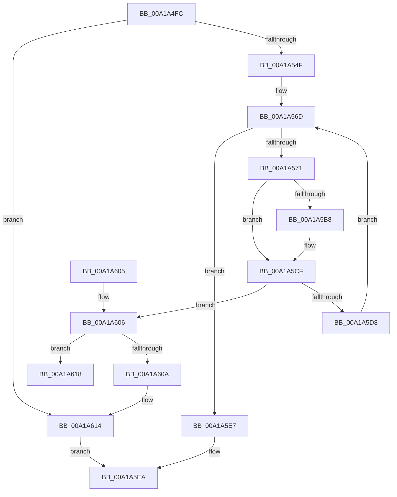

# AlpcpAllocateCompletionPacketLookaside

- RVA: `0x00A1A4FC`–`0x00A1A625` (길이 `297` bytes)
- VA: `0x0000000140A1A4FC`
- 실행 섹션: `PAGE`
- PDB 이름 있음: `예`; PDB Function 태그: `예`
- unwind 정보 RVA: `0x000AA468`
- 디코드: `79`개 명령, `297/297` bytes 표시
- 미해석 바이트: `0` (있으면 어셈블리에 `.byte`로 보존)

> 이 문서는 커널 이미지의 기계어와 PDB 기호를 분석해 생성했습니다. 4번과 5번은 함수 원형과 자료형을 바이너리 사용 방식에서 추정한 C 해석이며 원본 소스 복구 결과는 아닙니다.

## 1. Dependencies

- 직접 호출 지점: **4**; 고유 호출 대상: **4**
- 직접 호출자로 확인된 함수: **2**
- RIP 상대 이미지 참조: **1**

### Outgoing calls
- `0x00A1A53E` → [ExAllocatePool2](../../poolcode/B8/ExAllocatePool2_function_00B820F0.md) (function, `0x00B820F0`)
- `0x00A1A557` → [memset](../../text/6C/memset_function_006C6C40.md) (function, `0x006C6C40`)
- `0x00A1A5AE` → [ExAllocatePool3](../../poolcode/B8/ExAllocatePool3_function_00B84270.md) (function, `0x00B84270`)
- `0x00A1A60F` → [ExFreePoolWithTag](../../poolcode/B8/ExFreePoolWithTag_function_00B82870.md) (function, `0x00B82870`)

### Direct callers
- [AlpcpAssociateIoCompletionPort](AlpcpAssociateIoCompletionPort_function_00A1A28C.md) at `0x00A1A386`
- [AlpcpInitializeCompletionList](AlpcpInitializeCompletionList_function_00A1A6D0.md) at `0x00A1AACA`

### Static image references
- `0x00A1A5B8` → RVA `0x00419D50` (`AlpcpLookasidePacketCallbackRoutine`; read)

## 2. Other-region calls and transfers

- 다른 실행 섹션으로 향하는 call: **4**
  - `0x00A1A53E` → [ExAllocatePool2](../../poolcode/B8/ExAllocatePool2_function_00B820F0.md) (`PAGE` → `POOLCODE`)
  - `0x00A1A557` → [memset](../../text/6C/memset_function_006C6C40.md) (`PAGE` → `.text`)
  - `0x00A1A5AE` → [ExAllocatePool3](../../poolcode/B8/ExAllocatePool3_function_00B84270.md) (`PAGE` → `POOLCODE`)
  - `0x00A1A60F` → [ExFreePoolWithTag](../../poolcode/B8/ExFreePoolWithTag_function_00B82870.md) (`PAGE` → `POOLCODE`)
- call이 아닌 외부 분기/꼬리 이동: **1**
  - `0x00A1A620` → [sub_00B3731E](../B3/Unknown_function_00B3731E.md) (`tail-transfer`)

## 3. Assembly (complete function range)

```asm
00A1A4FC  48 8B C4                        mov rax, rsp
00A1A4FF  48 89 58 08                     mov qword ptr [rax + 8], rbx
00A1A503  48 89 68 10                     mov qword ptr [rax + 0x10], rbp
00A1A507  48 89 70 18                     mov qword ptr [rax + 0x18], rsi
00A1A50B  48 89 78 20                     mov qword ptr [rax + 0x20], rdi
00A1A50F  41 56                           push r14
00A1A511  48 83 EC 40                     sub rsp, 0x40
00A1A515  8B E9                           mov ebp, ecx
00A1A517  49 8B F0                        mov rsi, r8
00A1A51A  4C 8B F2                        mov r14, rdx
00A1A51D  41 B8 41 6C 49 6E               mov r8d, 0x6e496c41
00A1A523  B9 40 00 00 00                  mov ecx, 0x40
00A1A528  4C 8D 0C 6D 00 00 00 00         lea r9, [rbp*2]
00A1A530  4C 03 CD                        add r9, rbp
00A1A533  4A 8D 3C CD 38 00 00 00         lea rdi, [r9*8 + 0x38]
00A1A53B  48 8B D7                        mov rdx, rdi
00A1A53E  E8 AD 7B 16 00                  call 0x140b820f0
00A1A543  48 8B D8                        mov rbx, rax
00A1A546  48 85 C0                        test rax, rax
00A1A549  0F 84 C5 00 00 00               je 0x140a1a614
00A1A54F  4C 8B C7                        mov r8, rdi
00A1A552  33 D2                           xor edx, edx
00A1A554  48 8B C8                        mov rcx, rax
00A1A557  E8 E4 C6 CA FF                  call 0x1406c6c40
00A1A55C  48 83 23 00                     and qword ptr [rbx], 0
00A1A560  33 FF                           xor edi, edi
00A1A562  89 6B 08                        mov dword ptr [rbx + 8], ebp
00A1A565  4C 89 73 28                     mov qword ptr [rbx + 0x28], r14
00A1A569  48 89 73 30                     mov qword ptr [rbx + 0x30], rsi
00A1A56D  3B FD                           cmp edi, ebp
00A1A56F  73 76                           jae 0x140a1a5e7
00A1A571  BA 50 00 00 00                  mov edx, 0x50
00A1A576  C7 44 24 20 01 00 00 00         mov dword ptr [rsp + 0x20], 1
00A1A57E  0F 57 C0                        xorps xmm0, xmm0
00A1A581  4C 8D 34 7F                     lea r14, [rdi + rdi*2]
00A1A585  0F 11 44 24 30                  movups xmmword ptr [rsp + 0x30], xmm0
00A1A58A  83 64 24 38 00                  and dword ptr [rsp + 0x38], 0
00A1A58F  48 8D 73 38                     lea rsi, [rbx + 0x38]
00A1A593  4A 8D 34 F6                     lea rsi, [rsi + r14*8]
00A1A597  C6 44 24 30 01                  mov byte ptr [rsp + 0x30], 1
00A1A59C  8D 4A F0                        lea ecx, [rdx - 0x10]
00A1A59F  48 89 5E 10                     mov qword ptr [rsi + 0x10], rbx
00A1A5A3  4C 8D 4C 24 30                  lea r9, [rsp + 0x30]
00A1A5A8  41 B8 49 63 70 20               mov r8d, 0x20706349
00A1A5AE  E8 BD 9C 16 00                  call 0x140b84270
00A1A5B3  48 85 C0                        test rax, rax
00A1A5B6  74 17                           je 0x140a1a5cf
00A1A5B8  48 8D 0D 91 F7 9F FF            lea rcx, [rip - 0x60086f]
00A1A5BF  C6 40 10 04                     mov byte ptr [rax + 0x10], 4
00A1A5C3  48 89 48 38                     mov qword ptr [rax + 0x38], rcx
00A1A5C7  48 89 70 40                     mov qword ptr [rax + 0x40], rsi
00A1A5CB  C6 40 48 01                     mov byte ptr [rax + 0x48], 1
00A1A5CF  48 89 46 08                     mov qword ptr [rsi + 8], rax
00A1A5D3  48 85 C0                        test rax, rax
00A1A5D6  74 2E                           je 0x140a1a606
00A1A5D8  48 8B 43 20                     mov rax, qword ptr [rbx + 0x20]
00A1A5DC  FF C7                           inc edi
00A1A5DE  48 89 06                        mov qword ptr [rsi], rax
00A1A5E1  48 89 73 20                     mov qword ptr [rbx + 0x20], rsi
00A1A5E5  EB 86                           jmp 0x140a1a56d
00A1A5E7  48 8B C3                        mov rax, rbx
00A1A5EA  48 8B 5C 24 50                  mov rbx, qword ptr [rsp + 0x50]
00A1A5EF  48 8B 6C 24 58                  mov rbp, qword ptr [rsp + 0x58]
00A1A5F4  48 8B 74 24 60                  mov rsi, qword ptr [rsp + 0x60]
00A1A5F9  48 8B 7C 24 68                  mov rdi, qword ptr [rsp + 0x68]
00A1A5FE  48 83 C4 40                     add rsp, 0x40
00A1A602  41 5E                           pop r14
00A1A604  C3                              ret
00A1A605  CC                              int3
00A1A606  85 FF                           test edi, edi
00A1A608  75 0E                           jne 0x140a1a618
00A1A60A  33 D2                           xor edx, edx
00A1A60C  48 8B CB                        mov rcx, rbx
00A1A60F  E8 5C 82 16 00                  call 0x140b82870
00A1A614  33 C0                           xor eax, eax
00A1A616  EB D2                           jmp 0x140a1a5ea
00A1A618  48 8D 73 40                     lea rsi, [rbx + 0x40]
00A1A61C  4A 8D 34 F6                     lea rsi, [rsi + r14*8]
00A1A620  E9 F9 CC 11 00                  jmp 0x140b3731e
```

## 4. C-style interpretation (structured pseudocode)

```c
__int64 __fastcall AlpcpAllocateCompletionPacketLookaside(int a1, __int64 a2, __int64 a3)
{
    __int64 result;
    __int64 v_rdi;
    __int64 v_rsp;
    unsigned int v_stack_m10;
    unsigned __int64 v_stack_m18;
    unsigned int v_stack_m28;
    unsigned __int64 v_stack_p10;
    unsigned __int64 v_stack_p18;
    unsigned __int64 v_stack_p20;
    unsigned __int64 v_stack_p8;

    *(unsigned __int64 *)(v_rsp + 8) = v_rbx;
    *(unsigned __int64 *)(v_rsp + 16) = v_rbp;
    *(unsigned __int64 *)(v_rsp + 24) = v_rsi;
    *(unsigned __int64 *)(v_rsp + 32) = v_rdi;
    v_rsp = (v_rsp) - (64);
    a4 = ((unsigned int)(a1) * 2) + ((unsigned int)(a1));
    result = ExAllocatePool2(64, a4 * 8 + 56, (unsigned int)(0x6E496C41ULL), a4);
    if (result == 0) goto loc_00A1A614;
    a2 = 0;
    result = memset(result, a2, a4 * 8 + 56, a4);
    v_rdi = 0;
    *(unsigned int *)(result + 8) = (unsigned int)((unsigned int)(a1));
    *(unsigned __int64 *)(result + 40) = 0;
    *(unsigned __int64 *)(result + 48) = a3;
loc_00A1A56D:
    if (0 >= ((unsigned int)((unsigned int)(a1)))) goto loc_00A1A5E7;
    v_stack_m28 = 1;
    v_stack_m18 = v_xmm0;
    v_stack_m18 = 1;
    *(unsigned __int64 *)(result + 56 + v_rdi + v_rdi * 2 * 8 + 16) = result;
    result = ExAllocatePool3(80 - 16, 80, (unsigned int)(0x20706349ULL), v_stack_m18);
    if (result != 0) {
        a1 = v_rip - 6293615;
        *(unsigned __int8 *)(result + 16) = 4;
        *(unsigned __int64 *)(result + 56) = a1;
        *(unsigned __int64 *)(result + 64) = result + 56 + v_rdi + v_rdi * 2 * 8;
        *(unsigned __int8 *)(result + 72) = 1;
    }
    *(unsigned __int64 *)(result + 56 + v_rdi + v_rdi * 2 * 8 + 8) = result;
    if (result == 0) goto loc_00A1A606;
    v_rdi = (unsigned int)((v_rdi) + 1);
    *(unsigned __int64 *)(result + 56 + v_rdi + v_rdi * 2 * 8) = *(unsigned __int64 *)(result + 32);
    *(unsigned __int64 *)(result + 32) = result + 56 + v_rdi + v_rdi * 2 * 8;
    goto loc_00A1A56D;
loc_00A1A5E7:
loc_00A1A5EA:
    v_rsp = (v_rsp) + (64);
    return result;
loc_00A1A606:
    if ((unsigned int)(v_stack_p20) != 0) goto loc_00A1A618;
    a2 = 0;
    result = ExFreePoolWithTag(v_stack_p8, a2, (unsigned int)(0x20706349ULL), v_stack_m18);
loc_00A1A614:
    result = 0;
    goto loc_00A1A5EA;
loc_00A1A618:
}
```

## 5. (Beta) C Style

```c
int64_t AlpcpAllocateCompletionPacketLookaside(int32_t Arg1, int64_t Arg2, int64_t Arg3)
{
    int64_t result;
    int64_t local_rdi;
    int64_t local_rsp;
    uint32_t v_stack_m10;
    uint64_t v_stack_m18;
    uint32_t v_stack_m28;
    uint64_t v_stack_p10;
    uint64_t v_stack_p18;
    uint64_t v_stack_p20;
    uint64_t v_stack_p8;

    *(uint64_t *)(local_rsp + 0x8) = local_rbx;
    *(uint64_t *)(local_rsp + 0x10) = local_rbp;
    *(uint64_t *)(local_rsp + 0x18) = local_rsi;
    *(uint64_t *)(local_rsp + 0x20) = local_rdi;
    local_rsp = (local_rsp) - (64);
    a4 = ((uint32_t)(Arg1) * 2) + ((uint32_t)(Arg1));
    result = ExAllocatePool2(64, a4 * 8 + 56, (uint32_t)(0x6E496C41ULL), a4);
    if (result == 0) goto loc_00A1A614;
    Arg2 = 0;
    result = memset(result, Arg2, a4 * 8 + 56, a4);
    local_rdi = 0;
    *(uint32_t *)(result + 0x8) = (uint32_t)((uint32_t)(Arg1));
    *(uint64_t *)(result + 0x28) = 0;
    *(uint64_t *)(result + 0x30) = Arg3;
loc_00A1A56D:
    if (0 >= ((uint32_t)((uint32_t)(Arg1)))) goto loc_00A1A5E7;
    v_stack_m28 = 1;
    v_stack_m18 = v_xmm0;
    v_stack_m18 = 1;
    *(uint64_t *)(result + 0x38 + local_rdi + local_rdi * 2 * 8 + 0x10) = result;
    result = ExAllocatePool3(80 - 16, 80, (uint32_t)(0x20706349ULL), v_stack_m18);
    if (result != 0) {
        Arg1 = v_rip - 6293615;
        *(uint8_t *)(result + 0x10) = 4;
        *(uint64_t *)(result + 0x38) = Arg1;
        *(uint64_t *)(result + 0x40) = result + 56 + local_rdi + local_rdi * 2 * 8;
        *(uint8_t *)(result + 0x48) = 1;
    }
    *(uint64_t *)(result + 0x38 + local_rdi + local_rdi * 2 * 8 + 0x8) = result;
    if (result == 0) goto loc_00A1A606;
    local_rdi = (uint32_t)((local_rdi) + 1);
    *(uint64_t *)(result + 0x38 + local_rdi + local_rdi * 2 * 8) = *(uint64_t *)(result + 0x20);
    *(uint64_t *)(result + 0x20) = result + 56 + local_rdi + local_rdi * 2 * 8;
    goto loc_00A1A56D;
loc_00A1A5E7:
loc_00A1A5EA:
    local_rsp = (local_rsp) + (64);
    return result;
loc_00A1A606:
    if ((uint32_t)(v_stack_p20) != 0) goto loc_00A1A618;
    Arg2 = 0;
    result = ExFreePoolWithTag(v_stack_p8, Arg2, (uint32_t)(0x20706349ULL), v_stack_m18);
loc_00A1A614:
    result = 0;
    goto loc_00A1A5EA;
loc_00A1A618:
}
```

## 6. Execution-region graph

[열기: 2D/3D 그래프와 함수 탐색 컨트롤 패널](../../../control-panel.html?section=page&rva=0x00A1A4FC&view=graph)

- 2D 그래프는 위에서 아래로 흐르고, 3D 그래프는 빈 공간을 드래그해 회전합니다. Shift+드래그는 이동, 휠은 확대·축소, 함수 노드 선택은 대상 보고서 이동입니다.

### Static fallback


