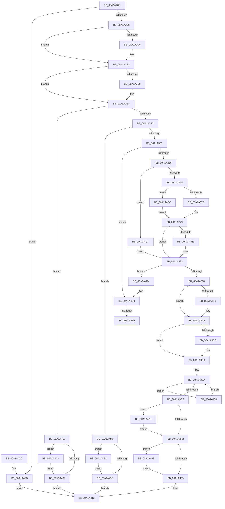

# AlpcpAssociateIoCompletionPort

- RVA: `0x00A1A28C`–`0x00A1A4F5` (길이 `617` bytes)
- VA: `0x0000000140A1A28C`
- 실행 섹션: `PAGE`
- PDB 이름 있음: `예`; PDB Function 태그: `예`
- unwind 정보 RVA: `0x000AA43C`
- 디코드: `159`개 명령, `617/617` bytes 표시
- 미해석 바이트: `0` (있으면 어셈블리에 `.byte`로 보존)

> 이 문서는 커널 이미지의 기계어와 PDB 기호를 분석해 생성했습니다. 4번과 5번은 함수 원형과 자료형을 바이너리 사용 방식에서 추정한 C 해석이며 원본 소스 복구 결과는 아닙니다.

## 1. Dependencies

- 직접 호출 지점: **16**; 고유 호출 대상: **8**
- 직접 호출자로 확인된 함수: **1**
- RIP 상대 이미지 참조: **1**

### Outgoing calls
- `0x00A1A2C5` → [KeAbPreAcquire](../../text/21/KeAbPreAcquire_function_00210230.md) (function, `0x00210230`)
- `0x00A1A2DE` → [ExfAcquirePushLockExclusiveEx](../../text/20/ExfAcquirePushLockExclusiveEx_function_0020FC90.md) (function, `0x0020FC90`)
- `0x00A1A33A` → [ObReferenceObjectByHandle](../86/ObReferenceObjectByHandle_function_00868DB0.md) (function, `0x00868DB0`)
- `0x00A1A386` → [AlpcpAllocateCompletionPacketLookaside](AlpcpAllocateCompletionPacketLookaside_function_00A1A4FC.md) (function, `0x00A1A4FC`)
- `0x00A1A3A7` → [KeAbPreAcquire](../../text/21/KeAbPreAcquire_function_00210230.md) (function, `0x00210230`)
- `0x00A1A3C1` → [ExfAcquirePushLockExclusiveEx](../../text/20/ExfAcquirePushLockExclusiveEx_function_0020FC90.md) (function, `0x0020FC90`)
- `0x00A1A3F5` → [KeAbPostRelease](../../text/2E/KeAbPostRelease_function_002E1600.md) (function, `0x002E1600`)
- `0x00A1A40C` → [KeAbPostRelease](../../text/2E/KeAbPostRelease_function_002E1600.md) (function, `0x002E1600`)
- `0x00A1A444` → [AlpcpQueueIoCompletionPort](../../text/3F/AlpcpQueueIoCompletionPort_function_003FF760.md) (function, `0x003FF760`)
- `0x00A1A451` → [ExfTryToWakePushLock](../../text/26/ExfTryToWakePushLock_function_00265DD0.md) (function, `0x00265DD0`)
- `0x00A1A46C` → [KeAbPostRelease](../../text/2E/KeAbPostRelease_function_002E1600.md) (function, `0x002E1600`)
- `0x00A1A47B` → [ExfTryToWakePushLock](../../text/26/ExfTryToWakePushLock_function_00265DD0.md) (function, `0x00265DD0`)
- `0x00A1A499` → [KeAbPostRelease](../../text/2E/KeAbPostRelease_function_002E1600.md) (function, `0x002E1600`)
- `0x00A1A4AB` → [ExfTryToWakePushLock](../../text/26/ExfTryToWakePushLock_function_00265DD0.md) (function, `0x00265DD0`)
- `0x00A1A4B5` → [ExfTryToWakePushLock](../../text/26/ExfTryToWakePushLock_function_00265DD0.md) (function, `0x00265DD0`)
- `0x00A1A4E6` → [ObfDereferenceObject](../../text/2F/ObfDereferenceObject_function_002F9350.md) (function, `0x002F9350`)

### Direct callers
- [NtAlpcSetInformation](NtAlpcSetInformation_function_00A19DC0.md) at `0x00A19EFB`

### Static image references
- `0x00A1A313` → RVA `0x00FC6CC0` (`ALMOSTRO`; read)

## 2. Other-region calls and transfers

- 다른 실행 섹션으로 향하는 call: **14**
  - `0x00A1A2C5` → [KeAbPreAcquire](../../text/21/KeAbPreAcquire_function_00210230.md) (`PAGE` → `.text`)
  - `0x00A1A2DE` → [ExfAcquirePushLockExclusiveEx](../../text/20/ExfAcquirePushLockExclusiveEx_function_0020FC90.md) (`PAGE` → `.text`)
  - `0x00A1A3A7` → [KeAbPreAcquire](../../text/21/KeAbPreAcquire_function_00210230.md) (`PAGE` → `.text`)
  - `0x00A1A3C1` → [ExfAcquirePushLockExclusiveEx](../../text/20/ExfAcquirePushLockExclusiveEx_function_0020FC90.md) (`PAGE` → `.text`)
  - `0x00A1A3F5` → [KeAbPostRelease](../../text/2E/KeAbPostRelease_function_002E1600.md) (`PAGE` → `.text`)
  - `0x00A1A40C` → [KeAbPostRelease](../../text/2E/KeAbPostRelease_function_002E1600.md) (`PAGE` → `.text`)
  - `0x00A1A444` → [AlpcpQueueIoCompletionPort](../../text/3F/AlpcpQueueIoCompletionPort_function_003FF760.md) (`PAGE` → `.text`)
  - `0x00A1A451` → [ExfTryToWakePushLock](../../text/26/ExfTryToWakePushLock_function_00265DD0.md) (`PAGE` → `.text`)
  - `0x00A1A46C` → [KeAbPostRelease](../../text/2E/KeAbPostRelease_function_002E1600.md) (`PAGE` → `.text`)
  - `0x00A1A47B` → [ExfTryToWakePushLock](../../text/26/ExfTryToWakePushLock_function_00265DD0.md) (`PAGE` → `.text`)
  - `0x00A1A499` → [KeAbPostRelease](../../text/2E/KeAbPostRelease_function_002E1600.md) (`PAGE` → `.text`)
  - `0x00A1A4AB` → [ExfTryToWakePushLock](../../text/26/ExfTryToWakePushLock_function_00265DD0.md) (`PAGE` → `.text`)
  - `0x00A1A4B5` → [ExfTryToWakePushLock](../../text/26/ExfTryToWakePushLock_function_00265DD0.md) (`PAGE` → `.text`)
  - `0x00A1A4E6` → [ObfDereferenceObject](../../text/2F/ObfDereferenceObject_function_002F9350.md) (`PAGE` → `.text`)
- call이 아닌 외부 분기/꼬리 이동: **2**
  - `0x00A1A4E0` → [sub_00B37302](../B3/Unknown_function_00B37302.md) (`tail-transfer`)
  - `0x00A1A4F0` → [sub_00B37302](../B3/Unknown_function_00B37302.md) (`tail-transfer`)

## 3. Assembly (complete function range)

```asm
00A1A28C  48 89 5C 24 08                  mov qword ptr [rsp + 8], rbx
00A1A291  48 89 6C 24 18                  mov qword ptr [rsp + 0x18], rbp
00A1A296  48 89 74 24 20                  mov qword ptr [rsp + 0x20], rsi
00A1A29B  57                              push rdi
00A1A29C  41 56                           push r14
00A1A29E  41 57                           push r15
00A1A2A0  48 83 EC 30                     sub rsp, 0x30
00A1A2A4  4D 8B F0                        mov r14, r8
00A1A2A7  48 8B EA                        mov rbp, rdx
00A1A2AA  48 8B F1                        mov rsi, rcx
00A1A2AD  48 85 D2                        test rdx, rdx
00A1A2B0  0F 84 77 01 00 00               je 0x140a1a42d
00A1A2B6  48 8D B9 60 01 00 00            lea rdi, [rcx + 0x160]
00A1A2BD  45 33 C0                        xor r8d, r8d
00A1A2C0  48 8B CF                        mov rcx, rdi
00A1A2C3  33 D2                           xor edx, edx
00A1A2C5  E8 66 5F 7F FF                  call 0x140210230
00A1A2CA  F0 48 0F BA 2F 00               lock bts qword ptr [rdi], 0
00A1A2D0  48 8B D8                        mov rbx, rax
00A1A2D3  73 0E                           jae 0x140a1a2e3
00A1A2D5  4C 8B C7                        mov r8, rdi
00A1A2D8  48 8B D0                        mov rdx, rax
00A1A2DB  48 8B CF                        mov rcx, rdi
00A1A2DE  E8 AD 59 7F FF                  call 0x14020fc90
00A1A2E3  48 85 DB                        test rbx, rbx
00A1A2E6  74 04                           je 0x140a1a2ec
00A1A2E8  C6 43 0A 01                     mov byte ptr [rbx + 0xa], 1
00A1A2EC  48 83 7E 20 00                  cmp qword ptr [rsi + 0x20], 0
00A1A2F1  0F 85 61 01 00 00               jne 0x140a1a458
00A1A2F7  48 83 BE 68 01 00 00 00         cmp qword ptr [rsi + 0x168], 0
00A1A2FF  0F 85 80 01 00 00               jne 0x140a1a485
00A1A305  65 48 8B 04 25 88 01 00 00      mov rax, qword ptr gs:[0x188]
00A1A30E  BA 02 00 00 00                  mov edx, 2
00A1A313  4C 8B 05 A6 C9 5A 00            mov r8, qword ptr [rip + 0x5ac9a6]
00A1A31A  48 8B CD                        mov rcx, rbp
00A1A31D  48 83 64 24 28 00               and qword ptr [rsp + 0x28], 0
00A1A323  48 83 64 24 58 00               and qword ptr [rsp + 0x58], 0
00A1A329  44 8A 88 32 02 00 00            mov r9b, byte ptr [rax + 0x232]
00A1A330  48 8D 44 24 58                  lea rax, [rsp + 0x58]
00A1A335  48 89 44 24 20                  mov qword ptr [rsp + 0x20], rax
00A1A33A  E8 71 EA E4 FF                  call 0x140868db0
00A1A33F  48 8B 54 24 58                  mov rdx, qword ptr [rsp + 0x58]
00A1A344  48 83 CB FF                     or rbx, 0xffffffffffffffff
00A1A348  48 89 56 20                     mov qword ptr [rsi + 0x20], rdx
00A1A34C  8B E8                           mov ebp, eax
00A1A34E  85 C0                           test eax, eax
00A1A350  0F 88 83 01 00 00               js 0x140a1a4d9
00A1A356  48 8B 8E 68 01 00 00            mov rcx, qword ptr [rsi + 0x168]
00A1A35D  4C 89 76 28                     mov qword ptr [rsi + 0x28], r14
00A1A361  48 85 C9                        test rcx, rcx
00A1A364  0F 85 5D 01 00 00               jne 0x140a1a4c7
00A1A36A  8A 02                           mov al, byte ptr [rdx]
00A1A36C  24 7F                           and al, 0x7f
00A1A36E  3C 15                           cmp al, 0x15
00A1A370  0F 84 46 01 00 00               je 0x140a1a4bc
00A1A376  8B 4A 2C                        mov ecx, dword ptr [rdx + 0x2c]
00A1A379  83 F9 04                        cmp ecx, 4
00A1A37C  76 05                           jbe 0x140a1a383
00A1A37E  B9 04 00 00 00                  mov ecx, 4
00A1A383  4D 8B C6                        mov r8, r14
00A1A386  E8 71 01 00 00                  call 0x140a1a4fc
00A1A38B  48 89 46 30                     mov qword ptr [rsi + 0x30], rax
00A1A38F  48 85 C0                        test rax, rax
00A1A392  0F 84 3C 01 00 00               je 0x140a1a4d4
00A1A398  48 8D AE 88 00 00 00            lea rbp, [rsi + 0x88]
00A1A39F  45 33 C0                        xor r8d, r8d
00A1A3A2  48 8B CD                        mov rcx, rbp
00A1A3A5  33 D2                           xor edx, edx
00A1A3A7  E8 84 5E 7F FF                  call 0x140210230
00A1A3AC  F0 48 0F BA 6D 00 00            lock bts qword ptr [rbp], 0
00A1A3B3  4C 8B F0                        mov r14, rax
00A1A3B6  73 0E                           jae 0x140a1a3c6
00A1A3B8  4C 8B C5                        mov r8, rbp
00A1A3BB  48 8B D0                        mov rdx, rax
00A1A3BE  48 8B CD                        mov rcx, rbp
00A1A3C1  E8 CA 58 7F FF                  call 0x14020fc90
00A1A3C6  4D 85 F6                        test r14, r14
00A1A3C9  74 05                           je 0x140a1a3d0
00A1A3CB  41 C6 46 0A 01                  mov byte ptr [r14 + 0xa], 1
00A1A3D0  4C 8D BE 90 00 00 00            lea r15, [rsi + 0x90]
00A1A3D7  4D 8B 37                        mov r14, qword ptr [r15]
00A1A3DA  4D 3B F7                        cmp r14, r15
00A1A3DD  75 55                           jne 0x140a1a434
00A1A3DF  48 8B C3                        mov rax, rbx
00A1A3E2  F0 48 0F C1 45 00               lock xadd qword ptr [rbp], rax
00A1A3E8  24 06                           and al, 6
00A1A3EA  3C 02                           cmp al, 2
00A1A3EC  0F 84 86 00 00 00               je 0x140a1a478
00A1A3F2  48 8B CD                        mov rcx, rbp
00A1A3F5  E8 06 72 8C FF                  call 0x1402e1600
00A1A3FA  33 ED                           xor ebp, ebp
00A1A3FC  F0 48 0F C1 1F                  lock xadd qword ptr [rdi], rbx
00A1A401  80 E3 06                        and bl, 6
00A1A404  80 FB 02                        cmp bl, 2
00A1A407  74 45                           je 0x140a1a44e
00A1A409  48 8B CF                        mov rcx, rdi
00A1A40C  E8 EF 71 8C FF                  call 0x1402e1600
00A1A411  8B C5                           mov eax, ebp
00A1A413  48 8B 5C 24 50                  mov rbx, qword ptr [rsp + 0x50]
00A1A418  48 8B 6C 24 60                  mov rbp, qword ptr [rsp + 0x60]
00A1A41D  48 8B 74 24 68                  mov rsi, qword ptr [rsp + 0x68]
00A1A422  48 83 C4 30                     add rsp, 0x30
00A1A426  41 5F                           pop r15
00A1A428  41 5E                           pop r14
00A1A42A  5F                              pop rdi
00A1A42B  C3                              ret
00A1A42C  CC                              int3
00A1A42D  B8 0D 00 00 C0                  mov eax, 0xc000000d
00A1A432  EB DF                           jmp 0x140a1a413
00A1A434  83 64 24 20 00                  and dword ptr [rsp + 0x20], 0
00A1A439  45 33 C9                        xor r9d, r9d
00A1A43C  45 33 C0                        xor r8d, r8d
00A1A43F  33 D2                           xor edx, edx
00A1A441  48 8B CE                        mov rcx, rsi
00A1A444  E8 17 53 9E FF                  call 0x1403ff760
00A1A449  4D 8B 36                        mov r14, qword ptr [r14]
00A1A44C  EB 8C                           jmp 0x140a1a3da
00A1A44E  48 8B CF                        mov rcx, rdi
00A1A451  E8 7A B9 84 FF                  call 0x140265dd0
00A1A456  EB B1                           jmp 0x140a1a409
00A1A458  48 83 CB FF                     or rbx, 0xffffffffffffffff
00A1A45C  F0 48 0F C1 1F                  lock xadd qword ptr [rdi], rbx
00A1A461  80 E3 06                        and bl, 6
00A1A464  80 FB 02                        cmp bl, 2
00A1A467  74 3F                           je 0x140a1a4a8
00A1A469  48 8B CF                        mov rcx, rdi
00A1A46C  E8 8F 71 8C FF                  call 0x1402e1600
00A1A471  B8 48 00 00 C0                  mov eax, 0xc0000048
00A1A476  EB 9B                           jmp 0x140a1a413
00A1A478  48 8B CD                        mov rcx, rbp
00A1A47B  E8 50 B9 84 FF                  call 0x140265dd0
00A1A480  E9 6D FF FF FF                  jmp 0x140a1a3f2
00A1A485  48 83 CB FF                     or rbx, 0xffffffffffffffff
00A1A489  F0 48 0F C1 1F                  lock xadd qword ptr [rdi], rbx
00A1A48E  80 E3 06                        and bl, 6
00A1A491  80 FB 02                        cmp bl, 2
00A1A494  74 1C                           je 0x140a1a4b2
00A1A496  48 8B CF                        mov rcx, rdi
00A1A499  E8 62 71 8C FF                  call 0x1402e1600
00A1A49E  B8 BB 00 00 C0                  mov eax, 0xc00000bb
00A1A4A3  E9 6B FF FF FF                  jmp 0x140a1a413
00A1A4A8  48 8B CF                        mov rcx, rdi
00A1A4AB  E8 20 B9 84 FF                  call 0x140265dd0
00A1A4B0  EB B7                           jmp 0x140a1a469
00A1A4B2  48 8B CF                        mov rcx, rdi
00A1A4B5  E8 16 B9 84 FF                  call 0x140265dd0
00A1A4BA  EB DA                           jmp 0x140a1a496
00A1A4BC  8B 8A 98 02 00 00               mov ecx, dword ptr [rdx + 0x298]
00A1A4C2  E9 B2 FE FF FF                  jmp 0x140a1a379
00A1A4C7  48 8B 49 60                     mov rcx, qword ptr [rcx + 0x60]
00A1A4CB  48 C1 E9 03                     shr rcx, 3
00A1A4CF  E9 AF FE FF FF                  jmp 0x140a1a383
00A1A4D4  BD 9A 00 00 C0                  mov ebp, 0xc000009a
00A1A4D9  48 8B 4E 20                     mov rcx, qword ptr [rsi + 0x20]
00A1A4DD  48 85 C9                        test rcx, rcx
00A1A4E0  0F 84 1C CE 11 00               je 0x140b37302
00A1A4E6  E8 65 EE 8D FF                  call 0x1402f9350
00A1A4EB  48 83 66 20 00                  and qword ptr [rsi + 0x20], 0
00A1A4F0  E9 0D CE 11 00                  jmp 0x140b37302
```

## 4. C-style interpretation (structured pseudocode)

```c
__int64 __fastcall AlpcpAssociateIoCompletionPort(__int64 a1, __int64 a2, __int64 a3)
{
    __int64 result;
    __int64 v_rbp;
    __int64 v_rbx;
    __int64 v_rsp;
    unsigned __int64 v_stack_m20;
    unsigned __int64 v_stack_m28;
    unsigned __int64 v_stack_p10;
    unsigned __int64 v_stack_p18;
    unsigned __int64 v_stack_p20;
    unsigned __int64 v_stack_p8;

    v_stack_p8 = v_rbx;
    v_stack_p18 = v_rbp;
    v_stack_p20 = v_rsi;
    v_rsp = (v_rsp) - (48);
    if (a2 == 0) goto loc_00A1A42D;
    a3 = 0;
    a2 = 0;
    result = KeAbPreAcquire(a1 + 352, a2, a3, a4);
    if (!(condition_is_above_or_equal)) {
        a3 = a1 + 352;
        a2 = result;
        a1 = a1 + 352;
        result = ExfAcquirePushLockExclusiveEx(a1, a2, a3, a4);
    }
    if (result != 0) {
        *(unsigned __int8 *)(result + 10) = 1;
    }
    if ((*(unsigned __int64 *)(a1 + 32)) != 0) goto loc_00A1A458;
    if ((*(unsigned __int64 *)(a1 + 360)) != 0) goto loc_00A1A485;
    v_stack_m28 = v_stack_p10;
    result = ObReferenceObjectByHandle(a2, 2, *(unsigned __int64 *)(v_rip + 5949862), *(unsigned __int8 *)(*(unsigned __int64 *)(gs_base + (0 + 392)) + 562));
    v_rbx = (result) | (-1);
    *(unsigned __int64 *)(a1 + 32) = v_stack_p10;
    if (sign_flag) goto loc_00A1A4D9;
    *(unsigned __int64 *)(a1 + 40) = a3;
    if (*(unsigned __int64 *)(a1 + 360) != 0) goto loc_00A1A4C7;
    result = (unsigned __int8)((*(unsigned __int8 *)(v_stack_p10)) & (127));
    if (((unsigned __int8)(result)) == 21) goto loc_00A1A4BC;
loc_00A1A379:
    if (((unsigned int)((unsigned int)(*(unsigned int *)(v_stack_p10 + 44)))) >= = 4) {
        a1 = 4;
    }
    result = AlpcpAllocateCompletionPacketLookaside(a1, v_stack_p10, a3, *(unsigned __int8 *)(*(unsigned __int64 *)(gs_base + (0 + 392)) + 562));
    *(unsigned __int64 *)(a1 + 48) = result;
    if (result == 0) goto loc_00A1A4D4;
    a3 = 0;
    a2 = 0;
    result = KeAbPreAcquire(a1 + 136, a2, a3, *(unsigned __int8 *)(*(unsigned __int64 *)(gs_base + (0 + 392)) + 562));
    if (!(condition_is_above_or_equal)) {
        a3 = a1 + 136;
        a2 = result;
        a1 = a1 + 136;
        result = ExfAcquirePushLockExclusiveEx(a1, a2, a3, *(unsigned __int8 *)(*(unsigned __int64 *)(gs_base + (0 + 392)) + 562));
    }
    if (result != 0) {
        *(unsigned __int8 *)(result + 10) = 1;
    }
loc_00A1A3DA:
    if ((*(unsigned __int64 *)(a1 + 144)) != (a1 + 144)) goto loc_00A1A434;
    result = (unsigned __int8)((v_rbx) & (6));
    if (((unsigned __int8)(result)) == 2) goto loc_00A1A478;
loc_00A1A3F2:
    result = KeAbPostRelease(a1 + 136, a2, a3, *(unsigned __int8 *)(*(unsigned __int64 *)(gs_base + (0 + 392)) + 562));
    v_rbp = 0;
    v_rbx = (unsigned __int8)((v_rbx) & (6));
    if (((unsigned __int8)(v_rbx)) == 2) goto loc_00A1A44E;
loc_00A1A409:
    result = KeAbPostRelease(a1 + 352, a2, a3, *(unsigned __int8 *)(*(unsigned __int64 *)(gs_base + (0 + 392)) + 562));
loc_00A1A413:
    v_rsp = (v_rsp) + (48);
    return 0;
loc_00A1A42D:
    goto loc_00A1A413;
loc_00A1A434:
    a4 = 0;
    a3 = 0;
    a2 = 0;
    result = AlpcpQueueIoCompletionPort(v_stack_p20, a2, a3, a4);
    goto loc_00A1A3DA;
loc_00A1A44E:
    result = ExfTryToWakePushLock(a1 + 352, a2, a3, a4);
    goto loc_00A1A409;
loc_00A1A458:
    v_rbx = (v_stack_p8) | (-1);
    v_rbx = (unsigned __int8)((v_rbx) & (6));
    if (((unsigned __int8)(v_rbx)) == 2) goto loc_00A1A4A8;
loc_00A1A469:
    result = KeAbPostRelease(a1 + 352, a2, a3, a4);
    goto loc_00A1A413;
loc_00A1A478:
    result = ExfTryToWakePushLock(v_stack_p18, a2, a3, a4);
    goto loc_00A1A3F2;
loc_00A1A485:
    v_rbx = (v_rbx) | (-1);
    v_rbx = (unsigned __int8)((v_rbx) & (6));
    if (((unsigned __int8)(v_rbx)) == 2) goto loc_00A1A4B2;
loc_00A1A496:
    result = KeAbPostRelease(a1 + 352, a2, a3, a4);
    goto loc_00A1A413;
loc_00A1A4A8:
    result = ExfTryToWakePushLock(a1 + 352, a2, a3, a4);
    goto loc_00A1A469;
loc_00A1A4B2:
    result = ExfTryToWakePushLock(a1 + 352, a2, a3, a4);
    goto loc_00A1A496;
loc_00A1A4BC:
    goto loc_00A1A379;
loc_00A1A4C7:
    a1 = (*(unsigned __int64 *)((unsigned int)(*(unsigned int *)(a2 + 664)) + 96)) >> (3);
    goto loc_00A1A383;
loc_00A1A4D4:
loc_00A1A4D9:
    result = ObfDereferenceObject(*(unsigned __int64 *)(v_stack_p20 + 32), a2, a3, a4);
}
```

## 5. (Beta) C Style

```c
int64_t AlpcpAssociateIoCompletionPort(void *Arg1, int64_t Arg2, int64_t Arg3)
{
    uint8_t *arg1 = (uint8_t *)Arg1;

    int64_t result;
    int64_t local_rbp;
    int64_t local_rbx;
    int64_t local_rsp;
    uint64_t v_stack_m20;
    uint64_t v_stack_m28;
    uint64_t v_stack_p10;
    uint64_t v_stack_p18;
    uint64_t v_stack_p20;
    uint64_t v_stack_p8;

    v_stack_p8 = local_rbx;
    v_stack_p18 = local_rbp;
    v_stack_p20 = local_rsi;
    local_rsp = (local_rsp) - (48);
    if (Arg2 == 0) goto loc_00A1A42D;
    Arg3 = 0;
    Arg2 = 0;
    result = KeAbPreAcquire(Arg1 + 352, Arg2, Arg3, a4);
    if (!(condition_is_above_or_equal)) {
        Arg3 = Arg1 + 352;
        Arg2 = result;
        Arg1 = Arg1 + 352;
        result = ExfAcquirePushLockExclusiveEx(Arg1, Arg2, Arg3, a4);
    }
    if (result != 0) {
        *(uint8_t *)(result + 0xA) = 1;
    }
    if ((*(uint64_t *)(arg1 + 0x20)) != 0) goto loc_00A1A458;
    if ((*(uint64_t *)(arg1 + 0x168)) != 0) goto loc_00A1A485;
    v_stack_m28 = v_stack_p10;
    result = ObReferenceObjectByHandle(Arg2, 2, *(uint64_t *)(v_rip + 0x5AC9A6), *(uint8_t *)(*(uint64_t *)(gs_base + (0 + 0x188)) + 0x232));
    local_rbx = (result) | (-1);
    *(uint64_t *)(arg1 + 0x20) = v_stack_p10;
    if (sign_flag) goto loc_00A1A4D9;
    *(uint64_t *)(arg1 + 0x28) = Arg3;
    if (*(uint64_t *)(arg1 + 0x168) != 0) goto loc_00A1A4C7;
    result = (uint8_t)((*(uint8_t *)(v_stack_p10)) & (127));
    if (((uint8_t)(result)) == 21) goto loc_00A1A4BC;
loc_00A1A379:
    if (((uint32_t)((uint32_t)(*(uint32_t *)(v_stack_p10 + 0x2C)))) >= = 4) {
        Arg1 = 4;
    }
    result = AlpcpAllocateCompletionPacketLookaside(Arg1, v_stack_p10, Arg3, *(uint8_t *)(*(uint64_t *)(gs_base + (0 + 0x188)) + 0x232));
    *(uint64_t *)(arg1 + 0x30) = result;
    if (result == 0) goto loc_00A1A4D4;
    Arg3 = 0;
    Arg2 = 0;
    result = KeAbPreAcquire(Arg1 + 136, Arg2, Arg3, *(uint8_t *)(*(uint64_t *)(gs_base + (0 + 0x188)) + 0x232));
    if (!(condition_is_above_or_equal)) {
        Arg3 = Arg1 + 136;
        Arg2 = result;
        Arg1 = Arg1 + 136;
        result = ExfAcquirePushLockExclusiveEx(Arg1, Arg2, Arg3, *(uint8_t *)(*(uint64_t *)(gs_base + (0 + 0x188)) + 0x232));
    }
    if (result != 0) {
        *(uint8_t *)(result + 0xA) = 1;
    }
loc_00A1A3DA:
    if ((*(uint64_t *)(arg1 + 0x90)) != (Arg1 + 144)) goto loc_00A1A434;
    result = (uint8_t)((local_rbx) & (6));
    if (((uint8_t)(result)) == 2) goto loc_00A1A478;
loc_00A1A3F2:
    result = KeAbPostRelease(Arg1 + 136, Arg2, Arg3, *(uint8_t *)(*(uint64_t *)(gs_base + (0 + 0x188)) + 0x232));
    local_rbp = 0;
    local_rbx = (uint8_t)((local_rbx) & (6));
    if (((uint8_t)(local_rbx)) == 2) goto loc_00A1A44E;
loc_00A1A409:
    result = KeAbPostRelease(Arg1 + 352, Arg2, Arg3, *(uint8_t *)(*(uint64_t *)(gs_base + (0 + 0x188)) + 0x232));
loc_00A1A413:
    local_rsp = (local_rsp) + (48);
    return 0;
loc_00A1A42D:
    goto loc_00A1A413;
loc_00A1A434:
    a4 = 0;
    Arg3 = 0;
    Arg2 = 0;
    result = AlpcpQueueIoCompletionPort(v_stack_p20, Arg2, Arg3, a4);
    goto loc_00A1A3DA;
loc_00A1A44E:
    result = ExfTryToWakePushLock(Arg1 + 352, Arg2, Arg3, a4);
    goto loc_00A1A409;
loc_00A1A458:
    local_rbx = (v_stack_p8) | (-1);
    local_rbx = (uint8_t)((local_rbx) & (6));
    if (((uint8_t)(local_rbx)) == 2) goto loc_00A1A4A8;
loc_00A1A469:
    result = KeAbPostRelease(Arg1 + 352, Arg2, Arg3, a4);
    goto loc_00A1A413;
loc_00A1A478:
    result = ExfTryToWakePushLock(v_stack_p18, Arg2, Arg3, a4);
    goto loc_00A1A3F2;
loc_00A1A485:
    local_rbx = (local_rbx) | (-1);
    local_rbx = (uint8_t)((local_rbx) & (6));
    if (((uint8_t)(local_rbx)) == 2) goto loc_00A1A4B2;
loc_00A1A496:
    result = KeAbPostRelease(Arg1 + 352, Arg2, Arg3, a4);
    goto loc_00A1A413;
loc_00A1A4A8:
    result = ExfTryToWakePushLock(Arg1 + 352, Arg2, Arg3, a4);
    goto loc_00A1A469;
loc_00A1A4B2:
    result = ExfTryToWakePushLock(Arg1 + 352, Arg2, Arg3, a4);
    goto loc_00A1A496;
loc_00A1A4BC:
    goto loc_00A1A379;
loc_00A1A4C7:
    Arg1 = (*(uint64_t *)((uint32_t)(*(uint32_t *)(Arg2 + 0x298)) + 0x60)) >> (3);
    goto loc_00A1A383;
loc_00A1A4D4:
loc_00A1A4D9:
    result = ObfDereferenceObject(*(uint64_t *)(v_stack_p20 + 0x20), Arg2, Arg3, a4);
}
```

### 관측된 메모리 오프셋

구조체 형식이 확인되지 않은 접근은 인자 기준의 오프셋으로만 기록했습니다.

| 기준 인자 | 오프셋 표현 | 폭 (bit) | 접근 |
|---|---:|---:|---|
| `Arg1` | `+ 0x0` | `64` | `R` |
| `Arg1` | `+ 0x0` | `64` | `R/W` |
| `Arg1` | `+ 0x20` | `64` | `R` |
| `Arg1` | `+ 0x20` | `64` | `R/W` |
| `Arg1` | `+ 0x20` | `64` | `W` |
| `Arg1` | `+ 0x28` | `64` | `W` |
| `Arg1` | `+ 0x30` | `64` | `W` |
| `Arg1` | `+ 0x88` | `64` | `R` |
| `Arg1` | `+ 0x90` | `64` | `R` |
| `Arg1` | `+ 0x160` | `64` | `R` |
| `Arg1` | `+ 0x168` | `64` | `R` |

## 6. Execution-region graph

[열기: 2D/3D 그래프와 함수 탐색 컨트롤 패널](../../../control-panel.html?section=page&rva=0x00A1A28C&view=graph)

- 2D 그래프는 위에서 아래로 흐르고, 3D 그래프는 빈 공간을 드래그해 회전합니다. Shift+드래그는 이동, 휠은 확대·축소, 함수 노드 선택은 대상 보고서 이동입니다.

### Static fallback


