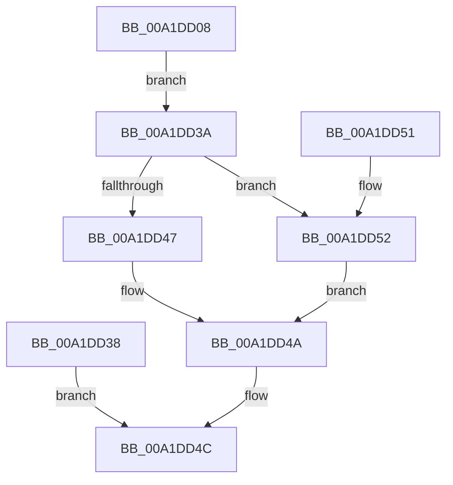

# AlpcpCaptureContextAttribute32

- RVA: `0x00A1DD08`–`0x00A1DD58` (길이 `80` bytes)
- VA: `0x0000000140A1DD08`
- 실행 섹션: `PAGE`
- PDB 이름 있음: `예`; PDB Function 태그: `아니요`
- unwind 정보 RVA: `0x000AA804`
- 디코드: `24`개 명령, `80/80` bytes 표시
- 미해석 바이트: `0` (있으면 어셈블리에 `.byte`로 보존)

> 이 문서는 커널 이미지의 기계어와 PDB 기호를 분석해 생성했습니다. 4번과 5번은 함수 원형과 자료형을 바이너리 사용 방식에서 추정한 C 해석이며 원본 소스 복구 결과는 아닙니다.

## 1. Dependencies

- 직접 호출 지점: **0**; 고유 호출 대상: **0**
- 직접 호출자로 확인된 함수: **1**
- RIP 상대 이미지 참조: **0**

### Outgoing calls
- 직접 디코드된 call 명령이 없습니다.

### Direct callers
- [AlpcpCaptureAttributes](../88/AlpcpCaptureAttributes_function_0088CD20.md) at `0x0088D04B`

### Static image references
- 디코드된 RIP-relative 메모리 참조가 없습니다.

## 2. Other-region calls and transfers

- 다른 실행 섹션으로 향하는 call: **0**
- 별도 외부 분기/꼬리 이동을 확인하지 못했습니다.

## 3. Assembly (complete function range)

```asm
00A1DD08  48 83 EC 18                     sub rsp, 0x18
00A1DD0C  4C 8B D1                        mov r10, rcx
00A1DD0F  41 8B 80 08 01 00 00            mov eax, dword ptr [r8 + 0x108]
00A1DD16  89 42 0C                        mov dword ptr [rdx + 0xc], eax
00A1DD19  41 8B 80 10 01 00 00            mov eax, dword ptr [r8 + 0x110]
00A1DD20  89 42 10                        mov dword ptr [rdx + 0x10], eax
00A1DD23  C7 42 08 00 00 00 00            mov dword ptr [rdx + 8], 0
00A1DD2A  8B 41 38                        mov eax, dword ptr [rcx + 0x38]
00A1DD2D  89 02                           mov dword ptr [rdx], eax
00A1DD2F  8B 4A 04                        mov ecx, dword ptr [rdx + 4]
00A1DD32  48 89 0C 24                     mov qword ptr [rsp], rcx
00A1DD36  EB 02                           jmp 0x140a1dd3a
00A1DD38  EB 12                           jmp 0x140a1dd4c
00A1DD3A  41 8B 82 A0 01 00 00            mov eax, dword ptr [r10 + 0x1a0]
00A1DD41  24 06                           and al, 6
00A1DD43  3C 04                           cmp al, 4
00A1DD45  75 0B                           jne 0x140a1dd52
00A1DD47  49 89 09                        mov qword ptr [r9], rcx
00A1DD4A  33 C0                           xor eax, eax
00A1DD4C  48 83 C4 18                     add rsp, 0x18
00A1DD50  C3                              ret
00A1DD51  CC                              int3
00A1DD52  49 89 49 08                     mov qword ptr [r9 + 8], rcx
00A1DD56  EB F2                           jmp 0x140a1dd4a
```

## 4. C-style interpretation (structured pseudocode)

```c
__int64 __fastcall AlpcpCaptureContextAttribute32(__int64 a1, __int64 a2, __int64 a3, __int64 a4)
{
    __int64 result;
    __int64 v_rsp;
    unsigned __int64 v_stack_m18;

    v_rsp = (v_rsp) - (24);
    *(unsigned int *)(a2 + 12) = (unsigned int)((unsigned int)(*(unsigned int *)(a3 + 264)));
    *(unsigned int *)(a2 + 16) = (unsigned int)((unsigned int)(*(unsigned int *)(a3 + 272)));
    *(unsigned int *)(a2 + 8) = 0;
    *(unsigned int *)(a2) = (unsigned int)((unsigned int)(*(unsigned int *)(a1 + 56)));
    v_stack_m18 = (unsigned int)(*(unsigned int *)(a2 + 4));
    goto loc_00A1DD3A;
loc_00A1DD3A:
    result = (unsigned __int8)(((unsigned int)(*(unsigned int *)(a1 + 416))) & (6));
    if (((unsigned __int8)(result)) != 4) goto loc_00A1DD52;
    *(unsigned __int64 *)(a4) = (unsigned int)(*(unsigned int *)(a2 + 4));
loc_00A1DD4A:
    result = 0;
loc_00A1DD4C:
    v_rsp = (v_rsp) + (24);
    return result;
loc_00A1DD52:
    *(unsigned __int64 *)(a4 + 8) = (unsigned int)(*(unsigned int *)(a2 + 4));
    goto loc_00A1DD4A;
}
```

## 5. (Beta) C Style

```c
int64_t AlpcpCaptureContextAttribute32(void *Arg1, void *Arg2, void *Arg3, void *Arg4)
{
    uint8_t *arg1 = (uint8_t *)Arg1;
    uint8_t *arg2 = (uint8_t *)Arg2;
    uint8_t *arg3 = (uint8_t *)Arg3;
    uint8_t *arg4 = (uint8_t *)Arg4;

    int64_t result;
    int64_t local_rsp;
    uint64_t v_stack_m18;

    local_rsp = (local_rsp) - (24);
    *(uint32_t *)(arg2 + 0xC) = (uint32_t)((uint32_t)(*(uint32_t *)(arg3 + 0x108)));
    *(uint32_t *)(arg2 + 0x10) = (uint32_t)((uint32_t)(*(uint32_t *)(arg3 + 0x110)));
    *(uint32_t *)(arg2 + 0x8) = 0;
    *(uint32_t *)(arg2) = (uint32_t)((uint32_t)(*(uint32_t *)(arg1 + 0x38)));
    v_stack_m18 = (uint32_t)(*(uint32_t *)(arg2 + 0x4));
    goto loc_00A1DD3A;
loc_00A1DD3A:
    result = (uint8_t)(((uint32_t)(*(uint32_t *)(arg1 + 0x1A0))) & (6));
    if (((uint8_t)(result)) != 4) goto loc_00A1DD52;
    *(uint64_t *)(arg4) = (uint32_t)(*(uint32_t *)(arg2 + 0x4));
loc_00A1DD4A:
    result = 0;
loc_00A1DD4C:
    local_rsp = (local_rsp) + (24);
    return result;
loc_00A1DD52:
    *(uint64_t *)(arg4 + 0x8) = (uint32_t)(*(uint32_t *)(arg2 + 0x4));
    goto loc_00A1DD4A;
}
```

### 관측된 메모리 오프셋

구조체 형식이 확인되지 않은 접근은 인자 기준의 오프셋으로만 기록했습니다.

| 기준 인자 | 오프셋 표현 | 폭 (bit) | 접근 |
|---|---:|---:|---|
| `Arg1` | `+ 0x38` | `32` | `R` |
| `Arg1` | `+ 0x1A0` | `32` | `R` |
| `Arg2` | `+ 0x0` | `32` | `W` |
| `Arg2` | `+ 0x4` | `32` | `R` |
| `Arg2` | `+ 0x8` | `32` | `W` |
| `Arg2` | `+ 0xC` | `32` | `W` |
| `Arg2` | `+ 0x10` | `32` | `W` |
| `Arg3` | `+ 0x108` | `32` | `R` |
| `Arg3` | `+ 0x110` | `32` | `R` |
| `Arg4` | `+ 0x0` | `64` | `W` |
| `Arg4` | `+ 0x8` | `64` | `W` |

## 6. Execution-region graph

[열기: 2D/3D 그래프와 함수 탐색 컨트롤 패널](../../../control-panel.html?section=page&rva=0x00A1DD08&view=graph)

- 2D 그래프는 위에서 아래로 흐르고, 3D 그래프는 빈 공간을 드래그해 회전합니다. Shift+드래그는 이동, 휠은 확대·축소, 함수 노드 선택은 대상 보고서 이동입니다.

### Static fallback


