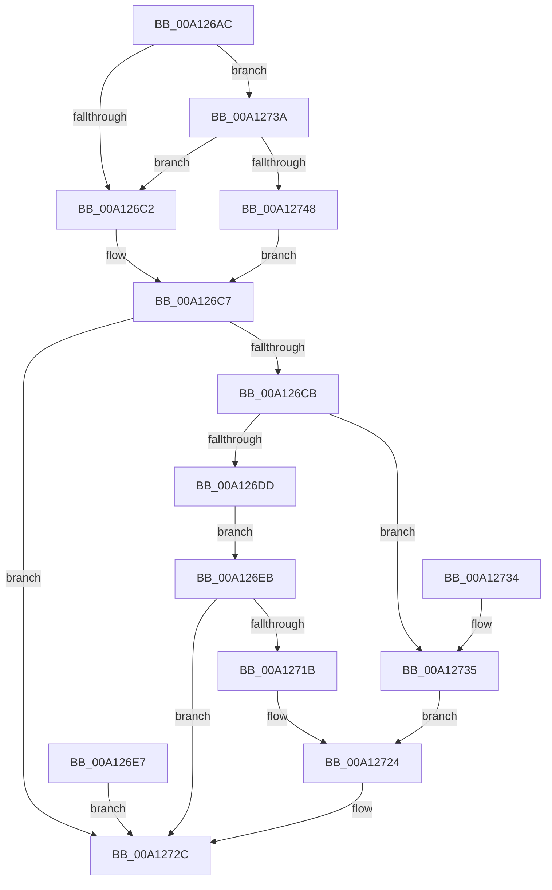

# AlpcpCaptureDirectAttribute

- RVA: `0x00A126AC`–`0x00A1274F` (길이 `163` bytes)
- VA: `0x0000000140A126AC`
- 실행 섹션: `PAGE`
- PDB 이름 있음: `예`; PDB Function 태그: `아니요`
- unwind 정보 RVA: `0x000A98F4`
- 디코드: `43`개 명령, `163/163` bytes 표시
- 미해석 바이트: `0` (있으면 어셈블리에 `.byte`로 보존)

> 이 문서는 커널 이미지의 기계어와 PDB 기호를 분석해 생성했습니다. 4번과 5번은 함수 원형과 자료형을 바이너리 사용 방식에서 추정한 C 해석이며 원본 소스 복구 결과는 아닙니다.

## 1. Dependencies

- 직접 호출 지점: **1**; 고유 호출 대상: **1**
- 직접 호출자로 확인된 함수: **1**
- RIP 상대 이미지 참조: **1**

### Outgoing calls
- `0x00A12710` → [ObReferenceObjectByHandle](../86/ObReferenceObjectByHandle_function_00868DB0.md) (function, `0x00868DB0`)

### Direct callers
- [AlpcpCaptureAttributes](../88/AlpcpCaptureAttributes_function_0088CD20.md) at `0x0088D115`

### Static image references
- `0x00A126EB` → RVA `0x00FC6B80` (`ALMOSTRO`; read)

## 2. Other-region calls and transfers

- 다른 실행 섹션으로 향하는 call: **0**
- 별도 외부 분기/꼬리 이동을 확인하지 못했습니다.

## 3. Assembly (complete function range)

```asm
00A126AC  48 89 54 24 10                  mov qword ptr [rsp + 0x10], rdx
00A126B1  53                              push rbx
00A126B2  48 83 EC 40                     sub rsp, 0x40
00A126B6  49 8B D8                        mov rbx, r8
00A126B9  41 F7 C1 10 00 01 00            test r9d, 0x10010
00A126C0  74 78                           je 0x140a1273a
00A126C2  BA 0D 00 00 C0                  mov edx, 0xc000000d
00A126C7  85 D2                           test edx, edx
00A126C9  78 61                           js 0x140a1272c
00A126CB  65 48 8B 04 25 88 01 00 00      mov rax, qword ptr gs:[0x188]
00A126D4  80 B8 32 02 00 00 00            cmp byte ptr [rax + 0x232], 0
00A126DB  74 58                           je 0x140a12735
00A126DD  48 8B 09                        mov rcx, qword ptr [rcx]
00A126E0  48 89 4C 24 30                  mov qword ptr [rsp + 0x30], rcx
00A126E5  EB 04                           jmp 0x140a126eb
00A126E7  8B D0                           mov edx, eax
00A126E9  EB 41                           jmp 0x140a1272c
00A126EB  4C 8B 05 8E 44 5B 00            mov r8, qword ptr [rip + 0x5b448e]
00A126F2  48 83 64 24 58 00               and qword ptr [rsp + 0x58], 0
00A126F8  48 83 64 24 28 00               and qword ptr [rsp + 0x28], 0
00A126FE  48 8D 44 24 58                  lea rax, [rsp + 0x58]
00A12703  48 89 44 24 20                  mov qword ptr [rsp + 0x20], rax
00A12708  41 B1 01                        mov r9b, 1
00A1270B  BA 02 00 00 00                  mov edx, 2
00A12710  E8 9B 66 E5 FF                  call 0x140868db0
00A12715  8B D0                           mov edx, eax
00A12717  85 C0                           test eax, eax
00A12719  78 11                           js 0x140a1272c
00A1271B  48 8B 44 24 58                  mov rax, qword ptr [rsp + 0x58]
00A12720  48 83 C8 02                     or rax, 2
00A12724  48 83 C8 01                     or rax, 1
00A12728  48 89 43 38                     mov qword ptr [rbx + 0x38], rax
00A1272C  8B C2                           mov eax, edx
00A1272E  48 83 C4 40                     add rsp, 0x40
00A12732  5B                              pop rbx
00A12733  C3                              ret
00A12734  CC                              int3
00A12735  48 8B 01                        mov rax, qword ptr [rcx]
00A12738  EB EA                           jmp 0x140a12724
00A1273A  F7 44 24 70 00 00 00 20         test dword ptr [rsp + 0x70], 0x20000000
00A12742  0F 84 7A FF FF FF               je 0x140a126c2
00A12748  33 D2                           xor edx, edx
00A1274A  E9 78 FF FF FF                  jmp 0x140a126c7
```

## 4. C-style interpretation (structured pseudocode)

```c
__int64 __fastcall AlpcpCaptureDirectAttribute(__int64 a1, __int64 a2, __int64 a3, int a4, unsigned int a5)
{
    __int64 result;
    __int64 v_rsp;
    unsigned __int64 v_stack_m18;
    unsigned __int64 v_stack_m20;
    unsigned __int64 v_stack_m28;
    unsigned __int64 v_stack_p10;

    v_stack_p10 = a2;
    v_rsp = (v_rsp) - (64);
    if (((a4) & (0x10010ULL)) == 0) goto loc_00A1273A;
loc_00A126C2:
loc_00A126C7:
    if (sign_flag) goto loc_00A1272C;
    if ((*(unsigned __int8 *)(*(unsigned __int64 *)(gs_base + (0 + 392)) + 562)) == 0) goto loc_00A12735;
    v_stack_m18 = *(unsigned __int64 *)(a1);
    goto loc_00A126EB;
loc_00A126EB:
    v_stack_m28 = v_stack_p10;
    result = ObReferenceObjectByHandle(*(unsigned __int64 *)(a1), 2, *(unsigned __int64 *)(v_rip + 5981326), 1);
    if (sign_flag) goto loc_00A1272C;
    result = (v_stack_p10) | (2);
loc_00A12724:
    result = (result) | (1);
    *(unsigned __int64 *)(a3 + 56) = result;
loc_00A1272C:
    v_rsp = (v_rsp) + (64);
    return (unsigned int)((unsigned int)((unsigned int)((unsigned int)(result))));
loc_00A12735:
    goto loc_00A12724;
loc_00A1273A:
    if (((a5) & (0x20000000ULL)) == 0) goto loc_00A126C2;
    a2 = 0;
    goto loc_00A126C7;
}
```

## 5. (Beta) C Style

```c
int64_t AlpcpCaptureDirectAttribute(void *Arg1, int64_t Arg2, void *Arg3, int32_t Arg4, uint32_t Arg5)
{
    uint8_t *arg1 = (uint8_t *)Arg1;
    uint8_t *arg3 = (uint8_t *)Arg3;

    int64_t result;
    int64_t local_rsp;
    uint64_t v_stack_m18;
    uint64_t v_stack_m20;
    uint64_t v_stack_m28;
    uint64_t v_stack_p10;

    v_stack_p10 = Arg2;
    local_rsp = (local_rsp) - (64);
    if (((Arg4) & (0x10010ULL)) == 0) goto loc_00A1273A;
loc_00A126C2:
loc_00A126C7:
    if (sign_flag) goto loc_00A1272C;
    if ((*(uint8_t *)(*(uint64_t *)(gs_base + (0 + 0x188)) + 0x232)) == 0) goto loc_00A12735;
    v_stack_m18 = *(uint64_t *)(arg1);
    goto loc_00A126EB;
loc_00A126EB:
    v_stack_m28 = v_stack_p10;
    result = ObReferenceObjectByHandle(*(uint64_t *)(arg1), 2, *(uint64_t *)(v_rip + 0x5B448E), 1);
    if (sign_flag) goto loc_00A1272C;
    result = (v_stack_p10) | (2);
loc_00A12724:
    result = (result) | (1);
    *(uint64_t *)(arg3 + 0x38) = result;
loc_00A1272C:
    local_rsp = (local_rsp) + (64);
    return (uint32_t)((uint32_t)((uint32_t)((uint32_t)(result))));
loc_00A12735:
    goto loc_00A12724;
loc_00A1273A:
    if (((Arg5) & (0x20000000ULL)) == 0) goto loc_00A126C2;
    Arg2 = 0;
    goto loc_00A126C7;
}
```

### 관측된 메모리 오프셋

구조체 형식이 확인되지 않은 접근은 인자 기준의 오프셋으로만 기록했습니다.

| 기준 인자 | 오프셋 표현 | 폭 (bit) | 접근 |
|---|---:|---:|---|
| `Arg1` | `+ 0x0` | `64` | `R` |
| `Arg3` | `+ 0x38` | `64` | `W` |

## 6. Execution-region graph

[열기: 2D/3D 그래프와 함수 탐색 컨트롤 패널](../../../control-panel.html?section=page&rva=0x00A126AC&view=graph)

- 2D 그래프는 위에서 아래로 흐르고, 3D 그래프는 빈 공간을 드래그해 회전합니다. Shift+드래그는 이동, 휠은 확대·축소, 함수 노드 선택은 대상 보고서 이동입니다.

### Static fallback


