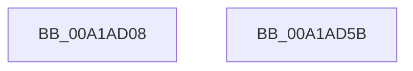

# AlpcpFreeCompletionList

- RVA: `0x00A1AD08`–`0x00A1AD5C` (길이 `84` bytes)
- VA: `0x0000000140A1AD08`
- 실행 섹션: `PAGE`
- PDB 이름 있음: `예`; PDB Function 태그: `아니요`
- unwind 정보 RVA: `0x0005CAAC`
- 디코드: `21`개 명령, `84/84` bytes 표시
- 미해석 바이트: `0` (있으면 어셈블리에 `.byte`로 보존)

> 이 문서는 커널 이미지의 기계어와 PDB 기호를 분석해 생성했습니다. 4번과 5번은 함수 원형과 자료형을 바이너리 사용 방식에서 추정한 C 해석이며 원본 소스 복구 결과는 아닙니다.

## 1. Dependencies

- 직접 호출 지점: **4**; 고유 호출 대상: **4**
- 직접 호출자로 확인된 함수: **2**
- RIP 상대 이미지 참조: **0**

### Outgoing calls
- `0x00A1AD20` → [MmUnlockPages](../../text/29/MmUnlockPages_function_0029EEE0.md) (function, `0x0029EEE0`)
- `0x00A1AD29` → [IoFreeMdl](../../text/29/IoFreeMdl_function_0029EA80.md) (function, `0x0029EA80`)
- `0x00A1AD31` → [AlpcpUnregisterCompletionListDatabase](AlpcpUnregisterCompletionListDatabase_function_00A1AD64.md) (function, `0x00A1AD64`)
- `0x00A1AD3B` → [ExFreePoolWithTag](../../poolcode/B8/ExFreePoolWithTag_function_00B82870.md) (function, `0x00B82870`)

### Direct callers
- [AlpcpDoPortCleanup](../92/AlpcpDoPortCleanup_function_00924E54.md) at `0x00924FF6`
- [NtAlpcSetInformation](NtAlpcSetInformation_function_00A19DC0.md) at `0x00A1A13B`

### Static image references
- 디코드된 RIP-relative 메모리 참조가 없습니다.

## 2. Other-region calls and transfers

- 다른 실행 섹션으로 향하는 call: **3**
  - `0x00A1AD20` → [MmUnlockPages](../../text/29/MmUnlockPages_function_0029EEE0.md) (`PAGE` → `.text`)
  - `0x00A1AD29` → [IoFreeMdl](../../text/29/IoFreeMdl_function_0029EA80.md) (`PAGE` → `.text`)
  - `0x00A1AD3B` → [ExFreePoolWithTag](../../poolcode/B8/ExFreePoolWithTag_function_00B82870.md) (`PAGE` → `POOLCODE`)
- 별도 외부 분기/꼬리 이동을 확인하지 못했습니다.

## 3. Assembly (complete function range)

```asm
00A1AD08  48 89 5C 24 08                  mov qword ptr [rsp + 8], rbx
00A1AD0D  57                              push rdi
00A1AD0E  48 83 EC 20                     sub rsp, 0x20
00A1AD12  48 8B 99 68 01 00 00            mov rbx, qword ptr [rcx + 0x168]
00A1AD19  48 8B F9                        mov rdi, rcx
00A1AD1C  48 8B 4B 20                     mov rcx, qword ptr [rbx + 0x20]
00A1AD20  E8 BB 41 88 FF                  call 0x14029eee0
00A1AD25  48 8B 4B 20                     mov rcx, qword ptr [rbx + 0x20]
00A1AD29  E8 52 3D 88 FF                  call 0x14029ea80
00A1AD2E  48 8B CB                        mov rcx, rbx
00A1AD31  E8 2E 00 00 00                  call 0x140a1ad64
00A1AD36  33 D2                           xor edx, edx
00A1AD38  48 8B CB                        mov rcx, rbx
00A1AD3B  E8 30 7B 16 00                  call 0x140b82870
00A1AD40  48 83 A7 68 01 00 00 00         and qword ptr [rdi + 0x168], 0
00A1AD48  0F BA B7 A0 01 00 00 0E         btr dword ptr [rdi + 0x1a0], 0xe
00A1AD50  48 8B 5C 24 30                  mov rbx, qword ptr [rsp + 0x30]
00A1AD55  48 83 C4 20                     add rsp, 0x20
00A1AD59  5F                              pop rdi
00A1AD5A  C3                              ret
00A1AD5B  CC                              int3
```

## 4. C-style interpretation (structured pseudocode)

```c
__int64 __fastcall AlpcpFreeCompletionList(__int64 a1, int a2)
{
    __int64 result;
    __int64 v_rsp;
    unsigned __int64 v_stack_p8;

    v_stack_p8 = v_rbx;
    v_rsp = (v_rsp) - (32);
    result = MmUnlockPages(*(unsigned __int64 *)(*(unsigned __int64 *)(a1 + 360) + 32), a2, a3, a4);
    result = IoFreeMdl(*(unsigned __int64 *)(*(unsigned __int64 *)(a1 + 360) + 32), a2, a3, a4);
    result = AlpcpUnregisterCompletionListDatabase(*(unsigned __int64 *)(a1 + 360), a2, a3, a4);
    a2 = 0;
    result = ExFreePoolWithTag(*(unsigned __int64 *)(a1 + 360), a2, a3, a4);
    v_rsp = (v_rsp) + (32);
    return result;
}
```

## 5. (Beta) C Style

```c
int64_t AlpcpFreeCompletionList(void *Arg1, int32_t Arg2)
{
    uint8_t *arg1 = (uint8_t *)Arg1;

    int64_t result;
    int64_t local_rsp;
    uint64_t v_stack_p8;

    v_stack_p8 = local_rbx;
    local_rsp = (local_rsp) - (32);
    result = MmUnlockPages(*(uint64_t *)(*(uint64_t *)(arg1 + 0x168) + 0x20), Arg2, a3, a4);
    result = IoFreeMdl(*(uint64_t *)(*(uint64_t *)(arg1 + 0x168) + 0x20), Arg2, a3, a4);
    result = AlpcpUnregisterCompletionListDatabase(*(uint64_t *)(arg1 + 0x168), Arg2, a3, a4);
    Arg2 = 0;
    result = ExFreePoolWithTag(*(uint64_t *)(arg1 + 0x168), Arg2, a3, a4);
    local_rsp = (local_rsp) + (32);
    return result;
}
```

### 관측된 메모리 오프셋

구조체 형식이 확인되지 않은 접근은 인자 기준의 오프셋으로만 기록했습니다.

| 기준 인자 | 오프셋 표현 | 폭 (bit) | 접근 |
|---|---:|---:|---|
| `Arg1` | `+ 0x168` | `64` | `R` |
| `Arg1` | `+ 0x168` | `64` | `R/W` |
| `Arg1` | `+ 0x1A0` | `32` | `R/W` |

## 6. Execution-region graph

[열기: 2D/3D 그래프와 함수 탐색 컨트롤 패널](../../../control-panel.html?section=page&rva=0x00A1AD08&view=graph)

- 2D 그래프는 위에서 아래로 흐르고, 3D 그래프는 빈 공간을 드래그해 회전합니다. Shift+드래그는 이동, 휠은 확대·축소, 함수 노드 선택은 대상 보고서 이동입니다.

### Static fallback


