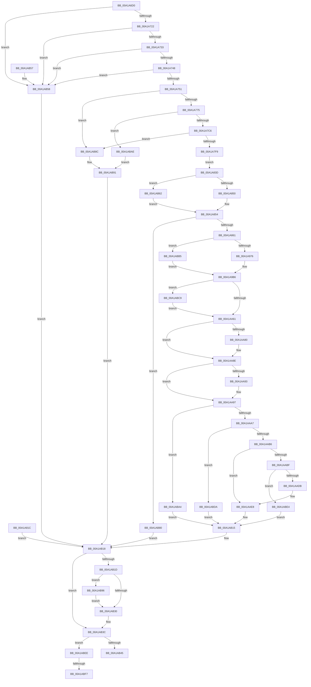

# AlpcpInitializeCompletionList

- RVA: `0x00A1A6D0`–`0x00A1AC06` (길이 `1,334` bytes)
- VA: `0x0000000140A1A6D0`
- 실행 섹션: `PAGE`
- PDB 이름 있음: `예`; PDB Function 태그: `예`
- unwind 정보 RVA: `0x000AA4B0`
- 디코드: `319`개 명령, `1,334/1,334` bytes 표시
- 미해석 바이트: `0` (있으면 어셈블리에 `.byte`로 보존)

> 이 문서는 커널 이미지의 기계어와 PDB 기호를 분석해 생성했습니다. 4번과 5번은 함수 원형과 자료형을 바이너리 사용 방식에서 추정한 C 해석이며 원본 소스 복구 결과는 아닙니다.

## 1. Dependencies

- 직접 호출 지점: **16**; 고유 호출 대상: **14**
- 직접 호출자로 확인된 함수: **1**
- RIP 상대 이미지 참조: **0**

### Outgoing calls
- `0x00A1A75F` → [ExAllocatePool2](../../poolcode/B8/ExAllocatePool2_function_00B820F0.md) (function, `0x00B820F0`)
- `0x00A1A780` → [memset](../../text/6C/memset_function_006C6C40.md) (function, `0x006C6C40`)
- `0x00A1A7B9` → [AlpcpRegisterCompletionListDatabase](AlpcpRegisterCompletionListDatabase_function_00A1AC0C.md) (function, `0x00A1AC0C`)
- `0x00A1A7E4` → [IoAllocateMdl](../../text/29/IoAllocateMdl_function_0029EBF0.md) (function, `0x0029EBF0`)
- `0x00A1A815` → [MmProbeAndLockPages](../../text/23/MmProbeAndLockPages_function_0023B990.md) (function, `0x0023B990`)
- `0x00A1A869` → [memset](../../text/6C/memset_function_006C6C40.md) (function, `0x006C6C40`)
- `0x00A1AA70` → [KeAbPreAcquire](../../text/21/KeAbPreAcquire_function_00210230.md) (function, `0x00210230`)
- `0x00A1AA89` → [ExfAcquirePushLockExclusiveEx](../../text/20/ExfAcquirePushLockExclusiveEx_function_0020FC90.md) (function, `0x0020FC90`)
- `0x00A1AACA` → [AlpcpAllocateCompletionPacketLookaside](AlpcpAllocateCompletionPacketLookaside_function_00A1A4FC.md) (function, `0x00A1A4FC`)
- `0x00A1AADF` → [AlpcpFreeCompletionPacketLookaside](../../text/47/AlpcpFreeCompletionPacketLookaside_function_0047BBB0.md) (function, `0x0047BBB0`)
- `0x00A1AB37` → [KeAbPostRelease](../../text/2E/KeAbPostRelease_function_002E1600.md) (function, `0x002E1600`)
- `0x00A1AB76` → [MmMapLockedPagesSpecifyCache](../../text/31/MmMapLockedPagesSpecifyCache_function_00318800.md) (function, `0x00318800`)
- `0x00A1AB9D` → [ExfTryToWakePushLock](../../text/26/ExfTryToWakePushLock_function_00265DD0.md) (function, `0x00265DD0`)
- `0x00A1ABB5` → [AlpcGetHeaderSize](../../text/45/AlpcGetHeaderSize_function_004500B0.md) (function, `0x004500B0`)
- `0x00A1ABD0` → [memset](../../text/6C/memset_function_006C6C40.md) (function, `0x006C6C40`)
- `0x00A1ABFB` → [MmUnlockPages](../../text/29/MmUnlockPages_function_0029EEE0.md) (function, `0x0029EEE0`)

### Direct callers
- [NtAlpcSetInformation](NtAlpcSetInformation_function_00A19DC0.md) at `0x00A1A04A`

### Static image references
- 디코드된 RIP-relative 메모리 참조가 없습니다.

## 2. Other-region calls and transfers

- 다른 실행 섹션으로 향하는 call: **14**
  - `0x00A1A75F` → [ExAllocatePool2](../../poolcode/B8/ExAllocatePool2_function_00B820F0.md) (`PAGE` → `POOLCODE`)
  - `0x00A1A780` → [memset](../../text/6C/memset_function_006C6C40.md) (`PAGE` → `.text`)
  - `0x00A1A7E4` → [IoAllocateMdl](../../text/29/IoAllocateMdl_function_0029EBF0.md) (`PAGE` → `.text`)
  - `0x00A1A815` → [MmProbeAndLockPages](../../text/23/MmProbeAndLockPages_function_0023B990.md) (`PAGE` → `.text`)
  - `0x00A1A869` → [memset](../../text/6C/memset_function_006C6C40.md) (`PAGE` → `.text`)
  - `0x00A1AA70` → [KeAbPreAcquire](../../text/21/KeAbPreAcquire_function_00210230.md) (`PAGE` → `.text`)
  - `0x00A1AA89` → [ExfAcquirePushLockExclusiveEx](../../text/20/ExfAcquirePushLockExclusiveEx_function_0020FC90.md) (`PAGE` → `.text`)
  - `0x00A1AADF` → [AlpcpFreeCompletionPacketLookaside](../../text/47/AlpcpFreeCompletionPacketLookaside_function_0047BBB0.md) (`PAGE` → `.text`)
  - `0x00A1AB37` → [KeAbPostRelease](../../text/2E/KeAbPostRelease_function_002E1600.md) (`PAGE` → `.text`)
  - `0x00A1AB76` → [MmMapLockedPagesSpecifyCache](../../text/31/MmMapLockedPagesSpecifyCache_function_00318800.md) (`PAGE` → `.text`)
  - `0x00A1AB9D` → [ExfTryToWakePushLock](../../text/26/ExfTryToWakePushLock_function_00265DD0.md) (`PAGE` → `.text`)
  - `0x00A1ABB5` → [AlpcGetHeaderSize](../../text/45/AlpcGetHeaderSize_function_004500B0.md) (`PAGE` → `.text`)
  - `0x00A1ABD0` → [memset](../../text/6C/memset_function_006C6C40.md) (`PAGE` → `.text`)
  - `0x00A1ABFB` → [MmUnlockPages](../../text/29/MmUnlockPages_function_0029EEE0.md) (`PAGE` → `.text`)
- call이 아닌 외부 분기/꼬리 이동: **2**
  - `0x00A1ABF1` → [sub_00B3733A](../B3/Unknown_function_00B3733A.md) (`tail-transfer`)
  - `0x00A1AC01` → [sub_00B3733A](../B3/Unknown_function_00B3733A.md) (`tail-transfer`)

## 3. Assembly (complete function range)

```asm
00A1A6D0  48 8B C4                        mov rax, rsp
00A1A6D3  44 89 48 20                     mov dword ptr [rax + 0x20], r9d
00A1A6D7  44 89 40 18                     mov dword ptr [rax + 0x18], r8d
00A1A6DB  48 89 50 10                     mov qword ptr [rax + 0x10], rdx
00A1A6DF  48 89 48 08                     mov qword ptr [rax + 8], rcx
00A1A6E3  53                              push rbx
00A1A6E4  56                              push rsi
00A1A6E5  57                              push rdi
00A1A6E6  41 54                           push r12
00A1A6E8  41 55                           push r13
00A1A6EA  41 56                           push r14
00A1A6EC  41 57                           push r15
00A1A6EE  48 83 EC 60                     sub rsp, 0x60
00A1A6F2  41 8B D8                        mov ebx, r8d
00A1A6F5  48 8B C2                        mov rax, rdx
00A1A6F8  4C 8B F1                        mov r14, rcx
00A1A6FB  33 FF                           xor edi, edi
00A1A6FD  44 8A FF                        mov r15b, dil
00A1A700  40 8A D7                        mov dl, dil
00A1A703  44 8A E7                        mov r12b, dil
00A1A706  8B F7                           mov esi, edi
00A1A708  B9 FF 0F 00 00                  mov ecx, 0xfff
00A1A70D  48 85 C1                        test rcx, rax
00A1A710  41 0F 94 C0                     sete r8b
00A1A714  85 D9                           test ecx, ebx
00A1A716  0F 94 C0                        sete al
00A1A719  44 84 C0                        test al, r8b
00A1A71C  0F 84 36 04 00 00               je 0x140a1ab58
00A1A722  8D 83 00 C0 FF FF               lea eax, [rbx - 0x4000]
00A1A728  3D 00 C0 FF 3F                  cmp eax, 0x3fffc000
00A1A72D  0F 87 25 04 00 00               ja 0x140a1ab58
00A1A733  44 8B AC 24 C0 00 00 00         mov r13d, dword ptr [rsp + 0xc0]
00A1A73B  41 F7 C5 FF FF FF 55            test r13d, 0x55ffffff
00A1A742  0F 85 10 04 00 00               jne 0x140a1ab58
00A1A748  45 85 C9                        test r9d, r9d
00A1A74B  0F 84 07 04 00 00               je 0x140a1ab58
00A1A751  BA A0 00 00 00                  mov edx, 0xa0
00A1A756  8D 4A 60                        lea ecx, [rdx + 0x60]
00A1A759  41 B8 41 6C 49 6E               mov r8d, 0x6e496c41
00A1A75F  E8 8C 79 16 00                  call 0x140b820f0
00A1A764  48 8B F0                        mov rsi, rax
00A1A767  48 89 44 24 40                  mov qword ptr [rsp + 0x40], rax
00A1A76C  48 85 C0                        test rax, rax
00A1A76F  0F 84 17 04 00 00               je 0x140a1ab8c
00A1A775  33 D2                           xor edx, edx
00A1A777  41 B8 A0 00 00 00               mov r8d, 0xa0
00A1A77D  48 8B C8                        mov rcx, rax
00A1A780  E8 BB C4 CA FF                  call 0x1406c6c40
00A1A785  65 48 8B 04 25 88 01 00 00      mov rax, qword ptr gs:[0x188]
00A1A78E  48 8B 88 B8 00 00 00            mov rcx, qword ptr [rax + 0xb8]
00A1A795  48 89 4E 10                     mov qword ptr [rsi + 0x10], rcx
00A1A799  48 8B 84 24 A8 00 00 00         mov rax, qword ptr [rsp + 0xa8]
00A1A7A1  48 89 46 28                     mov qword ptr [rsi + 0x28], rax
00A1A7A5  48 89 5C 24 48                  mov qword ptr [rsp + 0x48], rbx
00A1A7AA  48 03 C3                        add rax, rbx
00A1A7AD  48 89 44 24 50                  mov qword ptr [rsp + 0x50], rax
00A1A7B2  48 89 46 30                     mov qword ptr [rsi + 0x30], rax
00A1A7B6  48 8B CE                        mov rcx, rsi
00A1A7B9  E8 4E 04 00 00                  call 0x140a1ac0c
00A1A7BE  85 C0                           test eax, eax
00A1A7C0  0F 84 E8 03 00 00               je 0x140a1abae
00A1A7C6  44 8D 67 01                     lea r12d, [rdi + 1]
00A1A7CA  44 88 64 24 33                  mov byte ptr [rsp + 0x33], r12b
00A1A7CF  48 89 7C 24 20                  mov qword ptr [rsp + 0x20], rdi
00A1A7D4  45 33 C9                        xor r9d, r9d
00A1A7D7  45 33 C0                        xor r8d, r8d
00A1A7DA  8B D3                           mov edx, ebx
00A1A7DC  48 8B 8C 24 A8 00 00 00         mov rcx, qword ptr [rsp + 0xa8]
00A1A7E4  E8 07 44 88 FF                  call 0x14029ebf0
00A1A7E9  48 8B C8                        mov rcx, rax
00A1A7EC  48 89 46 20                     mov qword ptr [rsi + 0x20], rax
00A1A7F0  48 85 C0                        test rax, rax
00A1A7F3  0F 84 93 03 00 00               je 0x140a1ab8c
00A1A7F9  65 48 8B 04 25 88 01 00 00      mov rax, qword ptr gs:[0x188]
00A1A802  48 89 44 24 58                  mov qword ptr [rsp + 0x58], rax
00A1A807  8A 90 32 02 00 00               mov dl, byte ptr [rax + 0x232]
00A1A80D  88 54 24 34                     mov byte ptr [rsp + 0x34], dl
00A1A811  44 8D 47 02                     lea r8d, [rdi + 2]
00A1A815  E8 76 11 82 FF                  call 0x14023b990
00A1A81A  EB 21                           jmp 0x140a1a83d
00A1A81C  8B D8                           mov ebx, eax
00A1A81E  33 FF                           xor edi, edi
00A1A820  4C 8B B4 24 A0 00 00 00         mov r14, qword ptr [rsp + 0xa0]
00A1A828  48 8B 74 24 40                  mov rsi, qword ptr [rsp + 0x40]
00A1A82D  44 8A FF                        mov r15b, dil
00A1A830  44 8A EF                        mov r13b, dil
00A1A833  44 8A 64 24 33                  mov r12b, byte ptr [rsp + 0x33]
00A1A838  E9 DB 02 00 00                  jmp 0x140a1ab18
00A1A83D  44 88 64 24 30                  mov byte ptr [rsp + 0x30], r12b
00A1A842  48 8B 4E 20                     mov rcx, qword ptr [rsi + 0x20]
00A1A846  F6 41 0A 05                     test byte ptr [rcx + 0xa], 5
00A1A84A  0F 84 12 03 00 00               je 0x140a1ab62
00A1A850  48 8B 41 18                     mov rax, qword ptr [rcx + 0x18]
00A1A854  48 89 46 40                     mov qword ptr [rsi + 0x40], rax
00A1A858  48 85 C0                        test rax, rax
00A1A85B  0F 84 1F 03 00 00               je 0x140a1ab80
00A1A861  4C 8B C3                        mov r8, rbx
00A1A864  33 D2                           xor edx, edx
00A1A866  48 8B C8                        mov rcx, rax
00A1A869  E8 D2 C3 CA FF                  call 0x1406c6c40
00A1A86E  4C 8B 7E 40                     mov r15, qword ptr [rsi + 0x40]
00A1A872  48 B8 0D F0 AD BA EF BE AD DE   movabs rax, 0xdeadbeefbaadf00d
00A1A87C  49 89 07                        mov qword ptr [r15], rax
00A1A87F  48 B8 EF BE AD DE 0D F0 AD BA   movabs rax, 0xbaadf00ddeadbeef
00A1A889  49 89 87 48 01 00 00            mov qword ptr [r15 + 0x148], rax
00A1A890  8B C3                           mov eax, ebx
00A1A892  C1 E8 06                        shr eax, 6
00A1A895  44 8D 14 C5 FF 0F 00 00         lea r10d, [rax*8 + 0xfff]
00A1A89D  B8 00 F0 FF FF                  mov eax, 0xfffff000
00A1A8A2  44 23 D0                        and r10d, eax
00A1A8A5  44 89 54 24 38                  mov dword ptr [rsp + 0x38], r10d
00A1A8AA  41 2B DA                        sub ebx, r10d
00A1A8AD  81 EB 00 10 00 00               sub ebx, 0x1000
00A1A8B3  44 8B CB                        mov r9d, ebx
00A1A8B6  41 C1 E9 06                     shr r9d, 6
00A1A8BA  45 8B D9                        mov r11d, r9d
00A1A8BD  41 C1 EB 03                     shr r11d, 3
00A1A8C1  41 81 C3 FF 0F 00 00            add r11d, 0xfff
00A1A8C8  44 23 D8                        and r11d, eax
00A1A8CB  44 89 5C 24 3C                  mov dword ptr [rsp + 0x3c], r11d
00A1A8D0  41 2B DB                        sub ebx, r11d
00A1A8D3  89 5C 24 40                     mov dword ptr [rsp + 0x40], ebx
00A1A8D7  48 8B 44 24 48                  mov rax, qword ptr [rsp + 0x48]
00A1A8DC  48 89 46 48                     mov qword ptr [rsi + 0x48], rax
00A1A8E0  4C 89 7E 50                     mov qword ptr [rsi + 0x50], r15
00A1A8E4  48 8B 46 40                     mov rax, qword ptr [rsi + 0x40]
00A1A8E8  48 05 00 10 00 00               add rax, 0x1000
00A1A8EE  48 89 46 58                     mov qword ptr [rsi + 0x58], rax
00A1A8F2  45 8B C2                        mov r8d, r10d
00A1A8F5  4C 89 46 60                     mov qword ptr [rsi + 0x60], r8
00A1A8F9  49 8D 0C 02                     lea rcx, [r10 + rax]
00A1A8FD  48 89 4E 68                     mov qword ptr [rsi + 0x68], rcx
00A1A901  41 8B D3                        mov edx, r11d
00A1A904  48 89 56 70                     mov qword ptr [rsi + 0x70], rdx
00A1A908  41 8B C3                        mov eax, r11d
00A1A90B  C1 E8 06                        shr eax, 6
00A1A90E  44 2B C8                        sub r9d, eax
00A1A911  44 89 8E 88 00 00 00            mov dword ptr [rsi + 0x88], r9d
00A1A918  4A 8D 04 19                     lea rax, [rcx + r11]
00A1A91C  48 89 46 78                     mov qword ptr [rsi + 0x78], rax
00A1A920  8B C3                           mov eax, ebx
00A1A922  48 89 86 80 00 00 00            mov qword ptr [rsi + 0x80], rax
00A1A929  8B 84 24 B8 00 00 00            mov eax, dword ptr [rsp + 0xb8]
00A1A930  89 86 90 00 00 00               mov dword ptr [rsi + 0x90], eax
00A1A936  48 8B 8C 24 A8 00 00 00         mov rcx, qword ptr [rsp + 0xa8]
00A1A93E  48 89 4E 28                     mov qword ptr [rsi + 0x28], rcx
00A1A942  48 8B 44 24 50                  mov rax, qword ptr [rsp + 0x50]
00A1A947  48 89 46 30                     mov qword ptr [rsi + 0x30], rax
00A1A94B  4B 8D 04 13                     lea rax, [r11 + r10]
00A1A94F  48 81 C1 00 10 00 00            add rcx, 0x1000
00A1A956  48 03 C8                        add rcx, rax
00A1A959  48 89 4E 38                     mov qword ptr [rsi + 0x38], rcx
00A1A95D  44 89 AE 94 00 00 00            mov dword ptr [rsi + 0x94], r13d
00A1A964  8B 9C 24 C8 00 00 00            mov ebx, dword ptr [rsp + 0xc8]
00A1A96B  41 8B CD                        mov ecx, r13d
00A1A96E  85 DB                           test ebx, ebx
00A1A970  0F 84 3F 02 00 00               je 0x140a1abb5
00A1A976  C1 F9 1F                        sar ecx, 0x1f
00A1A979  83 E1 0C                        and ecx, 0xc
00A1A97C  83 C1 08                        add ecx, 8
00A1A97F  41 0F BA E5 1E                  bt r13d, 0x1e
00A1A984  8D 41 10                        lea eax, [rcx + 0x10]
00A1A987  0F 43 C1                        cmovae eax, ecx
00A1A98A  41 0F BA E5 1D                  bt r13d, 0x1d
00A1A98F  8D 48 14                        lea ecx, [rax + 0x14]
00A1A992  0F 43 C8                        cmovae ecx, eax
00A1A995  41 0F BA E5 1C                  bt r13d, 0x1c
00A1A99A  8D 41 10                        lea eax, [rcx + 0x10]
00A1A99D  0F 43 C1                        cmovae eax, ecx
00A1A9A0  41 0F BA E5 1B                  bt r13d, 0x1b
00A1A9A5  8D 48 18                        lea ecx, [rax + 0x18]
00A1A9A8  0F 43 C8                        cmovae ecx, eax
00A1A9AB  41 0F BA E5 19                  bt r13d, 0x19
00A1A9B0  8D 41 08                        lea eax, [rcx + 8]
00A1A9B3  0F 43 C1                        cmovae eax, ecx
00A1A9B6  89 86 98 00 00 00               mov dword ptr [rsi + 0x98], eax
00A1A9BC  8B 84 24 B0 00 00 00            mov eax, dword ptr [rsp + 0xb0]
00A1A9C3  41 89 47 08                     mov dword ptr [r15 + 8], eax
00A1A9C7  41 C7 47 0C 00 10 00 00         mov dword ptr [r15 + 0xc], 0x1000
00A1A9CF  45 89 57 10                     mov dword ptr [r15 + 0x10], r10d
00A1A9D3  41 8D 82 00 10 00 00            lea eax, [r10 + 0x1000]
00A1A9DA  41 89 47 14                     mov dword ptr [r15 + 0x14], eax
00A1A9DE  45 89 5F 18                     mov dword ptr [r15 + 0x18], r11d
00A1A9E2  41 03 C3                        add eax, r11d
00A1A9E5  41 89 47 1C                     mov dword ptr [r15 + 0x1c], eax
00A1A9E9  8B 44 24 40                     mov eax, dword ptr [rsp + 0x40]
00A1A9ED  41 89 47 20                     mov dword ptr [r15 + 0x20], eax
00A1A9F1  49 8B 47 40                     mov rax, qword ptr [r15 + 0x40]
00A1A9F5  48 0D FF FF FF 00               or rax, 0xffffff
00A1A9FB  49 89 47 40                     mov qword ptr [r15 + 0x40], rax
00A1A9FF  49 8B 47 40                     mov rax, qword ptr [r15 + 0x40]
00A1AA03  48 B9 00 00 00 FF FF FF 00 00   movabs rcx, 0xffffff000000
00A1AA0D  48 0B C1                        or rax, rcx
00A1AA10  49 89 47 40                     mov qword ptr [r15 + 0x40], rax
00A1AA14  49 8B 47 40                     mov rax, qword ptr [r15 + 0x40]
00A1AA18  48 B9 FF FF FF FF FF FF 00 00   movabs rcx, 0xffffffffffff
00A1AA22  48 23 C1                        and rax, rcx
00A1AA25  49 89 47 40                     mov qword ptr [r15 + 0x40], rax
00A1AA29  8B 86 94 00 00 00               mov eax, dword ptr [rsi + 0x94]
00A1AA2F  41 89 47 24                     mov dword ptr [r15 + 0x24], eax
00A1AA33  8B 86 98 00 00 00               mov eax, dword ptr [rsi + 0x98]
00A1AA39  41 89 47 28                     mov dword ptr [r15 + 0x28], eax
00A1AA3D  48 8B 4E 58                     mov rcx, qword ptr [rsi + 0x58]
00A1AA41  48 8B 46 60                     mov rax, qword ptr [rsi + 0x60]
00A1AA45  48 8D 14 08                     lea rdx, [rax + rcx]
00A1AA49  4C 8D 40 03                     lea r8, [rax + 3]
00A1AA4D  49 C1 E8 02                     shr r8, 2
00A1AA51  48 3B CA                        cmp rcx, rdx
00A1AA54  4C 0F 47 C7                     cmova r8, rdi
00A1AA58  4D 85 C0                        test r8, r8
00A1AA5B  0F 85 68 01 00 00               jne 0x140a1abc9
00A1AA61  4D 8D BE 60 01 00 00            lea r15, [r14 + 0x160]
00A1AA68  45 33 C0                        xor r8d, r8d
00A1AA6B  33 D2                           xor edx, edx
00A1AA6D  49 8B CF                        mov rcx, r15
00A1AA70  E8 BB 57 7F FF                  call 0x140210230
00A1AA75  4C 8B E8                        mov r13, rax
00A1AA78  F0 49 0F BA 2F 00               lock bts qword ptr [r15], 0
00A1AA7E  73 0E                           jae 0x140a1aa8e
00A1AA80  4D 8B C7                        mov r8, r15
00A1AA83  48 8B D0                        mov rdx, rax
00A1AA86  49 8B CF                        mov rcx, r15
00A1AA89  E8 02 52 7F FF                  call 0x14020fc90
00A1AA8E  4D 85 ED                        test r13, r13
00A1AA91  74 04                           je 0x140a1aa97
00A1AA93  45 88 65 0A                     mov byte ptr [r13 + 0xa], r12b
00A1AA97  45 8A FC                        mov r15b, r12b
00A1AA9A  49 39 BE 68 01 00 00            cmp qword ptr [r14 + 0x168], rdi
00A1AAA1  0F 85 FD 00 00 00               jne 0x140a1aba4
00A1AAA7  41 8B 86 A0 01 00 00            mov eax, dword ptr [r14 + 0x1a0]
00A1AAAE  A8 40                           test al, 0x40
00A1AAB0  0F 85 24 01 00 00               jne 0x140a1abda
00A1AAB6  49 8B 56 20                     mov rdx, qword ptr [r14 + 0x20]
00A1AABA  48 85 D2                        test rdx, rdx
00A1AABD  74 29                           je 0x140a1aae8
00A1AABF  8B 4C 24 38                     mov ecx, dword ptr [rsp + 0x38]
00A1AAC3  C1 E9 03                        shr ecx, 3
00A1AAC6  4D 8B 46 28                     mov r8, qword ptr [r14 + 0x28]
00A1AACA  E8 2D FA FF FF                  call 0x140a1a4fc
00A1AACF  4C 8B E8                        mov r13, rax
00A1AAD2  48 85 C0                        test rax, rax
00A1AAD5  0F 84 09 01 00 00               je 0x140a1abe4
00A1AADB  49 8B 4E 30                     mov rcx, qword ptr [r14 + 0x30]
00A1AADF  E8 CC 10 A6 FF                  call 0x14047bbb0
00A1AAE4  4D 89 6E 30                     mov qword ptr [r14 + 0x30], r13
00A1AAE8  49 89 B6 68 01 00 00            mov qword ptr [r14 + 0x168], rsi
00A1AAEF  48 8B F7                        mov rsi, rdi
00A1AAF2  41 8B 86 A0 01 00 00            mov eax, dword ptr [r14 + 0x1a0]
00A1AAF9  C1 E3 0B                        shl ebx, 0xb
00A1AAFC  33 D8                           xor ebx, eax
00A1AAFE  81 E3 00 08 00 00               and ebx, 0x800
00A1AB04  33 D8                           xor ebx, eax
00A1AB06  81 CB 00 C0 01 00               or ebx, 0x1c000
00A1AB0C  41 89 9E A0 01 00 00            mov dword ptr [r14 + 0x1a0], ebx
00A1AB13  8B DF                           mov ebx, edi
00A1AB15  45 8A EC                        mov r13b, r12b
00A1AB18  45 84 FF                        test r15b, r15b
00A1AB1B  74 1F                           je 0x140a1ab3c
00A1AB1D  48 83 C8 FF                     or rax, 0xffffffffffffffff
00A1AB21  F0 49 0F C1 86 60 01 00 00      lock xadd qword ptr [r14 + 0x160], rax
00A1AB2A  24 06                           and al, 6
00A1AB2C  3C 02                           cmp al, 2
00A1AB2E  74 66                           je 0x140a1ab96
00A1AB30  49 8D 8E 60 01 00 00            lea rcx, [r14 + 0x160]
00A1AB37  E8 C4 6A 8C FF                  call 0x1402e1600
00A1AB3C  48 85 F6                        test rsi, rsi
00A1AB3F  0F 85 A9 00 00 00               jne 0x140a1abee
00A1AB45  8B C3                           mov eax, ebx
00A1AB47  48 83 C4 60                     add rsp, 0x60
00A1AB4B  41 5F                           pop r15
00A1AB4D  41 5E                           pop r14
00A1AB4F  41 5D                           pop r13
00A1AB51  41 5C                           pop r12
00A1AB53  5F                              pop rdi
00A1AB54  5E                              pop rsi
00A1AB55  5B                              pop rbx
00A1AB56  C3                              ret
00A1AB57  CC                              int3
00A1AB58  44 8A EA                        mov r13b, dl
00A1AB5B  BB 0D 00 00 C0                  mov ebx, 0xc000000d
00A1AB60  EB B6                           jmp 0x140a1ab18
00A1AB62  C7 44 24 28 00 00 00 40         mov dword ptr [rsp + 0x28], 0x40000000
00A1AB6A  89 7C 24 20                     mov dword ptr [rsp + 0x20], edi
00A1AB6E  45 33 C9                        xor r9d, r9d
00A1AB71  45 8B C4                        mov r8d, r12d
00A1AB74  33 D2                           xor edx, edx
00A1AB76  E8 85 DC 8F FF                  call 0x140318800
00A1AB7B  E9 D4 FC FF FF                  jmp 0x140a1a854
00A1AB80  BB 9A 00 00 C0                  mov ebx, 0xc000009a
00A1AB85  44 8A 6C 24 30                  mov r13b, byte ptr [rsp + 0x30]
00A1AB8A  EB 8C                           jmp 0x140a1ab18
00A1AB8C  BB 9A 00 00 C0                  mov ebx, 0xc000009a
00A1AB91  44 8A EF                        mov r13b, dil
00A1AB94  EB 82                           jmp 0x140a1ab18
00A1AB96  49 8D 8E 60 01 00 00            lea rcx, [r14 + 0x160]
00A1AB9D  E8 2E B2 84 FF                  call 0x140265dd0
00A1ABA2  EB 8C                           jmp 0x140a1ab30
00A1ABA4  BB 1A 07 00 C0                  mov ebx, 0xc000071a
00A1ABA9  E9 67 FF FF FF                  jmp 0x140a1ab15
00A1ABAE  BB 18 00 00 C0                  mov ebx, 0xc0000018
00A1ABB3  EB DC                           jmp 0x140a1ab91
00A1ABB5  E8 F6 54 A3 FF                  call 0x1404500b0
00A1ABBA  44 8B 54 24 38                  mov r10d, dword ptr [rsp + 0x38]
00A1ABBF  44 8B 5C 24 3C                  mov r11d, dword ptr [rsp + 0x3c]
00A1ABC4  E9 ED FD FF FF                  jmp 0x140a1a9b6
00A1ABC9  49 C1 E0 02                     shl r8, 2
00A1ABCD  83 CA FF                        or edx, 0xffffffff
00A1ABD0  E8 6B C0 CA FF                  call 0x1406c6c40
00A1ABD5  E9 87 FE FF FF                  jmp 0x140a1aa61
00A1ABDA  BB 00 07 00 C0                  mov ebx, 0xc0000700
00A1ABDF  E9 31 FF FF FF                  jmp 0x140a1ab15
00A1ABE4  BB 9A 00 00 C0                  mov ebx, 0xc000009a
00A1ABE9  E9 27 FF FF FF                  jmp 0x140a1ab15
00A1ABEE  45 84 ED                        test r13b, r13b
00A1ABF1  0F 84 43 C7 11 00               je 0x140b3733a
00A1ABF7  48 8B 4E 20                     mov rcx, qword ptr [rsi + 0x20]
00A1ABFB  E8 E0 42 88 FF                  call 0x14029eee0
00A1AC00  90                              nop
00A1AC01  E9 34 C7 11 00                  jmp 0x140b3733a
```

## 4. C-style interpretation (structured pseudocode)

```c
__int64 __fastcall AlpcpInitializeCompletionList(__int64 a1, __int64 a2, int a3, int a4, unsigned int a5, unsigned int a6)
{
    __int64 result;
    __int64 v_r10;
    __int64 v_r11;
    __int64 v_rbx;
    __int64 v_rdi;
    __int64 v_rsp;
    unsigned __int64 v_stack_m40;
    unsigned __int64 v_stack_m48;
    unsigned __int64 v_stack_m50;
    unsigned __int64 v_stack_m58;
    unsigned int v_stack_m5C;
    unsigned int v_stack_m60;
    unsigned __int8 v_stack_m64;
    unsigned __int8 v_stack_m65;
    unsigned __int8 v_stack_m68;
    unsigned __int64 v_stack_m78;
    unsigned __int64 v_stack_p10;
    unsigned int v_stack_p18;
    unsigned int v_stack_p20;
    unsigned int v_stack_p28;
    unsigned __int8 v_stack_p30;
    unsigned int v_stack_p38;
    unsigned int v_stack_p3C;
    unsigned __int64 v_stack_p8;

    *(unsigned int *)(v_rsp + 32) = a4;
    *(unsigned int *)(v_rsp + 24) = a3;
    *(unsigned __int64 *)(v_rsp + 16) = a2;
    *(unsigned __int64 *)(v_rsp + 8) = a1;
    v_rsp = (v_rsp) - (96);
    v_rdi = 0;
    a3 = ((((unsigned int)(0xFFFULL)) & (a2)) == 0) ? 1 : 0;
    result = ((((unsigned int)((unsigned int)(0xFFFULL))) & ((unsigned int)((unsigned int)(a3)))) == 0) ? 1 : 0;
    if ((((unsigned __int8)(result)) & ((unsigned __int8)(a3))) == 0) goto loc_00A1AB58;
    if (((unsigned int)((unsigned int)(a3) - 16384)) > 0x3FFFC000ULL) goto loc_00A1AB58;
    if ((((unsigned int)((unsigned int)(a5))) & (0x55FFFFFFULL)) != 0) goto loc_00A1AB58;
    if (a4 == 0) goto loc_00A1AB58;
    result = ExAllocatePool2(160 + 96, 160, (unsigned int)(0x6E496C41ULL), a4);
    v_stack_m58 = result;
    if (result == 0) goto loc_00A1AB8C;
    a2 = 0;
    result = memset(result, a2, 160, a4);
    *(unsigned __int64 *)(result + 16) = *(unsigned __int64 *)(*(unsigned __int64 *)(gs_base + (0 + 392)) + 184);
    *(unsigned __int64 *)(result + 40) = v_stack_p10;
    v_stack_m50 = (unsigned int)(a3);
    result = (v_stack_p10) + ((unsigned int)(a3));
    v_stack_m48 = result;
    *(unsigned __int64 *)(result + 48) = result;
    result = AlpcpRegisterCompletionListDatabase(result, a2, 160, a4);
    if ((unsigned int)(result) == 0) goto loc_00A1ABAE;
    v_stack_m65 = (unsigned __int8)(v_rdi + 1);
    v_stack_m78 = 0;
    a4 = 0;
    a3 = 0;
    result = IoAllocateMdl(v_stack_p10, (unsigned int)((unsigned int)((unsigned int)(a3))), a3, a4);
    *(unsigned __int64 *)(result + 32) = result;
    if (result == 0) goto loc_00A1AB8C;
    v_stack_m40 = *(unsigned __int64 *)(gs_base + (0 + 392));
    v_stack_m64 = (unsigned __int8)(*(unsigned __int8 *)(*(unsigned __int64 *)(gs_base + (0 + 392)) + 562));
    result = MmProbeAndLockPages(result, *(unsigned __int8 *)(*(unsigned __int64 *)(gs_base + (0 + 392)) + 562), v_rdi + 2, a4);
    goto loc_00A1A83D;
loc_00A1A83D:
    v_stack_m68 = (unsigned __int8)(v_rdi + 1);
    if (((*(unsigned __int8 *)(*(unsigned __int64 *)(result + 32) + 10)) & (5)) == 0) goto loc_00A1AB62;
loc_00A1A854:
    *(unsigned __int64 *)(result + 64) = *(unsigned __int64 *)(*(unsigned __int64 *)(result + 32) + 24);
    if (*(unsigned __int64 *)(*(unsigned __int64 *)(result + 32) + 24) == 0) goto loc_00A1AB80;
    a2 = 0;
    result = memset(*(unsigned __int64 *)(*(unsigned __int64 *)(result + 32) + 24), a2, (unsigned int)(a3), a4);
    *(unsigned __int64 *)(*(unsigned __int64 *)(result + 64)) = result;
    *(unsigned __int64 *)(*(unsigned __int64 *)(result + 64) + 328) = result;
    result = (unsigned int)(((unsigned int)((unsigned int)((unsigned int)(a3)))) >> (6));
    v_r10 = (unsigned int)((result * 8 + 4095) & ((unsigned int)((unsigned int)(0xFFFFF000ULL))));
    v_stack_m60 = (unsigned int)(v_r10);
    v_rbx = (unsigned int)(((unsigned int)(a3)) - ((unsigned int)(v_r10)));
    v_rbx = (unsigned int)((v_rbx) - (0x1000ULL));
    a4 = (unsigned int)(((unsigned int)((unsigned int)(v_rbx))) >> (6));
    v_r11 = (unsigned int)(((unsigned int)(a4)) >> (3));
    v_r11 = (unsigned int)((v_r11) + (0xFFFULL));
    v_r11 = (unsigned int)((v_r11) & ((unsigned int)((unsigned int)(0xFFFFF000ULL))));
    v_stack_m5C = (unsigned int)(v_r11);
    v_rbx = (unsigned int)((v_rbx) - ((unsigned int)(v_r11)));
    v_stack_m58 = (unsigned int)(v_rbx);
    *(unsigned __int64 *)(result + 72) = v_stack_m50;
    *(unsigned __int64 *)(result + 80) = *(unsigned __int64 *)(result + 64);
    result = (*(unsigned __int64 *)(result + 64)) + (0x1000ULL);
    *(unsigned __int64 *)(result + 88) = result;
    *(unsigned __int64 *)(result + 96) = (unsigned int)((unsigned int)(v_r10));
    *(unsigned __int64 *)(result + 104) = v_r10 + result * 1;
    *(unsigned __int64 *)(result + 112) = (unsigned int)((unsigned int)(v_r11));
    result = (unsigned int)(((unsigned int)((unsigned int)(v_r11))) >> (6));
    a4 = (unsigned int)((a4) - ((unsigned int)(result)));
    *(unsigned int *)(result + 136) = a4;
    *(unsigned __int64 *)(result + 120) = v_r10 + result * 1 + v_r11 * 1;
    *(unsigned __int64 *)(result + 128) = (unsigned int)((unsigned int)(v_rbx));
    *(unsigned int *)(result + 144) = (unsigned int)((unsigned int)(v_stack_p20));
    *(unsigned __int64 *)(result + 40) = v_stack_p10;
    *(unsigned __int64 *)(result + 48) = v_stack_m48;
    a1 = (v_stack_p10) + (0x1000ULL);
    a1 = (a1) + (v_r11 + v_r10 * 1);
    *(unsigned __int64 *)(result + 56) = a1;
    *(unsigned int *)(result + 148) = (unsigned int)((unsigned int)(a5));
    if ((unsigned int)((unsigned int)(a6)) == 0) goto loc_00A1ABB5;
    a1 = (unsigned int)(((unsigned int)((unsigned int)((unsigned int)(a5)))) >> (31));
    a1 = (unsigned int)((a1) & (12));
    a1 = (unsigned int)((a1) + (8));
    result = a1 + 16;
    if (condition_is_above_or_equal) { result = (unsigned int)(a1); }
    a1 = result + 20;
    if (condition_is_above_or_equal) { a1 = (unsigned int)(result); }
    result = a1 + 16;
    if (condition_is_above_or_equal) { result = (unsigned int)(a1); }
    a1 = result + 24;
    if (condition_is_above_or_equal) { a1 = (unsigned int)(result); }
    result = a1 + 8;
    if (condition_is_above_or_equal) { result = (unsigned int)(a1); }
loc_00A1A9B6:
    *(unsigned int *)(result + 152) = (unsigned int)(result);
    *(unsigned int *)(*(unsigned __int64 *)(result + 64) + 8) = (unsigned int)((unsigned int)(v_stack_p18));
    *(unsigned int *)(*(unsigned __int64 *)(result + 64) + 12) = 0x1000ULL;
    *(unsigned int *)(*(unsigned __int64 *)(result + 64) + 16) = (unsigned int)(v_r10);
    *(unsigned int *)(*(unsigned __int64 *)(result + 64) + 20) = (unsigned int)(v_r10 + 4096);
    *(unsigned int *)(*(unsigned __int64 *)(result + 64) + 24) = (unsigned int)(v_r11);
    result = (unsigned int)((v_r10 + 4096) + ((unsigned int)(v_r11)));
    *(unsigned int *)(*(unsigned __int64 *)(result + 64) + 28) = (unsigned int)(result);
    *(unsigned int *)(*(unsigned __int64 *)(result + 64) + 32) = (unsigned int)((unsigned int)(v_stack_m58));
    result = (*(unsigned __int64 *)(*(unsigned __int64 *)(result + 64) + 64)) | (0xFFFFFFULL);
    *(unsigned __int64 *)(*(unsigned __int64 *)(result + 64) + 64) = result;
    result = (*(unsigned __int64 *)(*(unsigned __int64 *)(result + 64) + 64)) | (a1);
    *(unsigned __int64 *)(*(unsigned __int64 *)(result + 64) + 64) = result;
    result = (*(unsigned __int64 *)(*(unsigned __int64 *)(result + 64) + 64)) & (a1);
    *(unsigned __int64 *)(*(unsigned __int64 *)(result + 64) + 64) = result;
    *(unsigned int *)(*(unsigned __int64 *)(result + 64) + 36) = (unsigned int)((unsigned int)(*(unsigned int *)(result + 148)));
    *(unsigned int *)(*(unsigned __int64 *)(result + 64) + 40) = (unsigned int)((unsigned int)(*(unsigned int *)(result + 152)));
    a3 = (*(unsigned __int64 *)(result + 96) + 3) >> (2);
    if ((*(unsigned __int64 *)(result + 88)) > (*(unsigned __int64 *)(result + 96) + *(unsigned __int64 *)(result + 88) * 1)) { a3 = 0; }
    if (a3 != 0) goto loc_00A1ABC9;
loc_00A1AA61:
    a3 = 0;
    a2 = 0;
    result = KeAbPreAcquire(a1 + 352, a2, a3, a4);
    if (!(condition_is_above_or_equal)) {
        a3 = a1 + 352;
        a2 = result;
        a1 = a1 + 352;
        result = ExfAcquirePushLockExclusiveEx(a1, a2, a3, a4);
    }
    if (result != 0) {
        *(unsigned __int8 *)(result + 10) = (unsigned __int8)(v_rdi + 1);
    }
    if ((*(unsigned __int64 *)(a1 + 360)) != 0) goto loc_00A1ABA4;
    if ((((unsigned __int8)((unsigned int)(*(unsigned int *)(a1 + 416)))) & (64)) != 0) goto loc_00A1ABDA;
    if (*(unsigned __int64 *)(a1 + 32) == 0) goto loc_00A1AAE8;
    a1 = (unsigned int)(((unsigned int)(v_stack_m60)) >> (3));
    result = AlpcpAllocateCompletionPacketLookaside(a1, *(unsigned __int64 *)(a1 + 32), *(unsigned __int64 *)(a1 + 40), a4);
    if (result == 0) goto loc_00A1ABE4;
    result = AlpcpFreeCompletionPacketLookaside(*(unsigned __int64 *)(a1 + 48), *(unsigned __int64 *)(a1 + 32), *(unsigned __int64 *)(a1 + 40), a4);
    *(unsigned __int64 *)(a1 + 48) = result;
loc_00A1AAE8:
    *(unsigned __int64 *)(a1 + 360) = result;
    v_rbx = (unsigned int)(((unsigned int)(a6)) << (11));
    v_rbx = (unsigned int)((v_rbx) ^ ((unsigned int)((unsigned int)(*(unsigned int *)(a1 + 416)))));
    v_rbx = (unsigned int)((v_rbx) & (0x800ULL));
    v_rbx = (unsigned int)((v_rbx) ^ ((unsigned int)((unsigned int)(*(unsigned int *)(a1 + 416)))));
    v_rbx = (unsigned int)((v_rbx) | (0x1C000ULL));
    *(unsigned int *)(a1 + 416) = (unsigned int)(v_rbx);
loc_00A1AB15:
loc_00A1AB18:
    if ((unsigned __int8)((unsigned __int8)(v_rdi + 1)) == 0) goto loc_00A1AB3C;
    result = ((unsigned int)(*(unsigned int *)(a1 + 416))) | (-1);
    result = (unsigned __int8)((result) & (6));
    if (((unsigned __int8)(result)) == 2) goto loc_00A1AB96;
loc_00A1AB30:
    result = KeAbPostRelease(a1 + 352, *(unsigned __int64 *)(a1 + 32), *(unsigned __int64 *)(a1 + 40), a4);
loc_00A1AB3C:
    if (0 != 0) goto loc_00A1ABEE;
    v_rsp = (v_rsp) + (96);
    return 0;
loc_00A1AB58:
    goto loc_00A1AB18;
loc_00A1AB62:
    v_stack_p28 = 0x40000000ULL;
    v_stack_p20 = 0;
    a4 = 0;
    a2 = 0;
    result = MmMapLockedPagesSpecifyCache(a1 + 352, a2, (unsigned int)((unsigned int)(v_rdi + 1)), a4);
    goto loc_00A1A854;
loc_00A1AB80:
    goto loc_00A1AB18;
loc_00A1AB8C:
loc_00A1AB91:
    goto loc_00A1AB18;
loc_00A1AB96:
    result = ExfTryToWakePushLock(a1 + 352, a2, (unsigned int)((unsigned int)(v_rdi + 1)), a4);
    goto loc_00A1AB30;
loc_00A1ABA4:
    goto loc_00A1AB15;
loc_00A1ABAE:
    goto loc_00A1AB91;
loc_00A1ABB5:
    result = AlpcGetHeaderSize(a1 + 352, a2, (unsigned int)((unsigned int)(v_rdi + 1)), a4);
    goto loc_00A1A9B6;
loc_00A1ABC9:
    a3 = ((unsigned int)((unsigned int)(v_rdi + 1))) << (2);
    a2 = (unsigned int)((a2) | (0xFFFFFFFFULL));
    result = memset(a1 + 352, a2, a3, a4);
    goto loc_00A1AA61;
loc_00A1ABDA:
    goto loc_00A1AB15;
loc_00A1ABE4:
    goto loc_00A1AB15;
loc_00A1ABEE:
    result = MmUnlockPages(*(unsigned __int64 *)(0 + 32), a2, a3, a4);
}
```

## 5. (Beta) C Style

```c
int64_t AlpcpInitializeCompletionList(void *Arg1, int64_t Arg2, void *Arg3, int32_t Arg4, uint32_t Arg5, uint32_t Arg6)
{
    uint8_t *arg1 = (uint8_t *)Arg1;
    uint8_t *arg3 = (uint8_t *)Arg3;

    int64_t result;
    int64_t local_r10;
    int64_t local_r11;
    int64_t local_rbx;
    int64_t local_rdi;
    int64_t local_rsp;
    uint64_t v_stack_m40;
    uint64_t v_stack_m48;
    uint64_t v_stack_m50;
    uint64_t v_stack_m58;
    uint32_t v_stack_m5C;
    uint32_t v_stack_m60;
    uint8_t v_stack_m64;
    uint8_t v_stack_m65;
    uint8_t v_stack_m68;
    uint64_t v_stack_m78;
    uint64_t v_stack_p10;
    uint32_t v_stack_p18;
    uint32_t v_stack_p20;
    uint32_t v_stack_p28;
    uint8_t v_stack_p30;
    uint32_t v_stack_p38;
    uint32_t v_stack_p3C;
    uint64_t v_stack_p8;

    *(uint32_t *)(local_rsp + 0x20) = Arg4;
    *(uint32_t *)(local_rsp + 0x18) = Arg3;
    *(uint64_t *)(local_rsp + 0x10) = Arg2;
    *(void **)(local_rsp + 0x8) = Arg1;
    local_rsp = (local_rsp) - (96);
    local_rdi = 0;
    Arg3 = ((((uint32_t)(0xFFFULL)) & (Arg2)) == 0) ? 1 : 0;
    result = ((((uint32_t)((uint32_t)(0xFFFULL))) & ((uint32_t)((uint32_t)(Arg3)))) == 0) ? 1 : 0;
    if ((((uint8_t)(result)) & ((uint8_t)(Arg3))) == 0) goto loc_00A1AB58;
    if (((uint32_t)((uint32_t)(Arg3) - 16384)) > 0x3FFFC000ULL) goto loc_00A1AB58;
    if ((((uint32_t)((uint32_t)(Arg5))) & (0x55FFFFFFULL)) != 0) goto loc_00A1AB58;
    if (Arg4 == 0) goto loc_00A1AB58;
    result = ExAllocatePool2(160 + 96, 160, (uint32_t)(0x6E496C41ULL), Arg4);
    v_stack_m58 = result;
    if (result == 0) goto loc_00A1AB8C;
    Arg2 = 0;
    result = memset(result, Arg2, 160, Arg4);
    *(uint64_t *)(result + 0x10) = *(uint64_t *)(*(uint64_t *)(gs_base + (0 + 0x188)) + 0xB8);
    *(uint64_t *)(result + 0x28) = v_stack_p10;
    v_stack_m50 = (uint32_t)(Arg3);
    result = (v_stack_p10) + ((uint32_t)(Arg3));
    v_stack_m48 = result;
    *(uint64_t *)(result + 0x30) = result;
    result = AlpcpRegisterCompletionListDatabase(result, Arg2, 160, Arg4);
    if ((uint32_t)(result) == 0) goto loc_00A1ABAE;
    v_stack_m65 = (uint8_t)(local_rdi + 1);
    v_stack_m78 = 0;
    Arg4 = 0;
    Arg3 = 0;
    result = IoAllocateMdl(v_stack_p10, (uint32_t)((uint32_t)((uint32_t)(Arg3))), Arg3, Arg4);
    *(uint64_t *)(result + 0x20) = result;
    if (result == 0) goto loc_00A1AB8C;
    v_stack_m40 = *(uint64_t *)(gs_base + (0 + 0x188));
    v_stack_m64 = (uint8_t)(*(uint8_t *)(*(uint64_t *)(gs_base + (0 + 0x188)) + 0x232));
    result = MmProbeAndLockPages(result, *(uint8_t *)(*(uint64_t *)(gs_base + (0 + 0x188)) + 0x232), local_rdi + 2, Arg4);
    goto loc_00A1A83D;
loc_00A1A83D:
    v_stack_m68 = (uint8_t)(local_rdi + 1);
    if (((*(uint8_t *)(*(uint64_t *)(result + 0x20) + 0xA)) & (5)) == 0) goto loc_00A1AB62;
loc_00A1A854:
    *(uint64_t *)(result + 0x40) = *(uint64_t *)(*(uint64_t *)(result + 0x20) + 0x18);
    if (*(uint64_t *)(*(uint64_t *)(result + 0x20) + 0x18) == 0) goto loc_00A1AB80;
    Arg2 = 0;
    result = memset(*(uint64_t *)(*(uint64_t *)(result + 0x20) + 0x18), Arg2, (uint32_t)(Arg3), Arg4);
    *(uint64_t *)(*(uint64_t *)(result + 0x40)) = result;
    *(uint64_t *)(*(uint64_t *)(result + 0x40) + 0x148) = result;
    result = (uint32_t)(((uint32_t)((uint32_t)((uint32_t)(Arg3)))) >> (6));
    local_r10 = (uint32_t)((result * 8 + 4095) & ((uint32_t)((uint32_t)(0xFFFFF000ULL))));
    v_stack_m60 = (uint32_t)(local_r10);
    local_rbx = (uint32_t)(((uint32_t)(Arg3)) - ((uint32_t)(local_r10)));
    local_rbx = (uint32_t)((local_rbx) - (0x1000ULL));
    Arg4 = (uint32_t)(((uint32_t)((uint32_t)(local_rbx))) >> (6));
    local_r11 = (uint32_t)(((uint32_t)(Arg4)) >> (3));
    local_r11 = (uint32_t)((local_r11) + (0xFFFULL));
    local_r11 = (uint32_t)((local_r11) & ((uint32_t)((uint32_t)(0xFFFFF000ULL))));
    v_stack_m5C = (uint32_t)(local_r11);
    local_rbx = (uint32_t)((local_rbx) - ((uint32_t)(local_r11)));
    v_stack_m58 = (uint32_t)(local_rbx);
    *(uint64_t *)(result + 0x48) = v_stack_m50;
    *(uint64_t *)(result + 0x50) = *(uint64_t *)(result + 0x40);
    result = (*(uint64_t *)(result + 0x40)) + (0x1000ULL);
    *(uint64_t *)(result + 0x58) = result;
    *(uint64_t *)(result + 0x60) = (uint32_t)((uint32_t)(local_r10));
    *(uint64_t *)(result + 0x68) = local_r10 + result * 1;
    *(uint64_t *)(result + 0x70) = (uint32_t)((uint32_t)(local_r11));
    result = (uint32_t)(((uint32_t)((uint32_t)(local_r11))) >> (6));
    Arg4 = (uint32_t)((Arg4) - ((uint32_t)(result)));
    *(uint32_t *)(result + 0x88) = Arg4;
    *(uint64_t *)(result + 0x78) = local_r10 + result * 1 + local_r11 * 1;
    *(uint64_t *)(result + 0x80) = (uint32_t)((uint32_t)(local_rbx));
    *(uint32_t *)(result + 0x90) = (uint32_t)((uint32_t)(v_stack_p20));
    *(uint64_t *)(result + 0x28) = v_stack_p10;
    *(uint64_t *)(result + 0x30) = v_stack_m48;
    Arg1 = (v_stack_p10) + (0x1000ULL);
    Arg1 = (Arg1) + (local_r11 + local_r10 * 1);
    *(void **)(result + 0x38) = Arg1;
    *(uint32_t *)(result + 0x94) = (uint32_t)((uint32_t)(Arg5));
    if ((uint32_t)((uint32_t)(Arg6)) == 0) goto loc_00A1ABB5;
    Arg1 = (uint32_t)(((uint32_t)((uint32_t)((uint32_t)(Arg5)))) >> (31));
    Arg1 = (uint32_t)((Arg1) & (12));
    Arg1 = (uint32_t)((Arg1) + (8));
    result = Arg1 + 16;
    if (condition_is_above_or_equal) { result = (uint32_t)(Arg1); }
    Arg1 = result + 20;
    if (condition_is_above_or_equal) { Arg1 = (uint32_t)(result); }
    result = Arg1 + 16;
    if (condition_is_above_or_equal) { result = (uint32_t)(Arg1); }
    Arg1 = result + 24;
    if (condition_is_above_or_equal) { Arg1 = (uint32_t)(result); }
    result = Arg1 + 8;
    if (condition_is_above_or_equal) { result = (uint32_t)(Arg1); }
loc_00A1A9B6:
    *(uint32_t *)(result + 0x98) = (uint32_t)(result);
    *(uint32_t *)(*(uint64_t *)(result + 0x40) + 0x8) = (uint32_t)((uint32_t)(v_stack_p18));
    *(uint32_t *)(*(uint64_t *)(result + 0x40) + 0xC) = 0x1000ULL;
    *(uint32_t *)(*(uint64_t *)(result + 0x40) + 0x10) = (uint32_t)(local_r10);
    *(uint32_t *)(*(uint64_t *)(result + 0x40) + 0x14) = (uint32_t)(local_r10 + 4096);
    *(uint32_t *)(*(uint64_t *)(result + 0x40) + 0x18) = (uint32_t)(local_r11);
    result = (uint32_t)((local_r10 + 4096) + ((uint32_t)(local_r11)));
    *(uint32_t *)(*(uint64_t *)(result + 0x40) + 0x1C) = (uint32_t)(result);
    *(uint32_t *)(*(uint64_t *)(result + 0x40) + 0x20) = (uint32_t)((uint32_t)(v_stack_m58));
    result = (*(uint64_t *)(*(uint64_t *)(result + 0x40) + 0x40)) | (0xFFFFFFULL);
    *(uint64_t *)(*(uint64_t *)(result + 0x40) + 0x40) = result;
    result = (*(uint64_t *)(*(uint64_t *)(result + 0x40) + 0x40)) | (Arg1);
    *(uint64_t *)(*(uint64_t *)(result + 0x40) + 0x40) = result;
    result = (*(uint64_t *)(*(uint64_t *)(result + 0x40) + 0x40)) & (Arg1);
    *(uint64_t *)(*(uint64_t *)(result + 0x40) + 0x40) = result;
    *(uint32_t *)(*(uint64_t *)(result + 0x40) + 0x24) = (uint32_t)((uint32_t)(*(uint32_t *)(result + 0x94)));
    *(uint32_t *)(*(uint64_t *)(result + 0x40) + 0x28) = (uint32_t)((uint32_t)(*(uint32_t *)(result + 0x98)));
    Arg3 = (*(uint64_t *)(result + 0x60) + 3) >> (2);
    if ((*(uint64_t *)(result + 0x58)) > (*(uint64_t *)(result + 0x60) + *(uint64_t *)(result + 0x58) * 1)) { Arg3 = 0; }
    if (Arg3 != NULL) goto loc_00A1ABC9;
loc_00A1AA61:
    Arg3 = 0;
    Arg2 = 0;
    result = KeAbPreAcquire(Arg1 + 352, Arg2, Arg3, Arg4);
    if (!(condition_is_above_or_equal)) {
        Arg3 = Arg1 + 352;
        Arg2 = result;
        Arg1 = Arg1 + 352;
        result = ExfAcquirePushLockExclusiveEx(Arg1, Arg2, Arg3, Arg4);
    }
    if (result != 0) {
        *(uint8_t *)(result + 0xA) = (uint8_t)(local_rdi + 1);
    }
    if ((*(uint64_t *)(arg1 + 0x168)) != 0) goto loc_00A1ABA4;
    if ((((uint8_t)((uint32_t)(*(uint32_t *)(arg1 + 0x1A0)))) & (64)) != 0) goto loc_00A1ABDA;
    if (*(uint64_t *)(arg1 + 0x20) == 0) goto loc_00A1AAE8;
    Arg1 = (uint32_t)(((uint32_t)(v_stack_m60)) >> (3));
    result = AlpcpAllocateCompletionPacketLookaside(Arg1, *(uint64_t *)(arg1 + 0x20), *(uint64_t *)(arg1 + 0x28), Arg4);
    if (result == 0) goto loc_00A1ABE4;
    result = AlpcpFreeCompletionPacketLookaside(*(uint64_t *)(arg1 + 0x30), *(uint64_t *)(arg1 + 0x20), *(uint64_t *)(arg1 + 0x28), Arg4);
    *(uint64_t *)(arg1 + 0x30) = result;
loc_00A1AAE8:
    *(uint64_t *)(arg1 + 0x168) = result;
    local_rbx = (uint32_t)(((uint32_t)(Arg6)) << (11));
    local_rbx = (uint32_t)((local_rbx) ^ ((uint32_t)((uint32_t)(*(uint32_t *)(arg1 + 0x1A0)))));
    local_rbx = (uint32_t)((local_rbx) & (0x800ULL));
    local_rbx = (uint32_t)((local_rbx) ^ ((uint32_t)((uint32_t)(*(uint32_t *)(arg1 + 0x1A0)))));
    local_rbx = (uint32_t)((local_rbx) | (0x1C000ULL));
    *(uint32_t *)(arg1 + 0x1A0) = (uint32_t)(local_rbx);
loc_00A1AB15:
loc_00A1AB18:
    if ((uint8_t)((uint8_t)(local_rdi + 1)) == 0) goto loc_00A1AB3C;
    result = ((uint32_t)(*(uint32_t *)(arg1 + 0x1A0))) | (-1);
    result = (uint8_t)((result) & (6));
    if (((uint8_t)(result)) == 2) goto loc_00A1AB96;
loc_00A1AB30:
    result = KeAbPostRelease(Arg1 + 352, *(uint64_t *)(arg1 + 0x20), *(uint64_t *)(arg1 + 0x28), Arg4);
loc_00A1AB3C:
    if (0 != 0) goto loc_00A1ABEE;
    local_rsp = (local_rsp) + (96);
    return 0;
loc_00A1AB58:
    goto loc_00A1AB18;
loc_00A1AB62:
    v_stack_p28 = 0x40000000ULL;
    v_stack_p20 = 0;
    Arg4 = 0;
    Arg2 = 0;
    result = MmMapLockedPagesSpecifyCache(Arg1 + 352, Arg2, (uint32_t)((uint32_t)(local_rdi + 1)), Arg4);
    goto loc_00A1A854;
loc_00A1AB80:
    goto loc_00A1AB18;
loc_00A1AB8C:
loc_00A1AB91:
    goto loc_00A1AB18;
loc_00A1AB96:
    result = ExfTryToWakePushLock(Arg1 + 352, Arg2, (uint32_t)((uint32_t)(local_rdi + 1)), Arg4);
    goto loc_00A1AB30;
loc_00A1ABA4:
    goto loc_00A1AB15;
loc_00A1ABAE:
    goto loc_00A1AB91;
loc_00A1ABB5:
    result = AlpcGetHeaderSize(Arg1 + 352, Arg2, (uint32_t)((uint32_t)(local_rdi + 1)), Arg4);
    goto loc_00A1A9B6;
loc_00A1ABC9:
    Arg3 = ((uint32_t)((uint32_t)(local_rdi + 1))) << (2);
    Arg2 = (uint32_t)((Arg2) | (0xFFFFFFFFULL));
    result = memset(Arg1 + 352, Arg2, Arg3, Arg4);
    goto loc_00A1AA61;
loc_00A1ABDA:
    goto loc_00A1AB15;
loc_00A1ABE4:
    goto loc_00A1AB15;
loc_00A1ABEE:
    result = MmUnlockPages(*(uint64_t *)(0 + 0x20), Arg2, Arg3, Arg4);
}
```

### 관측된 메모리 오프셋

구조체 형식이 확인되지 않은 접근은 인자 기준의 오프셋으로만 기록했습니다.

| 기준 인자 | 오프셋 표현 | 폭 (bit) | 접근 |
|---|---:|---:|---|
| `Arg1` | `+ 0x0` | `64` | `R/W` |
| `Arg1` | `+ 0x20` | `64` | `R` |
| `Arg1` | `+ 0x28` | `64` | `R` |
| `Arg1` | `+ 0x30` | `64` | `R` |
| `Arg1` | `+ 0x30` | `64` | `W` |
| `Arg1` | `+ 0x160` | `64` | `R` |
| `Arg1` | `+ 0x160` | `64` | `R/W` |
| `Arg1` | `+ 0x168` | `64` | `R` |
| `Arg1` | `+ 0x168` | `64` | `W` |
| `Arg1` | `+ 0x1A0` | `32` | `R` |
| `Arg1` | `+ 0x1A0` | `32` | `W` |
| `Arg3` | `- 0x4000` | `32` | `R` |

## 6. Execution-region graph

[열기: 2D/3D 그래프와 함수 탐색 컨트롤 패널](../../../control-panel.html?section=page&rva=0x00A1A6D0&view=graph)

- 2D 그래프는 위에서 아래로 흐르고, 3D 그래프는 빈 공간을 드래그해 회전합니다. Shift+드래그는 이동, 휠은 확대·축소, 함수 노드 선택은 대상 보고서 이동입니다.

### Static fallback


