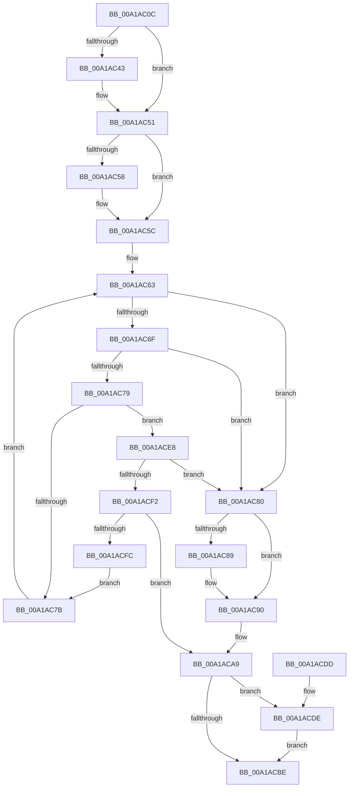

# AlpcpRegisterCompletionListDatabase

- RVA: `0x00A1AC0C`–`0x00A1AD01` (길이 `245` bytes)
- VA: `0x0000000140A1AC0C`
- 실행 섹션: `PAGE`
- PDB 이름 있음: `예`; PDB Function 태그: `아니요`
- unwind 정보 RVA: `0x0007AE84`
- 디코드: `68`개 명령, `245/245` bytes 표시
- 미해석 바이트: `0` (있으면 어셈블리에 `.byte`로 보존)

> 이 문서는 커널 이미지의 기계어와 PDB 기호를 분석해 생성했습니다. 4번과 5번은 함수 원형과 자료형을 바이너리 사용 방식에서 추정한 C 해석이며 원본 소스 복구 결과는 아닙니다.

## 1. Dependencies

- 직접 호출 지점: **4**; 고유 호출 대상: **4**
- 직접 호출자로 확인된 함수: **1**
- RIP 상대 이미지 참조: **4**

### Outgoing calls
- `0x00A1AC32` → [KeAbPreAcquire](../../text/21/KeAbPreAcquire_function_00210230.md) (function, `0x00210230`)
- `0x00A1AC4C` → [ExfAcquirePushLockExclusiveEx](../../text/20/ExfAcquirePushLockExclusiveEx_function_0020FC90.md) (function, `0x0020FC90`)
- `0x00A1ACC1` → [KeAbPostRelease](../../text/2E/KeAbPostRelease_function_002E1600.md) (function, `0x002E1600`)
- `0x00A1ACE1` → [ExfTryToWakePushLock](../../text/26/ExfTryToWakePushLock_function_00265DD0.md) (function, `0x00265DD0`)

### Direct callers
- [AlpcpInitializeCompletionList](AlpcpInitializeCompletionList_function_00A1A6D0.md) at `0x00A1A7B9`

### Static image references
- `0x00A1AC23` → RVA `0x00F10120` (`.data`; read)
- `0x00A1AC5C` → RVA `0x00F10130` (`.data`; read)
- `0x00A1ACA3` → RVA `0x00F10128` (`.data`; read/write)
- `0x00A1ACAD` → RVA `0x00F10120` (`.data`; read/write)

## 2. Other-region calls and transfers

- 다른 실행 섹션으로 향하는 call: **4**
  - `0x00A1AC32` → [KeAbPreAcquire](../../text/21/KeAbPreAcquire_function_00210230.md) (`PAGE` → `.text`)
  - `0x00A1AC4C` → [ExfAcquirePushLockExclusiveEx](../../text/20/ExfAcquirePushLockExclusiveEx_function_0020FC90.md) (`PAGE` → `.text`)
  - `0x00A1ACC1` → [KeAbPostRelease](../../text/2E/KeAbPostRelease_function_002E1600.md) (`PAGE` → `.text`)
  - `0x00A1ACE1` → [ExfTryToWakePushLock](../../text/26/ExfTryToWakePushLock_function_00265DD0.md) (`PAGE` → `.text`)
- 별도 외부 분기/꼬리 이동을 확인하지 못했습니다.

## 3. Assembly (complete function range)

```asm
00A1AC0C  48 89 5C 24 08                  mov qword ptr [rsp + 8], rbx
00A1AC11  48 89 6C 24 10                  mov qword ptr [rsp + 0x10], rbp
00A1AC16  48 89 74 24 18                  mov qword ptr [rsp + 0x18], rsi
00A1AC1B  57                              push rdi
00A1AC1C  48 83 EC 20                     sub rsp, 0x20
00A1AC20  48 8B D9                        mov rbx, rcx
00A1AC23  48 8D 2D F6 54 4F 00            lea rbp, [rip + 0x4f54f6]
00A1AC2A  48 8B CD                        mov rcx, rbp
00A1AC2D  45 33 C0                        xor r8d, r8d
00A1AC30  33 D2                           xor edx, edx
00A1AC32  E8 F9 55 7F FF                  call 0x140210230
00A1AC37  F0 48 0F BA 6D 00 00            lock bts qword ptr [rbp], 0
00A1AC3E  48 8B F8                        mov rdi, rax
00A1AC41  73 0E                           jae 0x140a1ac51
00A1AC43  4C 8B C5                        mov r8, rbp
00A1AC46  48 8B D0                        mov rdx, rax
00A1AC49  48 8B CD                        mov rcx, rbp
00A1AC4C  E8 3F 50 7F FF                  call 0x14020fc90
00A1AC51  33 F6                           xor esi, esi
00A1AC53  48 85 FF                        test rdi, rdi
00A1AC56  74 04                           je 0x140a1ac5c
00A1AC58  C6 47 0A 01                     mov byte ptr [rdi + 0xa], 1
00A1AC5C  48 8B 0D CD 54 4F 00            mov rcx, qword ptr [rip + 0x4f54cd]
00A1AC63  48 8D 05 C6 54 4F 00            lea rax, [rip + 0x4f54c6]
00A1AC6A  48 3B C8                        cmp rcx, rax
00A1AC6D  74 11                           je 0x140a1ac80
00A1AC6F  48 8B 41 10                     mov rax, qword ptr [rcx + 0x10]
00A1AC73  48 3B 43 10                     cmp rax, qword ptr [rbx + 0x10]
00A1AC77  77 07                           ja 0x140a1ac80
00A1AC79  74 6D                           je 0x140a1ace8
00A1AC7B  48 8B 09                        mov rcx, qword ptr [rcx]
00A1AC7E  EB E3                           jmp 0x140a1ac63
00A1AC80  48 8B 41 08                     mov rax, qword ptr [rcx + 8]
00A1AC84  48 39 08                        cmp qword ptr [rax], rcx
00A1AC87  74 07                           je 0x140a1ac90
00A1AC89  B9 03 00 00 00                  mov ecx, 3
00A1AC8E  CD 29                           int 0x29
00A1AC90  48 89 0B                        mov qword ptr [rbx], rcx
00A1AC93  BE 01 00 00 00                  mov esi, 1
00A1AC98  48 89 43 08                     mov qword ptr [rbx + 8], rax
00A1AC9C  48 89 18                        mov qword ptr [rax], rbx
00A1AC9F  48 89 59 08                     mov qword ptr [rcx + 8], rbx
00A1ACA3  FF 05 7F 54 4F 00               inc dword ptr [rip + 0x4f547f]
00A1ACA9  48 83 CA FF                     or rdx, 0xffffffffffffffff
00A1ACAD  F0 48 0F C1 15 6A 54 4F 00      lock xadd qword ptr [rip + 0x4f546a], rdx
00A1ACB6  80 E2 06                        and dl, 6
00A1ACB9  80 FA 02                        cmp dl, 2
00A1ACBC  74 20                           je 0x140a1acde
00A1ACBE  48 8B CD                        mov rcx, rbp
00A1ACC1  E8 3A 69 8C FF                  call 0x1402e1600
00A1ACC6  48 8B 5C 24 30                  mov rbx, qword ptr [rsp + 0x30]
00A1ACCB  8B C6                           mov eax, esi
00A1ACCD  48 8B 74 24 40                  mov rsi, qword ptr [rsp + 0x40]
00A1ACD2  48 8B 6C 24 38                  mov rbp, qword ptr [rsp + 0x38]
00A1ACD7  48 83 C4 20                     add rsp, 0x20
00A1ACDB  5F                              pop rdi
00A1ACDC  C3                              ret
00A1ACDD  CC                              int3
00A1ACDE  48 8B CD                        mov rcx, rbp
00A1ACE1  E8 EA B0 84 FF                  call 0x140265dd0
00A1ACE6  EB D6                           jmp 0x140a1acbe
00A1ACE8  48 8B 43 30                     mov rax, qword ptr [rbx + 0x30]
00A1ACEC  48 39 41 28                     cmp qword ptr [rcx + 0x28], rax
00A1ACF0  73 8E                           jae 0x140a1ac80
00A1ACF2  48 8B 43 28                     mov rax, qword ptr [rbx + 0x28]
00A1ACF6  48 39 41 30                     cmp qword ptr [rcx + 0x30], rax
00A1ACFA  77 AD                           ja 0x140a1aca9
00A1ACFC  E9 7A FF FF FF                  jmp 0x140a1ac7b
```

## 4. C-style interpretation (structured pseudocode)

```c
__int64 __fastcall AlpcpRegisterCompletionListDatabase(__int64 a1, int a2, int a3)
{
    __int64 result;
    __int64 v_rsi;
    __int64 v_rsp;
    unsigned __int64 v_stack_p10;
    unsigned __int64 v_stack_p18;
    unsigned __int64 v_stack_p8;

    v_stack_p8 = v_rbx;
    v_stack_p10 = v_rbp;
    v_stack_p18 = v_rsi;
    v_rsp = (v_rsp) - (32);
    a3 = 0;
    a2 = 0;
    result = KeAbPreAcquire(v_rip + 5199094, a2, a3, a4);
    if (!(condition_is_above_or_equal)) {
        a3 = v_rip + 5199094;
        a2 = result;
        a1 = v_rip + 5199094;
        result = ExfAcquirePushLockExclusiveEx(a1, a2, a3, a4);
    }
    v_rsi = 0;
    if (result != 0) {
        *(unsigned __int8 *)(result + 10) = 1;
    }
loc_00A1AC63:
    if ((*(unsigned __int64 *)(v_rip + 5199053)) == (v_rip + 5199046)) goto loc_00A1AC80;
    if ((*(unsigned __int64 *)(*(unsigned __int64 *)(v_rip + 5199053) + 16)) > (*(unsigned __int64 *)(a1 + 16))) goto loc_00A1AC80;
    if ((*(unsigned __int64 *)(*(unsigned __int64 *)(v_rip + 5199053) + 16)) == (*(unsigned __int64 *)(a1 + 16))) goto loc_00A1ACE8;
loc_00A1AC7B:
    goto loc_00A1AC63;
loc_00A1AC80:
    if ((*(unsigned __int64 *)(*(unsigned __int64 *)(*(unsigned __int64 *)(*(unsigned __int64 *)(v_rip + 5199053)) + 8))) != (*(unsigned __int64 *)(*(unsigned __int64 *)(v_rip + 5199053)))) {
        a1 = 3;
    }
    *(unsigned __int64 *)(a1) = a1;
    *(unsigned __int64 *)(a1 + 8) = *(unsigned __int64 *)(*(unsigned __int64 *)(*(unsigned __int64 *)(v_rip + 5199053)) + 8);
    *(unsigned __int64 *)(*(unsigned __int64 *)(*(unsigned __int64 *)(*(unsigned __int64 *)(v_rip + 5199053)) + 8)) = a1;
    *(unsigned __int64 *)(a1 + 8) = a1;
loc_00A1ACA9:
    a2 = (a2) | (-1);
    a2 = (unsigned __int8)((a2) & (6));
    if (((unsigned __int8)(a2)) == 2) goto loc_00A1ACDE;
loc_00A1ACBE:
    result = KeAbPostRelease(v_rip + 5199094, a2, a3, a4);
    v_rsp = (v_rsp) + (32);
    return 1;
loc_00A1ACDE:
    result = ExfTryToWakePushLock(v_stack_p10, a2, a3, a4);
    goto loc_00A1ACBE;
loc_00A1ACE8:
    if ((*(unsigned __int64 *)(v_stack_p10 + 40)) >= (*(unsigned __int64 *)(v_stack_p8 + 48))) goto loc_00A1AC80;
    if ((*(unsigned __int64 *)(v_stack_p10 + 48)) > (*(unsigned __int64 *)(v_stack_p8 + 40))) goto loc_00A1ACA9;
    goto loc_00A1AC7B;
}
```

## 5. (Beta) C Style

```c
int64_t AlpcpRegisterCompletionListDatabase(void *Arg1, int32_t Arg2, int32_t Arg3)
{
    uint8_t *arg1 = (uint8_t *)Arg1;

    int64_t result;
    int64_t local_rsi;
    int64_t local_rsp;
    uint64_t v_stack_p10;
    uint64_t v_stack_p18;
    uint64_t v_stack_p8;

    v_stack_p8 = local_rbx;
    v_stack_p10 = local_rbp;
    v_stack_p18 = local_rsi;
    local_rsp = (local_rsp) - (32);
    Arg3 = 0;
    Arg2 = 0;
    result = KeAbPreAcquire(v_rip + 5199094, Arg2, Arg3, a4);
    if (!(condition_is_above_or_equal)) {
        Arg3 = v_rip + 5199094;
        Arg2 = result;
        Arg1 = v_rip + 5199094;
        result = ExfAcquirePushLockExclusiveEx(Arg1, Arg2, Arg3, a4);
    }
    local_rsi = 0;
    if (result != 0) {
        *(uint8_t *)(result + 0xA) = 1;
    }
loc_00A1AC63:
    if ((*(uint64_t *)(v_rip + 0x4F54CD)) == (v_rip + 5199046)) goto loc_00A1AC80;
    if ((*(uint64_t *)(*(uint64_t *)(v_rip + 0x4F54CD) + 0x10)) > (*(uint64_t *)(arg1 + 0x10))) goto loc_00A1AC80;
    if ((*(uint64_t *)(*(uint64_t *)(v_rip + 0x4F54CD) + 0x10)) == (*(uint64_t *)(arg1 + 0x10))) goto loc_00A1ACE8;
loc_00A1AC7B:
    goto loc_00A1AC63;
loc_00A1AC80:
    if ((*(uint64_t *)(*(uint64_t *)(*(uint64_t *)(*(uint64_t *)(v_rip + 0x4F54CD)) + 0x8))) != (*(uint64_t *)(*(uint64_t *)(v_rip + 0x4F54CD)))) {
        Arg1 = 3;
    }
    *(void **)(arg1) = Arg1;
    *(uint64_t *)(arg1 + 0x8) = *(uint64_t *)(*(uint64_t *)(*(uint64_t *)(v_rip + 0x4F54CD)) + 0x8);
    *(void **)(*(uint64_t *)(*(uint64_t *)(*(uint64_t *)(v_rip + 0x4F54CD)) + 0x8)) = Arg1;
    *(void **)(arg1 + 0x8) = Arg1;
loc_00A1ACA9:
    Arg2 = (Arg2) | (-1);
    Arg2 = (uint8_t)((Arg2) & (6));
    if (((uint8_t)(Arg2)) == 2) goto loc_00A1ACDE;
loc_00A1ACBE:
    result = KeAbPostRelease(v_rip + 5199094, Arg2, Arg3, a4);
    local_rsp = (local_rsp) + (32);
    return 1;
loc_00A1ACDE:
    result = ExfTryToWakePushLock(v_stack_p10, Arg2, Arg3, a4);
    goto loc_00A1ACBE;
loc_00A1ACE8:
    if ((*(uint64_t *)(v_stack_p10 + 0x28)) >= (*(uint64_t *)(v_stack_p8 + 0x30))) goto loc_00A1AC80;
    if ((*(uint64_t *)(v_stack_p10 + 0x30)) > (*(uint64_t *)(v_stack_p8 + 0x28))) goto loc_00A1ACA9;
    goto loc_00A1AC7B;
}
```

### 관측된 메모리 오프셋

구조체 형식이 확인되지 않은 접근은 인자 기준의 오프셋으로만 기록했습니다.

| 기준 인자 | 오프셋 표현 | 폭 (bit) | 접근 |
|---|---:|---:|---|
| `Arg1` | `+ 0x0` | `64` | `W` |
| `Arg1` | `+ 0x8` | `64` | `W` |
| `Arg1` | `+ 0x10` | `64` | `R` |
| `Arg1` | `+ 0x28` | `64` | `R` |
| `Arg1` | `+ 0x30` | `64` | `R` |

## 6. Execution-region graph

[열기: 2D/3D 그래프와 함수 탐색 컨트롤 패널](../../../control-panel.html?section=page&rva=0x00A1AC0C&view=graph)

- 2D 그래프는 위에서 아래로 흐르고, 3D 그래프는 빈 공간을 드래그해 회전합니다. Shift+드래그는 이동, 휠은 확대·축소, 함수 노드 선택은 대상 보고서 이동입니다.

### Static fallback


