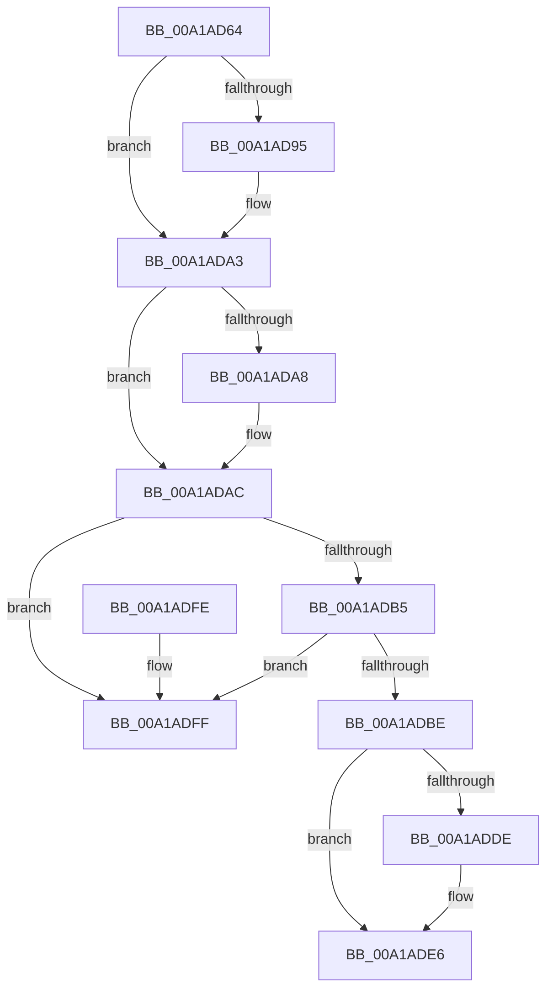

# AlpcpUnregisterCompletionListDatabase

- RVA: `0x00A1AD64`–`0x00A1AE06` (길이 `162` bytes)
- VA: `0x0000000140A1AD64`
- 실행 섹션: `PAGE`
- PDB 이름 있음: `예`; PDB Function 태그: `아니요`
- unwind 정보 RVA: `0x0006383C`
- 디코드: `46`개 명령, `162/162` bytes 표시
- 미해석 바이트: `0` (있으면 어셈블리에 `.byte`로 보존)

> 이 문서는 커널 이미지의 기계어와 PDB 기호를 분석해 생성했습니다. 4번과 5번은 함수 원형과 자료형을 바이너리 사용 방식에서 추정한 C 해석이며 원본 소스 복구 결과는 아닙니다.

## 1. Dependencies

- 직접 호출 지점: **4**; 고유 호출 대상: **4**
- 직접 호출자로 확인된 함수: **2**
- RIP 상대 이미지 참조: **3**

### Outgoing calls
- `0x00A1AD85` → [KeAbPreAcquire](../../text/21/KeAbPreAcquire_function_00210230.md) (function, `0x00210230`)
- `0x00A1AD9E` → [ExfAcquirePushLockExclusiveEx](../../text/20/ExfAcquirePushLockExclusiveEx_function_0020FC90.md) (function, `0x0020FC90`)
- `0x00A1ADE1` → [ExfTryToWakePushLock](../../text/26/ExfTryToWakePushLock_function_00265DD0.md) (function, `0x00265DD0`)
- `0x00A1ADE9` → [KeAbPostRelease](../../text/2E/KeAbPostRelease_function_002E1600.md) (function, `0x002E1600`)

### Direct callers
- [AlpcpFreeCompletionList](AlpcpFreeCompletionList_function_00A1AD08.md) at `0x00A1AD31`
- [sub_00B3733A](../B3/Unknown_function_00B3733A.md) at `0x00B37350`

### Static image references
- `0x00A1AD76` → RVA `0x00F10120` (`.data`; read)
- `0x00A1ADC5` → RVA `0x00F10128` (`.data`; read/write)
- `0x00A1ADCF` → RVA `0x00F10120` (`.data`; read/write)

## 2. Other-region calls and transfers

- 다른 실행 섹션으로 향하는 call: **4**
  - `0x00A1AD85` → [KeAbPreAcquire](../../text/21/KeAbPreAcquire_function_00210230.md) (`PAGE` → `.text`)
  - `0x00A1AD9E` → [ExfAcquirePushLockExclusiveEx](../../text/20/ExfAcquirePushLockExclusiveEx_function_0020FC90.md) (`PAGE` → `.text`)
  - `0x00A1ADE1` → [ExfTryToWakePushLock](../../text/26/ExfTryToWakePushLock_function_00265DD0.md) (`PAGE` → `.text`)
  - `0x00A1ADE9` → [KeAbPostRelease](../../text/2E/KeAbPostRelease_function_002E1600.md) (`PAGE` → `.text`)
- 별도 외부 분기/꼬리 이동을 확인하지 못했습니다.

## 3. Assembly (complete function range)

```asm
00A1AD64  48 89 5C 24 08                  mov qword ptr [rsp + 8], rbx
00A1AD69  48 89 74 24 10                  mov qword ptr [rsp + 0x10], rsi
00A1AD6E  57                              push rdi
00A1AD6F  48 83 EC 20                     sub rsp, 0x20
00A1AD73  48 8B D9                        mov rbx, rcx
00A1AD76  48 8D 35 A3 53 4F 00            lea rsi, [rip + 0x4f53a3]
00A1AD7D  48 8B CE                        mov rcx, rsi
00A1AD80  45 33 C0                        xor r8d, r8d
00A1AD83  33 D2                           xor edx, edx
00A1AD85  E8 A6 54 7F FF                  call 0x140210230
00A1AD8A  F0 48 0F BA 2E 00               lock bts qword ptr [rsi], 0
00A1AD90  48 8B F8                        mov rdi, rax
00A1AD93  73 0E                           jae 0x140a1ada3
00A1AD95  4C 8B C6                        mov r8, rsi
00A1AD98  48 8B D0                        mov rdx, rax
00A1AD9B  48 8B CE                        mov rcx, rsi
00A1AD9E  E8 ED 4E 7F FF                  call 0x14020fc90
00A1ADA3  48 85 FF                        test rdi, rdi
00A1ADA6  74 04                           je 0x140a1adac
00A1ADA8  C6 47 0A 01                     mov byte ptr [rdi + 0xa], 1
00A1ADAC  48 8B 13                        mov rdx, qword ptr [rbx]
00A1ADAF  48 39 5A 08                     cmp qword ptr [rdx + 8], rbx
00A1ADB3  75 4A                           jne 0x140a1adff
00A1ADB5  48 8B 43 08                     mov rax, qword ptr [rbx + 8]
00A1ADB9  48 39 18                        cmp qword ptr [rax], rbx
00A1ADBC  75 41                           jne 0x140a1adff
00A1ADBE  48 89 10                        mov qword ptr [rax], rdx
00A1ADC1  48 89 42 08                     mov qword ptr [rdx + 8], rax
00A1ADC5  FF 0D 5D 53 4F 00               dec dword ptr [rip + 0x4f535d]
00A1ADCB  48 83 C8 FF                     or rax, 0xffffffffffffffff
00A1ADCF  F0 48 0F C1 05 48 53 4F 00      lock xadd qword ptr [rip + 0x4f5348], rax
00A1ADD8  24 06                           and al, 6
00A1ADDA  3C 02                           cmp al, 2
00A1ADDC  75 08                           jne 0x140a1ade6
00A1ADDE  48 8B CE                        mov rcx, rsi
00A1ADE1  E8 EA AF 84 FF                  call 0x140265dd0
00A1ADE6  48 8B CE                        mov rcx, rsi
00A1ADE9  E8 12 68 8C FF                  call 0x1402e1600
00A1ADEE  48 8B 5C 24 30                  mov rbx, qword ptr [rsp + 0x30]
00A1ADF3  48 8B 74 24 38                  mov rsi, qword ptr [rsp + 0x38]
00A1ADF8  48 83 C4 20                     add rsp, 0x20
00A1ADFC  5F                              pop rdi
00A1ADFD  C3                              ret
00A1ADFE  CC                              int3
00A1ADFF  B9 03 00 00 00                  mov ecx, 3
00A1AE04  CD 29                           int 0x29
```

## 4. C-style interpretation (structured pseudocode)

```c
__int64 __fastcall AlpcpUnregisterCompletionListDatabase(__int64 a1, int a2, int a3)
{
    __int64 result;
    __int64 v_rsp;
    unsigned __int64 v_stack_p10;
    unsigned __int64 v_stack_p8;

    v_stack_p8 = v_rbx;
    v_stack_p10 = v_rsi;
    v_rsp = (v_rsp) - (32);
    a3 = 0;
    a2 = 0;
    result = KeAbPreAcquire(v_rip + 5198755, a2, a3, a4);
    if (!(condition_is_above_or_equal)) {
        a3 = v_rip + 5198755;
        a2 = result;
        a1 = v_rip + 5198755;
        result = ExfAcquirePushLockExclusiveEx(a1, a2, a3, a4);
    }
    if (result != 0) {
        *(unsigned __int8 *)(result + 10) = 1;
    }
    if ((*(unsigned __int64 *)(*(unsigned __int64 *)(a1) + 8)) != a1) goto loc_00A1ADFF;
    if ((*(unsigned __int64 *)(*(unsigned __int64 *)(a1 + 8))) != a1) goto loc_00A1ADFF;
    *(unsigned __int64 *)(*(unsigned __int64 *)(a1 + 8)) = *(unsigned __int64 *)(a1);
    *(unsigned __int64 *)(*(unsigned __int64 *)(a1) + 8) = *(unsigned __int64 *)(a1 + 8);
    result = (*(unsigned __int64 *)(a1 + 8)) | (-1);
    result = (unsigned __int8)((result) & (6));
    if (((unsigned __int8)(result)) == 2) {
        a1 = v_rip + 5198755;
        result = ExfTryToWakePushLock(a1, *(unsigned __int64 *)(a1), a3, a4);
    }
    result = KeAbPostRelease(v_rip + 5198755, *(unsigned __int64 *)(a1), a3, a4);
    v_rsp = (v_rsp) + (32);
    return result;
loc_00A1ADFF:
    return result;
}
```

## 5. (Beta) C Style

```c
int64_t AlpcpUnregisterCompletionListDatabase(void *Arg1, int32_t Arg2, int32_t Arg3)
{
    uint8_t *arg1 = (uint8_t *)Arg1;

    int64_t result;
    int64_t local_rsp;
    uint64_t v_stack_p10;
    uint64_t v_stack_p8;

    v_stack_p8 = local_rbx;
    v_stack_p10 = local_rsi;
    local_rsp = (local_rsp) - (32);
    Arg3 = 0;
    Arg2 = 0;
    result = KeAbPreAcquire(v_rip + 5198755, Arg2, Arg3, a4);
    if (!(condition_is_above_or_equal)) {
        Arg3 = v_rip + 5198755;
        Arg2 = result;
        Arg1 = v_rip + 5198755;
        result = ExfAcquirePushLockExclusiveEx(Arg1, Arg2, Arg3, a4);
    }
    if (result != 0) {
        *(uint8_t *)(result + 0xA) = 1;
    }
    if ((*(uint64_t *)(*(uint64_t *)(arg1) + 0x8)) != Arg1) goto loc_00A1ADFF;
    if ((*(uint64_t *)(*(uint64_t *)(arg1 + 0x8))) != Arg1) goto loc_00A1ADFF;
    *(uint64_t *)(*(uint64_t *)(arg1 + 0x8)) = *(uint64_t *)(arg1);
    *(uint64_t *)(*(uint64_t *)(arg1) + 0x8) = *(uint64_t *)(arg1 + 0x8);
    result = (*(uint64_t *)(arg1 + 0x8)) | (-1);
    result = (uint8_t)((result) & (6));
    if (((uint8_t)(result)) == 2) {
        Arg1 = v_rip + 5198755;
        result = ExfTryToWakePushLock(Arg1, *(uint64_t *)(arg1), Arg3, a4);
    }
    result = KeAbPostRelease(v_rip + 5198755, *(uint64_t *)(arg1), Arg3, a4);
    local_rsp = (local_rsp) + (32);
    return result;
loc_00A1ADFF:
    return result;
}
```

### 관측된 메모리 오프셋

구조체 형식이 확인되지 않은 접근은 인자 기준의 오프셋으로만 기록했습니다.

| 기준 인자 | 오프셋 표현 | 폭 (bit) | 접근 |
|---|---:|---:|---|
| `Arg1` | `+ 0x0` | `64` | `R` |
| `Arg1` | `+ 0x8` | `64` | `R` |

## 6. Execution-region graph

[열기: 2D/3D 그래프와 함수 탐색 컨트롤 패널](../../../control-panel.html?section=page&rva=0x00A1AD64&view=graph)

- 2D 그래프는 위에서 아래로 흐르고, 3D 그래프는 빈 공간을 드래그해 회전합니다. Shift+드래그는 이동, 휠은 확대·축소, 함수 노드 선택은 대상 보고서 이동입니다.

### Static fallback


