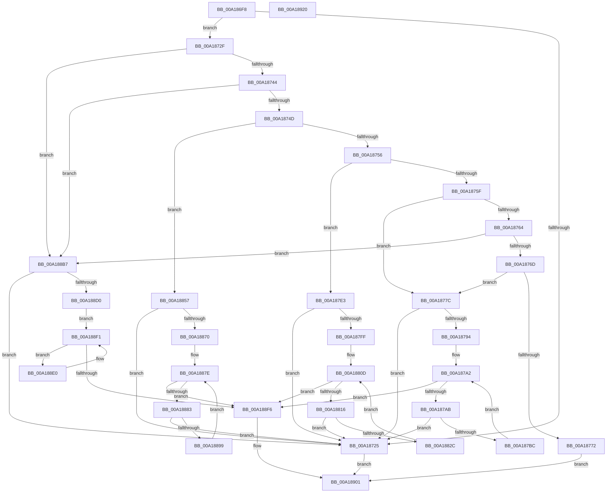

# AuthzBasepCopyoutClaimAttributeValues

- RVA: `0x00A186F8`–`0x00A18921` (길이 `553` bytes)
- VA: `0x0000000140A186F8`
- 실행 섹션: `PAGE`
- PDB 이름 있음: `예`; PDB Function 태그: `아니요`
- unwind 정보 RVA: `0x00075C18`
- 디코드: `153`개 명령, `553/553` bytes 표시
- 미해석 바이트: `0` (있으면 어셈블리에 `.byte`로 보존)

> 이 문서는 커널 이미지의 기계어와 PDB 기호를 분석해 생성했습니다. 4번과 5번은 함수 원형과 자료형을 바이너리 사용 방식에서 추정한 C 해석이며 원본 소스 복구 결과는 아닙니다.

## 1. Dependencies

- 직접 호출 지점: **3**; 고유 호출 대상: **2**
- 직접 호출자로 확인된 함수: **1**
- RIP 상대 이미지 참조: **0**

### Outgoing calls
- `0x00A187D3` → [memcpy](../../text/6C/memcpy_function_006C6840.md) (function, `0x006C6840`)
- `0x00A18847` → [RtlStringCbCopyNW](../../text/39/RtlStringCbCopyNW_function_003905E8.md) (function, `0x003905E8`)
- `0x00A188A7` → [RtlStringCbCopyNW](../../text/39/RtlStringCbCopyNW_function_003905E8.md) (function, `0x003905E8`)

### Direct callers
- [AuthzBasepCopyoutClaimAttributes](AuthzBasepCopyoutClaimAttributes_function_00A18570.md) at `0x00A1868B`

### Static image references
- 디코드된 RIP-relative 메모리 참조가 없습니다.

## 2. Other-region calls and transfers

- 다른 실행 섹션으로 향하는 call: **3**
  - `0x00A187D3` → [memcpy](../../text/6C/memcpy_function_006C6840.md) (`PAGE` → `.text`)
  - `0x00A18847` → [RtlStringCbCopyNW](../../text/39/RtlStringCbCopyNW_function_003905E8.md) (`PAGE` → `.text`)
  - `0x00A188A7` → [RtlStringCbCopyNW](../../text/39/RtlStringCbCopyNW_function_003905E8.md) (`PAGE` → `.text`)
- 별도 외부 분기/꼬리 이동을 확인하지 못했습니다.

## 3. Assembly (complete function range)

```asm
00A186F8  48 89 5C 24 08                  mov qword ptr [rsp + 8], rbx
00A186FD  48 89 6C 24 10                  mov qword ptr [rsp + 0x10], rbp
00A18702  48 89 74 24 18                  mov qword ptr [rsp + 0x18], rsi
00A18707  57                              push rdi
00A18708  41 54                           push r12
00A1870A  41 55                           push r13
00A1870C  41 56                           push r14
00A1870E  41 57                           push r15
00A18710  48 83 EC 20                     sub rsp, 0x20
00A18714  33 DB                           xor ebx, ebx
00A18716  4B 8D 3C 08                     lea rdi, [r8 + r9]
00A1871A  49 8B F0                        mov rsi, r8
00A1871D  4C 8B D9                        mov r11, rcx
00A18720  49 3B F8                        cmp rdi, r8
00A18723  73 0A                           jae 0x140a1872f
00A18725  BB 05 00 00 80                  mov ebx, 0x80000005
00A1872A  E9 D2 01 00 00                  jmp 0x140a18901
00A1872F  48 8B 44 24 70                  mov rax, qword ptr [rsp + 0x70]
00A18734  0F B7 49 30                     movzx ecx, word ptr [rcx + 0x30]
00A18738  48 89 18                        mov qword ptr [rax], rbx
00A1873B  83 E9 01                        sub ecx, 1
00A1873E  0F 84 73 01 00 00               je 0x140a188b7
00A18744  83 E9 01                        sub ecx, 1
00A18747  0F 84 6A 01 00 00               je 0x140a188b7
00A1874D  83 E9 01                        sub ecx, 1
00A18750  0F 84 01 01 00 00               je 0x140a18857
00A18756  83 E9 01                        sub ecx, 1
00A18759  0F 84 84 00 00 00               je 0x140a187e3
00A1875F  83 E9 01                        sub ecx, 1
00A18762  74 18                           je 0x140a1877c
00A18764  83 E9 01                        sub ecx, 1
00A18767  0F 84 4A 01 00 00               je 0x140a188b7
00A1876D  83 F9 0A                        cmp ecx, 0xa
00A18770  74 0A                           je 0x140a1877c
00A18772  BB 0D 00 00 C0                  mov ebx, 0xc000000d
00A18777  E9 85 01 00 00                  jmp 0x140a18901
00A1877C  45 8B 53 3C                     mov r10d, dword ptr [r11 + 0x3c]
00A18780  49 8D 68 07                     lea rbp, [r8 + 7]
00A18784  48 83 E5 F8                     and rbp, 0xfffffffffffffff8
00A18788  49 C1 E2 04                     shl r10, 4
00A1878C  4C 03 D5                        add r10, rbp
00A1878F  4C 3B D7                        cmp r10, rdi
00A18792  77 91                           ja 0x140a18725
00A18794  4D 8D 7B 48                     lea r15, [r11 + 0x48]
00A18798  48 89 6A 18                     mov qword ptr [rdx + 0x18], rbp
00A1879C  4D 8B 37                        mov r14, qword ptr [r15]
00A1879F  44 8B EB                        mov r13d, ebx
00A187A2  4D 3B F7                        cmp r14, r15
00A187A5  0F 84 4B 01 00 00               je 0x140a188f6
00A187AB  45 8B 46 30                     mov r8d, dword ptr [r14 + 0x30]
00A187AF  4F 8D 24 02                     lea r12, [r10 + r8]
00A187B3  4C 3B E7                        cmp r12, rdi
00A187B6  0F 87 69 FF FF FF               ja 0x140a18725
00A187BC  41 8B C5                        mov eax, r13d
00A187BF  49 8B CA                        mov rcx, r10
00A187C2  48 03 C0                        add rax, rax
00A187C5  4C 89 54 C5 00                  mov qword ptr [rbp + rax*8], r10
00A187CA  44 89 44 C5 08                  mov dword ptr [rbp + rax*8 + 8], r8d
00A187CF  49 8B 56 28                     mov rdx, qword ptr [r14 + 0x28]
00A187D3  E8 68 E0 CA FF                  call 0x1406c6840
00A187D8  4D 8B 36                        mov r14, qword ptr [r14]
00A187DB  4D 8B D4                        mov r10, r12
00A187DE  41 FF C5                        inc r13d
00A187E1  EB BF                           jmp 0x140a187a2
00A187E3  45 8B 53 3C                     mov r10d, dword ptr [r11 + 0x3c]
00A187E7  49 8D 68 07                     lea rbp, [r8 + 7]
00A187EB  48 83 E5 F8                     and rbp, 0xfffffffffffffff8
00A187EF  49 C1 E2 04                     shl r10, 4
00A187F3  4C 03 D5                        add r10, rbp
00A187F6  4C 3B D7                        cmp r10, rdi
00A187F9  0F 87 26 FF FF FF               ja 0x140a18725
00A187FF  4D 8D 73 48                     lea r14, [r11 + 0x48]
00A18803  48 89 6A 18                     mov qword ptr [rdx + 0x18], rbp
00A18807  4D 8B 1E                        mov r11, qword ptr [r14]
00A1880A  44 8B E3                        mov r12d, ebx
00A1880D  4D 3B DE                        cmp r11, r14
00A18810  0F 84 E0 00 00 00               je 0x140a188f6
00A18816  45 0F B7 4B 30                  movzx r9d, word ptr [r11 + 0x30]
00A1881B  49 8D 51 02                     lea rdx, [r9 + 2]
00A1881F  4D 8D 3C 12                     lea r15, [r10 + rdx]
00A18823  4C 3B FF                        cmp r15, rdi
00A18826  0F 87 F9 FE FF FF               ja 0x140a18725
00A1882C  49 8B 43 28                     mov rax, qword ptr [r11 + 0x28]
00A18830  41 8B CC                        mov ecx, r12d
00A18833  48 03 C9                        add rcx, rcx
00A18836  48 89 44 CD 00                  mov qword ptr [rbp + rcx*8], rax
00A1883B  4C 89 54 CD 08                  mov qword ptr [rbp + rcx*8 + 8], r10
00A18840  49 8B CA                        mov rcx, r10
00A18843  4D 8B 43 38                     mov r8, qword ptr [r11 + 0x38]
00A18847  E8 9C 7D 97 FF                  call 0x1403905e8
00A1884C  4D 8B 1B                        mov r11, qword ptr [r11]
00A1884F  4D 8B D7                        mov r10, r15
00A18852  41 FF C4                        inc r12d
00A18855  EB B6                           jmp 0x140a1880d
00A18857  41 8B 43 3C                     mov eax, dword ptr [r11 + 0x3c]
00A1885B  4D 8D 70 07                     lea r14, [r8 + 7]
00A1885F  49 83 E6 F8                     and r14, 0xfffffffffffffff8
00A18863  4D 8D 14 C6                     lea r10, [r14 + rax*8]
00A18867  4C 3B D7                        cmp r10, rdi
00A1886A  0F 87 B5 FE FF FF               ja 0x140a18725
00A18870  4D 8D 7B 48                     lea r15, [r11 + 0x48]
00A18874  4C 89 72 18                     mov qword ptr [rdx + 0x18], r14
00A18878  4D 8B 1F                        mov r11, qword ptr [r15]
00A1887B  44 8B E3                        mov r12d, ebx
00A1887E  4D 3B DF                        cmp r11, r15
00A18881  74 73                           je 0x140a188f6
00A18883  45 0F B7 4B 28                  movzx r9d, word ptr [r11 + 0x28]
00A18888  49 8D 51 02                     lea rdx, [r9 + 2]
00A1888C  49 8D 2C 12                     lea rbp, [r10 + rdx]
00A18890  48 3B EF                        cmp rbp, rdi
00A18893  0F 87 8C FE FF FF               ja 0x140a18725
00A18899  41 8B C4                        mov eax, r12d
00A1889C  49 8B CA                        mov rcx, r10
00A1889F  4D 89 14 C6                     mov qword ptr [r14 + rax*8], r10
00A188A3  4D 8B 43 30                     mov r8, qword ptr [r11 + 0x30]
00A188A7  E8 3C 7D 97 FF                  call 0x1403905e8
00A188AC  4D 8B 1B                        mov r11, qword ptr [r11]
00A188AF  4C 8B D5                        mov r10, rbp
00A188B2  41 FF C4                        inc r12d
00A188B5  EB C7                           jmp 0x140a1887e
00A188B7  41 8B 43 3C                     mov eax, dword ptr [r11 + 0x3c]
00A188BB  49 83 C0 07                     add r8, 7
00A188BF  49 83 E0 F8                     and r8, 0xfffffffffffffff8
00A188C3  4D 8D 14 C0                     lea r10, [r8 + rax*8]
00A188C7  4C 3B D7                        cmp r10, rdi
00A188CA  0F 87 55 FE FF FF               ja 0x140a18725
00A188D0  49 83 C3 48                     add r11, 0x48
00A188D4  4C 89 42 18                     mov qword ptr [rdx + 0x18], r8
00A188D8  44 8B CB                        mov r9d, ebx
00A188DB  49 8B 13                        mov rdx, qword ptr [r11]
00A188DE  EB 11                           jmp 0x140a188f1
00A188E0  48 8B 42 28                     mov rax, qword ptr [rdx + 0x28]
00A188E4  41 8B C9                        mov ecx, r9d
00A188E7  41 FF C1                        inc r9d
00A188EA  49 89 04 C8                     mov qword ptr [r8 + rcx*8], rax
00A188EE  48 8B 12                        mov rdx, qword ptr [rdx]
00A188F1  49 3B D3                        cmp rdx, r11
00A188F4  75 EA                           jne 0x140a188e0
00A188F6  48 8B 44 24 70                  mov rax, qword ptr [rsp + 0x70]
00A188FB  4C 2B D6                        sub r10, rsi
00A188FE  4C 89 10                        mov qword ptr [rax], r10
00A18901  48 8B 6C 24 58                  mov rbp, qword ptr [rsp + 0x58]
00A18906  8B C3                           mov eax, ebx
00A18908  48 8B 5C 24 50                  mov rbx, qword ptr [rsp + 0x50]
00A1890D  48 8B 74 24 60                  mov rsi, qword ptr [rsp + 0x60]
00A18912  48 83 C4 20                     add rsp, 0x20
00A18916  41 5F                           pop r15
00A18918  41 5E                           pop r14
00A1891A  41 5D                           pop r13
00A1891C  41 5C                           pop r12
00A1891E  5F                              pop rdi
00A1891F  C3                              ret
00A18920  CC                              int3
```

## 4. C-style interpretation (structured pseudocode)

```c
__int64 __fastcall AuthzBasepCopyoutClaimAttributeValues(__int64 a1, __int64 a2, __int64 a3, __int64 a4, __int64 a5)
{
    __int64 result;
    __int64 v_r10;
    __int64 v_r11;
    __int64 v_r12;
    __int64 v_r13;
    __int64 v_r14;
    __int64 v_rbp;
    __int64 v_rbx;
    __int64 v_rsp;
    unsigned __int64 v_stack_p10;
    unsigned __int64 v_stack_p18;
    unsigned __int64 v_stack_p8;

    v_stack_p8 = v_rbx;
    v_stack_p10 = v_rbp;
    v_stack_p18 = v_rsi;
    v_rsp = (v_rsp) - (32);
    v_rbx = 0;
    if ((a3 + a4 * 1) >= a3) goto loc_00A1872F;
loc_00A18725:
    goto loc_00A18901;
loc_00A1872F:
    *(unsigned __int64 *)(a5) = (unsigned int)(0x80000005ULL);
    a1 = (unsigned int)((*(unsigned __int16 *)(a1 + 48)) - (1));
    if (condition_is_equal) goto loc_00A188B7;
    a1 = (unsigned int)((a1) - (1));
    if (condition_is_equal) goto loc_00A188B7;
    a1 = (unsigned int)((a1) - (1));
    if (condition_is_equal) goto loc_00A18857;
    a1 = (unsigned int)((a1) - (1));
    if (condition_is_equal) goto loc_00A187E3;
    a1 = (unsigned int)((a1) - (1));
    if (condition_is_equal) goto loc_00A1877C;
    a1 = (unsigned int)((a1) - (1));
    if (condition_is_equal) goto loc_00A188B7;
    if (((unsigned int)(a1)) == 10) goto loc_00A1877C;
    goto loc_00A18901;
loc_00A1877C:
    v_rbp = (a3 + 7) & (-8);
    v_r10 = ((unsigned int)(*(unsigned int *)(a1 + 60))) << (4);
    v_r10 = (v_r10) + (v_rbp);
    if (v_r10 > (a3 + a4 * 1)) goto loc_00A18725;
    *(unsigned __int64 *)(a2 + 24) = v_rbp;
loc_00A187A2:
    if ((*(unsigned __int64 *)(a1 + 72)) == (a1 + 72)) goto loc_00A188F6;
    if ((v_r10 + (unsigned int)(*(unsigned int *)(*(unsigned __int64 *)(a1 + 72) + 48)) * 1) > (a3 + a4 * 1)) goto loc_00A18725;
    result = ((unsigned int)((unsigned int)((unsigned int)((unsigned int)((unsigned int)(0xC000000DULL)))))) + ((unsigned int)((unsigned int)((unsigned int)((unsigned int)((unsigned int)(0xC000000DULL))))));
    *(unsigned __int64 *)(v_rbp + result * 8) = v_r10;
    *(unsigned int *)(v_rbp + result * 8 + 8) = (unsigned int)((unsigned int)(*(unsigned int *)(*(unsigned __int64 *)(a1 + 72) + 48)));
    result = memcpy(v_r10, *(unsigned __int64 *)(*(unsigned __int64 *)(a1 + 72) + 40), (unsigned int)(*(unsigned int *)(*(unsigned __int64 *)(a1 + 72) + 48)), a4);
    v_r13 = (unsigned int)(((unsigned int)((unsigned int)((unsigned int)(0xC000000DULL)))) + 1);
    goto loc_00A187A2;
loc_00A187E3:
    v_rbp = ((unsigned int)(*(unsigned int *)(*(unsigned __int64 *)(a1 + 72) + 48)) + 7) & (-8);
    v_r10 = ((unsigned int)(*(unsigned int *)(a1 + 60))) << (4);
    v_r10 = (v_r10) + (v_rbp);
    if (v_r10 > (a3 + a4 * 1)) goto loc_00A18725;
    *(unsigned __int64 *)(*(unsigned __int64 *)(*(unsigned __int64 *)(a1 + 72) + 40) + 24) = v_rbp;
loc_00A1880D:
    if ((*(unsigned __int64 *)(a1 + 72)) == (a1 + 72)) goto loc_00A188F6;
    if ((v_r10 + *(unsigned __int16 *)(*(unsigned __int64 *)(a1 + 72) + 48) + 2 * 1) > (a3 + a4 * 1)) goto loc_00A18725;
    a1 = ((unsigned int)((unsigned int)((unsigned int)((unsigned int)((unsigned int)(0xC000000DULL)))))) + ((unsigned int)((unsigned int)((unsigned int)((unsigned int)((unsigned int)(0xC000000DULL))))));
    *(unsigned __int64 *)(v_rbp + a1 * 8) = *(unsigned __int64 *)(*(unsigned __int64 *)(a1 + 72) + 40);
    *(unsigned __int64 *)(v_rbp + a1 * 8 + 8) = v_r10;
    result = RtlStringCbCopyNW(v_r10, *(unsigned __int16 *)(*(unsigned __int64 *)(a1 + 72) + 48) + 2, *(unsigned __int64 *)(*(unsigned __int64 *)(a1 + 72) + 56), *(unsigned __int16 *)(*(unsigned __int64 *)(a1 + 72) + 48));
    v_r12 = (unsigned int)(((unsigned int)((unsigned int)((unsigned int)(0xC000000DULL)))) + 1);
    goto loc_00A1880D;
loc_00A18857:
    v_r14 = (*(unsigned __int64 *)(*(unsigned __int64 *)(a1 + 72) + 56) + 7) & (-8);
    if ((v_r14 + (unsigned int)(*(unsigned int *)(*(unsigned __int64 *)(*(unsigned __int64 *)(a1 + 72)) + 60)) * 8) > (a3 + a4 * 1)) goto loc_00A18725;
    *(unsigned __int64 *)(*(unsigned __int16 *)(*(unsigned __int64 *)(a1 + 72) + 48) + 2 + 24) = v_r14;
loc_00A1887E:
    if ((*(unsigned __int64 *)(*(unsigned __int64 *)(*(unsigned __int64 *)(a1 + 72)) + 72)) == (*(unsigned __int64 *)(*(unsigned __int64 *)(a1 + 72)) + 72)) goto loc_00A188F6;
    if ((v_r14 + (unsigned int)(*(unsigned int *)(*(unsigned __int64 *)(*(unsigned __int64 *)(a1 + 72)) + 60)) * 8 + *(unsigned __int16 *)(*(unsigned __int64 *)(*(unsigned __int64 *)(*(unsigned __int64 *)(a1 + 72)) + 72) + 40) + 2 * 1) > (a3 + a4 * 1)) goto loc_00A18725;
    *(unsigned __int64 *)(v_r14 + (unsigned int)((unsigned int)((unsigned int)((unsigned int)((unsigned int)(0xC000000DULL))))) * 8) = v_r14 + (unsigned int)(*(unsigned int *)(*(unsigned __int64 *)(*(unsigned __int64 *)(a1 + 72)) + 60)) * 8;
    result = RtlStringCbCopyNW(v_r14 + (unsigned int)(*(unsigned int *)(*(unsigned __int64 *)(*(unsigned __int64 *)(a1 + 72)) + 60)) * 8, *(unsigned __int16 *)(*(unsigned __int64 *)(*(unsigned __int64 *)(*(unsigned __int64 *)(a1 + 72)) + 72) + 40) + 2, *(unsigned __int64 *)(*(unsigned __int64 *)(*(unsigned __int64 *)(*(unsigned __int64 *)(a1 + 72)) + 72) + 48), *(unsigned __int16 *)(*(unsigned __int64 *)(*(unsigned __int64 *)(*(unsigned __int64 *)(a1 + 72)) + 72) + 40));
    v_r12 = (unsigned int)(((unsigned int)((unsigned int)((unsigned int)(0xC000000DULL)))) + 1);
    goto loc_00A1887E;
loc_00A188B7:
    a3 = (*(unsigned __int64 *)(*(unsigned __int64 *)(*(unsigned __int64 *)(*(unsigned __int64 *)(a1 + 72)) + 72) + 48)) + (7);
    a3 = (a3) & (-8);
    if ((a3 + (unsigned int)(*(unsigned int *)(*(unsigned __int64 *)(*(unsigned __int64 *)(*(unsigned __int64 *)(*(unsigned __int64 *)(a1 + 72)) + 72)) + 60)) * 8) > (a3 + a4 * 1)) goto loc_00A18725;
    v_r11 = (*(unsigned __int64 *)(*(unsigned __int64 *)(*(unsigned __int64 *)(*(unsigned __int64 *)(a1 + 72)) + 72))) + (72);
    *(unsigned __int64 *)(*(unsigned __int16 *)(*(unsigned __int64 *)(*(unsigned __int64 *)(*(unsigned __int64 *)(a1 + 72)) + 72) + 40) + 2 + 24) = a3;
    goto loc_00A188F1;
loc_00A188E0:
    a4 = (unsigned int)(((unsigned int)((unsigned int)((unsigned int)(0xC000000DULL)))) + 1);
    *(unsigned __int64 *)(a3 + (unsigned int)((unsigned int)((unsigned int)((unsigned int)((unsigned int)(0xC000000DULL))))) * 8) = *(unsigned __int64 *)(*(unsigned __int64 *)(v_r11) + 40);
loc_00A188F1:
    if ((*(unsigned __int64 *)(*(unsigned __int64 *)(v_r11))) != v_r11) goto loc_00A188E0;
loc_00A188F6:
    v_r10 = (a3 + (unsigned int)(*(unsigned int *)(*(unsigned __int64 *)(*(unsigned __int64 *)(*(unsigned __int64 *)(*(unsigned __int64 *)(a1 + 72)) + 72)) + 60)) * 8) - (a3);
    *(unsigned __int64 *)(a5) = v_r10;
loc_00A18901:
    v_rsp = (v_rsp) + (32);
    return (unsigned int)((unsigned int)((unsigned int)(0xC000000DULL)));
}
```

## 5. (Beta) C Style

```c
int64_t AuthzBasepCopyoutClaimAttributeValues(void *Arg1, void *Arg2, void *Arg3, int64_t Arg4, void *Arg5)
{
    uint8_t *arg1 = (uint8_t *)Arg1;
    uint8_t *arg2 = (uint8_t *)Arg2;
    uint8_t *arg3 = (uint8_t *)Arg3;
    uint8_t *arg5 = (uint8_t *)Arg5;

    int64_t result;
    int64_t local_r10;
    int64_t local_r11;
    int64_t local_r12;
    int64_t local_r13;
    int64_t local_r14;
    int64_t local_rbp;
    int64_t local_rbx;
    int64_t local_rsp;
    uint64_t v_stack_p10;
    uint64_t v_stack_p18;
    uint64_t v_stack_p8;

    v_stack_p8 = local_rbx;
    v_stack_p10 = local_rbp;
    v_stack_p18 = local_rsi;
    local_rsp = (local_rsp) - (32);
    local_rbx = 0;
    if ((Arg3 + Arg4 * 1) >= Arg3) goto loc_00A1872F;
loc_00A18725:
    goto loc_00A18901;
loc_00A1872F:
    *(uint64_t *)(arg5) = (uint32_t)(0x80000005ULL);
    Arg1 = (uint32_t)((*(uint16_t *)(arg1 + 0x30)) - (1));
    if (condition_is_equal) goto loc_00A188B7;
    Arg1 = (uint32_t)((Arg1) - (1));
    if (condition_is_equal) goto loc_00A188B7;
    Arg1 = (uint32_t)((Arg1) - (1));
    if (condition_is_equal) goto loc_00A18857;
    Arg1 = (uint32_t)((Arg1) - (1));
    if (condition_is_equal) goto loc_00A187E3;
    Arg1 = (uint32_t)((Arg1) - (1));
    if (condition_is_equal) goto loc_00A1877C;
    Arg1 = (uint32_t)((Arg1) - (1));
    if (condition_is_equal) goto loc_00A188B7;
    if (((uint32_t)(Arg1)) == 10) goto loc_00A1877C;
    goto loc_00A18901;
loc_00A1877C:
    local_rbp = (Arg3 + 7) & (-8);
    local_r10 = ((uint32_t)(*(uint32_t *)(arg1 + 0x3C))) << (4);
    local_r10 = (local_r10) + (local_rbp);
    if (local_r10 > (Arg3 + Arg4 * 1)) goto loc_00A18725;
    *(uint64_t *)(arg2 + 0x18) = local_rbp;
loc_00A187A2:
    if ((*(uint64_t *)(arg1 + 0x48)) == (Arg1 + 72)) goto loc_00A188F6;
    if ((local_r10 + (uint32_t)(*(uint32_t *)(*(uint64_t *)(arg1 + 0x48) + 0x30)) * 1) > (Arg3 + Arg4 * 1)) goto loc_00A18725;
    result = ((uint32_t)((uint32_t)((uint32_t)((uint32_t)((uint32_t)(0xC000000DULL)))))) + ((uint32_t)((uint32_t)((uint32_t)((uint32_t)((uint32_t)(0xC000000DULL))))));
    *(uint64_t *)(local_rbp + result * 8) = local_r10;
    *(uint32_t *)(local_rbp + result * 8 + 0x8) = (uint32_t)((uint32_t)(*(uint32_t *)(*(uint64_t *)(arg1 + 0x48) + 0x30)));
    result = memcpy(local_r10, *(uint64_t *)(*(uint64_t *)(arg1 + 0x48) + 0x28), (uint32_t)(*(uint32_t *)(*(uint64_t *)(arg1 + 0x48) + 0x30)), Arg4);
    local_r13 = (uint32_t)(((uint32_t)((uint32_t)((uint32_t)(0xC000000DULL)))) + 1);
    goto loc_00A187A2;
loc_00A187E3:
    local_rbp = ((uint32_t)(*(uint32_t *)(*(uint64_t *)(arg1 + 0x48) + 0x30)) + 7) & (-8);
    local_r10 = ((uint32_t)(*(uint32_t *)(arg1 + 0x3C))) << (4);
    local_r10 = (local_r10) + (local_rbp);
    if (local_r10 > (Arg3 + Arg4 * 1)) goto loc_00A18725;
    *(uint64_t *)(*(uint64_t *)(*(uint64_t *)(arg1 + 0x48) + 0x28) + 0x18) = local_rbp;
loc_00A1880D:
    if ((*(uint64_t *)(arg1 + 0x48)) == (Arg1 + 72)) goto loc_00A188F6;
    if ((local_r10 + *(uint16_t *)(*(uint64_t *)(arg1 + 0x48) + 0x30) + 2 * 1) > (Arg3 + Arg4 * 1)) goto loc_00A18725;
    Arg1 = ((uint32_t)((uint32_t)((uint32_t)((uint32_t)((uint32_t)(0xC000000DULL)))))) + ((uint32_t)((uint32_t)((uint32_t)((uint32_t)((uint32_t)(0xC000000DULL))))));
    *(uint64_t *)(local_rbp + arg1 * 8) = *(uint64_t *)(*(uint64_t *)(arg1 + 0x48) + 0x28);
    *(uint64_t *)(local_rbp + arg1 * 8 + 0x8) = local_r10;
    result = RtlStringCbCopyNW(local_r10, *(uint16_t *)(*(uint64_t *)(arg1 + 0x48) + 0x30) + 2, *(uint64_t *)(*(uint64_t *)(arg1 + 0x48) + 0x38), *(uint16_t *)(*(uint64_t *)(arg1 + 0x48) + 0x30));
    local_r12 = (uint32_t)(((uint32_t)((uint32_t)((uint32_t)(0xC000000DULL)))) + 1);
    goto loc_00A1880D;
loc_00A18857:
    local_r14 = (*(uint64_t *)(*(uint64_t *)(arg1 + 0x48) + 0x38) + 7) & (-8);
    if ((local_r14 + (uint32_t)(*(uint32_t *)(*(uint64_t *)(*(uint64_t *)(arg1 + 0x48)) + 0x3C)) * 8) > (Arg3 + Arg4 * 1)) goto loc_00A18725;
    *(uint64_t *)(*(uint16_t *)(*(uint64_t *)(arg1 + 0x48) + 0x30) + 0x2 + 0x18) = local_r14;
loc_00A1887E:
    if ((*(uint64_t *)(*(uint64_t *)(*(uint64_t *)(arg1 + 0x48)) + 0x48)) == (*(uint64_t *)(*(uint64_t *)(arg1 + 0x48)) + 72)) goto loc_00A188F6;
    if ((local_r14 + (uint32_t)(*(uint32_t *)(*(uint64_t *)(*(uint64_t *)(arg1 + 0x48)) + 0x3C)) * 8 + *(uint16_t *)(*(uint64_t *)(*(uint64_t *)(*(uint64_t *)(arg1 + 0x48)) + 0x48) + 0x28) + 2 * 1) > (Arg3 + Arg4 * 1)) goto loc_00A18725;
    *(uint64_t *)(local_r14 + (uint32_t)((uint32_t)((uint32_t)((uint32_t)((uint32_t)(0xC000000DULL))))) * 8) = local_r14 + (uint32_t)(*(uint32_t *)(*(uint64_t *)(*(uint64_t *)(arg1 + 0x48)) + 0x3C)) * 8;
    result = RtlStringCbCopyNW(local_r14 + (uint32_t)(*(uint32_t *)(*(uint64_t *)(*(uint64_t *)(arg1 + 0x48)) + 0x3C)) * 8, *(uint16_t *)(*(uint64_t *)(*(uint64_t *)(*(uint64_t *)(arg1 + 0x48)) + 0x48) + 0x28) + 2, *(uint64_t *)(*(uint64_t *)(*(uint64_t *)(*(uint64_t *)(arg1 + 0x48)) + 0x48) + 0x30), *(uint16_t *)(*(uint64_t *)(*(uint64_t *)(*(uint64_t *)(arg1 + 0x48)) + 0x48) + 0x28));
    local_r12 = (uint32_t)(((uint32_t)((uint32_t)((uint32_t)(0xC000000DULL)))) + 1);
    goto loc_00A1887E;
loc_00A188B7:
    Arg3 = (*(uint64_t *)(*(uint64_t *)(*(uint64_t *)(*(uint64_t *)(arg1 + 0x48)) + 0x48) + 0x30)) + (7);
    Arg3 = (Arg3) & (-8);
    if ((Arg3 + (uint32_t)(*(uint32_t *)(*(uint64_t *)(*(uint64_t *)(*(uint64_t *)(*(uint64_t *)(arg1 + 0x48)) + 0x48)) + 0x3C)) * 8) > (Arg3 + Arg4 * 1)) goto loc_00A18725;
    local_r11 = (*(uint64_t *)(*(uint64_t *)(*(uint64_t *)(*(uint64_t *)(arg1 + 0x48)) + 0x48))) + (72);
    *(void **)(*(uint16_t *)(*(uint64_t *)(*(uint64_t *)(*(uint64_t *)(arg1 + 0x48)) + 0x48) + 0x28) + 0x2 + 0x18) = Arg3;
    goto loc_00A188F1;
loc_00A188E0:
    Arg4 = (uint32_t)(((uint32_t)((uint32_t)((uint32_t)(0xC000000DULL)))) + 1);
    *(uint64_t *)(arg3 + (uint32_t)((uint32_t)((uint32_t)((uint32_t)((uint32_t)(0xC000000DULL))))) * 8) = *(uint64_t *)(*(uint64_t *)(local_r11) + 0x28);
loc_00A188F1:
    if ((*(uint64_t *)(*(uint64_t *)(local_r11))) != local_r11) goto loc_00A188E0;
loc_00A188F6:
    local_r10 = (Arg3 + (uint32_t)(*(uint32_t *)(*(uint64_t *)(*(uint64_t *)(*(uint64_t *)(*(uint64_t *)(arg1 + 0x48)) + 0x48)) + 0x3C)) * 8) - (Arg3);
    *(uint64_t *)(arg5) = local_r10;
loc_00A18901:
    local_rsp = (local_rsp) + (32);
    return (uint32_t)((uint32_t)((uint32_t)(0xC000000DULL)));
}
```

### 관측된 메모리 오프셋

구조체 형식이 확인되지 않은 접근은 인자 기준의 오프셋으로만 기록했습니다.

| 기준 인자 | 오프셋 표현 | 폭 (bit) | 접근 |
|---|---:|---:|---|
| `Arg1` | `+ 0x0` | `64` | `R` |
| `Arg1` | `+ 0x30` | `16` | `R` |
| `Arg1` | `+ 0x3C` | `32` | `R` |
| `Arg1` | `+ 0x48` | `64` | `R` |
| `Arg2` | `+ 0x18` | `64` | `W` |
| `Arg3` | `+ 0x0 + r9*1` | `64` | `R` |
| `Arg3` | `+ 0x0 + rax*8` | `64` | `R` |
| `Arg3` | `+ 0x0 + rax*8` | `64` | `W` |
| `Arg3` | `+ 0x0 + rcx*8` | `64` | `W` |
| `Arg3` | `+ 0x7` | `64` | `R` |
| `Arg3` | `+ 0x8 + rax*8` | `32` | `W` |
| `Arg3` | `+ 0x8 + rcx*8` | `64` | `W` |
| `Arg5` | `+ 0x0` | `64` | `W` |

## 6. Execution-region graph

[열기: 2D/3D 그래프와 함수 탐색 컨트롤 패널](../../../control-panel.html?section=page&rva=0x00A186F8&view=graph)

- 2D 그래프는 위에서 아래로 흐르고, 3D 그래프는 빈 공간을 드래그해 회전합니다. Shift+드래그는 이동, 휠은 확대·축소, 함수 노드 선택은 대상 보고서 이동입니다.

### Static fallback


