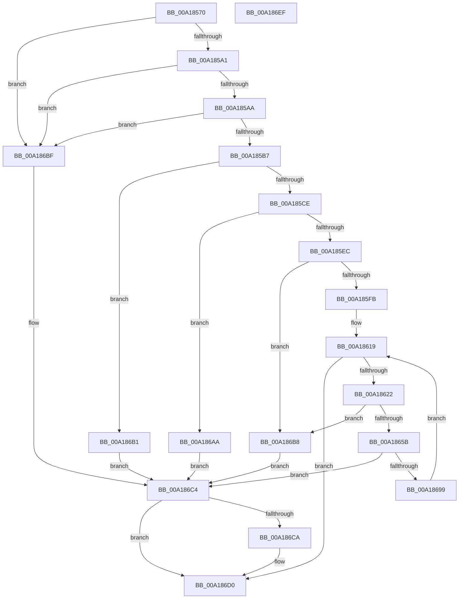

# AuthzBasepCopyoutClaimAttributes

- RVA: `0x00A18570`–`0x00A186F0` (길이 `384` bytes)
- VA: `0x0000000140A18570`
- 실행 섹션: `PAGE`
- PDB 이름 있음: `예`; PDB Function 태그: `아니요`
- unwind 정보 RVA: `0x000AA18C`
- 디코드: `107`개 명령, `384/384` bytes 표시
- 미해석 바이트: `0` (있으면 어셈블리에 `.byte`로 보존)

> 이 문서는 커널 이미지의 기계어와 PDB 기호를 분석해 생성했습니다. 4번과 5번은 함수 원형과 자료형을 바이너리 사용 방식에서 추정한 C 해석이며 원본 소스 복구 결과는 아닙니다.

## 1. Dependencies

- 직접 호출 지점: **3**; 고유 호출 대상: **3**
- 직접 호출자로 확인된 함수: **1**
- RIP 상대 이미지 참조: **0**

### Outgoing calls
- `0x00A185BC` → [memset](../../text/6C/memset_function_006C6C40.md) (function, `0x006C6C40`)
- `0x00A18669` → [RtlStringCbCopyNW](../../text/39/RtlStringCbCopyNW_function_003905E8.md) (function, `0x003905E8`)
- `0x00A1868B` → [AuthzBasepCopyoutClaimAttributeValues](AuthzBasepCopyoutClaimAttributeValues_function_00A186F8.md) (function, `0x00A186F8`)

### Direct callers
- [AuthzBasepQueryClaimAttributesToken](AuthzBasepQueryClaimAttributesToken_function_00A1830C.md) at `0x00A183A0`

### Static image references
- 디코드된 RIP-relative 메모리 참조가 없습니다.

## 2. Other-region calls and transfers

- 다른 실행 섹션으로 향하는 call: **2**
  - `0x00A185BC` → [memset](../../text/6C/memset_function_006C6C40.md) (`PAGE` → `.text`)
  - `0x00A18669` → [RtlStringCbCopyNW](../../text/39/RtlStringCbCopyNW_function_003905E8.md) (`PAGE` → `.text`)
- 별도 외부 분기/꼬리 이동을 확인하지 못했습니다.

## 3. Assembly (complete function range)

```asm
00A18570  48 89 5C 24 08                  mov qword ptr [rsp + 8], rbx
00A18575  48 89 6C 24 18                  mov qword ptr [rsp + 0x18], rbp
00A1857A  48 89 74 24 20                  mov qword ptr [rsp + 0x20], rsi
00A1857F  57                              push rdi
00A18580  41 54                           push r12
00A18582  41 55                           push r13
00A18584  41 56                           push r14
00A18586  41 57                           push r15
00A18588  48 83 EC 30                     sub rsp, 0x30
00A1858C  45 33 ED                        xor r13d, r13d
00A1858F  49 8B F0                        mov rsi, r8
00A18592  48 8B DA                        mov rbx, rdx
00A18595  48 8B F9                        mov rdi, rcx
00A18598  48 85 D2                        test rdx, rdx
00A1859B  0F 84 1E 01 00 00               je 0x140a186bf
00A185A1  4D 85 C0                        test r8, r8
00A185A4  0F 84 15 01 00 00               je 0x140a186bf
00A185AA  4A 8D 2C 02                     lea rbp, [rdx + r8]
00A185AE  48 3B EA                        cmp rbp, rdx
00A185B1  0F 82 08 01 00 00               jb 0x140a186bf
00A185B7  33 D2                           xor edx, edx
00A185B9  48 8B CB                        mov rcx, rbx
00A185BC  E8 7F E6 CA FF                  call 0x1406c6c40
00A185C1  4C 8D 73 10                     lea r14, [rbx + 0x10]
00A185C5  4C 3B F5                        cmp r14, rbp
00A185C8  0F 87 E3 00 00 00               ja 0x140a186b1
00A185CE  44 8B 0F                        mov r9d, dword ptr [rdi]
00A185D1  41 8D 4D 20                     lea ecx, [r13 + 0x20]
00A185D5  41 8B C1                        mov eax, r9d
00A185D8  4C 89 6C 24 68                  mov qword ptr [rsp + 0x68], r13
00A185DD  48 F7 E1                        mul rcx
00A185E0  4C 8B C0                        mov r8, rax
00A185E3  48 85 D2                        test rdx, rdx
00A185E6  0F 85 BE 00 00 00               jne 0x140a186aa
00A185EC  49 03 C6                        add rax, r14
00A185EF  41 8B CD                        mov ecx, r13d
00A185F2  48 3B C5                        cmp rax, rbp
00A185F5  0F 87 BD 00 00 00               ja 0x140a186b8
00A185FB  4C 89 73 08                     mov qword ptr [rbx + 8], r14
00A185FF  4C 8D 67 08                     lea r12, [rdi + 8]
00A18603  4F 8D 3C 30                     lea r15, [r8 + r14]
00A18607  C7 03 01 00 00 00               mov dword ptr [rbx], 1
00A1860D  44 89 4B 04                     mov dword ptr [rbx + 4], r9d
00A18611  49 83 C6 10                     add r14, 0x10
00A18615  49 8B 3C 24                     mov rdi, qword ptr [r12]
00A18619  49 3B FC                        cmp rdi, r12
00A1861C  0F 84 AE 00 00 00               je 0x140a186d0
00A18622  0F B7 47 30                     movzx eax, word ptr [rdi + 0x30]
00A18626  49 FF C7                        inc r15
00A18629  66 41 89 46 F8                  mov word ptr [r14 - 8], ax
00A1862E  49 83 E7 FE                     and r15, 0xfffffffffffffffe
00A18632  8B 47 3C                        mov eax, dword ptr [rdi + 0x3c]
00A18635  41 89 06                        mov dword ptr [r14], eax
00A18638  66 45 89 6E FA                  mov word ptr [r14 - 6], r13w
00A1863D  8B 47 34                        mov eax, dword ptr [rdi + 0x34]
00A18640  41 89 46 FC                     mov dword ptr [r14 - 4], eax
00A18644  44 0F B7 4F 20                  movzx r9d, word ptr [rdi + 0x20]
00A18649  4D 8D 69 02                     lea r13, [r9 + 2]
00A1864D  4B 8D 04 2F                     lea rax, [r15 + r13]
00A18651  4C 89 6C 24 68                  mov qword ptr [rsp + 0x68], r13
00A18656  48 3B C5                        cmp rax, rbp
00A18659  77 5D                           ja 0x140a186b8
00A1865B  4D 89 7E F0                     mov qword ptr [r14 - 0x10], r15
00A1865F  49 8B D5                        mov rdx, r13
00A18662  4C 8B 47 28                     mov r8, qword ptr [rdi + 0x28]
00A18666  49 8B CF                        mov rcx, r15
00A18669  E8 7A 7F 97 FF                  call 0x1403905e8
00A1866E  4D 03 FD                        add r15, r13
00A18671  48 8D 44 24 68                  lea rax, [rsp + 0x68]
00A18676  4C 8B CD                        mov r9, rbp
00A18679  48 89 44 24 20                  mov qword ptr [rsp + 0x20], rax
00A1867E  4D 2B CF                        sub r9, r15
00A18681  49 8D 56 F0                     lea rdx, [r14 - 0x10]
00A18685  4D 8B C7                        mov r8, r15
00A18688  48 8B CF                        mov rcx, rdi
00A1868B  E8 68 00 00 00                  call 0x140a186f8
00A18690  45 33 ED                        xor r13d, r13d
00A18693  8B C8                           mov ecx, eax
00A18695  85 C0                           test eax, eax
00A18697  78 2B                           js 0x140a186c4
00A18699  4C 03 7C 24 68                  add r15, qword ptr [rsp + 0x68]
00A1869E  48 8B 3F                        mov rdi, qword ptr [rdi]
00A186A1  49 83 C6 20                     add r14, 0x20
00A186A5  E9 6F FF FF FF                  jmp 0x140a18619
00A186AA  B9 95 00 00 C0                  mov ecx, 0xc0000095
00A186AF  EB 13                           jmp 0x140a186c4
00A186B1  B9 23 00 00 C0                  mov ecx, 0xc0000023
00A186B6  EB 0C                           jmp 0x140a186c4
00A186B8  B9 05 00 00 80                  mov ecx, 0x80000005
00A186BD  EB 05                           jmp 0x140a186c4
00A186BF  B9 0D 00 00 C0                  mov ecx, 0xc000000d
00A186C4  48 83 FE 10                     cmp rsi, 0x10
00A186C8  72 06                           jb 0x140a186d0
00A186CA  0F 57 C0                        xorps xmm0, xmm0
00A186CD  0F 11 03                        movups xmmword ptr [rbx], xmm0
00A186D0  48 8B 5C 24 60                  mov rbx, qword ptr [rsp + 0x60]
00A186D5  8B C1                           mov eax, ecx
00A186D7  48 8B 6C 24 70                  mov rbp, qword ptr [rsp + 0x70]
00A186DC  48 8B 74 24 78                  mov rsi, qword ptr [rsp + 0x78]
00A186E1  48 83 C4 30                     add rsp, 0x30
00A186E5  41 5F                           pop r15
00A186E7  41 5E                           pop r14
00A186E9  41 5D                           pop r13
00A186EB  41 5C                           pop r12
00A186ED  5F                              pop rdi
00A186EE  C3                              ret
00A186EF  CC                              int3
```

## 4. C-style interpretation (structured pseudocode)

```c
__int64 __fastcall AuthzBasepCopyoutClaimAttributes(__int64 a1, __int64 a2, __int64 a3)
{
    __int64 result;
    __int64 v_r13;
    __int64 v_r14;
    __int64 v_r15;
    __int64 v_rsp;
    unsigned __int64 v_stack_m38;
    unsigned __int64 v_stack_p10;
    unsigned __int64 v_stack_p18;
    unsigned __int64 v_stack_p20;
    unsigned __int64 v_stack_p8;

    v_stack_p8 = v_rbx;
    v_stack_p18 = v_rbp;
    v_stack_p20 = v_rsi;
    v_rsp = (v_rsp) - (48);
    v_r13 = 0;
    if (a2 == 0) goto loc_00A186BF;
    if (a3 == 0) goto loc_00A186BF;
    if ((a2 + a3 * 1) < a2) goto loc_00A186BF;
    a2 = 0;
    result = memset(0, a2, a3, a4);
    if ((a2 + 16) > (a2 + a3 * 1)) goto loc_00A186B1;
    v_stack_p10 = 0;
    if (0 != 0) goto loc_00A186AA;
    result = ((unsigned int)((unsigned int)((unsigned int)(*(unsigned int *)(a1))))) + (a2 + 16);
    if (result > (a2 + a3 * 1)) goto loc_00A186B8;
    *(unsigned __int64 *)(a2 + 8) = a2 + 16;
    *(unsigned int *)(a2) = 1;
    *(unsigned int *)(a2 + 4) = (unsigned int)((unsigned int)(*(unsigned int *)(a1)));
    v_r14 = (a2 + 16) + (16);
loc_00A18619:
    if ((*(unsigned __int64 *)(a1 + 8)) == (a1 + 8)) goto loc_00A186D0;
    v_r15 = ((unsigned int)((unsigned int)((unsigned int)(*(unsigned int *)(a1)))) + a2 + 16 * 1) + 1;
    *(unsigned __int16 *)(v_r14 - 8) = (unsigned __int16)(*(unsigned __int16 *)(*(unsigned __int64 *)(a1 + 8) + 48));
    v_r15 = (v_r15) & (-2);
    *(unsigned int *)(v_r14) = (unsigned int)((unsigned int)(*(unsigned int *)(*(unsigned __int64 *)(a1 + 8) + 60)));
    *(unsigned __int16 *)(v_r14 - 6) = 0;
    *(unsigned int *)(v_r14 - 4) = (unsigned int)((unsigned int)(*(unsigned int *)(*(unsigned __int64 *)(a1 + 8) + 52)));
    v_stack_p10 = *(unsigned __int16 *)(*(unsigned __int64 *)(a1 + 8) + 32) + 2;
    if ((v_r15 + *(unsigned __int16 *)(*(unsigned __int64 *)(a1 + 8) + 32) + 2 * 1) > (a2 + a3 * 1)) goto loc_00A186B8;
    *(unsigned __int64 *)(v_r14 - 16) = v_r15;
    result = RtlStringCbCopyNW(v_r15, *(unsigned __int16 *)(*(unsigned __int64 *)(a1 + 8) + 32) + 2, *(unsigned __int64 *)(*(unsigned __int64 *)(a1 + 8) + 40), *(unsigned __int16 *)(*(unsigned __int64 *)(a1 + 8) + 32));
    v_r15 = (v_r15) + (*(unsigned __int16 *)(*(unsigned __int64 *)(a1 + 8) + 32) + 2);
    v_stack_m38 = v_stack_p10;
    a4 = (a2 + a3 * 1) - (v_r15);
    result = AuthzBasepCopyoutClaimAttributeValues(*(unsigned __int64 *)(a1 + 8), v_r14 - 16, v_r15, a4);
    v_r13 = 0;
    if (sign_flag) goto loc_00A186C4;
    v_r15 = (v_r15) + (v_stack_p10);
    v_r14 = (v_r14) + (32);
    goto loc_00A18619;
loc_00A186AA:
    goto loc_00A186C4;
loc_00A186B1:
    goto loc_00A186C4;
loc_00A186B8:
    goto loc_00A186C4;
loc_00A186BF:
loc_00A186C4:
    if (a3 >= 16) {
        *(unsigned __int64 *)(a2) = v_xmm0;
    }
    v_rsp = (v_rsp) + (48);
    return (unsigned int)((unsigned int)((unsigned int)(0xC000000DULL)));
}
```

## 5. (Beta) C Style

```c
int64_t AuthzBasepCopyoutClaimAttributes(void *Arg1, void *Arg2, int64_t Arg3)
{
    uint8_t *arg1 = (uint8_t *)Arg1;
    uint8_t *arg2 = (uint8_t *)Arg2;

    int64_t result;
    int64_t local_r13;
    int64_t local_r14;
    int64_t local_r15;
    int64_t local_rsp;
    uint64_t v_stack_m38;
    uint64_t v_stack_p10;
    uint64_t v_stack_p18;
    uint64_t v_stack_p20;
    uint64_t v_stack_p8;

    v_stack_p8 = local_rbx;
    v_stack_p18 = local_rbp;
    v_stack_p20 = local_rsi;
    local_rsp = (local_rsp) - (48);
    local_r13 = 0;
    if (Arg2 == NULL) goto loc_00A186BF;
    if (Arg3 == 0) goto loc_00A186BF;
    if ((Arg2 + Arg3 * 1) < Arg2) goto loc_00A186BF;
    Arg2 = 0;
    result = memset(0, Arg2, Arg3, a4);
    if ((Arg2 + 16) > (Arg2 + Arg3 * 1)) goto loc_00A186B1;
    v_stack_p10 = 0;
    if (0 != 0) goto loc_00A186AA;
    result = ((uint32_t)((uint32_t)((uint32_t)(*(uint32_t *)(arg1))))) + (Arg2 + 16);
    if (result > (Arg2 + Arg3 * 1)) goto loc_00A186B8;
    *(void **)(arg2 + 0x8) = Arg2 + 16;
    *(uint32_t *)(arg2) = 1;
    *(uint32_t *)(arg2 + 0x4) = (uint32_t)((uint32_t)(*(uint32_t *)(arg1)));
    local_r14 = (Arg2 + 16) + (16);
loc_00A18619:
    if ((*(uint64_t *)(arg1 + 0x8)) == (Arg1 + 8)) goto loc_00A186D0;
    local_r15 = ((uint32_t)((uint32_t)((uint32_t)(*(uint32_t *)(arg1)))) + Arg2 + 16 * 1) + 1;
    *(uint16_t *)(local_r14 - 0x8) = (uint16_t)(*(uint16_t *)(*(uint64_t *)(arg1 + 0x8) + 0x30));
    local_r15 = (local_r15) & (-2);
    *(uint32_t *)(local_r14) = (uint32_t)((uint32_t)(*(uint32_t *)(*(uint64_t *)(arg1 + 0x8) + 0x3C)));
    *(uint16_t *)(local_r14 - 0x6) = 0;
    *(uint32_t *)(local_r14 - 0x4) = (uint32_t)((uint32_t)(*(uint32_t *)(*(uint64_t *)(arg1 + 0x8) + 0x34)));
    v_stack_p10 = *(uint16_t *)(*(uint64_t *)(arg1 + 0x8) + 0x20) + 2;
    if ((local_r15 + *(uint16_t *)(*(uint64_t *)(arg1 + 0x8) + 0x20) + 2 * 1) > (Arg2 + Arg3 * 1)) goto loc_00A186B8;
    *(uint64_t *)(local_r14 - 0x10) = local_r15;
    result = RtlStringCbCopyNW(local_r15, *(uint16_t *)(*(uint64_t *)(arg1 + 0x8) + 0x20) + 2, *(uint64_t *)(*(uint64_t *)(arg1 + 0x8) + 0x28), *(uint16_t *)(*(uint64_t *)(arg1 + 0x8) + 0x20));
    local_r15 = (local_r15) + (*(uint16_t *)(*(uint64_t *)(arg1 + 0x8) + 0x20) + 2);
    v_stack_m38 = v_stack_p10;
    a4 = (Arg2 + Arg3 * 1) - (local_r15);
    result = AuthzBasepCopyoutClaimAttributeValues(*(uint64_t *)(arg1 + 0x8), local_r14 - 16, local_r15, a4);
    local_r13 = 0;
    if (sign_flag) goto loc_00A186C4;
    local_r15 = (local_r15) + (v_stack_p10);
    local_r14 = (local_r14) + (32);
    goto loc_00A18619;
loc_00A186AA:
    goto loc_00A186C4;
loc_00A186B1:
    goto loc_00A186C4;
loc_00A186B8:
    goto loc_00A186C4;
loc_00A186BF:
loc_00A186C4:
    if (Arg3 >= 16) {
        *(uint64_t *)(arg2) = v_xmm0;
    }
    local_rsp = (local_rsp) + (48);
    return (uint32_t)((uint32_t)((uint32_t)(0xC000000DULL)));
}
```

### 관측된 메모리 오프셋

구조체 형식이 확인되지 않은 접근은 인자 기준의 오프셋으로만 기록했습니다.

| 기준 인자 | 오프셋 표현 | 폭 (bit) | 접근 |
|---|---:|---:|---|
| `Arg1` | `+ 0x0` | `32` | `R` |
| `Arg1` | `+ 0x0` | `64` | `R` |
| `Arg1` | `+ 0x8` | `64` | `R` |
| `Arg2` | `+ 0x0` | `32` | `W` |
| `Arg2` | `+ 0x0` | `128` | `R` |
| `Arg2` | `+ 0x4` | `32` | `W` |
| `Arg2` | `+ 0x8` | `64` | `W` |
| `Arg2` | `+ 0x10` | `64` | `R` |

## 6. Execution-region graph

[열기: 2D/3D 그래프와 함수 탐색 컨트롤 패널](../../../control-panel.html?section=page&rva=0x00A18570&view=graph)

- 2D 그래프는 위에서 아래로 흐르고, 3D 그래프는 빈 공간을 드래그해 회전합니다. Shift+드래그는 이동, 휠은 확대·축소, 함수 노드 선택은 대상 보고서 이동입니다.

### Static fallback


