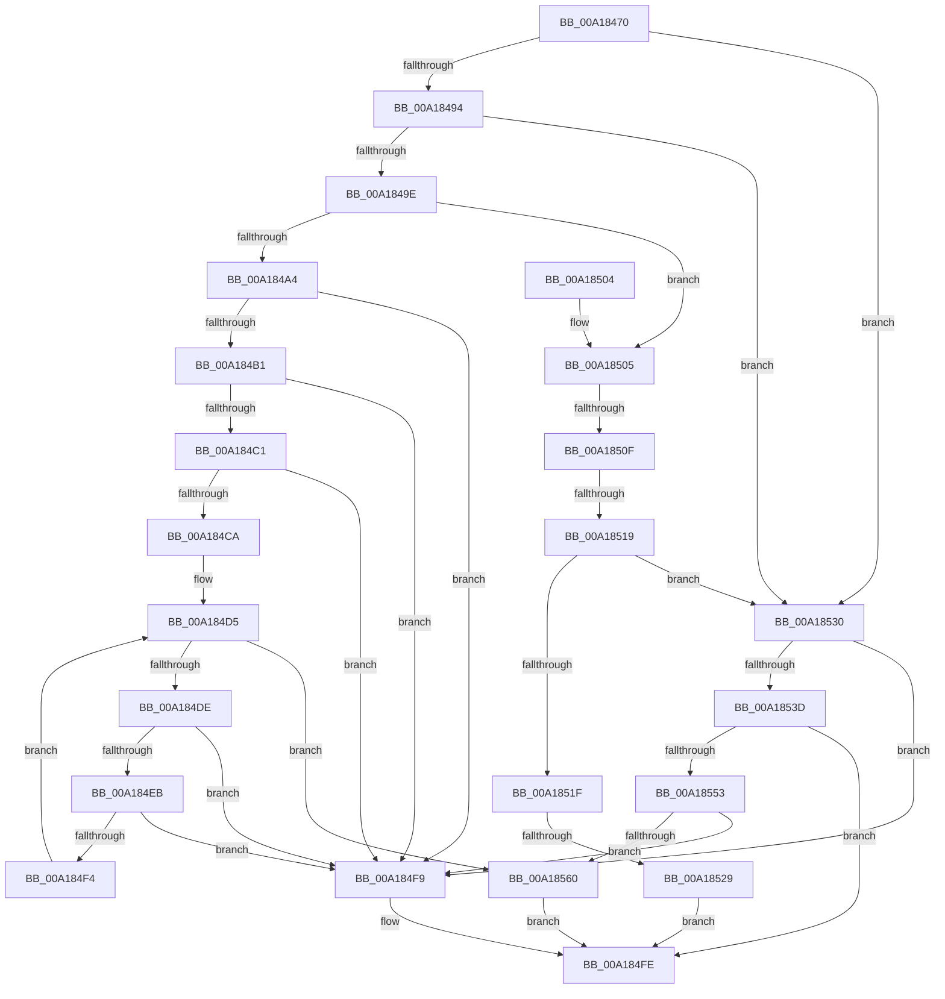

# AuthzBasepGetClaimAttributeValueCopyoutBufferSize

- RVA: `0x00A18470`–`0x00A18567` (길이 `247` bytes)
- VA: `0x0000000140A18470`
- 실행 섹션: `PAGE`
- PDB 이름 있음: `예`; PDB Function 태그: `예`
- unwind 정보 RVA: `0x000AA170`
- 디코드: `71`개 명령, `247/247` bytes 표시
- 미해석 바이트: `0` (있으면 어셈블리에 `.byte`로 보존)

> 이 문서는 커널 이미지의 기계어와 PDB 기호를 분석해 생성했습니다. 4번과 5번은 함수 원형과 자료형을 바이너리 사용 방식에서 추정한 C 해석이며 원본 소스 복구 결과는 아닙니다.

## 1. Dependencies

- 직접 호출 지점: **1**; 고유 호출 대상: **1**
- 직접 호출자로 확인된 함수: **1**
- RIP 상대 이미지 참조: **0**

### Outgoing calls
- `0x00A1854A` → [RtlULongLongMult](../../text/43/RtlULongLongMult_function_0043E530.md) (function, `0x0043E530`)

### Direct callers
- [AuthzBasepGetClaimAttributesCopyoutBufferSize](AuthzBasepGetClaimAttributesCopyoutBufferSize_function_00A183C0.md) at `0x00A18439`

### Static image references
- 디코드된 RIP-relative 메모리 참조가 없습니다.

## 2. Other-region calls and transfers

- 다른 실행 섹션으로 향하는 call: **1**
  - `0x00A1854A` → [RtlULongLongMult](../../text/43/RtlULongLongMult_function_0043E530.md) (`PAGE` → `.text`)
- call이 아닌 외부 분기/꼬리 이동: **3**
  - `0x00A18509` → [sub_00B37182 + 0x64](../B3/Unknown_function_00B37182.md) (`tail-transfer`)
  - `0x00A18513` → [sub_00B37182](../B3/Unknown_function_00B37182.md) (`tail-transfer`)
  - `0x00A18523` → [sub_00B37182](../B3/Unknown_function_00B37182.md) (`tail-transfer`)

## 3. Assembly (complete function range)

```asm
00A18470  40 53                           push rbx
00A18472  48 83 EC 20                     sub rsp, 0x20
00A18476  48 83 64 24 30 00               and qword ptr [rsp + 0x30], 0
00A1847C  48 8B DA                        mov rbx, rdx
00A1847F  44 0F B7 41 30                  movzx r8d, word ptr [rcx + 0x30]
00A18484  4C 8B D1                        mov r10, rcx
00A18487  4C 8B 0A                        mov r9, qword ptr [rdx]
00A1848A  41 83 E8 01                     sub r8d, 1
00A1848E  0F 84 9C 00 00 00               je 0x140a18530
00A18494  41 83 E8 01                     sub r8d, 1
00A18498  0F 84 92 00 00 00               je 0x140a18530
00A1849E  41 83 E8 01                     sub r8d, 1
00A184A2  75 61                           jne 0x140a18505
00A184A4  4D 8D 41 07                     lea r8, [r9 + 7]
00A184A8  49 83 E0 F8                     and r8, 0xfffffffffffffff8
00A184AC  4D 3B C1                        cmp r8, r9
00A184AF  72 48                           jb 0x140a184f9
00A184B1  8B 41 3C                        mov eax, dword ptr [rcx + 0x3c]
00A184B4  B9 08 00 00 00                  mov ecx, 8
00A184B9  48 F7 E1                        mul rcx
00A184BC  48 85 D2                        test rdx, rdx
00A184BF  75 38                           jne 0x140a184f9
00A184C1  4A 8D 0C 00                     lea rcx, [rax + r8]
00A184C5  49 3B C8                        cmp rcx, r8
00A184C8  72 2F                           jb 0x140a184f9
00A184CA  49 83 C2 48                     add r10, 0x48
00A184CE  49 8D 0C 00                     lea rcx, [r8 + rax]
00A184D2  49 8B 12                        mov rdx, qword ptr [r10]
00A184D5  49 3B D2                        cmp rdx, r10
00A184D8  0F 84 82 00 00 00               je 0x140a18560
00A184DE  44 0F B7 42 28                  movzx r8d, word ptr [rdx + 0x28]
00A184E3  4C 03 C1                        add r8, rcx
00A184E6  4C 3B C1                        cmp r8, rcx
00A184E9  72 0E                           jb 0x140a184f9
00A184EB  49 8D 48 02                     lea rcx, [r8 + 2]
00A184EF  49 3B C8                        cmp rcx, r8
00A184F2  72 05                           jb 0x140a184f9
00A184F4  48 8B 12                        mov rdx, qword ptr [rdx]
00A184F7  EB DC                           jmp 0x140a184d5
00A184F9  B8 95 00 00 C0                  mov eax, 0xc0000095
00A184FE  48 83 C4 20                     add rsp, 0x20
00A18502  5B                              pop rbx
00A18503  C3                              ret
00A18504  CC                              int3
00A18505  41 83 E8 01                     sub r8d, 1
00A18509  0F 84 D7 EC 11 00               je 0x140b371e6
00A1850F  41 83 E8 01                     sub r8d, 1
00A18513  0F 84 69 EC 11 00               je 0x140b37182
00A18519  41 83 E8 01                     sub r8d, 1
00A1851D  74 11                           je 0x140a18530
00A1851F  41 83 F8 0A                     cmp r8d, 0xa
00A18523  0F 84 59 EC 11 00               je 0x140b37182
00A18529  B8 0D 00 00 C0                  mov eax, 0xc000000d
00A1852E  EB CE                           jmp 0x140a184fe
00A18530  4D 8D 59 07                     lea r11, [r9 + 7]
00A18534  49 83 E3 F8                     and r11, 0xfffffffffffffff8
00A18538  4D 3B D9                        cmp r11, r9
00A1853B  72 BC                           jb 0x140a184f9
00A1853D  8B 51 3C                        mov edx, dword ptr [rcx + 0x3c]
00A18540  4C 8D 44 24 30                  lea r8, [rsp + 0x30]
00A18545  B9 08 00 00 00                  mov ecx, 8
00A1854A  E8 E1 5F A2 FF                  call 0x14043e530
00A1854F  85 C0                           test eax, eax
00A18551  78 AB                           js 0x140a184fe
00A18553  48 8B 4C 24 30                  mov rcx, qword ptr [rsp + 0x30]
00A18558  49 03 CB                        add rcx, r11
00A1855B  49 3B CB                        cmp rcx, r11
00A1855E  72 99                           jb 0x140a184f9
00A18560  33 C0                           xor eax, eax
00A18562  48 89 0B                        mov qword ptr [rbx], rcx
00A18565  EB 97                           jmp 0x140a184fe
```

## 4. C-style interpretation (structured pseudocode)

```c
__int64 __fastcall AuthzBasepGetClaimAttributeValueCopyoutBufferSize(__int64 a1, __int64 a2)
{
    __int64 result;
    __int64 v_r10;
    __int64 v_r11;
    __int64 v_rsp;
    unsigned __int64 v_stack_p30;
    unsigned __int64 v_stack_p8;

    v_rsp = (v_rsp) - (32);
    a3 = (unsigned int)((*(unsigned __int16 *)(a1 + 48)) - (1));
    if (condition_is_equal) goto loc_00A18530;
    a3 = (unsigned int)((a3) - (1));
    if (condition_is_equal) goto loc_00A18530;
    a3 = (unsigned int)((a3) - (1));
    if (condition_is_not_equal) goto loc_00A18505;
    a3 = (*(unsigned __int64 *)(a2) + 7) & (-8);
    if (a3 < (*(unsigned __int64 *)(a2))) goto loc_00A184F9;
    if (a2 != 0) goto loc_00A184F9;
    if (((unsigned int)(*(unsigned int *)(a1 + 60)) + a3 * 1) < a3) goto loc_00A184F9;
    v_r10 = (a1) + (72);
loc_00A184D5:
    if ((*(unsigned __int64 *)(v_r10)) == v_r10) goto loc_00A18560;
    a3 = (*(unsigned __int16 *)(*(unsigned __int64 *)(v_r10) + 40)) + (a3 + (unsigned int)(*(unsigned int *)(a1 + 60)) * 1);
    if (a3 < (a3 + (unsigned int)(*(unsigned int *)(a1 + 60)) * 1)) goto loc_00A184F9;
    if ((a3 + 2) < a3) goto loc_00A184F9;
    goto loc_00A184D5;
loc_00A184F9:
loc_00A184FE:
    v_rsp = (v_rsp) + (32);
    return (unsigned int)(0xC0000095ULL);
loc_00A18505:
    a3 = (unsigned int)((a3) - (1));
    a3 = (unsigned int)((a3) - (1));
    a3 = (unsigned int)((a3) - (1));
    if (condition_is_equal) goto loc_00A18530;
    goto loc_00A184FE;
loc_00A18530:
    v_r11 = (*(unsigned __int64 *)(a2) + 7) & (-8);
    if (v_r11 < (*(unsigned __int64 *)(a2))) goto loc_00A184F9;
    result = RtlULongLongMult(8, (unsigned int)(*(unsigned int *)(a3 + 2 + 60)), v_stack_p30, *(unsigned __int64 *)(a2));
    if (sign_flag) goto loc_00A184FE;
    a1 = (v_stack_p30) + (v_r11);
    if (a1 < v_r11) goto loc_00A184F9;
loc_00A18560:
    result = 0;
    *(unsigned __int64 *)(a2) = a1;
    goto loc_00A184FE;
}
```

## 5. (Beta) C Style

```c
int64_t AuthzBasepGetClaimAttributeValueCopyoutBufferSize(void *Arg1, void *Arg2)
{
    uint8_t *arg1 = (uint8_t *)Arg1;
    uint8_t *arg2 = (uint8_t *)Arg2;

    int64_t result;
    int64_t local_r10;
    int64_t local_r11;
    int64_t local_rsp;
    uint64_t v_stack_p30;
    uint64_t v_stack_p8;

    local_rsp = (local_rsp) - (32);
    a3 = (uint32_t)((*(uint16_t *)(arg1 + 0x30)) - (1));
    if (condition_is_equal) goto loc_00A18530;
    a3 = (uint32_t)((a3) - (1));
    if (condition_is_equal) goto loc_00A18530;
    a3 = (uint32_t)((a3) - (1));
    if (condition_is_not_equal) goto loc_00A18505;
    a3 = (*(uint64_t *)(arg2) + 7) & (-8);
    if (a3 < (*(uint64_t *)(arg2))) goto loc_00A184F9;
    if (Arg2 != NULL) goto loc_00A184F9;
    if (((uint32_t)(*(uint32_t *)(arg1 + 0x3C)) + a3 * 1) < a3) goto loc_00A184F9;
    local_r10 = (Arg1) + (72);
loc_00A184D5:
    if ((*(uint64_t *)(local_r10)) == local_r10) goto loc_00A18560;
    a3 = (*(uint16_t *)(*(uint64_t *)(local_r10) + 0x28)) + (a3 + (uint32_t)(*(uint32_t *)(arg1 + 0x3C)) * 1);
    if (a3 < (a3 + (uint32_t)(*(uint32_t *)(arg1 + 0x3C)) * 1)) goto loc_00A184F9;
    if ((a3 + 2) < a3) goto loc_00A184F9;
    goto loc_00A184D5;
loc_00A184F9:
loc_00A184FE:
    local_rsp = (local_rsp) + (32);
    return (uint32_t)(0xC0000095ULL);
loc_00A18505:
    a3 = (uint32_t)((a3) - (1));
    a3 = (uint32_t)((a3) - (1));
    a3 = (uint32_t)((a3) - (1));
    if (condition_is_equal) goto loc_00A18530;
    goto loc_00A184FE;
loc_00A18530:
    local_r11 = (*(uint64_t *)(arg2) + 7) & (-8);
    if (local_r11 < (*(uint64_t *)(arg2))) goto loc_00A184F9;
    result = RtlULongLongMult(8, (uint32_t)(*(uint32_t *)(a3 + 0x2 + 0x3C)), v_stack_p30, *(uint64_t *)(arg2));
    if (sign_flag) goto loc_00A184FE;
    Arg1 = (v_stack_p30) + (local_r11);
    if (Arg1 < local_r11) goto loc_00A184F9;
loc_00A18560:
    result = 0;
    *(void **)(arg2) = Arg1;
    goto loc_00A184FE;
}
```

### 관측된 메모리 오프셋

구조체 형식이 확인되지 않은 접근은 인자 기준의 오프셋으로만 기록했습니다.

| 기준 인자 | 오프셋 표현 | 폭 (bit) | 접근 |
|---|---:|---:|---|
| `Arg1` | `+ 0x0` | `64` | `R` |
| `Arg1` | `+ 0x30` | `16` | `R` |
| `Arg1` | `+ 0x3C` | `32` | `R` |
| `Arg2` | `+ 0x0` | `64` | `R` |
| `Arg2` | `+ 0x0` | `64` | `W` |

## 6. Execution-region graph

[열기: 2D/3D 그래프와 함수 탐색 컨트롤 패널](../../../control-panel.html?section=page&rva=0x00A18470&view=graph)

- 2D 그래프는 위에서 아래로 흐르고, 3D 그래프는 빈 공간을 드래그해 회전합니다. Shift+드래그는 이동, 휠은 확대·축소, 함수 노드 선택은 대상 보고서 이동입니다.

### Static fallback


