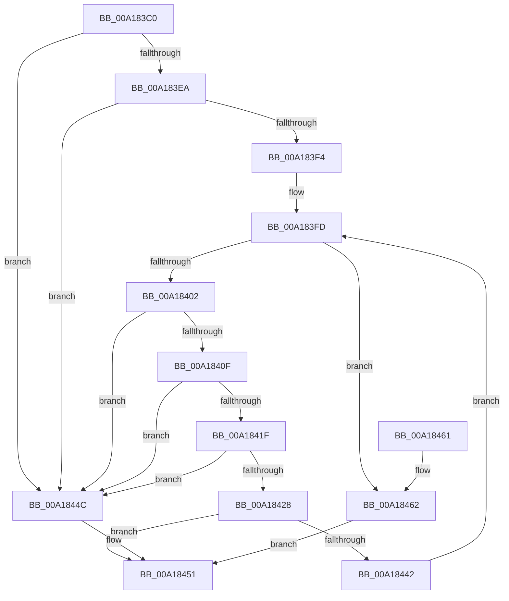

# AuthzBasepGetClaimAttributesCopyoutBufferSize

- RVA: `0x00A183C0`–`0x00A18467` (길이 `167` bytes)
- VA: `0x0000000140A183C0`
- 실행 섹션: `PAGE`
- PDB 이름 있음: `예`; PDB Function 태그: `아니요`
- unwind 정보 RVA: `0x000AA15C`
- 디코드: `51`개 명령, `167/167` bytes 표시
- 미해석 바이트: `0` (있으면 어셈블리에 `.byte`로 보존)

> 이 문서는 커널 이미지의 기계어와 PDB 기호를 분석해 생성했습니다. 4번과 5번은 함수 원형과 자료형을 바이너리 사용 방식에서 추정한 C 해석이며 원본 소스 복구 결과는 아닙니다.

## 1. Dependencies

- 직접 호출 지점: **1**; 고유 호출 대상: **1**
- 직접 호출자로 확인된 함수: **1**
- RIP 상대 이미지 참조: **0**

### Outgoing calls
- `0x00A18439` → [AuthzBasepGetClaimAttributeValueCopyoutBufferSize](AuthzBasepGetClaimAttributeValueCopyoutBufferSize_function_00A18470.md) (function, `0x00A18470`)

### Direct callers
- [AuthzBasepQueryClaimAttributesToken](AuthzBasepQueryClaimAttributesToken_function_00A1830C.md) at `0x00A1836B`

### Static image references
- 디코드된 RIP-relative 메모리 참조가 없습니다.

## 2. Other-region calls and transfers

- 다른 실행 섹션으로 향하는 call: **0**
- 별도 외부 분기/꼬리 이동을 확인하지 못했습니다.

## 3. Assembly (complete function range)

```asm
00A183C0  48 89 5C 24 10                  mov qword ptr [rsp + 0x10], rbx
00A183C5  48 89 74 24 18                  mov qword ptr [rsp + 0x18], rsi
00A183CA  57                              push rdi
00A183CB  48 83 EC 20                     sub rsp, 0x20
00A183CF  8B 01                           mov eax, dword ptr [rcx]
00A183D1  48 8B F9                        mov rdi, rcx
00A183D4  48 83 64 24 30 00               and qword ptr [rsp + 0x30], 0
00A183DA  B9 20 00 00 00                  mov ecx, 0x20
00A183DF  48 8B F2                        mov rsi, rdx
00A183E2  48 F7 E1                        mul rcx
00A183E5  48 85 D2                        test rdx, rdx
00A183E8  75 62                           jne 0x140a1844c
00A183EA  48 8D 48 10                     lea rcx, [rax + 0x10]
00A183EE  48 83 F9 10                     cmp rcx, 0x10
00A183F2  72 58                           jb 0x140a1844c
00A183F4  48 83 C7 08                     add rdi, 8
00A183F8  33 C0                           xor eax, eax
00A183FA  48 8B 1F                        mov rbx, qword ptr [rdi]
00A183FD  48 3B DF                        cmp rbx, rdi
00A18400  74 60                           je 0x140a18462
00A18402  48 8D 51 01                     lea rdx, [rcx + 1]
00A18406  48 83 E2 FE                     and rdx, 0xfffffffffffffffe
00A1840A  48 3B D1                        cmp rdx, rcx
00A1840D  72 3D                           jb 0x140a1844c
00A1840F  0F B7 43 20                     movzx eax, word ptr [rbx + 0x20]
00A18413  48 8D 0C 10                     lea rcx, [rax + rdx]
00A18417  48 03 C2                        add rax, rdx
00A1841A  48 3B C2                        cmp rax, rdx
00A1841D  72 2D                           jb 0x140a1844c
00A1841F  48 8D 41 02                     lea rax, [rcx + 2]
00A18423  48 3B C1                        cmp rax, rcx
00A18426  72 24                           jb 0x140a1844c
00A18428  48 8D 41 02                     lea rax, [rcx + 2]
00A1842C  48 8B CB                        mov rcx, rbx
00A1842F  48 8D 54 24 30                  lea rdx, [rsp + 0x30]
00A18434  48 89 44 24 30                  mov qword ptr [rsp + 0x30], rax
00A18439  E8 32 00 00 00                  call 0x140a18470
00A1843E  85 C0                           test eax, eax
00A18440  78 0F                           js 0x140a18451
00A18442  48 8B 1B                        mov rbx, qword ptr [rbx]
00A18445  48 8B 4C 24 30                  mov rcx, qword ptr [rsp + 0x30]
00A1844A  EB B1                           jmp 0x140a183fd
00A1844C  B8 95 00 00 C0                  mov eax, 0xc0000095
00A18451  48 8B 5C 24 38                  mov rbx, qword ptr [rsp + 0x38]
00A18456  48 8B 74 24 40                  mov rsi, qword ptr [rsp + 0x40]
00A1845B  48 83 C4 20                     add rsp, 0x20
00A1845F  5F                              pop rdi
00A18460  C3                              ret
00A18461  CC                              int3
00A18462  48 89 0E                        mov qword ptr [rsi], rcx
00A18465  EB EA                           jmp 0x140a18451
```

## 4. C-style interpretation (structured pseudocode)

```c
__int64 __fastcall AuthzBasepGetClaimAttributesCopyoutBufferSize(__int64 a1, __int64 a2)
{
    __int64 result;
    __int64 v_rdi;
    __int64 v_rsp;
    unsigned __int64 v_stack_p10;
    unsigned __int64 v_stack_p18;
    unsigned __int64 v_stack_p8;

    v_stack_p10 = v_rbx;
    v_stack_p18 = v_rsi;
    v_rsp = (v_rsp) - (32);
    if (a2 != 0) goto loc_00A1844C;
    if (((unsigned int)(*(unsigned int *)(a1)) + 16) < 16) goto loc_00A1844C;
    v_rdi = (a1) + (8);
    result = 0;
loc_00A183FD:
    if ((*(unsigned __int64 *)(v_rdi)) == v_rdi) goto loc_00A18462;
    a2 = ((unsigned int)(*(unsigned int *)(a1)) + 16 + 1) & (-2);
    if (a2 < ((unsigned int)(*(unsigned int *)(a1)) + 16)) goto loc_00A1844C;
    result = (*(unsigned __int16 *)(*(unsigned __int64 *)(v_rdi) + 32)) + (a2);
    if (result < a2) goto loc_00A1844C;
    if ((*(unsigned __int16 *)(*(unsigned __int64 *)(v_rdi) + 32) + a2 * 1 + 2) < (*(unsigned __int16 *)(*(unsigned __int64 *)(v_rdi) + 32) + a2 * 1)) goto loc_00A1844C;
    v_stack_p8 = *(unsigned __int16 *)(*(unsigned __int64 *)(v_rdi) + 32) + a2 * 1 + 2;
    result = AuthzBasepGetClaimAttributeValueCopyoutBufferSize(*(unsigned __int64 *)(v_rdi), v_stack_p8, a3, a4);
    if (sign_flag) goto loc_00A18451;
    goto loc_00A183FD;
loc_00A1844C:
loc_00A18451:
    v_rsp = (v_rsp) + (32);
    return (unsigned int)(0xC0000095ULL);
loc_00A18462:
    *(unsigned __int64 *)(v_stack_p18) = v_stack_p8;
    goto loc_00A18451;
}
```

## 5. (Beta) C Style

```c
int64_t AuthzBasepGetClaimAttributesCopyoutBufferSize(void *Arg1, void *Arg2)
{
    uint8_t *arg1 = (uint8_t *)Arg1;
    uint8_t *arg2 = (uint8_t *)Arg2;

    int64_t result;
    int64_t local_rdi;
    int64_t local_rsp;
    uint64_t v_stack_p10;
    uint64_t v_stack_p18;
    uint64_t v_stack_p8;

    v_stack_p10 = local_rbx;
    v_stack_p18 = local_rsi;
    local_rsp = (local_rsp) - (32);
    if (Arg2 != NULL) goto loc_00A1844C;
    if (((uint32_t)(*(uint32_t *)(arg1)) + 16) < 16) goto loc_00A1844C;
    local_rdi = (Arg1) + (8);
    result = 0;
loc_00A183FD:
    if ((*(uint64_t *)(local_rdi)) == local_rdi) goto loc_00A18462;
    Arg2 = ((uint32_t)(*(uint32_t *)(arg1)) + 16 + 1) & (-2);
    if (Arg2 < ((uint32_t)(*(uint32_t *)(arg1)) + 16)) goto loc_00A1844C;
    result = (*(uint16_t *)(*(uint64_t *)(local_rdi) + 0x20)) + (Arg2);
    if (result < Arg2) goto loc_00A1844C;
    if ((*(uint16_t *)(*(uint64_t *)(local_rdi) + 0x20) + Arg2 * 1 + 2) < (*(uint16_t *)(*(uint64_t *)(local_rdi) + 0x20) + Arg2 * 1)) goto loc_00A1844C;
    v_stack_p8 = *(uint16_t *)(*(uint64_t *)(local_rdi) + 0x20) + Arg2 * 1 + 2;
    result = AuthzBasepGetClaimAttributeValueCopyoutBufferSize(*(uint64_t *)(local_rdi), v_stack_p8, a3, a4);
    if (sign_flag) goto loc_00A18451;
    goto loc_00A183FD;
loc_00A1844C:
loc_00A18451:
    local_rsp = (local_rsp) + (32);
    return (uint32_t)(0xC0000095ULL);
loc_00A18462:
    *(uint64_t *)(v_stack_p18) = v_stack_p8;
    goto loc_00A18451;
}
```

### 관측된 메모리 오프셋

구조체 형식이 확인되지 않은 접근은 인자 기준의 오프셋으로만 기록했습니다.

| 기준 인자 | 오프셋 표현 | 폭 (bit) | 접근 |
|---|---:|---:|---|
| `Arg1` | `+ 0x0` | `32` | `R` |
| `Arg1` | `+ 0x0` | `64` | `R` |
| `Arg2` | `+ 0x0` | `64` | `W` |

## 6. Execution-region graph

[열기: 2D/3D 그래프와 함수 탐색 컨트롤 패널](../../../control-panel.html?section=page&rva=0x00A183C0&view=graph)

- 2D 그래프는 위에서 아래로 흐르고, 3D 그래프는 빈 공간을 드래그해 회전합니다. Shift+드래그는 이동, 휠은 확대·축소, 함수 노드 선택은 대상 보고서 이동입니다.

### Static fallback


