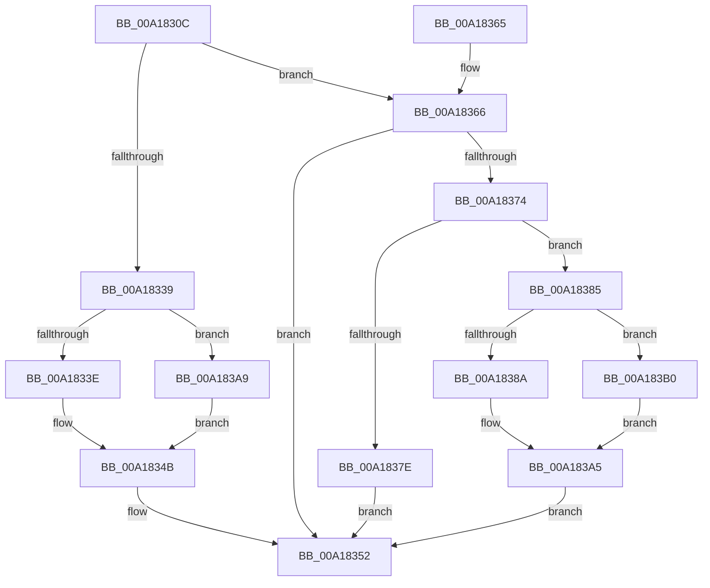

# AuthzBasepQueryClaimAttributesToken

- RVA: `0x00A1830C`–`0x00A183B7` (길이 `171` bytes)
- VA: `0x0000000140A1830C`
- 실행 섹션: `PAGE`
- PDB 이름 있음: `예`; PDB Function 태그: `아니요`
- unwind 정보 RVA: `0x000AA144`
- 디코드: `54`개 명령, `171/171` bytes 표시
- 미해석 바이트: `0` (있으면 어셈블리에 `.byte`로 보존)

> 이 문서는 커널 이미지의 기계어와 PDB 기호를 분석해 생성했습니다. 4번과 5번은 함수 원형과 자료형을 바이너리 사용 방식에서 추정한 C 해석이며 원본 소스 복구 결과는 아닙니다.

## 1. Dependencies

- 직접 호출 지점: **3**; 고유 호출 대상: **3**
- 직접 호출자로 확인된 함수: **2**
- RIP 상대 이미지 참조: **0**

### Outgoing calls
- `0x00A1836B` → [AuthzBasepGetClaimAttributesCopyoutBufferSize](AuthzBasepGetClaimAttributesCopyoutBufferSize_function_00A183C0.md) (function, `0x00A183C0`)
- `0x00A18392` → [memset](../../text/6C/memset_function_006C6C40.md) (function, `0x006C6C40`)
- `0x00A183A0` → [AuthzBasepCopyoutClaimAttributes](AuthzBasepCopyoutClaimAttributes_function_00A18570.md) (function, `0x00A18570`)

### Direct callers
- [SeQueryInformationToken](../8B/SeQueryInformationToken_function_008B5090.md) at `0x008B5BA5`
- [SeQueryInformationToken](../8B/SeQueryInformationToken_function_008B5090.md) at `0x008B5C0B`
- [NtQueryInformationToken](../AE/NtQueryInformationToken_function_00AECDD0.md) at `0x00AEF867`
- [NtQueryInformationToken](../AE/NtQueryInformationToken_function_00AECDD0.md) at `0x00AEF8F7`

### Static image references
- 디코드된 RIP-relative 메모리 참조가 없습니다.

## 2. Other-region calls and transfers

- 다른 실행 섹션으로 향하는 call: **1**
  - `0x00A18392` → [memset](../../text/6C/memset_function_006C6C40.md) (`PAGE` → `.text`)
- 별도 외부 분기/꼬리 이동을 확인하지 못했습니다.

## 3. Assembly (complete function range)

```asm
00A1830C  48 89 5C 24 10                  mov qword ptr [rsp + 0x10], rbx
00A18311  48 89 6C 24 18                  mov qword ptr [rsp + 0x18], rbp
00A18316  56                              push rsi
00A18317  57                              push rdi
00A18318  41 56                           push r14
00A1831A  48 83 EC 20                     sub rsp, 0x20
00A1831E  48 83 64 24 40 00               and qword ptr [rsp + 0x40], 0
00A18324  49 8B F9                        mov rdi, r9
00A18327  41 83 21 00                     and dword ptr [r9], 0
00A1832B  4C 8B F2                        mov r14, rdx
00A1832E  83 39 00                        cmp dword ptr [rcx], 0
00A18331  48 8B E9                        mov rbp, rcx
00A18334  41 8B F0                        mov esi, r8d
00A18337  75 2D                           jne 0x140a18366
00A18339  83 FE 10                        cmp esi, 0x10
00A1833C  72 6B                           jb 0x140a183a9
00A1833E  0F 57 C0                        xorps xmm0, xmm0
00A18341  33 C0                           xor eax, eax
00A18343  0F 11 02                        movups xmmword ptr [rdx], xmm0
00A18346  66 C7 02 01 00                  mov word ptr [rdx], 1
00A1834B  41 C7 01 10 00 00 00            mov dword ptr [r9], 0x10
00A18352  48 8B 5C 24 48                  mov rbx, qword ptr [rsp + 0x48]
00A18357  48 8B 6C 24 50                  mov rbp, qword ptr [rsp + 0x50]
00A1835C  48 83 C4 20                     add rsp, 0x20
00A18360  41 5E                           pop r14
00A18362  5F                              pop rdi
00A18363  5E                              pop rsi
00A18364  C3                              ret
00A18365  CC                              int3
00A18366  48 8D 54 24 40                  lea rdx, [rsp + 0x40]
00A1836B  E8 50 00 00 00                  call 0x140a183c0
00A18370  85 C0                           test eax, eax
00A18372  78 DE                           js 0x140a18352
00A18374  48 8B 5C 24 40                  mov rbx, qword ptr [rsp + 0x40]
00A18379  48 85 DB                        test rbx, rbx
00A1837C  75 07                           jne 0x140a18385
00A1837E  B8 0D 00 00 C0                  mov eax, 0xc000000d
00A18383  EB CD                           jmp 0x140a18352
00A18385  48 3B F3                        cmp rsi, rbx
00A18388  72 26                           jb 0x140a183b0
00A1838A  4C 8B C6                        mov r8, rsi
00A1838D  33 D2                           xor edx, edx
00A1838F  49 8B CE                        mov rcx, r14
00A18392  E8 A9 E8 CA FF                  call 0x1406c6c40
00A18397  4C 8B C6                        mov r8, rsi
00A1839A  49 8B D6                        mov rdx, r14
00A1839D  48 8B CD                        mov rcx, rbp
00A183A0  E8 CB 01 00 00                  call 0x140a18570
00A183A5  89 1F                           mov dword ptr [rdi], ebx
00A183A7  EB A9                           jmp 0x140a18352
00A183A9  B8 23 00 00 C0                  mov eax, 0xc0000023
00A183AE  EB 9B                           jmp 0x140a1834b
00A183B0  B8 23 00 00 C0                  mov eax, 0xc0000023
00A183B5  EB EE                           jmp 0x140a183a5
```

## 4. C-style interpretation (structured pseudocode)

```c
__int64 __fastcall AuthzBasepQueryClaimAttributesToken(__int64 a1, __int64 a2, int a3, __int64 a4)
{
    __int64 result;
    __int64 v_rsp;
    unsigned __int64 v_stack_p10;
    unsigned __int64 v_stack_p18;
    unsigned __int64 v_stack_p40;
    unsigned __int64 v_stack_p8;

    v_stack_p10 = v_rbx;
    v_stack_p18 = v_rbp;
    v_rsp = (v_rsp) - (32);
    if ((*(unsigned int *)(a1)) != 0) goto loc_00A18366;
    if (((unsigned int)((unsigned int)(a3))) < 16) goto loc_00A183A9;
    result = 0;
    *(unsigned __int64 *)(a2) = v_xmm0;
    *(unsigned __int16 *)(a2) = 1;
loc_00A1834B:
    *(unsigned int *)(a4) = 16;
loc_00A18352:
    v_rsp = (v_rsp) + (32);
    return result;
loc_00A18366:
    result = AuthzBasepGetClaimAttributesCopyoutBufferSize(a1, v_stack_p40, a3, a4);
    if (sign_flag) goto loc_00A18352;
    if (v_stack_p40 != 0) goto loc_00A18385;
    goto loc_00A18352;
loc_00A18385:
    if (((unsigned int)(a3)) < v_stack_p40) goto loc_00A183B0;
    a2 = 0;
    result = memset(0, a2, (unsigned int)(a3), a4);
    result = AuthzBasepCopyoutClaimAttributes(v_stack_p18, 0, (unsigned int)(a3), a4);
loc_00A183A5:
    *(unsigned int *)(a4) = (unsigned int)(v_stack_p40);
    goto loc_00A18352;
loc_00A183A9:
    goto loc_00A1834B;
loc_00A183B0:
    goto loc_00A183A5;
}
```

## 5. (Beta) C Style

```c
int64_t AuthzBasepQueryClaimAttributesToken(void *Arg1, void *Arg2, int32_t Arg3, void *Arg4)
{
    uint8_t *arg1 = (uint8_t *)Arg1;
    uint8_t *arg2 = (uint8_t *)Arg2;
    uint8_t *arg4 = (uint8_t *)Arg4;

    int64_t result;
    int64_t local_rsp;
    uint64_t v_stack_p10;
    uint64_t v_stack_p18;
    uint64_t v_stack_p40;
    uint64_t v_stack_p8;

    v_stack_p10 = local_rbx;
    v_stack_p18 = local_rbp;
    local_rsp = (local_rsp) - (32);
    if ((*(uint32_t *)(arg1)) != 0) goto loc_00A18366;
    if (((uint32_t)((uint32_t)(Arg3))) < 16) goto loc_00A183A9;
    result = 0;
    *(uint64_t *)(arg2) = v_xmm0;
    *(uint16_t *)(arg2) = 1;
loc_00A1834B:
    *(uint32_t *)(arg4) = 16;
loc_00A18352:
    local_rsp = (local_rsp) + (32);
    return result;
loc_00A18366:
    result = AuthzBasepGetClaimAttributesCopyoutBufferSize(Arg1, v_stack_p40, Arg3, Arg4);
    if (sign_flag) goto loc_00A18352;
    if (v_stack_p40 != 0) goto loc_00A18385;
    goto loc_00A18352;
loc_00A18385:
    if (((uint32_t)(Arg3)) < v_stack_p40) goto loc_00A183B0;
    Arg2 = 0;
    result = memset(0, Arg2, (uint32_t)(Arg3), Arg4);
    result = AuthzBasepCopyoutClaimAttributes(v_stack_p18, 0, (uint32_t)(Arg3), Arg4);
loc_00A183A5:
    *(uint32_t *)(arg4) = (uint32_t)(v_stack_p40);
    goto loc_00A18352;
loc_00A183A9:
    goto loc_00A1834B;
loc_00A183B0:
    goto loc_00A183A5;
}
```

### 관측된 메모리 오프셋

구조체 형식이 확인되지 않은 접근은 인자 기준의 오프셋으로만 기록했습니다.

| 기준 인자 | 오프셋 표현 | 폭 (bit) | 접근 |
|---|---:|---:|---|
| `Arg1` | `+ 0x0` | `32` | `R` |
| `Arg2` | `+ 0x0` | `16` | `W` |
| `Arg2` | `+ 0x0` | `128` | `R` |
| `Arg4` | `+ 0x0` | `32` | `R/W` |
| `Arg4` | `+ 0x0` | `32` | `W` |

## 6. Execution-region graph

[열기: 2D/3D 그래프와 함수 탐색 컨트롤 패널](../../../control-panel.html?section=page&rva=0x00A1830C&view=graph)

- 2D 그래프는 위에서 아래로 흐르고, 3D 그래프는 빈 공간을 드래그해 회전합니다. Shift+드래그는 이동, 휠은 확대·축소, 함수 노드 선택은 대상 보고서 이동입니다.

### Static fallback


