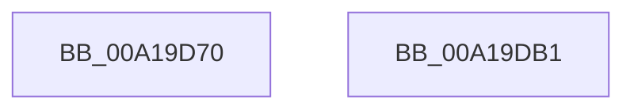

# CmQueryValueKeyCallout

- RVA: `0x00A19D70`–`0x00A19DB2` (길이 `66` bytes)
- VA: `0x0000000140A19D70`
- 실행 섹션: `PAGE`
- PDB 이름 있음: `예`; PDB Function 태그: `아니요`
- unwind 정보 RVA: `0x000697A4`
- 디코드: `19`개 명령, `66/66` bytes 표시
- 미해석 바이트: `0` (있으면 어셈블리에 `.byte`로 보존)

> 이 문서는 커널 이미지의 기계어와 PDB 기호를 분석해 생성했습니다. 4번과 5번은 함수 원형과 자료형을 바이너리 사용 방식에서 추정한 C 해석이며 원본 소스 복구 결과는 아닙니다.

## 1. Dependencies

- 직접 호출 지점: **1**; 고유 호출 대상: **1**
- 직접 호출자로 확인된 함수: **0**
- RIP 상대 이미지 참조: **0**

### Outgoing calls
- `0x00A19DA4` → [CmQueryValueKey](../85/CmQueryValueKey_function_008550F0.md) (function, `0x008550F0`)

### Direct callers
- 이 함수 시작 RVA로 연결되는 직접 call은 확인되지 않았습니다. 간접 호출은 완전히 역산할 수 없습니다.

### Static image references
- 디코드된 RIP-relative 메모리 참조가 없습니다.

## 2. Other-region calls and transfers

- 다른 실행 섹션으로 향하는 call: **0**
- 별도 외부 분기/꼬리 이동을 확인하지 못했습니다.

## 3. Assembly (complete function range)

```asm
00A19D70  40 53                           push rbx
00A19D72  48 83 EC 40                     sub rsp, 0x40
00A19D76  48 8B 41 38                     mov rax, qword ptr [rcx + 0x38]
00A19D7A  48 8D 54 24 30                  lea rdx, [rsp + 0x30]
00A19D7F  0F 10 41 10                     movups xmm0, xmmword ptr [rcx + 0x10]
00A19D83  4C 8B 49 28                     mov r9, qword ptr [rcx + 0x28]
00A19D87  48 8B D9                        mov rbx, rcx
00A19D8A  44 8B 41 20                     mov r8d, dword ptr [rcx + 0x20]
00A19D8E  48 89 44 24 28                  mov qword ptr [rsp + 0x28], rax
00A19D93  8B 41 30                        mov eax, dword ptr [rcx + 0x30]
00A19D96  48 8B 49 08                     mov rcx, qword ptr [rcx + 8]
00A19D9A  F3 0F 7F 44 24 30               movdqu xmmword ptr [rsp + 0x30], xmm0
00A19DA0  89 44 24 20                     mov dword ptr [rsp + 0x20], eax
00A19DA4  E8 47 B3 E3 FF                  call 0x1408550f0
00A19DA9  89 03                           mov dword ptr [rbx], eax
00A19DAB  48 83 C4 40                     add rsp, 0x40
00A19DAF  5B                              pop rbx
00A19DB0  C3                              ret
00A19DB1  CC                              int3
```

## 4. C-style interpretation (structured pseudocode)

```c
__int64 __fastcall CmQueryValueKeyCallout(__int64 a1)
{
    __int64 result;
    __int64 v_rsp;
    unsigned __int64 v_stack_m18;
    unsigned __int64 v_stack_m20;
    unsigned int v_stack_m28;

    v_rsp = (v_rsp) - (64);
    v_stack_m20 = *(unsigned __int64 *)(a1 + 56);
    v_stack_m18 = v_xmm0;
    v_stack_m28 = (unsigned int)((unsigned int)(*(unsigned int *)(a1 + 48)));
    result = CmQueryValueKey(*(unsigned __int64 *)(a1 + 8), v_stack_m18, (unsigned int)(*(unsigned int *)(a1 + 32)), *(unsigned __int64 *)(a1 + 40));
    *(unsigned int *)(a1) = (unsigned int)(result);
    v_rsp = (v_rsp) + (64);
    return result;
}
```

## 5. (Beta) C Style

```c
int64_t CmQueryValueKeyCallout(void *Arg1)
{
    uint8_t *arg1 = (uint8_t *)Arg1;

    int64_t result;
    int64_t local_rsp;
    uint64_t v_stack_m18;
    uint64_t v_stack_m20;
    uint32_t v_stack_m28;

    local_rsp = (local_rsp) - (64);
    v_stack_m20 = *(uint64_t *)(arg1 + 0x38);
    v_stack_m18 = v_xmm0;
    v_stack_m28 = (uint32_t)((uint32_t)(*(uint32_t *)(arg1 + 0x30)));
    result = CmQueryValueKey(*(uint64_t *)(arg1 + 0x8), v_stack_m18, (uint32_t)(*(uint32_t *)(arg1 + 0x20)), *(uint64_t *)(arg1 + 0x28));
    *(uint32_t *)(arg1) = (uint32_t)(result);
    local_rsp = (local_rsp) + (64);
    return result;
}
```

### 관측된 메모리 오프셋

구조체 형식이 확인되지 않은 접근은 인자 기준의 오프셋으로만 기록했습니다.

| 기준 인자 | 오프셋 표현 | 폭 (bit) | 접근 |
|---|---:|---:|---|
| `Arg1` | `+ 0x0` | `32` | `W` |
| `Arg1` | `+ 0x8` | `64` | `R` |
| `Arg1` | `+ 0x10` | `128` | `R` |
| `Arg1` | `+ 0x20` | `32` | `R` |
| `Arg1` | `+ 0x28` | `64` | `R` |
| `Arg1` | `+ 0x30` | `32` | `R` |
| `Arg1` | `+ 0x38` | `64` | `R` |

## 6. Execution-region graph

[열기: 2D/3D 그래프와 함수 탐색 컨트롤 패널](../../../control-panel.html?section=page&rva=0x00A19D70&view=graph)

- 2D 그래프는 위에서 아래로 흐르고, 3D 그래프는 빈 공간을 드래그해 회전합니다. Shift+드래그는 이동, 휠은 확대·축소, 함수 노드 선택은 대상 보고서 이동입니다.

### Static fallback


