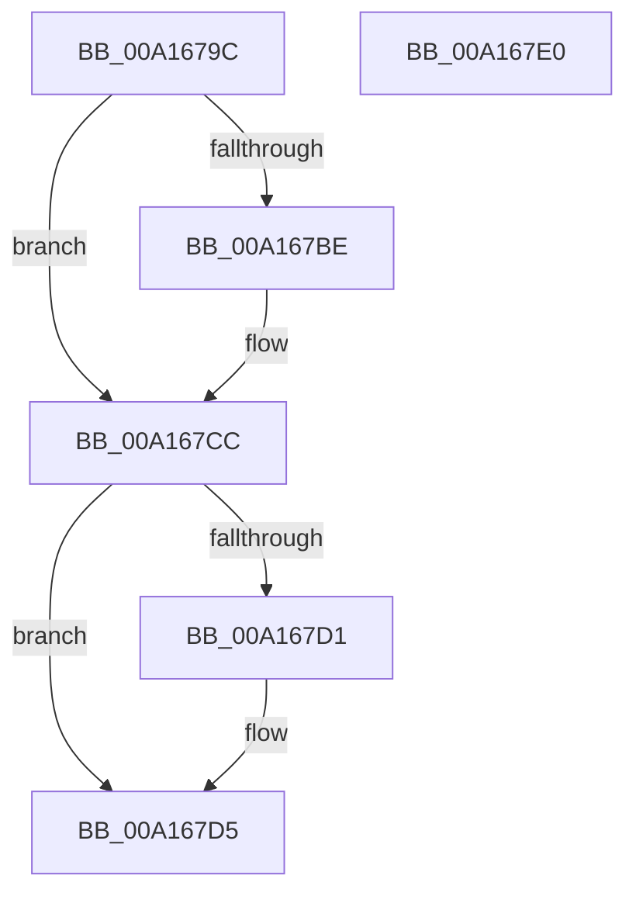

# CmSiRWLockAcquireExclusive

- RVA: `0x00A1679C`–`0x00A167E1` (길이 `69` bytes)
- VA: `0x0000000140A1679C`
- 실행 섹션: `PAGE`
- PDB 이름 있음: `예`; PDB Function 태그: `아니요`
- unwind 정보 RVA: `0x0005CAAC`
- 디코드: `22`개 명령, `69/69` bytes 표시
- 미해석 바이트: `0` (있으면 어셈블리에 `.byte`로 보존)

> 이 문서는 커널 이미지의 기계어와 PDB 기호를 분석해 생성했습니다. 4번과 5번은 함수 원형과 자료형을 바이너리 사용 방식에서 추정한 C 해석이며 원본 소스 복구 결과는 아닙니다.

## 1. Dependencies

- 직접 호출 지점: **2**; 고유 호출 대상: **2**
- 직접 호출자로 확인된 함수: **12**
- RIP 상대 이미지 참조: **0**

### Outgoing calls
- `0x00A167AE` → [KeAbPreAcquire](../../text/21/KeAbPreAcquire_function_00210230.md) (function, `0x00210230`)
- `0x00A167C7` → [ExfAcquirePushLockExclusiveEx](../../text/20/ExfAcquirePushLockExclusiveEx_function_0020FC90.md) (function, `0x0020FC90`)

### Direct callers
- [CmSiAcquireProcessLockedPagesCharge](../../text/47/CmSiAcquireProcessLockedPagesCharge_function_0047D714.md) at `0x0047D75F`
- [CmSiReleaseProcessLockedPagesCharge](../../text/47/CmSiReleaseProcessLockedPagesCharge_function_0047D81C.md) at `0x0047D861`
- [SshpSetCollectionActive](../../text/48/SshpSetCollectionActive_function_0048507C.md) at `0x0048509E`
- [SshpDereferenceBlocker](../../text/48/SshpDereferenceBlocker_function_00486960.md) at `0x00486A27`
- [SshpDereferenceBlocker](../../text/48/SshpDereferenceBlocker_function_00486960.md) at `0x00486A74`
- [SleepstudyHelperCreateLibraryEx](../../text/4B/SleepstudyHelperCreateLibraryEx_function_004BAE50.md) at `0x004BAF1A`
- [CmSiSetProcessWorkingSetMaximum](../../text/66/CmSiSetProcessWorkingSetMaximum_function_0066DD6C.md) at `0x0066DDAD`
- [CmpVolumeManagerGetContextForFile](../95/CmpVolumeManagerGetContextForFile_function_009525A8.md) at `0x0095270F`
- [CmpVolumeContextDecrementRefCount](../9B/CmpVolumeContextDecrementRefCount_function_009B2E14.md) at `0x009B2E56`
- [sub_00B262D0](../B2/Unknown_function_00B262D0.md) at `0x00B262D7`
- [CmpDumpKeyToBuffer](../../pagecmrc/BC/CmpDumpKeyToBuffer_function_00BC9130.md) at `0x00BC9194`
- [HvLockHiveFlusherExclusive](../../pagecmrc/BC/HvLockHiveFlusherExclusive_function_00BC9C50.md) at `0x00BC9C58`
- [CmFcManagerStartRuntimePhase](../../init/C5/CmFcManagerStartRuntimePhase_function_00C5DC70.md) at `0x00C5DD28`
- [CmFcManagerStartRuntimePhase](../../init/C5/CmFcManagerStartRuntimePhase_function_00C5DC70.md) at `0x00C5DE54`
- [CmFcManagerStartRuntimePhase](../../init/C5/CmFcManagerStartRuntimePhase_function_00C5DC70.md) at `0x00C5E0AB`

### Static image references
- 디코드된 RIP-relative 메모리 참조가 없습니다.

## 2. Other-region calls and transfers

- 다른 실행 섹션으로 향하는 call: **2**
  - `0x00A167AE` → [KeAbPreAcquire](../../text/21/KeAbPreAcquire_function_00210230.md) (`PAGE` → `.text`)
  - `0x00A167C7` → [ExfAcquirePushLockExclusiveEx](../../text/20/ExfAcquirePushLockExclusiveEx_function_0020FC90.md) (`PAGE` → `.text`)
- 별도 외부 분기/꼬리 이동을 확인하지 못했습니다.

## 3. Assembly (complete function range)

```asm
00A1679C  48 89 5C 24 08                  mov qword ptr [rsp + 8], rbx
00A167A1  57                              push rdi
00A167A2  48 83 EC 20                     sub rsp, 0x20
00A167A6  45 33 C0                        xor r8d, r8d
00A167A9  33 D2                           xor edx, edx
00A167AB  48 8B F9                        mov rdi, rcx
00A167AE  E8 7D 9A 7F FF                  call 0x140210230
00A167B3  F0 48 0F BA 2F 00               lock bts qword ptr [rdi], 0
00A167B9  48 8B D8                        mov rbx, rax
00A167BC  73 0E                           jae 0x140a167cc
00A167BE  4C 8B C7                        mov r8, rdi
00A167C1  48 8B D0                        mov rdx, rax
00A167C4  48 8B CF                        mov rcx, rdi
00A167C7  E8 C4 94 7F FF                  call 0x14020fc90
00A167CC  48 85 DB                        test rbx, rbx
00A167CF  74 04                           je 0x140a167d5
00A167D1  C6 43 0A 01                     mov byte ptr [rbx + 0xa], 1
00A167D5  48 8B 5C 24 30                  mov rbx, qword ptr [rsp + 0x30]
00A167DA  48 83 C4 20                     add rsp, 0x20
00A167DE  5F                              pop rdi
00A167DF  C3                              ret
00A167E0  CC                              int3
```

## 4. C-style interpretation (structured pseudocode)

```c
__int64 __fastcall CmSiRWLockAcquireExclusive(__int64 a1, int a2, int a3)
{
    __int64 result;
    __int64 v_rsp;
    unsigned __int64 v_stack_p8;

    v_stack_p8 = v_rbx;
    v_rsp = (v_rsp) - (32);
    a3 = 0;
    a2 = 0;
    result = KeAbPreAcquire(a1, a2, a3, a4);
    if (!(condition_is_above_or_equal)) {
        a3 = a1;
        a2 = result;
        a1 = a1;
        result = ExfAcquirePushLockExclusiveEx(a1, a2, a3, a4);
    }
    if (result != 0) {
        *(unsigned __int8 *)(result + 10) = 1;
    }
    v_rsp = (v_rsp) + (32);
    return result;
}
```

## 5. (Beta) C Style

```c
int64_t CmSiRWLockAcquireExclusive(void *Arg1, int32_t Arg2, int32_t Arg3)
{
    uint8_t *arg1 = (uint8_t *)Arg1;

    int64_t result;
    int64_t local_rsp;
    uint64_t v_stack_p8;

    v_stack_p8 = local_rbx;
    local_rsp = (local_rsp) - (32);
    Arg3 = 0;
    Arg2 = 0;
    result = KeAbPreAcquire(Arg1, Arg2, Arg3, a4);
    if (!(condition_is_above_or_equal)) {
        Arg3 = Arg1;
        Arg2 = result;
        Arg1 = Arg1;
        result = ExfAcquirePushLockExclusiveEx(Arg1, Arg2, Arg3, a4);
    }
    if (result != 0) {
        *(uint8_t *)(result + 0xA) = 1;
    }
    local_rsp = (local_rsp) + (32);
    return result;
}
```

### 관측된 메모리 오프셋

구조체 형식이 확인되지 않은 접근은 인자 기준의 오프셋으로만 기록했습니다.

| 기준 인자 | 오프셋 표현 | 폭 (bit) | 접근 |
|---|---:|---:|---|
| `Arg1` | `+ 0x0` | `64` | `R/W` |

## 6. Execution-region graph

[열기: 2D/3D 그래프와 함수 탐색 컨트롤 패널](../../../control-panel.html?section=page&rva=0x00A1679C&view=graph)

- 2D 그래프는 위에서 아래로 흐르고, 3D 그래프는 빈 공간을 드래그해 회전합니다. Shift+드래그는 이동, 휠은 확대·축소, 함수 노드 선택은 대상 보고서 이동입니다.

### Static fallback


