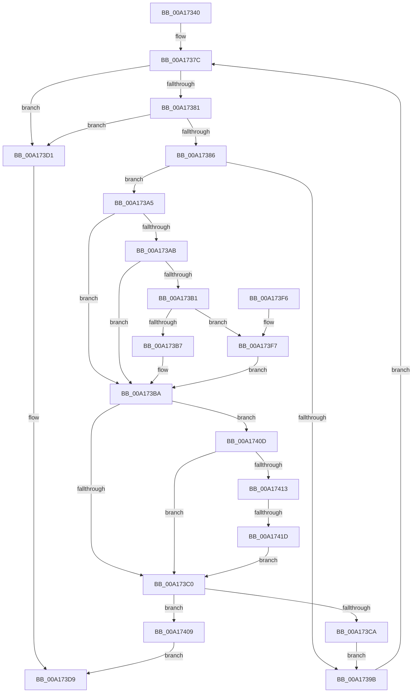

# CmpCompareUnicodeString

- RVA: `0x00A17340`–`0x00A1742A` (길이 `234` bytes)
- VA: `0x0000000140A17340`
- 실행 섹션: `PAGE`
- PDB 이름 있음: `예`; PDB Function 태그: `예`
- unwind 정보 RVA: `0x000A9F80`
- 디코드: `75`개 명령, `234/234` bytes 표시
- 미해석 바이트: `0` (있으면 어셈블리에 `.byte`로 보존)

> 이 문서는 커널 이미지의 기계어와 PDB 기호를 분석해 생성했습니다. 4번과 5번은 함수 원형과 자료형을 바이너리 사용 방식에서 추정한 C 해석이며 원본 소스 복구 결과는 아닙니다.

## 1. Dependencies

- 직접 호출 지점: **2**; 고유 호출 대상: **1**
- 직접 호출자로 확인된 함수: **3**
- RIP 상대 이미지 참조: **0**

### Outgoing calls
- `0x00A173FA` → [RtlUpcaseUnicodeChar](../85/RtlUpcaseUnicodeChar_function_0085F0F0.md) (function, `0x0085F0F0`)
- `0x00A17420` → [RtlUpcaseUnicodeChar](../85/RtlUpcaseUnicodeChar_function_0085F0F0.md) (function, `0x0085F0F0`)

### Direct callers
- [CmpCheckValueList](../97/CmpCheckValueList_function_00970F6C.md) at `0x00971C3B`
- [sub_00B167CA](../B1/Unknown_function_00B167CA.md) at `0x00B16801`
- [sub_00B25530](../B2/Unknown_function_00B25530.md) at `0x00B25557`

### Static image references
- 디코드된 RIP-relative 메모리 참조가 없습니다.

## 2. Other-region calls and transfers

- 다른 실행 섹션으로 향하는 call: **0**
- call이 아닌 외부 분기/꼬리 이동: **1**
  - `0x00A17417` → [sub_00B370C4](../B3/Unknown_function_00B370C4.md) (`tail-transfer`)

## 3. Assembly (complete function range)

```asm
00A17340  48 89 5C 24 08                  mov qword ptr [rsp + 8], rbx
00A17345  48 89 6C 24 10                  mov qword ptr [rsp + 0x10], rbp
00A1734A  48 89 74 24 18                  mov qword ptr [rsp + 0x18], rsi
00A1734F  57                              push rdi
00A17350  41 54                           push r12
00A17352  41 55                           push r13
00A17354  41 56                           push r14
00A17356  41 57                           push r15
00A17358  48 83 EC 20                     sub rsp, 0x20
00A1735C  0F B7 31                        movzx esi, word ptr [rcx]
00A1735F  B8 E0 FF 00 00                  mov eax, 0xffe0
00A17364  0F B7 2A                        movzx ebp, word ptr [rdx]
00A17367  45 8B E0                        mov r12d, r8d
00A1736A  4C 8B 71 08                     mov r14, qword ptr [rcx + 8]
00A1736E  4C 8B 7A 08                     mov r15, qword ptr [rdx + 8]
00A17372  66 D1 EE                        shr si, 1
00A17375  44 8D 68 1F                     lea r13d, [rax + 0x1f]
00A17379  66 D1 ED                        shr bp, 1
00A1737C  66 85 F6                        test si, si
00A1737F  74 50                           je 0x140a173d1
00A17381  66 85 ED                        test bp, bp
00A17384  74 4B                           je 0x140a173d1
00A17386  41 0F B7 1E                     movzx ebx, word ptr [r14]
00A1738A  49 83 C6 02                     add r14, 2
00A1738E  41 0F B7 3F                     movzx edi, word ptr [r15]
00A17392  49 83 C7 02                     add r15, 2
00A17396  66 3B DF                        cmp bx, di
00A17399  75 0A                           jne 0x140a173a5
00A1739B  66 41 03 F5                     add si, r13w
00A1739F  66 41 03 ED                     add bp, r13w
00A173A3  EB D7                           jmp 0x140a1737c
00A173A5  41 F6 C4 01                     test r12b, 1
00A173A9  75 0F                           jne 0x140a173ba
00A173AB  66 83 FB 61                     cmp bx, 0x61
00A173AF  72 09                           jb 0x140a173ba
00A173B1  66 83 FB 7A                     cmp bx, 0x7a
00A173B5  77 40                           ja 0x140a173f7
00A173B7  66 03 D8                        add bx, ax
00A173BA  41 F6 C4 02                     test r12b, 2
00A173BE  74 4D                           je 0x140a1740d
00A173C0  0F B7 C7                        movzx eax, di
00A173C3  0F B7 CB                        movzx ecx, bx
00A173C6  2B C8                           sub ecx, eax
00A173C8  75 3F                           jne 0x140a17409
00A173CA  B8 E0 FF 00 00                  mov eax, 0xffe0
00A173CF  EB CA                           jmp 0x140a1739b
00A173D1  0F B7 CD                        movzx ecx, bp
00A173D4  0F B7 C6                        movzx eax, si
00A173D7  2B C1                           sub eax, ecx
00A173D9  48 8B 5C 24 50                  mov rbx, qword ptr [rsp + 0x50]
00A173DE  48 8B 6C 24 58                  mov rbp, qword ptr [rsp + 0x58]
00A173E3  48 8B 74 24 60                  mov rsi, qword ptr [rsp + 0x60]
00A173E8  48 83 C4 20                     add rsp, 0x20
00A173EC  41 5F                           pop r15
00A173EE  41 5E                           pop r14
00A173F0  41 5D                           pop r13
00A173F2  41 5C                           pop r12
00A173F4  5F                              pop rdi
00A173F5  C3                              ret
00A173F6  CC                              int3
00A173F7  0F B7 CB                        movzx ecx, bx
00A173FA  E8 F1 7C E4 FF                  call 0x14085f0f0
00A173FF  0F B7 D8                        movzx ebx, ax
00A17402  B8 E0 FF 00 00                  mov eax, 0xffe0
00A17407  EB B1                           jmp 0x140a173ba
00A17409  8B C1                           mov eax, ecx
00A1740B  EB CC                           jmp 0x140a173d9
00A1740D  66 83 FF 61                     cmp di, 0x61
00A17411  72 AD                           jb 0x140a173c0
00A17413  66 83 FF 7A                     cmp di, 0x7a
00A17417  0F 86 A7 FC 11 00               jbe 0x140b370c4
00A1741D  0F B7 CF                        movzx ecx, di
00A17420  E8 CB 7C E4 FF                  call 0x14085f0f0
00A17425  0F B7 F8                        movzx edi, ax
00A17428  EB 96                           jmp 0x140a173c0
```

## 4. C-style interpretation (structured pseudocode)

```c
__int64 __fastcall CmpCompareUnicodeString(__int64 a1, __int64 a2, int a3)
{
    __int64 result;
    __int64 v_r14;
    __int64 v_r15;
    __int64 v_rbp;
    __int64 v_rbx;
    __int64 v_rsi;
    __int64 v_rsp;
    unsigned __int64 v_stack_p10;
    unsigned __int64 v_stack_p18;
    unsigned __int64 v_stack_p8;

    v_stack_p8 = v_rbx;
    v_stack_p10 = v_rbp;
    v_stack_p18 = v_rsi;
    v_rsp = (v_rsp) - (32);
    v_rsi = (unsigned __int16)((*(unsigned __int16 *)(a1)) >> (1));
    v_rbp = (unsigned __int16)((*(unsigned __int16 *)(a2)) >> (1));
loc_00A1737C:
    if ((unsigned __int16)(v_rsi) == 0) goto loc_00A173D1;
    if ((unsigned __int16)(v_rbp) == 0) goto loc_00A173D1;
    v_r14 = (*(unsigned __int64 *)(a1 + 8)) + (2);
    v_r15 = (*(unsigned __int64 *)(a2 + 8)) + (2);
    if (((unsigned __int16)(*(unsigned __int16 *)(*(unsigned __int64 *)(a1 + 8)))) != ((unsigned __int16)(*(unsigned __int16 *)(*(unsigned __int64 *)(a2 + 8))))) goto loc_00A173A5;
loc_00A1739B:
    v_rsi = (unsigned __int16)((v_rsi) + ((unsigned __int16)((unsigned int)(0xFFE0ULL) + 31)));
    v_rbp = (unsigned __int16)((v_rbp) + ((unsigned __int16)((unsigned int)(0xFFE0ULL) + 31)));
    goto loc_00A1737C;
loc_00A173A5:
    if ((((unsigned __int8)((unsigned int)(a3))) & (1)) != 0) goto loc_00A173BA;
    if (((unsigned __int16)(*(unsigned __int16 *)(*(unsigned __int64 *)(a1 + 8)))) < 97) goto loc_00A173BA;
    if (((unsigned __int16)(*(unsigned __int16 *)(*(unsigned __int64 *)(a1 + 8)))) > 122) goto loc_00A173F7;
    v_rbx = (unsigned __int16)((*(unsigned __int16 *)(*(unsigned __int64 *)(a1 + 8))) + ((unsigned __int16)((unsigned int)(0xFFE0ULL))));
loc_00A173BA:
    if ((((unsigned __int8)((unsigned int)(a3))) & (2)) == 0) goto loc_00A1740D;
loc_00A173C0:
    a1 = (unsigned int)(((unsigned __int16)(v_rbx)) - ((unsigned int)((unsigned __int16)(*(unsigned __int16 *)(*(unsigned __int64 *)(a2 + 8))))));
    if (condition_is_not_equal) goto loc_00A17409;
    goto loc_00A1739B;
loc_00A173D1:
    result = (unsigned int)(((unsigned __int16)(v_rsi)) - ((unsigned int)((unsigned __int16)(v_rbp))));
loc_00A173D9:
    v_rsp = (v_rsp) + (32);
    return result;
loc_00A173F7:
    result = RtlUpcaseUnicodeChar((unsigned __int16)(v_stack_p8), a2, a3, a4);
    goto loc_00A173BA;
loc_00A17409:
    goto loc_00A173D9;
loc_00A1740D:
    if (((unsigned __int16)(*(unsigned __int16 *)(*(unsigned __int64 *)(a2 + 8)))) < 97) goto loc_00A173C0;
    result = RtlUpcaseUnicodeChar((unsigned __int16)(*(unsigned __int16 *)(*(unsigned __int64 *)(a2 + 8))), a2, a3, a4);
    goto loc_00A173C0;
}
```

## 5. (Beta) C Style

```c
int64_t CmpCompareUnicodeString(void *Arg1, void *Arg2, int32_t Arg3)
{
    uint8_t *arg1 = (uint8_t *)Arg1;
    uint8_t *arg2 = (uint8_t *)Arg2;

    int64_t result;
    int64_t local_r14;
    int64_t local_r15;
    int64_t local_rbp;
    int64_t local_rbx;
    int64_t local_rsi;
    int64_t local_rsp;
    uint64_t v_stack_p10;
    uint64_t v_stack_p18;
    uint64_t v_stack_p8;

    v_stack_p8 = local_rbx;
    v_stack_p10 = local_rbp;
    v_stack_p18 = local_rsi;
    local_rsp = (local_rsp) - (32);
    local_rsi = (uint16_t)((*(uint16_t *)(arg1)) >> (1));
    local_rbp = (uint16_t)((*(uint16_t *)(arg2)) >> (1));
loc_00A1737C:
    if ((uint16_t)(local_rsi) == 0) goto loc_00A173D1;
    if ((uint16_t)(local_rbp) == 0) goto loc_00A173D1;
    local_r14 = (*(uint64_t *)(arg1 + 0x8)) + (2);
    local_r15 = (*(uint64_t *)(arg2 + 0x8)) + (2);
    if (((uint16_t)(*(uint16_t *)(*(uint64_t *)(arg1 + 0x8)))) != ((uint16_t)(*(uint16_t *)(*(uint64_t *)(arg2 + 0x8))))) goto loc_00A173A5;
loc_00A1739B:
    local_rsi = (uint16_t)((local_rsi) + ((uint16_t)((uint32_t)(0xFFE0ULL) + 31)));
    local_rbp = (uint16_t)((local_rbp) + ((uint16_t)((uint32_t)(0xFFE0ULL) + 31)));
    goto loc_00A1737C;
loc_00A173A5:
    if ((((uint8_t)((uint32_t)(Arg3))) & (1)) != 0) goto loc_00A173BA;
    if (((uint16_t)(*(uint16_t *)(*(uint64_t *)(arg1 + 0x8)))) < 97) goto loc_00A173BA;
    if (((uint16_t)(*(uint16_t *)(*(uint64_t *)(arg1 + 0x8)))) > 122) goto loc_00A173F7;
    local_rbx = (uint16_t)((*(uint16_t *)(*(uint64_t *)(arg1 + 0x8))) + ((uint16_t)((uint32_t)(0xFFE0ULL))));
loc_00A173BA:
    if ((((uint8_t)((uint32_t)(Arg3))) & (2)) == 0) goto loc_00A1740D;
loc_00A173C0:
    Arg1 = (uint32_t)(((uint16_t)(local_rbx)) - ((uint32_t)((uint16_t)(*(uint16_t *)(*(uint64_t *)(arg2 + 0x8))))));
    if (condition_is_not_equal) goto loc_00A17409;
    goto loc_00A1739B;
loc_00A173D1:
    result = (uint32_t)(((uint16_t)(local_rsi)) - ((uint32_t)((uint16_t)(local_rbp))));
loc_00A173D9:
    local_rsp = (local_rsp) + (32);
    return result;
loc_00A173F7:
    result = RtlUpcaseUnicodeChar((uint16_t)(v_stack_p8), Arg2, Arg3, a4);
    goto loc_00A173BA;
loc_00A17409:
    goto loc_00A173D9;
loc_00A1740D:
    if (((uint16_t)(*(uint16_t *)(*(uint64_t *)(arg2 + 0x8)))) < 97) goto loc_00A173C0;
    result = RtlUpcaseUnicodeChar((uint16_t)(*(uint16_t *)(*(uint64_t *)(arg2 + 0x8))), Arg2, Arg3, a4);
    goto loc_00A173C0;
}
```

### 관측된 메모리 오프셋

구조체 형식이 확인되지 않은 접근은 인자 기준의 오프셋으로만 기록했습니다.

| 기준 인자 | 오프셋 표현 | 폭 (bit) | 접근 |
|---|---:|---:|---|
| `Arg1` | `+ 0x0` | `16` | `R` |
| `Arg1` | `+ 0x8` | `64` | `R` |
| `Arg2` | `+ 0x0` | `16` | `R` |
| `Arg2` | `+ 0x8` | `64` | `R` |

## 6. Execution-region graph

[열기: 2D/3D 그래프와 함수 탐색 컨트롤 패널](../../../control-panel.html?section=page&rva=0x00A17340&view=graph)

- 2D 그래프는 위에서 아래로 흐르고, 3D 그래프는 빈 공간을 드래그해 회전합니다. Shift+드래그는 이동, 휠은 확대·축소, 함수 노드 선택은 대상 보고서 이동입니다.

### Static fallback


