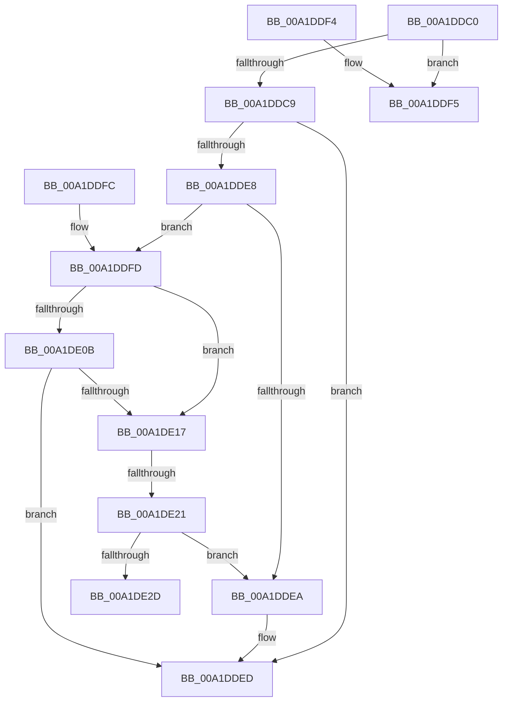

# CmpIsKcbLockAllowed

- RVA: `0x00A1DDC0`–`0x00A1DE32` (길이 `114` bytes)
- VA: `0x0000000140A1DDC0`
- 실행 섹션: `PAGE`
- PDB 이름 있음: `예`; PDB Function 태그: `예`
- unwind 정보 RVA: `0x000DB714`
- 디코드: `32`개 명령, `114/114` bytes 표시
- 미해석 바이트: `0` (있으면 어셈블리에 `.byte`로 보존)

> 이 문서는 커널 이미지의 기계어와 PDB 기호를 분석해 생성했습니다. 4번과 5번은 함수 원형과 자료형을 바이너리 사용 방식에서 추정한 C 해석이며 원본 소스 복구 결과는 아닙니다.

## 1. Dependencies

- 직접 호출 지점: **0**; 고유 호출 대상: **0**
- 직접 호출자로 확인된 함수: **1**
- RIP 상대 이미지 참조: **0**

### Outgoing calls
- 직접 디코드된 call 명령이 없습니다.

### Direct callers
- [sub_0085EABD](../85/Unknown_function_0085EABD.md) at `0x0085EB08`

### Static image references
- 디코드된 RIP-relative 메모리 참조가 없습니다.

## 2. Other-region calls and transfers

- 다른 실행 섹션으로 향하는 call: **0**
- call이 아닌 외부 분기/꼬리 이동: **2**
  - `0x00A1DE1B` → `0x00B37366` (`tail-transfer`)
  - `0x00A1DE2D` → `0x00B37366` (`tail-transfer`)

## 3. Assembly (complete function range)

```asm
00A1DDC0  41 C6 00 00                     mov byte ptr [r8], 0
00A1DDC4  48 3B CA                        cmp rcx, rdx
00A1DDC7  74 2C                           je 0x140a1ddf5
00A1DDC9  8B 41 08                        mov eax, dword ptr [rcx + 8]
00A1DDCC  41 B9 FF 03 00 00               mov r9d, 0x3ff
00A1DDD2  44 8B 42 08                     mov r8d, dword ptr [rdx + 8]
00A1DDD6  C1 E8 15                        shr eax, 0x15
00A1DDD9  41 C1 E8 15                     shr r8d, 0x15
00A1DDDD  41 23 C1                        and eax, r9d
00A1DDE0  45 23 C1                        and r8d, r9d
00A1DDE3  41 3B C0                        cmp eax, r8d
00A1DDE6  77 05                           ja 0x140a1dded
00A1DDE8  73 13                           jae 0x140a1ddfd
00A1DDEA  48 8B CA                        mov rcx, rdx
00A1DDED  48 3B CA                        cmp rcx, rdx
00A1DDF0  0F 94 C0                        sete al
00A1DDF3  C3                              ret
00A1DDF4  CC                              int3
00A1DDF5  41 C6 00 01                     mov byte ptr [r8], 1
00A1DDF9  B0 01                           mov al, 1
00A1DDFB  C3                              ret
00A1DDFC  CC                              int3
00A1DDFD  44 0F B7 81 BA 00 00 00         movzx r8d, word ptr [rcx + 0xba]
00A1DE05  41 F6 C0 04                     test r8b, 4
00A1DE09  74 0C                           je 0x140a1de17
00A1DE0B  F7 82 B8 00 00 00 00 00 02 00   test dword ptr [rdx + 0xb8], 0x20000
00A1DE15  75 D6                           jne 0x140a1dded
00A1DE17  41 F6 C0 02                     test r8b, 2
00A1DE1B  0F 84 45 95 11 00               je 0x140b37366
00A1DE21  F7 82 B8 00 00 00 00 00 04 00   test dword ptr [rdx + 0xb8], 0x40000
00A1DE2B  75 BD                           jne 0x140a1ddea
00A1DE2D  E9 34 95 11 00                  jmp 0x140b37366
```

## 4. C-style interpretation (structured pseudocode)

```c
__int64 __fastcall CmpIsKcbLockAllowed(__int64 a1, __int64 a2, __int64 a3)
{
    __int64 result;

    *(unsigned __int8 *)(a3) = 0;
    if (a1 == a2) goto loc_00A1DDF5;
    result = (unsigned int)(((unsigned int)(*(unsigned int *)(a1 + 8))) >> (21));
    a3 = (unsigned int)(((unsigned int)(*(unsigned int *)(a2 + 8))) >> (21));
    result = (unsigned int)((result) & ((unsigned int)((unsigned int)(0x3FFULL))));
    a3 = (unsigned int)((a3) & ((unsigned int)((unsigned int)(0x3FFULL))));
    if (((unsigned int)(result)) > ((unsigned int)(a3))) goto loc_00A1DDED;
    if (((unsigned int)(result)) >= ((unsigned int)(a3))) goto loc_00A1DDFD;
loc_00A1DDEA:
loc_00A1DDED:
    result = (a2 == a2) ? 1 : 0;
    return result;
loc_00A1DDF5:
    *(unsigned __int8 *)(a3) = 1;
    return 1;
loc_00A1DDFD:
    if ((((unsigned __int8)(*(unsigned __int16 *)(a2 + 186))) & (4)) == 0) goto loc_00A1DE17;
    if (((*(unsigned int *)(a2 + 184)) & (0x20000ULL)) != 0) goto loc_00A1DDED;
loc_00A1DE17:
    if (((*(unsigned int *)(a2 + 184)) & (0x40000ULL)) != 0) goto loc_00A1DDEA;
}
```

## 5. (Beta) C Style

```c
int64_t CmpIsKcbLockAllowed(int64_t Arg1, void *Arg2, void *Arg3)
{
    uint8_t *arg2 = (uint8_t *)Arg2;
    uint8_t *arg3 = (uint8_t *)Arg3;

    int64_t result;

    *(uint8_t *)(arg3) = 0;
    if (Arg1 == Arg2) goto loc_00A1DDF5;
    result = (uint32_t)(((uint32_t)(*(uint32_t *)(Arg1 + 0x8))) >> (21));
    Arg3 = (uint32_t)(((uint32_t)(*(uint32_t *)(arg2 + 0x8))) >> (21));
    result = (uint32_t)((result) & ((uint32_t)((uint32_t)(0x3FFULL))));
    Arg3 = (uint32_t)((Arg3) & ((uint32_t)((uint32_t)(0x3FFULL))));
    if (((uint32_t)(result)) > ((uint32_t)(Arg3))) goto loc_00A1DDED;
    if (((uint32_t)(result)) >= ((uint32_t)(Arg3))) goto loc_00A1DDFD;
loc_00A1DDEA:
loc_00A1DDED:
    result = (Arg2 == Arg2) ? 1 : 0;
    return result;
loc_00A1DDF5:
    *(uint8_t *)(arg3) = 1;
    return 1;
loc_00A1DDFD:
    if ((((uint8_t)(*(uint16_t *)(arg2 + 0xBA))) & (4)) == 0) goto loc_00A1DE17;
    if (((*(uint32_t *)(arg2 + 0xB8)) & (0x20000ULL)) != 0) goto loc_00A1DDED;
loc_00A1DE17:
    if (((*(uint32_t *)(arg2 + 0xB8)) & (0x40000ULL)) != 0) goto loc_00A1DDEA;
}
```

### 관측된 메모리 오프셋

구조체 형식이 확인되지 않은 접근은 인자 기준의 오프셋으로만 기록했습니다.

| 기준 인자 | 오프셋 표현 | 폭 (bit) | 접근 |
|---|---:|---:|---|
| `Arg2` | `+ 0x8` | `32` | `R` |
| `Arg2` | `+ 0xB8` | `32` | `R` |
| `Arg3` | `+ 0x0` | `8` | `W` |

## 6. Execution-region graph

[열기: 2D/3D 그래프와 함수 탐색 컨트롤 패널](../../../control-panel.html?section=page&rva=0x00A1DDC0&view=graph)

- 2D 그래프는 위에서 아래로 흐르고, 3D 그래프는 빈 공간을 드래그해 회전합니다. Shift+드래그는 이동, 휠은 확대·축소, 함수 노드 선택은 대상 보고서 이동입니다.

### Static fallback


