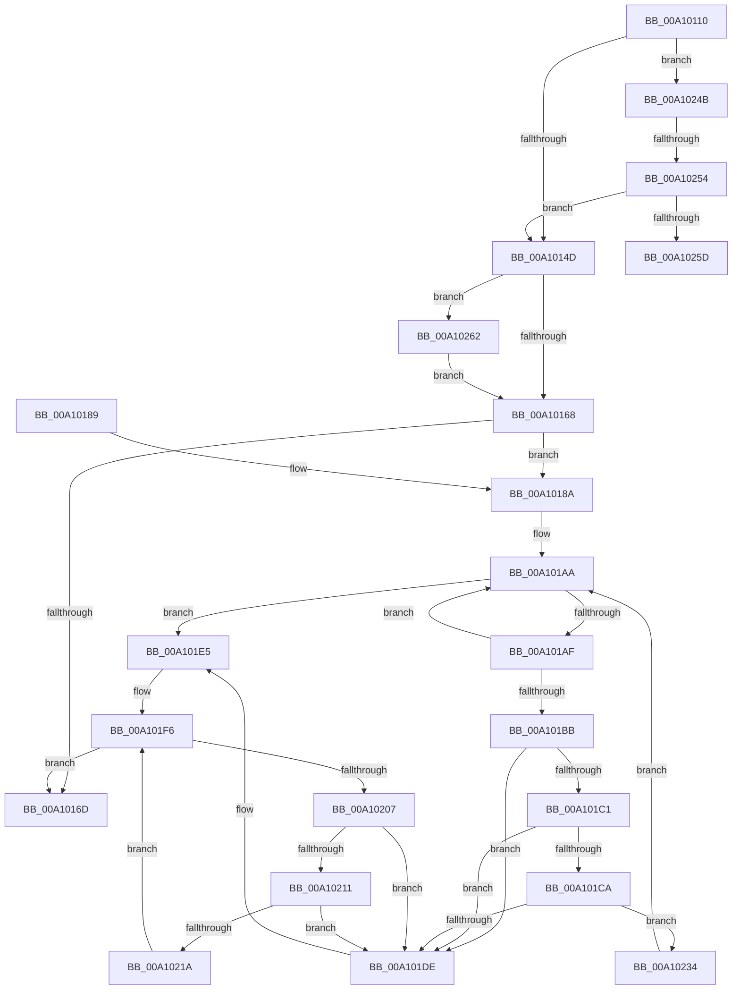

# DbgkClearProcessDebugObject

- RVA: `0x00A10110`–`0x00A1026F` (길이 `351` bytes)
- VA: `0x0000000140A10110`
- 실행 섹션: `PAGE`
- PDB 이름 있음: `예`; PDB Function 태그: `예`
- unwind 정보 RVA: `0x000A91E8`
- 디코드: `93`개 명령, `351/351` bytes 표시
- 미해석 바이트: `0` (있으면 어셈블리에 `.byte`로 보존)

> 이 문서는 커널 이미지의 기계어와 PDB 기호를 분석해 생성했습니다. 4번과 5번은 함수 원형과 자료형을 바이너리 사용 방식에서 추정한 C 해석이며 원본 소스 복구 결과는 아닙니다.

## 1. Dependencies

- 직접 호출 지점: **7**; 고유 호출 대상: **5**
- 직접 호출자로 확인된 함수: **2**
- RIP 상대 이미지 참조: **1**

### Outgoing calls
- `0x00A10138` → [ExAcquireFastMutex](../../text/20/ExAcquireFastMutex_function_0020E5A0.md) (function, `0x0020E5A0`)
- `0x00A1015B` → [ExReleaseFastMutex](../../text/25/ExReleaseFastMutex_function_002519C0.md) (function, `0x002519C0`)
- `0x00A1019E` → [ExAcquireFastMutex](../../text/20/ExAcquireFastMutex_function_0020E5A0.md) (function, `0x0020E5A0`)
- `0x00A101E9` → [ExReleaseFastMutex](../../text/25/ExReleaseFastMutex_function_002519C0.md) (function, `0x002519C0`)
- `0x00A101F1` → [ObfDereferenceObject](../../text/2F/ObfDereferenceObject_function_002F9350.md) (function, `0x002F9350`)
- `0x00A1022D` → [DbgkpWakeTarget](DbgkpWakeTarget_function_00A106AC.md) (function, `0x00A106AC`)
- `0x00A10265` → [DbgkpMarkProcessPeb](../AC/DbgkpMarkProcessPeb_function_00AC8D0C.md) (function, `0x00AC8D0C`)

### Direct callers
- [PspTerminateAllThreads](../8C/PspTerminateAllThreads_function_008C97D0.md) at `0x008C999E`
- [NtRemoveProcessDebug](../A0/NtRemoveProcessDebug_function_00A0FAF0.md) at `0x00A0FC0E`

### Static image references
- `0x00A10131` → RVA `0x00F8F220` (`.data`; read)

## 2. Other-region calls and transfers

- 다른 실행 섹션으로 향하는 call: **5**
  - `0x00A10138` → [ExAcquireFastMutex](../../text/20/ExAcquireFastMutex_function_0020E5A0.md) (`PAGE` → `.text`)
  - `0x00A1015B` → [ExReleaseFastMutex](../../text/25/ExReleaseFastMutex_function_002519C0.md) (`PAGE` → `.text`)
  - `0x00A1019E` → [ExAcquireFastMutex](../../text/20/ExAcquireFastMutex_function_0020E5A0.md) (`PAGE` → `.text`)
  - `0x00A101E9` → [ExReleaseFastMutex](../../text/25/ExReleaseFastMutex_function_002519C0.md) (`PAGE` → `.text`)
  - `0x00A101F1` → [ObfDereferenceObject](../../text/2F/ObfDereferenceObject_function_002F9350.md) (`PAGE` → `.text`)
- call이 아닌 외부 분기/꼬리 이동: **2**
  - `0x00A1024E` → [sub_00B36A32](../B3/Unknown_function_00B36A32.md) (`tail-transfer`)
  - `0x00A1025D` → [sub_00B36A32](../B3/Unknown_function_00B36A32.md) (`tail-transfer`)

## 3. Assembly (complete function range)

```asm
00A10110  48 8B C4                        mov rax, rsp
00A10113  48 89 58 08                     mov qword ptr [rax + 8], rbx
00A10117  48 89 70 10                     mov qword ptr [rax + 0x10], rsi
00A1011B  48 89 78 18                     mov qword ptr [rax + 0x18], rdi
00A1011F  4C 89 70 20                     mov qword ptr [rax + 0x20], r14
00A10123  55                              push rbp
00A10124  48 8B EC                        mov rbp, rsp
00A10127  48 83 EC 30                     sub rsp, 0x30
00A1012B  48 8B F1                        mov rsi, rcx
00A1012E  48 8B FA                        mov rdi, rdx
00A10131  48 8D 0D E8 F0 57 00            lea rcx, [rip + 0x57f0e8]
00A10138  E8 63 E4 7F FF                  call 0x14020e5a0
00A1013D  48 8B 9E 08 03 00 00            mov rbx, qword ptr [rsi + 0x308]
00A10144  48 85 DB                        test rbx, rbx
00A10147  0F 85 FE 00 00 00               jne 0x140a1024b
00A1014D  33 DB                           xor ebx, ebx
00A1014F  BF 53 03 00 C0                  mov edi, 0xc0000353
00A10154  48 8D 0D C5 F0 57 00            lea rcx, [rip + 0x57f0c5]
00A1015B  E8 60 18 84 FF                  call 0x1402519c0
00A10160  85 FF                           test edi, edi
00A10162  0F 89 FA 00 00 00               jns 0x140a10262
00A10168  48 85 DB                        test rbx, rbx
00A1016B  75 1D                           jne 0x140a1018a
00A1016D  48 8B 5C 24 40                  mov rbx, qword ptr [rsp + 0x40]
00A10172  8B C7                           mov eax, edi
00A10174  48 8B 7C 24 50                  mov rdi, qword ptr [rsp + 0x50]
00A10179  48 8B 74 24 48                  mov rsi, qword ptr [rsp + 0x48]
00A1017E  4C 8B 74 24 58                  mov r14, qword ptr [rsp + 0x58]
00A10183  48 83 C4 30                     add rsp, 0x30
00A10187  5D                              pop rbp
00A10188  C3                              ret
00A10189  CC                              int3
00A1018A  48 8D 45 F0                     lea rax, [rbp - 0x10]
00A1018E  48 89 45 F8                     mov qword ptr [rbp - 8], rax
00A10192  48 8D 4B 18                     lea rcx, [rbx + 0x18]
00A10196  48 8D 45 F0                     lea rax, [rbp - 0x10]
00A1019A  48 89 45 F0                     mov qword ptr [rbp - 0x10], rax
00A1019E  E8 FD E3 7F FF                  call 0x14020e5a0
00A101A3  4C 8D 43 50                     lea r8, [rbx + 0x50]
00A101A7  49 8B 00                        mov rax, qword ptr [r8]
00A101AA  49 3B C0                        cmp rax, r8
00A101AD  74 36                           je 0x140a101e5
00A101AF  48 8B D0                        mov rdx, rax
00A101B2  48 8B 00                        mov rax, qword ptr [rax]
00A101B5  48 39 72 38                     cmp qword ptr [rdx + 0x38], rsi
00A101B9  75 EF                           jne 0x140a101aa
00A101BB  48 39 50 08                     cmp qword ptr [rax + 8], rdx
00A101BF  75 1D                           jne 0x140a101de
00A101C1  48 8B 4A 08                     mov rcx, qword ptr [rdx + 8]
00A101C5  48 39 11                        cmp qword ptr [rcx], rdx
00A101C8  75 14                           jne 0x140a101de
00A101CA  48 89 01                        mov qword ptr [rcx], rax
00A101CD  48 89 48 08                     mov qword ptr [rax + 8], rcx
00A101D1  48 8D 4D F0                     lea rcx, [rbp - 0x10]
00A101D5  4C 8B 4D F8                     mov r9, qword ptr [rbp - 8]
00A101D9  49 39 09                        cmp qword ptr [r9], rcx
00A101DC  74 56                           je 0x140a10234
00A101DE  B9 03 00 00 00                  mov ecx, 3
00A101E3  CD 29                           int 0x29
00A101E5  48 8D 4B 18                     lea rcx, [rbx + 0x18]
00A101E9  E8 D2 17 84 FF                  call 0x1402519c0
00A101EE  48 8B CB                        mov rcx, rbx
00A101F1  E8 5A 91 8E FF                  call 0x1402f9350
00A101F6  48 8B 4D F0                     mov rcx, qword ptr [rbp - 0x10]
00A101FA  48 8D 45 F0                     lea rax, [rbp - 0x10]
00A101FE  48 3B C8                        cmp rcx, rax
00A10201  0F 84 66 FF FF FF               je 0x140a1016d
00A10207  48 8D 45 F0                     lea rax, [rbp - 0x10]
00A1020B  48 39 41 08                     cmp qword ptr [rcx + 8], rax
00A1020F  75 CD                           jne 0x140a101de
00A10211  48 8B 01                        mov rax, qword ptr [rcx]
00A10214  48 39 48 08                     cmp qword ptr [rax + 8], rcx
00A10218  75 C4                           jne 0x140a101de
00A1021A  48 89 45 F0                     mov qword ptr [rbp - 0x10], rax
00A1021E  48 8D 55 F0                     lea rdx, [rbp - 0x10]
00A10222  48 89 50 08                     mov qword ptr [rax + 8], rdx
00A10226  C7 41 48 54 03 00 C0            mov dword ptr [rcx + 0x48], 0xc0000354
00A1022D  E8 7A 04 00 00                  call 0x140a106ac
00A10232  EB C2                           jmp 0x140a101f6
00A10234  4C 89 4A 08                     mov qword ptr [rdx + 8], r9
00A10238  48 8D 4D F0                     lea rcx, [rbp - 0x10]
00A1023C  48 89 0A                        mov qword ptr [rdx], rcx
00A1023F  49 89 11                        mov qword ptr [r9], rdx
00A10242  48 89 55 F8                     mov qword ptr [rbp - 8], rdx
00A10246  E9 5F FF FF FF                  jmp 0x140a101aa
00A1024B  48 3B DF                        cmp rbx, rdi
00A1024E  0F 84 DE 67 12 00               je 0x140b36a32
00A10254  48 85 FF                        test rdi, rdi
00A10257  0F 85 F0 FE FF FF               jne 0x140a1014d
00A1025D  E9 D0 67 12 00                  jmp 0x140b36a32
00A10262  48 8B CE                        mov rcx, rsi
00A10265  E8 A2 8A 0B 00                  call 0x140ac8d0c
00A1026A  E9 F9 FE FF FF                  jmp 0x140a10168
```

## 4. C-style interpretation (structured pseudocode)

```c
__int64 __fastcall DbgkClearProcessDebugObject(__int64 a1, __int64 a2)
{
    __int64 result;
    __int64 v_rbx;
    __int64 v_rsp;
    unsigned __int64 v_stack_m10;
    unsigned __int64 v_stack_m18;
    unsigned __int64 v_stack_p10;
    unsigned __int64 v_stack_p18;
    unsigned __int64 v_stack_p20;
    unsigned __int64 v_stack_p8;

    *(unsigned __int64 *)(v_rsp + 8) = v_rbx;
    *(unsigned __int64 *)(v_rsp + 16) = v_rsi;
    *(unsigned __int64 *)(v_rsp + 24) = v_rdi;
    *(unsigned __int64 *)(v_rsp + 32) = v_r14;
    v_rsp = (v_rsp) - (48);
    result = ExAcquireFastMutex(v_rip + 5763304, a2, a3, a4);
    if (*(unsigned __int64 *)(a1 + 776) != 0) goto loc_00A1024B;
loc_00A1014D:
    v_rbx = 0;
    result = ExReleaseFastMutex(v_rip + 5763269, a2, a3, a4);
    if (!sign_flag) goto loc_00A10262;
loc_00A10168:
    if (0 != 0) goto loc_00A1018A;
loc_00A1016D:
    v_rsp = (v_rsp) + (48);
    return (unsigned int)((unsigned int)((unsigned int)(0xC0000353ULL)));
loc_00A1018A:
    v_stack_m10 = v_stack_m18;
    v_stack_m18 = v_stack_m18;
    result = ExAcquireFastMutex(v_stack_p8 + 24, a2, a3, a4);
loc_00A101AA:
    if ((*(unsigned __int64 *)(v_stack_p8 + 80)) == (v_stack_p8 + 80)) goto loc_00A101E5;
    if ((*(unsigned __int64 *)(*(unsigned __int64 *)(v_stack_p8 + 80) + 56)) != v_stack_p10) goto loc_00A101AA;
    if ((*(unsigned __int64 *)(*(unsigned __int64 *)(*(unsigned __int64 *)(v_stack_p8 + 80)) + 8)) != (*(unsigned __int64 *)(v_stack_p8 + 80))) goto loc_00A101DE;
    if ((*(unsigned __int64 *)(*(unsigned __int64 *)(*(unsigned __int64 *)(v_stack_p8 + 80) + 8))) != (*(unsigned __int64 *)(v_stack_p8 + 80))) goto loc_00A101DE;
    *(unsigned __int64 *)(*(unsigned __int64 *)(*(unsigned __int64 *)(v_stack_p8 + 80) + 8)) = *(unsigned __int64 *)(*(unsigned __int64 *)(v_stack_p8 + 80));
    *(unsigned __int64 *)(*(unsigned __int64 *)(*(unsigned __int64 *)(v_stack_p8 + 80)) + 8) = *(unsigned __int64 *)(*(unsigned __int64 *)(v_stack_p8 + 80) + 8);
    if ((*(unsigned __int64 *)(v_stack_m10)) == v_stack_m18) goto loc_00A10234;
loc_00A101DE:
loc_00A101E5:
    result = ExReleaseFastMutex(v_stack_p8 + 24, *(unsigned __int64 *)(v_stack_p8 + 80), v_stack_p8 + 80, v_stack_m10);
    result = ObfDereferenceObject(v_stack_p8, *(unsigned __int64 *)(v_stack_p8 + 80), v_stack_p8 + 80, v_stack_m10);
loc_00A101F6:
    if (v_stack_m18 == v_stack_m18) goto loc_00A1016D;
    if ((*(unsigned __int64 *)(v_stack_m18 + 8)) != v_stack_m18) goto loc_00A101DE;
    if ((*(unsigned __int64 *)(*(unsigned __int64 *)(v_stack_m18) + 8)) != v_stack_m18) goto loc_00A101DE;
    v_stack_m18 = *(unsigned __int64 *)(v_stack_m18);
    *(unsigned __int64 *)(*(unsigned __int64 *)(v_stack_m18) + 8) = v_stack_m18;
    *(unsigned int *)(v_stack_m18 + 72) = 0xC0000354ULL;
    result = DbgkpWakeTarget(v_stack_m18, v_stack_m18, v_stack_p8 + 80, v_stack_m10);
    goto loc_00A101F6;
loc_00A10234:
    *(unsigned __int64 *)(v_stack_m18 + 8) = v_stack_m10;
    *(unsigned __int64 *)(v_stack_m18) = v_stack_m18;
    *(unsigned __int64 *)(v_stack_m10) = v_stack_m18;
    v_stack_m10 = v_stack_m18;
    goto loc_00A101AA;
loc_00A1024B:
    if (v_stack_p18 != 0) goto loc_00A1014D;
loc_00A10262:
    result = DbgkpMarkProcessPeb(v_stack_p10, v_stack_m18, v_stack_p8 + 80, v_stack_m10);
    goto loc_00A10168;
}
```

## 5. (Beta) C Style

```c
int64_t DbgkClearProcessDebugObject(void *Arg1, int64_t Arg2)
{
    uint8_t *arg1 = (uint8_t *)Arg1;

    int64_t result;
    int64_t local_rbx;
    int64_t local_rsp;
    uint64_t v_stack_m10;
    uint64_t v_stack_m18;
    uint64_t v_stack_p10;
    uint64_t v_stack_p18;
    uint64_t v_stack_p20;
    uint64_t v_stack_p8;

    *(uint64_t *)(local_rsp + 0x8) = local_rbx;
    *(uint64_t *)(local_rsp + 0x10) = local_rsi;
    *(uint64_t *)(local_rsp + 0x18) = local_rdi;
    *(uint64_t *)(local_rsp + 0x20) = local_r14;
    local_rsp = (local_rsp) - (48);
    result = ExAcquireFastMutex(v_rip + 5763304, Arg2, a3, a4);
    if (*(uint64_t *)(arg1 + 0x308) != 0) goto loc_00A1024B;
loc_00A1014D:
    local_rbx = 0;
    result = ExReleaseFastMutex(v_rip + 5763269, Arg2, a3, a4);
    if (!sign_flag) goto loc_00A10262;
loc_00A10168:
    if (0 != 0) goto loc_00A1018A;
loc_00A1016D:
    local_rsp = (local_rsp) + (48);
    return (uint32_t)((uint32_t)((uint32_t)(0xC0000353ULL)));
loc_00A1018A:
    v_stack_m10 = v_stack_m18;
    v_stack_m18 = v_stack_m18;
    result = ExAcquireFastMutex(v_stack_p8 + 24, Arg2, a3, a4);
loc_00A101AA:
    if ((*(uint64_t *)(v_stack_p8 + 0x50)) == (v_stack_p8 + 80)) goto loc_00A101E5;
    if ((*(uint64_t *)(*(uint64_t *)(v_stack_p8 + 0x50) + 0x38)) != v_stack_p10) goto loc_00A101AA;
    if ((*(uint64_t *)(*(uint64_t *)(*(uint64_t *)(v_stack_p8 + 0x50)) + 0x8)) != (*(uint64_t *)(v_stack_p8 + 0x50))) goto loc_00A101DE;
    if ((*(uint64_t *)(*(uint64_t *)(*(uint64_t *)(v_stack_p8 + 0x50) + 0x8))) != (*(uint64_t *)(v_stack_p8 + 0x50))) goto loc_00A101DE;
    *(uint64_t *)(*(uint64_t *)(*(uint64_t *)(v_stack_p8 + 0x50) + 0x8)) = *(uint64_t *)(*(uint64_t *)(v_stack_p8 + 0x50));
    *(uint64_t *)(*(uint64_t *)(*(uint64_t *)(v_stack_p8 + 0x50)) + 0x8) = *(uint64_t *)(*(uint64_t *)(v_stack_p8 + 0x50) + 0x8);
    if ((*(uint64_t *)(v_stack_m10)) == v_stack_m18) goto loc_00A10234;
loc_00A101DE:
loc_00A101E5:
    result = ExReleaseFastMutex(v_stack_p8 + 24, *(uint64_t *)(v_stack_p8 + 0x50), v_stack_p8 + 80, v_stack_m10);
    result = ObfDereferenceObject(v_stack_p8, *(uint64_t *)(v_stack_p8 + 0x50), v_stack_p8 + 80, v_stack_m10);
loc_00A101F6:
    if (v_stack_m18 == v_stack_m18) goto loc_00A1016D;
    if ((*(uint64_t *)(v_stack_m18 + 0x8)) != v_stack_m18) goto loc_00A101DE;
    if ((*(uint64_t *)(*(uint64_t *)(v_stack_m18) + 0x8)) != v_stack_m18) goto loc_00A101DE;
    v_stack_m18 = *(uint64_t *)(v_stack_m18);
    *(uint64_t *)(*(uint64_t *)(v_stack_m18) + 0x8) = v_stack_m18;
    *(uint32_t *)(v_stack_m18 + 0x48) = 0xC0000354ULL;
    result = DbgkpWakeTarget(v_stack_m18, v_stack_m18, v_stack_p8 + 80, v_stack_m10);
    goto loc_00A101F6;
loc_00A10234:
    *(uint64_t *)(v_stack_m18 + 0x8) = v_stack_m10;
    *(uint64_t *)(v_stack_m18) = v_stack_m18;
    *(uint64_t *)(v_stack_m10) = v_stack_m18;
    v_stack_m10 = v_stack_m18;
    goto loc_00A101AA;
loc_00A1024B:
    if (v_stack_p18 != 0) goto loc_00A1014D;
loc_00A10262:
    result = DbgkpMarkProcessPeb(v_stack_p10, v_stack_m18, v_stack_p8 + 80, v_stack_m10);
    goto loc_00A10168;
}
```

### 관측된 메모리 오프셋

구조체 형식이 확인되지 않은 접근은 인자 기준의 오프셋으로만 기록했습니다.

| 기준 인자 | 오프셋 표현 | 폭 (bit) | 접근 |
|---|---:|---:|---|
| `Arg1` | `+ 0x308` | `64` | `R` |

## 6. Execution-region graph

[열기: 2D/3D 그래프와 함수 탐색 컨트롤 패널](../../../control-panel.html?section=page&rva=0x00A10110&view=graph)

- 2D 그래프는 위에서 아래로 흐르고, 3D 그래프는 빈 공간을 드래그해 회전합니다. Shift+드래그는 이동, 휠은 확대·축소, 함수 노드 선택은 대상 보고서 이동입니다.

### Static fallback


